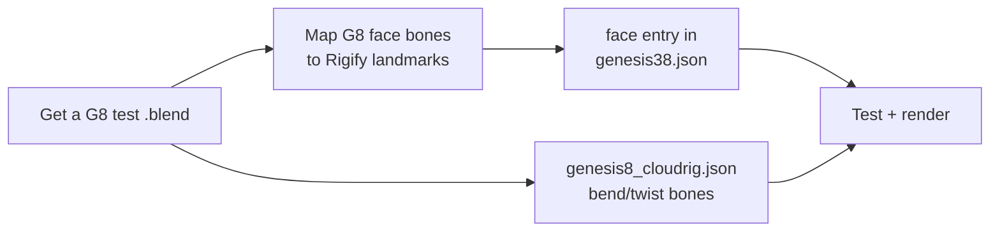

<callout icon="🎯">

**Goal:** make the Diffeomorphic **DAZ Importer** (import\_daz) turn DAZ figures into production rigs in one click: a full **Rigify face**, and a **CloudRig** conversion, while keeping DAZ weights, corrective morphs and morph sliders working.

</callout>

<columns>

<column>

### 📍 Where it stands

**Genesis 9: done**, tested on Mavis (Blender 5.1). *Updated 2026-10-23.*

- **Rigify face:** fitted to the DAZ face, upgraded to Rigify's modular face, bound. Confirmed by the user.
- **CloudRig:** Convert To CloudRig, exact rest pose, eyes, FK spine, eyelid follow, and a DAZ CloudRig sidebar tab.

**Next up:** Genesis 8. Commit the Genesis 9 work on a branch first.

</column>

<column>

### 🧭 Start here

- [G9 Rigify Face](page:pwa7tbk5vg): how the face is fitted and bound
- [G9 CloudRig Conversion](page:tqg3n192rl): the CloudRig pipeline and the sidebar tab
- [Diffeomorphic Dev & Testing](page:cglhfqaus0): headless testing, test file, building the zip
- [Diffeomorphic Tasks](page:6eeklid8pz): everything done and to do

</column>

<column>

### ⚖️ The rule

A conversion must leave the character **identical at rest**. Every change is checked by comparing the mesh with the new rig on and off (target: under 0.1 mm).

</column>

</columns>

## Tasks

<database-view db="l5jop1os75" view="l8tr8g6tgm"/>

<database-chart by="j85hbmwydp" chart="stacked" colors="color" db="l5jop1os75" series="n0pdrc7oi2"/>

## Two ways to rig a DAZ figure

<columns>

<column>

### 🟦 Rigify

- Rigify becomes the deforming rig: DAZ vertex groups move to Rigify bones.
- The face: DAZ face bones follow the Rigify DEF bones.
- Buttons: **Convert To Rigify**, or Create Metarig + Rigify Metarig.

</column>

<column>

### ☁️ CloudRig

- The DAZ rig stays the deforming rig and is driven by CloudRig (Copy Transforms per bone).
- The face: DAZ face bones become CloudRig Single Controls, plus eye aim and jaw.
- Button: **Convert To CloudRig**. Needs the CloudRig extension.

</column>

</columns>

## Genesis 8: plan

<callout icon="❓">

**Open for Genesis 8:** its face bone names and hierarchy differ from Genesis 9 (for example `lEye`, `lLipCorner`), and its arms and legs use separate bend and twist bones (`lShldrBend` / `lShldrTwist`). Both data files need their own mappings; the code should mostly carry over.

</callout>

## Risks

<callout background="yellow" icon="⚠️">

**Only one test character.** Everything was verified on Mavis. Figures with separate toe bones, geografts or FACS bone drivers may need extra mapping.

</callout>

<callout background="yellow" icon="⚠️">

**Stale add-on code.** Blender keeps an extension's old code loaded after reinstalling. Always restart Blender before testing a new build.

</callout>
