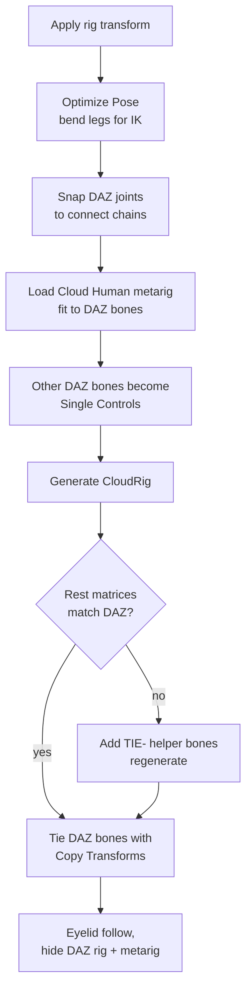

<callout icon="💡">

**What it does:** one button, **Convert To CloudRig** (Rigify panel of the DAZ sidebar), builds a CloudRig control rig for a **Genesis 9** figure and drives the DAZ rig from it. The meshes stay on the DAZ rig, so weights, corrective morphs, twist drivers and morph sliders keep working. Needs the CloudRig extension (tested with 2.2.31, Blender 5.1).

</callout>

<callout icon="📌">

**Why the user's first attempt failed:** they pressed CloudRig's Generate on the metarig from DAZ's Create Metarig. That is a *Rigify* metarig, which CloudRig can't generate. Convert To CloudRig builds a real CloudRig metarig instead.

</callout>

## Pipeline

## Bone mapping

<columns>

<column>

### CloudRig components

| Part | Component |
| --- | --- |
| Hips + spine1–4 | Spine: Cartoon (starts in FK) |
| neck1–2, head | Chain: FK |
| shoulders | Shoulder Bone |
| arms | Limb: Generic |
| legs | Limb: Biped Leg + heel pivot |
| fingers, thumbs | Chain: FK |
| eyes | Aim |
| everything else | Single Control |

</column>

<column>

### How the DAZ rig follows

- Each DAZ bone gets a **Copy Transforms** named `CloudRig` from the CloudRig bone with the same rest matrix (world space; face bones in local space, mix BEFORE\_FULL, so morph-driven face motion still adds on top).
- Eyes copy **`CTR-Eye.L/R`**: the plain `Eye.L` never moves.
- Twist bones aren't in the metarig; the DAZ twist drivers read the tied limb bones. Verified identical to twisting the DAZ rig.
- The DAZ rig object copies the CloudRig object's transform.

</column>

</columns>

## Getting the rest pose exact

The target is that the character looks **identical at rest** after conversion. On Mavis the largest mesh difference is **0.01 mm**, including a copy whose rig was scaled 0.5, moved and rotated.

<toggle>

Problems found and how they were fixed

1. **IK limbs twisted at rest** (about 11° on the arms). CloudRig's IK settles around the bend plane, so the metarig limbs now get the standard IK roll (X axis = bend axis).
1. **Toes 4.6° off.** CloudRig's FK toe takes the foot's roll; the metarig toe roll is now aligned to the foot.
1. **Roll differences between DAZ and CloudRig.** After the first generate, any DAZ bone whose CloudRig bone has a different rest matrix gets a hidden `TIE-` helper in the metarig (exact DAZ rest, parented to the CloudRig bone), and the rig is generated again. Helpers live in the metarig, so they survive regenerating.
1. **Left bones symmetrized.** The Cloud Human metarig has X-Axis Mirror on, so editing a right bone moved the left one. Turned off while editing (both the metarig and the DAZ rig), then restored.
1. **False helpers.** Quaternions q and −q are the same rotation but read as a 2π angle; the check now uses min(angle, 2π − angle).
1. **Wrong scale.** CloudRig generates without object transform, so a scaled DAZ rig gave a rig of the wrong size. The rig transform is now applied first, as Convert To Rigify does.
1. **Empty collections.** Removing all empty metarig collections made CloudRig's Mechanism and Original Bones collections visible; only `Hair` is removed now.

</toggle>

## DAZ CloudRig tab

Press **N** in the 3D viewport and open **DAZ CloudRig**. It shows when the CloudRig, the hidden DAZ rig or one of its meshes is selected.

<columns>

<column>

### Body Parts

Show/hide toggles for Face, Eyes, Spine, Arms, Legs, Fingers and Extras, with each part's IK, FK, Tweak and Extra groups beside it.

</column>

<column>

### Eyelid Follow

Sliders per lid (default upper 0.6, lower 0.3). The lids follow the eye's up/down rotation only; looking sideways leaves them alone.

</column>

<column>

### FK / IK

A slider for Spine and each arm and leg, plus **Snap & Switch** (CloudRig's own `pose.cloudrig_toggle_ikfk_bake`, arguments read from the rig's `ui_data`). Needs Pose Mode. Tested: switching the left arm moved the hand 0.0 mm.

</column>

</columns>

## Files

| File | Contents |
| --- | --- |
| `rigify_tools/cloudrig.py` | DAZ\_OT\_ConvertToCloudRig, DAZ\_PT\_CloudRigControls |
| `data/rigify/genesis9_cloudrig.json` | chains, inserts, limbs, align\_roll, heels, aims, eyelid\_follow, helpers, parameters |
| `rigify_tools/__init__.py`, `panel.py` | registration and the panel button |

<callout background="yellow" icon="⚠️">

**After reinstalling the addon, restart Blender.** The user's first report ("eyes and spine don't work") came from Blender still running the previous build. Also convert a fresh file: an already converted rig is refused on purpose.

</callout>

## Open

- [ ] Only Mavis tested; figures with separate toe bones get them as Single Controls under DAZ Extras.
- [ ] The Cloud Human demo properties (Hairstyle, Pants, Top) still show in CloudRig's Properties panel.

See also [G9 Rigify Face](page:pwa7tbk5vg).
