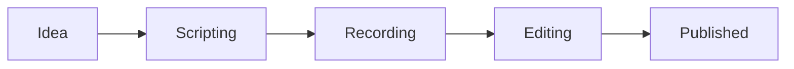

<callout icon="🎬">

**A YouTube channel that shows how to use Peeka**, one feature a video. Every video topic is a card in [Peeka Videos](page:bxn2nq634w): drag it along the Production board as it moves from idea to published.

</callout>

## Record these first

The **first wave**: eight videos that take a new viewer from "what is this?" to using Peeka every day. Record them in this order.

- [ ] **Why Peeka? (channel trailer)**, 2 min
- [ ] **Peeka in 5 minutes: a tour**, 5 min
- [ ] **Installing Peeka and connecting Claude**, 6 min
- [ ] **The slash menu: every block in Peeka**, 10 min
- [ ] **Databases 101: tables, boards, calendars and galleries**, 10 min
- [ ] **Templates: never start from a blank page**, 6 min
- [ ] **Daily notes with your schedule in them**, 6 min
- [ ] **Peeka + Claude: your AI reads and writes your notes**, 8 min

## All the videos

<database-view db="6fx02qvq4e"/>

## The series

| Series | What it teaches | Videos |
| --- | --- | :-: |
| Getting started | The tour, installing, pages, folders and the sidebar | 4 |
| Writing | Every block, links and the graph, covers and themes, PDF | 4 |
| Databases | Views, formulas, automations, relations, charts, spreadsheets | 5 |
| Organizing | Templates, properties and tags, synced blocks, copies | 4 |
| Daily workflow | Daily notes, quick notes, reminders, page history | 4 |
| Peeka + AI | Claude reading and writing your notes | 2 |
| Sharing | Shared spaces across computers | 1 |
| Moving in and out | From Notion, from Obsidian, export to Markdown | 3 |

<database-chart by="ce3clyy7sb" chart="bars-across" db="6fx02qvq4e" measure="sum" value="81dmuvoj04"/>

## Talking points for the first wave

<toggle collapsed=true>

🎞️ Why Peeka? (channel trailer)

- Notes, pages and databases on your own computer, in plain markdown files you own.
- Notion's blocks and databases, Obsidian's files and links, in one desktop app.
- Your AI (Claude) can read and write your notes for you.
- Reminders, a schedule and daily notes built in; shared spaces for working together.
- End on: "this channel shows you each feature, one video at a time".

</toggle>

<toggle collapsed=true>

🧭 Peeka in 5 minutes: a tour

- The sidebar: Spaces (folders and pages), Databases, the bell and the Schedule; hiding it.
- Make a page and a folder; a cover and a theme.
- Type `/` once to show there is more; tease the slash menu video.
- Where your notes live: a folder of markdown files.

</toggle>

<toggle collapsed=true>

🔌 Installing Peeka and connecting Claude

- Run the installer; what it puts where.
- It connects peeka-mcp to Claude Code, Claude Desktop and Antigravity, with the peeka-notion skill.
- Ask Claude to "make a page in Peeka": watch it appear within seconds.

</toggle>

<toggle collapsed=true>

🧱 The slash menu: every block in Peeka

- Headings, lists, to-dos, toggles, quotes, callouts.
- Columns, tables, code, equations, Mermaid diagrams.
- Images, files, embeds (a YouTube video in a page!), links to pages with `@`.
- The block menu: turn into, colours, move, duplicate.

</toggle>

<toggle collapsed=true>

🗂️ Databases 101: tables, boards, calendars and galleries

- Make a database; column types (select, status, date, checkbox, number).
- Views: table, board grouped by status, calendar on a date, gallery.
- Filters and sorts; a row is a page of its own.
- Use this very Peeka Videos database as the example.

</toggle>

<toggle collapsed=true>

📋 Templates: never start from a blank page

- The Templates folder; Peeka makes one with a meeting template the first time.
- New from template (sidebar button, or a folder's menu), and / Template inside a page.
- Fields: `{{date}}`, `{{time}}`, `{{title}}`, and `{{date:dddd, MMMM Do}}`.
- Shifts and reminders: `{{date+7d}}`, `{{remind+3d}}`; valid fields show bold and coloured as you type.
- Every field, format and shift: [Template Fields Reference](page:f2oxm0ft0l).

</toggle>

<toggle collapsed=true>

☀️ Daily notes with your schedule in them

- Ctrl+Shift+D (or the sun in the sidebar) opens today's note.
- Make a "Daily note" template, with `{{agenda}}` where the day's schedule goes.
- Show a reminder and a dated database row appearing in it.
- Bonus: quick notes with `peeka --capture` land in today's note.

</toggle>

<toggle collapsed=true>

🤖 Peeka + Claude: your AI reads and writes your notes

- Ask Claude to summarise a page, and to build a page with callouts, toggles and a database.
- Claude makes relations and rollups: projects with their task counts.
- Everything Claude writes is in page history, so it can be undone.

</toggle>

## Every video's checklist

Copy this list into a video's row page when you start it.

- [ ] Script: the one thing the viewer should be able to do afterwards
- [ ] A fresh demo workspace, with no private notes on screen
- [ ] Record the screen at 1080p or more, in one theme for the whole video
- [ ] Edit: cut pauses, zoom in on small UI, add chapters
- [ ] Thumbnail: the feature's name and one screenshot
- [ ] Description: what it shows, timestamps, where to download Peeka
- [ ] Link the next video in the series at the end
- [ ] Set its Status to Published, and its Publish date

## From idea to published

<callout icon="❓">

**To decide:** the channel's name, how often to publish (one a week?), and where people download Peeka from (TBD).

</callout>
