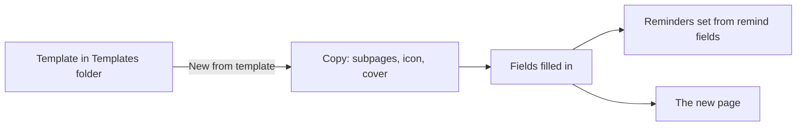

<callout icon="📌">

**Every field Peeka fills in when a page is made from a template**, with what it becomes. Script the [Templates and Daily notes videos](page:e0df67pncr) from this page. Examples are as if the page were made on **Tuesday 27 October 2026 at 14:05**.

</callout>

<columns>

<column>

### Where fields work

- In any page in the top-level **Templates** folder (and folders inside it)
- In the template's **title** too: `Meeting {{date}}` makes "Meeting 2026-10-27"
- In every block except **code** and **equations**, which are left as typed
- A bold or coloured field stays bold or coloured once filled in

</column>

<column>

### How they look while you write

- A field Peeka understands is drawn **bold, in the accent colour** (the code keyword colour with the black-and-white accent)
- One it doesn't understand stays plain, so a typo shows at once
- This is only how it's drawn: the text in the file is unchanged

</column>

</columns>

## The five kinds of field

| Field | Becomes | Notes |
| --- | --- | --- |
| `{{title}}` | the new page's title | Bare only: no format, no shift |
| `{{date}}` | 2026-10-27 | `YYYY-MM-DD` unless a format is given |
| `{{time}}` | 14:05 | `HH:mm` unless a format is given |
| `{{remind+…}}` | the date it names, **and a reminder then** | Needs a shift; see below |
| `{{agenda}}` | the day's schedule | Daily note template only, on a line of its own |

Names ignore case: `{{Date}}` and `{{DATE}}` work, and spaces inside the braces are allowed.

## Shifts: a date or time from now

Add `+` or `-`, a whole number and a unit right after the name.

| Unit | Means | Example | Becomes |
| --- | --- | --- | --- |
| `d` | days | `{{date+7d}}` | 2026-11-03 |
| `d` | days back | `{{date-1d}}` | 2026-10-26 |
| `w` | weeks | `{{date+2w}}` | 2026-11-10 |
| `mo` | months | `{{date+1mo}}` | 2026-11-27 |
| `h` | hours | `{{time+2h}}` | 16:05 |
| `min` | minutes | `{{time+30min}}` | 14:35 |

<callout background="yellow" icon="⚠️">

**A bare `m` is neither** minutes nor months, so `{{date+3m}}` is not a field: it stays as typed (and is not highlighted). Write `min` or `mo`.

</callout>

## Formats: how a date or time is written

After a colon, in Obsidian's (moment.js) format, so templates from an Obsidian vault work unchanged. A shift and a format go together: `{{date+1d:dddd}}` becomes **Wednesday**.

| Token | Becomes | Token | Becomes |
| --- | --- | --- | --- |
| `YYYY` | 2026 | `HH` | 14 |
| `YY` | 26 | `H` | 14 |
| `MMMM` | October | `hh` | 02 |
| `MMM` | Oct | `h` | 2 |
| `MM` | 10 | `mm` | 05 |
| `M` | 10 | `m` | 5 |
| `dddd` | Tuesday | `ss` / `s` | seconds |
| `ddd` | Tue | `A` | PM |
| `Do` | 27th | `a` | pm |
| `DD` | 27 | `Q` | 4 (the quarter) |
| `D` | 27 | `[text]` | text, as it is |

Examples:

- `{{date:dddd, MMMM Do}}` → Tuesday, October 27th
- `{{date:D MMM YYYY}}` → 27 Oct 2026
- `{{time:h:mm a}}` → 2:05 pm
- `{{date:[Week of] MMMM Do}}` → Week of October 27th
- `{{date:YYYY-[Q]Q}}` → 2026-Q4

## Reminders: `{{remind…}}`

Written as the date it names, and the page made from the template gets a reminder then. Its note is the line the field is in, filled in.

| Field | Written as | Reminds you |
| --- | --- | --- |
| `{{remind+7d}}` | 2026-11-03 | 3 Nov at **09:00** |
| `{{remind+1w}}` | 2026-11-03 | 3 Nov at 09:00 |
| `{{remind+1mo}}` | 2026-11-27 | 27 Nov at 09:00 |
| `{{remind+2h}}` | 2026-10-27 16:05 | today at **16:05** |
| `{{remind+30min}}` | 2026-10-27 14:35 | today at 14:35 |
| `{{remind+1d:ddd D MMM}}` | Wed 28 Oct | 28 Oct at 09:00 |

- Days, weeks and months remind at **9:00 that day**; hours and minutes at that very time.
- `{{remind}}` with no shift is **not a field** (now is no time to be reminded at).
- A shift into the past (`{{remind-1d}}`) is written as its date, but no reminder is set.

<toggle collapsed=true>

Example: a follow-up line in a meeting template

The template line:

`- [ ] Follow up with the team {{remind+3d}}`

A page made from it on 27 October has this line:

`- [ ] Follow up with the team 2026-10-30`

and you are reminded on 30 October at 09:00: "Follow up with the team 2026-10-30".

</toggle>

## The daily note's `{{agenda}}`

When today's note is made (Ctrl+Shift+D, the sun in the sidebar, a quick note, or a clip from the web clipper), the day's schedule goes where `{{agenda}}` is:

- the reminders that come that day
- the database rows with that day in a date column

each linked to its page. It's written once, as text you can edit, and isn't kept up to date afterwards (the Schedule view is).

<callout icon="💡">

`{{agenda}}` has to be **alone on its line**. Inside a sentence it stays as typed (and isn't highlighted), and the schedule goes at the top of the note instead.

</callout>

The note uses the template called **Daily note** in the Templates folder. Without one, it's made as:

```markdown
## Today

{{agenda}}

## Notes
```

## Valid or not, at a glance

<columns>

<column>

### ✅ Filled in (and highlighted)

- `{{date}}`
- `{{Date: dddd}}`
- `{{date+1mo:MMMM}}`
- `{{time-15min}}`
- `{{remind+1w}}`
- `{{title}}`
- `{{agenda}}` alone on its line

</column>

<column>

### ❌ Left as typed (plain)

- `{{remind}}`: needs a shift
- `{{date+3m}}`: `m` is ambiguous
- `{{title:dddd}}`: title takes no format
- `{{title+1d}}`: nor a shift
- `{{date+1y}}`: no year unit (use `+12mo`)
- `{{agenda}}` inside a sentence
- `{{anything else}}`

</column>

</columns>

## How a template becomes a page


