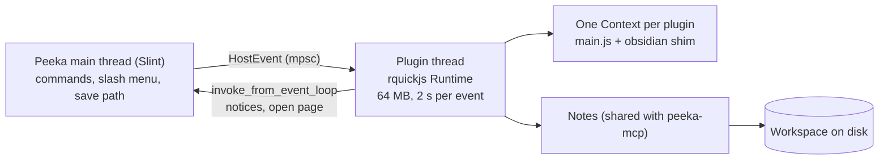

<callout background="blue" icon="📌">

**Plan:** TypeScript/JS plugins run by Peeka in a QuickJS sandbox (`rquickjs`), plus an `obsidian` module so **simple** Obsidian plugins run unchanged. Milestones live in `PLUGINS.md` in the repo root. Status: planned 2026-10-23, nothing built yet.

</callout>

## Can Peeka run Obsidian plugins?

<columns>

<column>

### ✅ Can work (text and commands)

- `addCommand` that transforms notes
- `app.vault` read / modify / create
- Vault events (modify, create)
- `Notice`, `requestUrl`
- `loadData` / `saveData` settings
- Links and backlinks via `metadataCache`

</column>

<column>

### ❌ Won't work

- DOM UI: `ItemView`, `Modal`, `PluginSettingTab`, `createEl`, post-processors
- CodeMirror 6 editor extensions
- Node / Electron: `fs`, `child_process`
- Private internals (`app.plugins`)
- So: Dataview, Templater, Kanban, Calendar, Excalidraw

</column>

</columns>

<callout background="yellow" icon="⚠️">

**What to promise:** "many simple Obsidian plugins work", **not** "Obsidian plugins work". Unsupported ones are turned off with a clear reason, never crash Peeka.

</callout>

## Architecture



- **Engine:** QuickJS via `rquickjs`, 1–2 MB. V8 (`deno_core`) is too heavy here, and WASM (Extism) only pays off if plugins in other languages are wanted.
- **One thread** runs every plugin. The UI stays on the main thread.
- **Pages** are read and written through the same `Notes` as `peeka-mcp`, moved into a shared crate.
- **Sandbox:** plugins reach only what the `peeka` global exposes. A plugin that runs too long is interrupted, and one that throws is turned off.
- **On disk:** `<workspace>/.peeka/plugins/<id>/` holds `manifest.json` (same shape as Obsidian's), `main.js` and `data.json`.

<toggle collapsed=true>

The `peeka` API (peeka.d.ts)

```ts
declare namespace peeka {
  function readPage(id: string): Promise<{ id: string; title: string; markdown: string; version: string }>;
  function writePage(id: string, markdown: string, version: string): Promise<void>;
  function createPage(title: string, markdown: string, parent?: string): Promise<string>;
  function listPages(): Promise<{ id: string; title: string; path: string }[]>;
  function search(query: string): Promise<{ id: string; title: string; line: string }[]>;
  function backlinks(id: string): Promise<string[]>;
  function addCommand(cmd: { id: string; name: string; run(): void | Promise<void> }): void;
  function on(event: "page-saved" | "page-created", cb: (id: string) => void): void;
  function notice(text: string): void;
  function loadData<T>(): Promise<T | null>;
  function saveData(data: unknown): Promise<void>;
  function fetch(url: string, init?: object): Promise<{ status: number; text: string }>;
}
```

</toggle>

<toggle collapsed=true>

Runtime sketch (Rust)

```rust
pub fn run(workspace: PathBuf, ui: slint::Weak<AppWindow>, rx: Receiver<HostEvent>) {
    let rt = Runtime::new().unwrap();
    rt.set_memory_limit(64 << 20);
    rt.set_max_stack_size(1 << 20);
    let deadline = Arc::new(AtomicU64::new(u64::MAX));
    let d = Arc::clone(&deadline);
    rt.set_interrupt_handler(Some(Box::new(move || now_ms() > d.load(Relaxed))));
    rt.set_loader(PluginResolver, PluginLoader); // require('obsidian') → embedded shim

    let plugins: Vec<_> = discover(&workspace.join(".peeka/plugins"))
        .map(|dir| {
            let ctx = Context::full(&rt).unwrap();
            ctx.with(|ctx| { api::install(&ctx, &dir, &workspace, &ui); load_plugin(&ctx, &dir) });
            (dir, ctx)
        })
        .collect();

    for event in rx {
        deadline.store(now_ms() + 2_000, Relaxed);
        dispatch(&plugins, event);
        rt.execute_pending_job();
    }
}
```

</toggle>

<toggle collapsed=true>

The `obsidian` shim (JS, built on `peeka`)

```js
class Notice { constructor(msg) { peeka.notice(String(msg)); } }

class Vault {
  async read(file)       { return (await peeka.readPage(file.path)).markdown; }
  async modify(file, md) { const p = await peeka.readPage(file.path); await peeka.writePage(file.path, md, p.version); }
  on(event, cb)          { return peeka.on(event === "modify" ? "page-saved" : event, (id) => cb(toTFile(id))); }
}

class Plugin {
  addCommand(c) { peeka.addCommand({ id: c.id, name: c.name, run: c.callback ?? c.editorCallback }); return c; }
  loadData()    { return peeka.loadData(); }
  saveData(d)   { return peeka.saveData(d); }
}

const unsupported = (name) => new Proxy(function () {}, {
  get() { throw new Error(`${name} isn't available in Peeka`); },
  construct() { throw new Error(`${name} isn't available in Peeka`); },
});

module.exports = { Plugin, Notice, requestUrl: peeka.fetch,
  ItemView: unsupported("ItemView"), Modal: unsupported("Modal"),
  PluginSettingTab: unsupported("PluginSettingTab") };
```

</toggle>

## Decisions

| \# | Decision | Recommendation |
| --- | --- | --- |
| P-a | Engine | QuickJS (`rquickjs`) |
| P-b | Per workspace or per Peeka | Per workspace, `.peeka/plugins/` |
| P-c | How far for Obsidian plugins | Text and commands only, no webview |
| P-d | Plugin UI | Declarative: plugin describes, Peeka draws |
| P-e | Network access | Asked once per plugin and host |

## Milestones

- [ ] **P0. `Notes` shared:** move `peeka-mcp`'s `Notes` into a crate shared with Peeka
- [ ] **P1. Plugin thread + hello world:** `PluginHost`, limits, `notice`, `addCommand`, commands in the slash menu
- [ ] **P2. Pages, events, settings:** read/write with `version`, `page-saved`, `loadData`/`saveData`, `fetch` with a permission prompt
- [ ] **P3. Settings → Plugins + authors:** switches, reasons, `peeka.d.ts`, a sample plugin repo
- [ ] **P4. `obsidian` module:** CommonJS `require`, the shim, at least 3 real Obsidian plugins working unchanged
- [ ] **P5. Declarative plugin UI:** settings forms, sidebar panels

## Risks

- **Expectations:** most popular Obsidian plugins are UI-heavy and won't run.
- **QuickJS speed:** fine for notes, slow for heavy indexing. The time limit protects Peeka.
- **Writes racing the editor:** `writePage` needs the `version`, as `replace_page` does.
- **Shared spaces:** a plugin rewriting pages on save would change them for everyone, so leave plugin writes there out at first.
