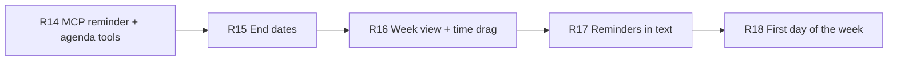

<callout icon="📌">

**As of 23 Nov 2026, checked against AppFlowy v0.15.1 (15 Nov 2026).** AppFlowy has caught up on calendar views. Peeka still leads on repeating reminders, automations and AI access. The gaps are tracked as **R14–R20** in [Peeka Roadmap](page:q31hpcweeb).

</callout>

## What Peeka has today

| Piece | Where | What it does |
| --- | --- | --- |
| Reminders | `src/schedule.rs` | Set on a page, one-off or repeating (daily, weekdays, chosen weekdays, monthly). Keeps the wall-clock time when the clocks change. Done, snooze, delete. Stored in `.peeka/schedule` and synced |
| Schedule view | `src/agenda.rs` | Overdue / Today / Tomorrow / This week / Later, across reminders and every dated database row |
| Month view | `ui/calendar.slint` | A month grid with how much is on each day |
| Database calendar | Blockwright `db_board.rs` | A month grid; dragging a card moves its day and keeps its time; "+" adds a row |
| Automations | Blockwright `automation.rs` | A formula condition triggers Notify, Alert or Set-cell, checked on a timer |
| Notifications | `notify.rs`, `inbox.rs`, `desktop.rs` | Notifications in the window corner, the bell's inbox, and desktop notifications (notify-rust) |
| Daily notes | `src/daily.rs` | `{{agenda}}` and `{{remind+7d}}` in templates |

## AppFlowy has, Peeka doesn't

- [ ] **Events spanning several days** (start and end dates). AppFlowy 0.14.3; its end-date field dates from 0.3.3. → R15
- [ ] **Weekly calendar view.** 0.14.3 → R16
- [ ] **Dragging to change an event's time range.** 0.14.3. Peeka only moves the day. → R16
- [ ] **Reminders inside a document's text**, which open that spot when clicked. 0.3.4, mobile 0.4.4 → R17
- [ ] **Setting for the first day of the week.** 0.10.x → R18
- [ ] **Timeline view.** 0.14.4 → R19
- [ ] **Mobile push notifications.** 0.10.3. Peeka has no mobile app, and reminders fire only while Peeka is running. → R13
- [ ] **AI built into the app** (chat, writer, local Ollama, meeting transcripts). 0.8–0.14 → R20
- [ ] **Relative date filters** (today, this week, last 30 days). 0.11.9. TBD: check whether Blockwright's filters already do this
- [ ] **Forms feeding a database.** 0.14.2. Not a scheduling feature

## Peeka has, AppFlowy doesn't

<columns>

<column>

### Scheduling

- **Repeating reminders** that keep their time when the clocks change. No AppFlowy release note mentions repeating or recurring reminders
- **Snooze and done** from the notification
- **One Schedule view** across every reminder and every dated row in every database

</column>

<column>

### Automation and AI

- **Database automations** (condition → Notify / Alert / Set). AppFlowy has formulas and conditional styling, but no automations
- **An MCP server you maintain yourself** (`peeka-mcp`). AppFlowy has only third-party ones
- Daily notes with the day's agenda

</column>

</columns>

## Can an AI manage the schedule?

<callout background="yellow" icon="⚠️">

**Not fully, in either app.** An AI can create dated database rows and calendar views through MCP, but neither app's MCP can manage reminders.

</callout>

- **Peeka:** `peeka-mcp` can make databases with `date`/`datetime` columns, calendar views and rows, and those rows show in Schedule and Month. There are no tools for reminders, the agenda or automations, because `schedule.rs` is in the app crate and not in `peeka-notes`.
- **AppFlowy:** third-party MCP servers ([appflowy-mcp](https://pypi.org/project/appflowy-mcp/), [weironz/appflowy\_mcp](https://glama.ai/mcp/servers/weironz/appflowy_mcp), [appflowy-mcp-toolkit](https://pypi.org/project/appflowy-mcp-toolkit/0.1.0/)) cover pages, databases, rows and search. Their listings show no reminder tools.

### The fix (R14)

1. Move `Schedule`, `Repeat` and `agenda::sections` / `on_day` into `peeka-notes`, as was done for the database tools (PLUGINS.md P0)
1. Expose `list_reminders`, `add_reminder` (page, when, note, repeat), `complete_reminder`, `snooze_reminder`, `remove_reminder` and `agenda` (a date range)
1. Optionally, an `automations` option on `create_database`
1. The running app already re-reads `.peeka/schedule` (`main.rs:3865`), so changes show right away

## Build order

<toggle collapsed=true>

Sources and limits

- [AppFlowy releases](https://github.com/AppFlowy-IO/AppFlowy/releases): every release note, 0.0.1 to v0.15.1, read through `gh`
- [appflowy-mcp](https://pypi.org/project/appflowy-mcp/), [weironz/appflowy\_mcp](https://glama.ai/mcp/servers/weironz/appflowy_mcp), [appflowy-mcp-toolkit](https://pypi.org/project/appflowy-mcp-toolkit/0.1.0/)
- Only release notes were checked. Small features that never made a changelog (for example, a reminder option on AppFlowy's date property) may be missing.

</toggle>
