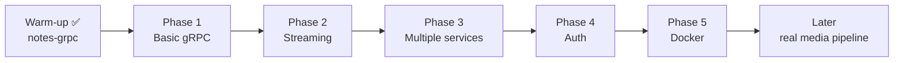

<callout icon="🎯">

**Goal:** a Go backend that processes videos and images asynchronously: a Fiber REST API in front, gRPC services behind it, results in PostgreSQL, all of it in Docker. A small media-processing platform, built to learn **real microservice communication**. The build guide lives in [Persephone](page:615lx823qx); this page is where the work is tracked.

</callout>

<columns>

<column>

### 📍 Where it stands

**Done:** the warm-up, notes over gRPC with Fiber in front (`notes-grpc/`).

**Next up:** Phase 1, `video.proto`, `video-service` and the Fiber API.

**Code:** `~/gitRepo/persephone`

</column>

<column>

### 🧭 Start here

- [Persephone](page:615lx823qx): the build guide, phase by phase
- [Persephone Tasks](page:psr47jblrk): everything to do
- [gRPC in Go](page:07vn6lyy82): the tutorial it builds on
- [GoFiber](page:phgfxrea1z10a): the API side

</column>

<column>

### 🧠 The rule

**REST** talks to clients outside.

**gRPC** talks between services inside.

</column>

</columns>

## Tasks

The full tracker is [Persephone Tasks](page:psr47jblrk): a board by status, a table by phase, a board by service, and a calendar on Due.

<database-view db="ffb7jvfshm"/>

<columns>

<column>

### Progress

<database-chart by="axgmeepv9f" chart="donut" colors="color" db="ffb7jvfshm"/>

</column>

<column>

### Estimated hours per phase

<database-chart by="qkin2k1zqq" chart="bars-across" db="ffb7jvfshm" measure="sum" value="f3a5w90iy5"/>

</column>

</columns>

## Services

Every program, its port, and how to run it. Update **Status** as each one comes up.

<database-view db="7qhvhuenew"/>

## Phases

Each phase adds one idea on top of a working system.

<toggle>

What "done" means for each phase

1. **Basic gRPC:** `curl localhost:3000/videos/42` answers through the Fiber API from `video-service`, and gRPC errors come back as the right HTTP status.
1. **Streaming:** `curl -N localhost:3000/videos/42/progress` shows progress events, driven by real `ffprobe` / `ffmpeg` steps.
1. **Multiple services:** thumbnails and metadata come from their own services, and results are stored in PostgreSQL.
1. **Auth:** a request without a valid token is refused by the services, not just by the API.
1. **Docker:** `docker compose up` starts everything, and the API finds the services by name.

</toggle>

## Risks

<callout background="yellow" icon="⚠️">

**No version control yet.** `~/gitRepo/persephone` isn't a git repository, so there's no history and no backup. Running `git init` and committing the warm-up is the first task.

</callout>

<callout background="yellow" icon="⚠️">

**ffmpeg is the hard part.** Phases 1–2 can fake processing with `time.Sleep`; real video work brings codecs, long-running jobs and big files. Keep the fake steps until the gRPC shape is solid, then swap them one at a time.

</callout>

<callout background="yellow" icon="⚠️">

**Streams outlive requests.** A progress stream must stop when the client leaves and when processing ends. The guide's `progress` handler handles both; keep that when the steps become real.

</callout>
