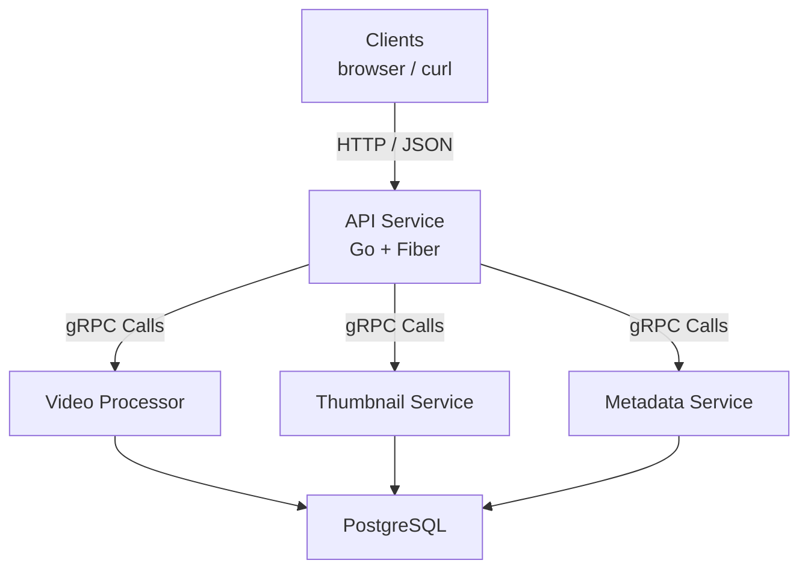

<callout icon="🎯">

**Goal:** build a backend that processes videos and images **asynchronously**. Progress, tasks and the list of services are on the [Persephone Project Hub](page:ge5mc0q47z); this page is the build guide.

</callout>

## Architecture

Think of it as a small version of a media-processing platform:



<callout icon="🧠">

**REST = communication with your external clients.**

**gRPC = communication between your internal services.**

</callout>

---

## What to build

The client talks to your **Fiber REST API** (the API service). Each route turns into a gRPC call:

| HTTP route (Fiber) | gRPC call | Service |
| --- | --- | --- |
| `POST /videos` | `UploadVideo` | video-service |
| `GET /videos/:id` | `GetVideo` | video-service |
| `GET /videos/:id/status` | `GetVideo` (its `status`) | video-service |
| `POST /videos/:id/process` | `ProcessVideo` | video-service |
| `GET /videos/:id/progress` | `WatchProcessing` (stream), sent on as Server-Sent Events | video-service (Phase 2) |
| `DELETE /videos/:id` | `DeleteVideo` | video-service |

But internally, the Fiber API communicates with your processing services using **gRPC**. For example:

```text
POST /videos
      │
      ▼
Fiber API
      │
      │ gRPC
      ▼
Video Processing Service
      │
      ├── extract metadata
      ├── generate thumbnails
      ├── extract frames
      └── create preview
```

<callout icon="💡">

It's the same shape as the Notes tutorial in [gRPC in Go](page:07vn6lyy82) (section 4): there, a Fiber API on :3000 in front of a gRPC service on :50051. Persephone is that, with videos instead of notes, and more services.

</callout>

---

## Where the code is

`~/gitRepo/persephone`, module `github.com/MensahPrince/persephone`.

- **`notes-grpc/`**: the warm-up, the [gRPC in Go](page:07vn6lyy82) tutorial (4.1–4.6). The gRPC service is `notes-grpc/main.go` and the Fiber API is `notes-grpc/api/main.go`; both run. Run them from `notes-grpc/` with `go run .` and `go run ./api`.
- **The Persephone services** go at the top of the repo, laid out the same way:

```
persephone/
├── go.mod                         module github.com/MensahPrince/persephone
├── proto/video/v1/video.proto     the contract
├── gen/video/v1/                  generated by protoc (never edit)
├── api/main.go                    Fiber REST API, :3000      → go run ./api
├── video-service/main.go          gRPC, :50051               → go run ./video-service
├── thumbnail-service/main.go      gRPC, :50052  (Phase 3)    → go run ./thumbnail-service
├── metadata-service/main.go       gRPC, :50053  (Phase 3)    → go run ./metadata-service
└── notes-grpc/                    the warm-up (its own module)
```

Every `main.go` is its own program; `go run ./<folder>` runs it. Programs import the generated code as `github.com/MensahPrince/persephone/gen/video/v1`.

---

## Phase 1 — Basic gRPC

Start here. Create two programs:

```text
api            (Fiber)
video-service  (gRPC)
```

The same steps as [gRPC in Go](page:07vn6lyy82) 4.1–4.6, with `VideoService` instead of `NoteService`. From `~/gitRepo/persephone`:

```bash
mkdir -p proto/video/v1 gen api video-service
go get google.golang.org/grpc google.golang.org/protobuf github.com/gofiber/fiber/v3
```

(`go.mod` is already there. If `protoc` can't find its plugins: `export PATH="$PATH:$(go env GOPATH)/bin"`.)

### 1\. Define the protobuf: `proto/video/v1/video.proto`

```proto
syntax = "proto3";

package video.v1;

option go_package = "github.com/MensahPrince/persephone/gen/video/v1;videov1";

service VideoService {
  rpc GetVideo(GetVideoRequest) returns (VideoResponse);
  rpc ProcessVideo(ProcessVideoRequest) returns (ProcessResponse);
  rpc WatchProcessing(WatchRequest) returns (stream ProcessingUpdate);  // Phase 2
}

message GetVideoRequest {
  string id = 1;
}

message VideoResponse {
  string id = 1;
  string title = 2;
  string status = 3;   // "uploaded", "processing", "done", "failed"
}

message ProcessVideoRequest {
  string id = 1;
}

message ProcessResponse {
  string id = 1;
  string status = 2;
}

message WatchRequest {
  string id = 1;
}

message ProcessingUpdate {
  string id = 1;
  int32 percent = 2;   // 0 … 100
  string step = 3;     // "extract metadata", "generate thumbnails", …
}
```

`UploadVideo` and `DeleteVideo` from the route table come later; add an `rpc` for each when you get to them.

Generate the Go code:

```bash
protoc -I proto \
  --go_out=gen      --go_opt=paths=source_relative \
  --go-grpc_out=gen --go-grpc_opt=paths=source_relative \
  proto/video/v1/video.proto
```

### 2\. The service: `video-service/main.go`

A gRPC server on :50051 with `GetVideo`, `ProcessVideo`, and the Phase 2 `WatchProcessing` stream.

<toggle>

`video-service/main.go`

```go
package main

import (
	"context"
	"log"
	"net"
	"time"

	"google.golang.org/grpc"
	"google.golang.org/grpc/codes"
	"google.golang.org/grpc/reflection"
	"google.golang.org/grpc/status"

	videov1 "github.com/MensahPrince/persephone/gen/video/v1"
)

type server struct {
	videov1.UnimplementedVideoServiceServer
}

func (s *server) GetVideo(ctx context.Context, req *videov1.GetVideoRequest) (*videov1.VideoResponse, error) {
	if req.GetId() == "" {
		return nil, status.Error(codes.InvalidArgument, "id is required")
	}
	// Phase 1: a fake answer. Later: look it up in PostgreSQL.
	return &videov1.VideoResponse{Id: req.GetId(), Title: "demo", Status: "uploaded"}, nil
}

func (s *server) ProcessVideo(ctx context.Context, req *videov1.ProcessVideoRequest) (*videov1.ProcessResponse, error) {
	return &videov1.ProcessResponse{Id: req.GetId(), Status: "processing"}, nil
}

// Phase 2: stream progress instead of one "done".
func (s *server) WatchProcessing(req *videov1.WatchRequest, stream grpc.ServerStreamingServer[videov1.ProcessingUpdate]) error {
	steps := []string{"extract metadata", "extract frames", "generate thumbnails", "create preview"}
	for i, step := range steps {
		if err := stream.Context().Err(); err != nil {
			return status.FromContextError(err).Err()
		}
		pct := int32((i + 1) * 100 / len(steps))
		if err := stream.Send(&videov1.ProcessingUpdate{Id: req.GetId(), Percent: pct, Step: step}); err != nil {
			return err
		}
		time.Sleep(500 * time.Millisecond) // stands in for real work
	}
	return nil
}

func main() {
	lis, err := net.Listen("tcp", ":50051")
	if err != nil {
		log.Fatalf("listen: %v", err)
	}
	s := grpc.NewServer()
	videov1.RegisterVideoServiceServer(s, &server{})
	reflection.Register(s)
	log.Printf("video-service listening on %s", lis.Addr())
	log.Fatal(s.Serve(lis))
}
```

</toggle>

### 3\. The Fiber API: `api/main.go`

The REST API on :3000, with one gRPC client made once in `main`, and the three routes.

<toggle>

`api/main.go`

```go
package main

import (
	"bufio"
	"context"
	"fmt"
	"log"
	"time"

	"github.com/gofiber/fiber/v3"
	"google.golang.org/grpc"
	"google.golang.org/grpc/credentials/insecure"
	"google.golang.org/protobuf/encoding/protojson"
	"google.golang.org/protobuf/proto"

	videov1 "github.com/MensahPrince/persephone/gen/video/v1"
)

// api holds one gRPC client per service, each made once in main.
type api struct {
	videos videov1.VideoServiceClient
}

func main() {
	conn, err := grpc.NewClient("localhost:50051",
		grpc.WithTransportCredentials(insecure.NewCredentials()), // local dev only
	)
	if err != nil {
		log.Fatalf("grpc client: %v", err)
	}
	defer conn.Close()

	a := &api{videos: videov1.NewVideoServiceClient(conn)}

	app := fiber.New() // add fiber.Config{ErrorHandler: errorHandler} from gRPC in Go 4.5
	app.Get("/videos/:id", a.getVideo)
	app.Post("/videos/:id/process", a.processVideo)
	app.Get("/videos/:id/progress", a.progress) // Phase 2

	log.Fatal(app.Listen(":3000"))
}

// GET /videos/:id  →  VideoService.GetVideo
func (a *api) getVideo(c fiber.Ctx) error {
	ctx, cancel := context.WithTimeout(c.Context(), 5*time.Second)
	defer cancel()

	v, err := a.videos.GetVideo(ctx, &videov1.GetVideoRequest{Id: c.Params("id")})
	if err != nil {
		return err
	}
	return sendProto(c, v)
}

// POST /videos/:id/process  →  VideoService.ProcessVideo
func (a *api) processVideo(c fiber.Ctx) error {
	ctx, cancel := context.WithTimeout(c.Context(), 5*time.Second)
	defer cancel()

	r, err := a.videos.ProcessVideo(ctx, &videov1.ProcessVideoRequest{Id: c.Params("id")})
	if err != nil {
		return err
	}
	return sendProto(c.Status(fiber.StatusAccepted), r)
}

// GET /videos/:id/progress  →  VideoService.WatchProcessing, relayed as Server-Sent Events
func (a *api) progress(c fiber.Ctx) error {
	ctx, cancel := context.WithTimeout(c.Context(), 30*time.Minute) // outlives the handler
	stream, err := a.videos.WatchProcessing(ctx, &videov1.WatchRequest{Id: c.Params("id")})
	if err != nil {
		cancel()
		return err
	}
	c.Set(fiber.HeaderContentType, "text/event-stream")
	c.Set(fiber.HeaderCacheControl, "no-cache")
	return c.SendStreamWriter(func(w *bufio.Writer) {
		defer cancel()
		for {
			update, err := stream.Recv()
			if err != nil { // io.EOF: processing finished
				return
			}
			b, _ := protojson.Marshal(update)
			fmt.Fprintf(w, "data: %s\n\n", b)
			if w.Flush() != nil { // the client went away
				return
			}
		}
	})
}

func sendProto(c fiber.Ctx, m proto.Message) error {
	b, err := protojson.Marshal(m)
	if err != nil {
		return err
	}
	c.Set(fiber.HeaderContentType, fiber.MIMEApplicationJSON)
	return c.Send(b)
}
```

</toggle>

<callout icon="💡">

For proper error answers (gRPC `NotFound` → 404, `InvalidArgument` → 400, …), copy `errorHandler` and `httpStatus` from [gRPC in Go](page:07vn6lyy82) 4.5 and pass `fiber.Config{ErrorHandler: errorHandler}` to `fiber.New`.

</callout>

### 4\. Run it

```bash
# terminal 1
go run ./video-service

# terminal 2
go run ./api

# terminal 3
curl -s localhost:3000/videos/42
# {"id":"42", "title":"demo", "status":"uploaded"}
curl -s -X POST localhost:3000/videos/42/process
# {"id":"42", "status":"processing"}    (202)
curl -N localhost:3000/videos/42/progress
# data: {"id":"42", "percent":25, "step":"extract metadata"}
# data: {"id":"42", "percent":50, "step":"extract frames"}  …
```

### Learn

- [ ] `.proto` files
- [ ] messages
- [ ] services
- [ ] RPC methods
- [ ] `protoc`
- [ ] generated Go code
- [ ] gRPC server
- [ ] gRPC client
- [ ] unary RPC

---

## Phase 2 — Streaming

Instead of:

```text
ProcessVideo()
    ↓
"done"
```

have the processing service stream progress:

```text
0%
 ↓
10%
 ↓
25%
 ↓
40%
 ↓
70%
 ↓
100%
```

Using server streaming:

```proto
rpc WatchProcessing(WatchRequest)
    returns (stream ProcessingUpdate);
```

Your Fiber API exposes that as `GET /videos/:id/progress`.

It's already in the Phase 1 code: the service's `WatchProcessing` sends one `ProcessingUpdate` per step, and the API's `progress` handler passes each one on as a Server-Sent Event with `c.SendStreamWriter`. The same pattern, explained: `streamNotes` in [gRPC in Go](page:07vn6lyy82) 4.5, and "Streaming progress (Server-Sent Events)" in [GoFiber](page:phgfxrea1z10a).

<callout icon="➡️">

**Next:** make the steps real (call `ffprobe` / `ffmpeg`) instead of `time.Sleep`.

</callout>

---

## Phase 3 — Multiple services

Split it into:

```text
api-service         Fiber, :3000
video-service       gRPC,  :50051
thumbnail-service   gRPC,  :50052
metadata-service    gRPC,  :50053
```

Then have services communicate through gRPC.

Each service gets its own `.proto` (e.g. `proto/thumbnail/v1/thumbnail.proto`) and folder. The Fiber API keeps **one client per service**, each made once in `main`:

```go
type api struct {
	videos videov1.VideoServiceClient         // localhost:50051
	thumbs thumbnailv1.ThumbnailServiceClient // localhost:50052
	meta   metadatav1.MetadataServiceClient   // localhost:50053
}
```

Now you're learning **actual microservice communication** rather than just learning gRPC syntax.

---

## Phase 4 — Authentication

Add gRPC metadata and interceptors. For example:

```text
Authorization: Bearer <token>
```

The Fiber API doesn't check the token itself: it passes the `Authorization` header on to the services as gRPC metadata (`rpcContext` in [gRPC in Go](page:07vn6lyy82) 4.5, or a group middleware in [GoFiber](page:phgfxrea1z10a)), and each service checks it in a unary interceptor ([gRPC in Go](page:07vn6lyy82) 5.2).

### Learn

- [ ] unary interceptors
- [ ] authentication
- [ ] authorization
- [ ] middleware
- [ ] request metadata

---

## Phase 5 — Docker

Containerize everything:

```text
docker-compose
│
├── api
├── video-service
├── thumbnail-service
├── postgres
└── redis
```

In Compose, the API dials services by name (`video-service:50051`) instead of `localhost:50051`, so read the addresses from environment variables, e.g. `os.Getenv("VIDEO_ADDR")`.

Then you've got a genuinely impressive Go backend project.

---

## Later: a real processing pipeline

You could eventually make the processing service do things like:

```text
Upload video
     ↓
Extract metadata
     ↓
Extract frames
     ↓
Generate thumbnails
     ↓
Detect frame rate
     ↓
Generate low-res preview
     ↓
Store results
```
