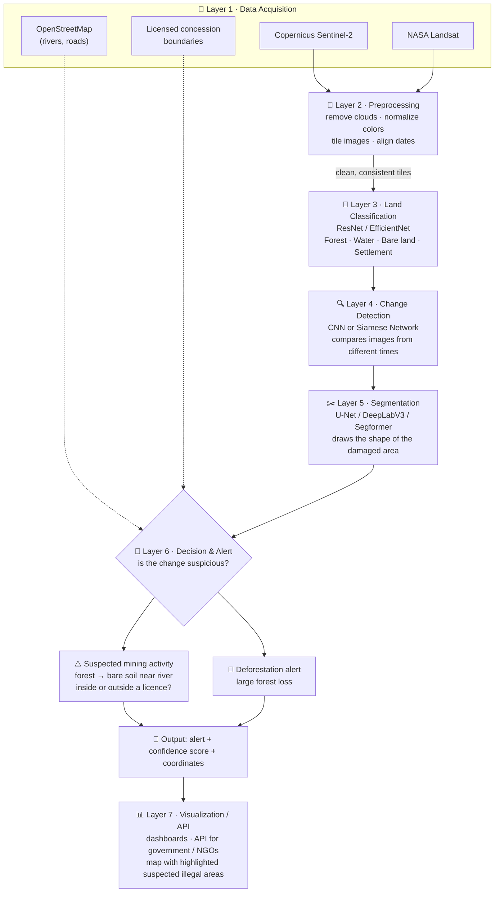

**Remote Sensing Environmental Monitoring Intelligence**

> **One-line idea:** REMI watches the Earth from above, notices when land changes in a suspicious way, and tells people exactly where to look.

<callout icon="🎯">

**Working on REMI?** Status, tasks, data sources and risks are on the [REMI Project Hub](page:imqxd436oq); the tasks themselves are in [REMI Tasks](page:xuncxrlmu3). This page is the design.

</callout>

<callout icon="🧾">

**Synopsis:** REMI is an AI-powered environmental monitoring stack that detects illegal mining (*galamsey*) and deforestation from satellite imagery. Instead of one model, it is a **layered AI stack**: each layer does one job, and together they **identify, classify and decide** on suspicious land change, producing an alert, a confidence score and coordinates for a human to verify.

</callout>

<columns>

<column>

### 🌍 The problem

Illegal mining and deforestation happen in **remote areas** that are hard to monitor continuously.

Today's monitoring depends on:

- Environmental rights activists
- Patrol teams

Both need people physically there, and no one can be everywhere, all the time.

</column>

<column>

### 🛰️ The idea

**Satellites can** be everywhere, all the time.

REMI takes in **spatial data** and decides whether an area is a **galamsey-affected site**, turning a constant stream of images into decisions.

</column>

<column>

### 📍 What comes out

- 🚨 An **alert** (suspected mining, or deforestation)
- 📊 A **confidence score**
- 🗺️ **Coordinates** and the outline of the area
- 📄 **Licence status**: inside, outside or unknown

</column>

</columns>

---

## 🧠 How it works

**Mental model:** think of REMI as an **assembly line**. Raw satellite images enter at one end. Each station does exactly one job (clean, label, compare, outline, judge) and passes its result to the next. What comes out at the end is a verdict.

<toggle>

**Why layers instead of one big model?**

One model trying to clean, classify, compare, outline and judge all at once would be hard to train, hard to debug, and impossible to explain. A layered stack lets each model do one thing well. When something goes wrong, you know which layer to fix.

</toggle>

### Layers at a glance

| Layer | Question it answers | Models / tools | Output |
| --- | --- | --- | --- |
| 1 · Data Acquisition | What does the land look like? | Sentinel-2, Landsat, OSM, concession maps | Raw images and map layers |
| 2 · Preprocessing | Are these images clean and comparable? | Cloud masking, normalisation, tiling, alignment | Clean, consistent tiles |
| 3 · Land Classification | What kind of land is this? | ResNet, EfficientNet | Forest / Water / Bare land / Settlement |
| 4 · Change Detection | What changed between then and now? | CNN or Siamese Network | Areas that changed |
| 5 · Segmentation | Exactly where is the damage, and what shape? | U-Net, DeepLabV3, Segformer | Outline of the affected area |
| 6 · Decision & Alert | Is this change suspicious enough to act on? | Rules + licence overlay | Alert, confidence, coordinates |
| 7 · Visualization / API | How do people use the result? | Dashboards, API, map | Alerts in front of people |

---

## The layers

### 📡 Layer 1 · Data Acquisition

**Question it answers:** *"What does the land look like?"*

**Job:** get the satellite images. Select an area, select a time range, and download the images. Where to get each source, and whether access is confirmed, is tracked on the [REMI Project Hub](page:imqxd436oq).

| Source | Provides |
| --- | --- |
| Copernicus (Sentinel-2) | Satellite imagery |
| NASA Landsat | Satellite imagery |
| OpenStreetMap | Rivers and roads |
| Licensed concession boundaries | Where mining is legally permitted (from the licensing authority) |

<callout icon="💡">

**Rivers and roads matter later.** Mining tends to appear near water, and roads reveal access routes.

</callout>

<callout icon="💡">

**Concession boundaries answer a question no satellite can:** *is mining allowed here?* They are used in Layer 6 to separate "suspicious" from "suspicious and outside any licence."

</callout>

### 🧹 Layer 2 · Preprocessing

**Question it answers:** *"Are these images clean and comparable?"*

**Job:** clean and prepare images for the AI.

- ☁️ **Remove clouds**, so they aren't mistaken for land features
- 🎨 **Normalize colors**, so lighting and season differences don't look like change
- 🧩 **Cut large images into smaller tiles**, because models work on small, uniform chunks
- 📐 **Align images from different dates**, so the same pixel points at the same patch of ground

**Output:** clean, consistent image tiles.

<callout icon="💡">

Without this layer, the AI would report "changes" that are really just clouds, shadows, or a misaligned image.

</callout>

### 🌲 Layer 3 · Land Classification

**Question it answers:** *"What kind of land is this?"*

**Models:** ResNet and EfficientNet, both used to understand what is in the image.

<columns>

<column>

- 🌳 Forest
- 💧 Water

</column>

<column>

- 🟤 Bare land
- 🏘️ Settlement

</column>

</columns>

### 🔍 Layer 4 · Change Detection

**Question it answers:** *"What changed between then and now?"*

**Model:** a CNN or a Siamese Network, comparing images from different times.

<callout icon="🧠">

**Mental model:** a Siamese network looks at two images side by side (before and after) and asks, "How different are these?" It is the AI version of a spot-the-difference puzzle.

</callout>

### ✂️ Layer 5 · Segmentation

**Question it answers:** *"Exactly where is the damage, and what shape is it?"*

**Job:** draw the shape of the damaged area.

**Models:** U-Net, DeepLabV3, Segformer.

<callout icon="💡">

Classification says "this tile is bare land." Segmentation traces the outline of the scar, pixel by pixel, so the affected area can be **measured and mapped**.

</callout>

### 🚨 Layer 6 · Decision & Alert

**Question it answers:** *"Is this change suspicious enough to act on?"*

**Job:** decide if the change is suspicious.

| Observed change | Verdict |
| --- | --- |
| Forest → bare soil near a river | ⚠️ Suspected mining activity |
| Same change, **outside** any licensed concession | 🚩 Suspected mining outside any licence (highest priority) |
| Same change, **inside** a licensed concession | ℹ️ Suspected mining within a licence (may be legal; review) |
| Large forest loss | 🌲 Deforestation alert |

**Output:** an alert, a confidence score, coordinates, and the licence status: inside, outside, or unknown (when no concession data is available).

<callout icon="💡">

The **confidence score** lets humans prioritise: high-confidence alerts get investigated first.

</callout>

<callout background="yellow" icon="⚠️">

**Why the wording matters.** Satellites can't tell legal from illegal: they see land change that *looks like* mining. Overlaying licensed concession boundaries turns "suspicious" into "suspicious and outside any licence." Until that data is connected, every mining alert is worded as **"suspected mining activity"** and goes to a **human for verification** before anyone acts on it.

</callout>

### 📊 Layer 7 · Visualization / API

**Question it answers:** *"How do people use the result?"*

**Job:** show results, through:

- Dashboards
- An API for government or NGOs
- A map with highlighted suspected illegal areas

---

## ❓ Open questions

Gaps noticed while restructuring this page; tick them off or delete them.

- [ ] **Aerial data:** the synopsis said REMI should also take in data from drones, helicopters and planes, but Layer 1 lists only satellites. Add them as sources, or keep them for later? *Options for sharper imagery, checked 2026-11-21, are in the toggle below.*

<toggle>

🔭 Higher-resolution imagery: the options (checked 2026-11-21)

Sentinel-2 is **10 m** per pixel: the best free resolution everywhere, but too coarse for the **narrowest riverbed workings**, which are thinner than one pixel (see [REMI M3 Labelled Data Report](page:spbr0bdedd)).

| Option | Resolution | Cost | Catch |
| --- | --- | --- | --- |
| **Planet Education & Research (Basic)**, PlanetScope | **3 m**, nearly daily | **Free** for students, faculty and staff at degree-granting institutions | Needs a university email, and not every institution is eligible. About **3,000 km² a month**, and new imagery arrives **30 days late**. Non-commercial use only. A paid Research licence is listed at about US$15,000 a year |
| **Planet Tropical Forest Observatory (TFO)**, the successor to NICFI | under 5 m, monthly mosaics | Paid (discounts for conservation work and former NICFI users) | The free **NICFI** tropical basemaps (2020 to January 2025) **ended**; free access was phased out by April 2025, and Norway cancelled the next phase in September 2025 |
| **Commercial very-high-resolution** (Maxar, Airbus Pléiades, Planet SkySat) | 0\.3–0.5 m | Expensive, usually hundreds to thousands of dollars per image | For checking a few sites, not the whole box |
| **Drones** | a few cm | The drone, and permission to fly | Small areas only, but the best ground truth for a few sites |
| **Esri / Google basemaps** (already in the QGIS labelling project) | about 0.5 m | Free to **view** | Unknown date, not licensed for analysis. Good for recognising things while labelling |
| <b><s>AI super-resolution</s></b> (e.g. ESA's SEN2SR, Sentinel-2 to 2.5 m) | "2.5 m" | Free, open models | **Not recommended for REMI:** the model *guesses* the missing detail rather than measuring it, and could draw pits that aren't there. Too risky for evidence shown to authorities. At most for display |

<callout icon="📌">

**Recommendation.** Keep **Sentinel-2** as the main pipeline: free, open, frequent, and covers all of Ghana. If you're at a university, apply for **Planet Education & Research Basic**: the pilot box (\~1,100 km²) fits the monthly allowance one or two dates at a time, at **3 m**. Use it for sharper **labels** and to **check hotspots**, such as the narrow channels Sentinel-2 misses. Consider **drone flights** later, for ground truth at a few verified sites.

</callout>

**How to apply for Planet Education & Research Basic:** register with your **university email** through Planet's Education and Research page (planet.com/markets/education-and-research), following Planet's support article *How Can I Register for the Education and Research Basic Program?*. Questions go to science@planet.com. Check that your institution is eligible before planning around it.

</toggle>

- [ ] **Training data:** where do labelled examples of galamsey sites and land classes come from?
- [ ] **Measuring it:** which metrics show REMI works (precision of alerts, false alarms per month, area error)?
- [ ] **Concession data:** is the licensing authority's boundary data available, and in what format?
- [ ] **Thresholds:** what counts as "large" forest loss, and "near" a river?
