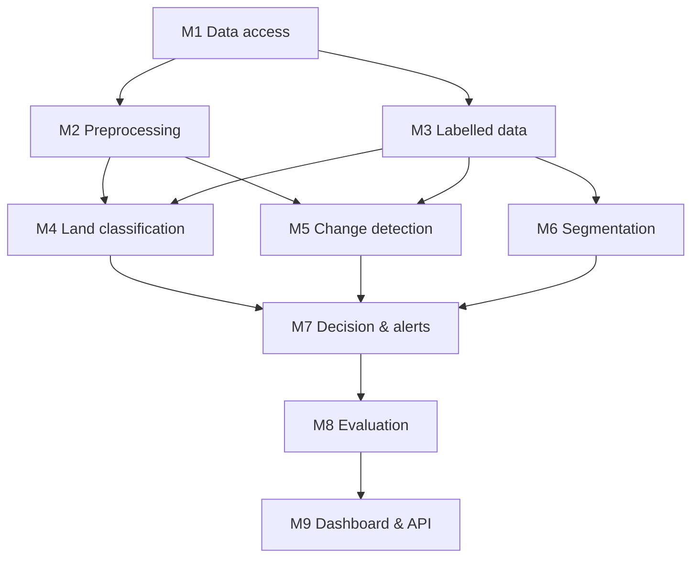

<callout icon="🎯">

**Goal:** a layered AI stack that watches satellite imagery, notices land change that looks like galamsey or deforestation, and tells people **exactly where to look**, with a confidence score and coordinates. The design lives in [🛰️R.E.M.I](page:ckbvimllzp); this page is where the work is tracked.

</callout>

<columns>

<column>

### 📍 Where it stands

**Phase:** M3 (Labelled data) in progress; M2 done; M1 done except the concession data (request drafted). *Updated 2026-11-21.*

**Done:** M1 data for the pilot box (Prestea, Western Region): before/after images for both satellites ([REMI Test Imagery](page:epzdv5qm9v)), OSM roads and rivers, and a stream network computed from the elevation map. M2 steps 1–4: cloud and water masks, Sentinel-2 tile seams removed, dates matched in brightness, water change rebuilt on the matched images, and aligned 256 × 256 before/after patches with block-based train/val/test splits ([REMI M2 Preprocessing Report](page:8u0jq0qub6)).

M3 steps 1–2: weak labels from WorldCover 2021 and published mining outlines, a ranked list of 914 candidate clearings, and the tile split stratified by mining area ([REMI M3 Labelled Data Report](page:spbr0bdedd)).

**New: a 2015/16 baseline** (five Sentinel-2 dates combined, haze-aware): from 2016 to 2025, **1,820 ha of forest newly cleared** on trustworthy pixels, mostly along rivers, and 880 ha of it outside both published mining maps ([REMI M2 Preprocessing Report](page:8u0jq0qub6), step 5).

Reported galamsey sites gathered from news, government and research (12 reports; the Himan raid on the Ankobra matches a growing mining field in the images).

**New (2026-11-26): all 914 candidates labelled.** 592 have the galamsey look, 114 are large-scale mines (a new label), and 205 are unsure. Claude made 903 of the labels, so they still need checking, test split first ([REMI M3 Labelled Data Report](page:spbr0bdedd), step 3).

**Next up:** redo the tile split on the labelled mining, then start M4. Check Claude's test-split labels in QGIS, place the five reported villages OSM doesn't know, and send the [REMI Concession Data Request](page:jnd1xbtqpj).

**Code:** `github.com/MensahPrince/REMI` (git since 2026-11-21).

**Stack:** satellite imagery, CNNs (ResNet, Siamese, U-Net), a map and an API.

</column>

<column>

### 🧭 Start here

- [🛰️R.E.M.I](page:ckbvimllzp): the problem and the seven layers
- [REMI Tasks](page:xuncxrlmu3): everything to do, by milestone
- [REMI Data Download Guide](page:sf7hcbolae): how to get test data for M1
- [REMI Test Imagery](page:epzdv5qm9v): the first Sentinel-2 and Landsat images of the pilot box
- [REMI Software Stack](page:uvhchbwrgv): the tools and Python environment for processing the images
- [REMI M2 Preprocessing Report](page:8u0jq0qub6): cloud and water masks, and the rest of M2 as it's done
- [REMI QGIS Walkthrough: Water Mask](page:f4yout9h9z): build the water mask by hand in QGIS and check it against the script
- [REMI Concession Data Request](page:jnd1xbtqpj): the email asking the Minerals Commission for licence boundaries (draft, not sent)
- [REMI M3 Labelled Data Report](page:spbr0bdedd): weak labels, the candidate list, how to label it in QGIS, and reported galamsey sites
- [REMI Mining Maps Explained](page:eezqbdbynt): pictures of the two published mining maps, and what "a pixel is mining" means
- [REMI Sources](page:841cvgtq57): every dataset, method, paper and news report used, where it's used and why (for citing)
- Data sources: below

</column>

<column>

### ⚖️ The rule

Every mining alert reads **"suspected mining activity"** and goes to a **person for verification** before anyone acts on it.

</column>

</columns>

## Tasks

The full tracker is [REMI Tasks](page:xuncxrlmu3): a board by status, a table by milestone, a board by pipeline layer, and a calendar on Due.

<database-view db="bd8ihklpd2" view="xy8ofwlnqx"/>

<columns>

<column width=0.507>

### Progress

<database-chart by="tsi044177t" chart="donut" colors="color" db="bd8ihklpd2"/>

</column>

<column width=0.493>

### Estimated hours per milestone

<database-chart by="tx9mosxoeg" chart="bars-across" db="bd8ihklpd2" measure="sum" value="jyde7e5yu7"/>

</column>

</columns>

## Milestones

Each milestone makes the next one possible. Labelled data (M3) feeds every model, so it starts as soon as the first images are in.

<toggle>

What "done" means for each milestone

1. **Data access:** Sentinel-2 and Landsat images of the pilot area for two dates on disk, rivers and roads from OSM, and concession data requested.
1. **Preprocessing:** clouds masked, colors comparable across dates, images tiled and aligned.
1. **Labelled data:** known galamsey sites and land-class labels for the pilot area, with masks for some scars.
1. **Land classification:** a classifier that labels tiles as forest, water, bare land or settlement, with its accuracy measured.
1. **Change detection:** before/after pairs flagged where land changed.
1. **Segmentation:** outlines of mining scars, with their area in hectares.
1. **Decision & alerts:** rules and the licence overlay turn changes into alerts with a confidence score.
1. **Evaluation:** alert precision, false alarms and area error measured on sites the models never saw.
1. **Dashboard & API:** suspected areas on a map, an API, and a verification step before any alert is acted on.

</toggle>

## Data sources

Step-by-step downloads for Sentinel-2, Landsat and OpenStreetMap are in the [REMI Data Download Guide](page:sf7hcbolae). The first images downloaded with it, and what they show, are in [REMI Test Imagery](page:epzdv5qm9v).

<callout background="orange" icon="🚧">

**Update 2026-11-21: USGS is back up, and the REMI account is active ✅** (registered and activated by email the same day). Landsat now has two working routes: USGS EarthExplorer (https://earthexplorer.usgs.gov) and the Planetary Computer. (EarthExplorer: https://earthexplorer.usgs.gov). ⚠️ Planned maintenance **Monday 2026-11-23, 13:00–\~20:00 Ghana time** (7 a.m.–2 p.m. CT). Details on [REMI Sources](page:841cvgtq57).

**USGS is down (checked 2026-10-21).** EarthExplorer, the account sign-up page and the M2M API all return *503 Service Unavailable*. This doesn't block Landsat: the same Collection 2 Level-2 data comes from the **Microsoft Planetary Computer** (Option A in the guide), which is up and is where the current Landsat images came from. Create the USGS account once it's back.

</callout>

<database-view db="qcgldygqxs"/>

## Risks

<callout background="yellow" icon="⚠️">

**Labelled data is scarce.** Every model needs examples of galamsey sites and land classes, and few public datasets exist. Start collecting them in M1, not after preprocessing.

</callout>

<callout background="yellow" icon="⚠️">

**Clouds.** Tropical regions are cloudy for much of the year, so cloud-free images of the same place on two dates can be rare. Choose date ranges with this in mind, and consider combining Sentinel-2 with Landsat.

</callout>

<callout background="yellow" icon="⚠️">

**OSM's river network is incomplete.** In the pilot box, OSM has 130 km of rivers, almost all of it the main Ankobra channel; most small streams are missing, and they are where riverside galamsey happens. Of the open water Sentinel-2 detects (463 ha on 2025-02-04, using the MNDWI water index), only **26 %** lies on an OSM river or water body. With OSM alone, Layer 6's "near a river?" check would miss most riverside mining.

**Closing the gap** (combine three sources, each covering what the others can't):

1. **Streams from elevation data.** Water flows downhill, so a stream network can be computed from the free 30 m **Copernicus DEM**, including streams hidden under forest canopy that no satellite image can see. This becomes the river network for Layer 6.
1. **Open water from the images.** The MNDWI index finds rivers, ponds and flooded pits on every date (part of M2). New water appearing between dates is itself a sign of mining.
1. **OSM** stays for roads, river names and the main channel.

Optional: **JRC Global Surface Water** (where water has been since 1984) to tell long-standing water from new mining ponds.

<callout background="green" icon="✅">

**Step 1 done (2026-10-21):** the DEM stream network is computed (`data/derived/streams_dem.gpkg`, 1,270 km). Detected water within 150 m of a known channel rose from **42 %** with OSM alone to **73 %** with OSM and the DEM streams combined. The DEM is strong on tributaries and weaker on the flat main floodplain, so Layer 6 uses **OSM for the Ankobra and the DEM for the tributaries**. Details and pictures are on [REMI Test Imagery](page:epzdv5qm9v).

</callout>

<callout background="green" icon="✅">

**Step 2 done (2026-10-21):** water masks and before/after change maps for both satellite pairs. New water **away from the rivers** looks like a real mining signal; change **along the main Ankobra channel** is mostly noise (season, silt and mixed pixels). Details on [REMI M2 Preprocessing Report](page:8u0jq0qub6); to rebuild it by hand in QGIS, see [REMI QGIS Walkthrough: Water Mask](page:f4yout9h9z).

</callout>

</callout>

<callout background="yellow" icon="⚠️">

**SCL hides mining.** Sentinel-2's built-in cloud layer labelled bright tailings at the Tarkwa mine as cloud, and missed most small clouds. Any step that trusts SCL would hide fresh bare ground, the main sign of galamsey. Sentinel-2 cloud masks use omnicloudmask instead; see [REMI M2 Preprocessing Report](page:8u0jq0qub6).

</callout>

<callout background="yellow" icon="⚠️">

**False alarms cost trust.** An alert that sends people to a legal mine or a farm makes the next alert easier to ignore. Measure false alarms (M8), and keep a person verifying every alert.

</callout>

<callout background="yellow" icon="⚠️">

**Concession data may be slow to get, or unavailable.** Without it, every alert's licence status is "unknown". Request it early, and design Layer 6 to work without it.

</callout>

<callout background="yellow" icon="⚠️">

**Depending on one data provider.** USGS going down on 2026-10-21 showed the risk. Keep at least two routes working for each satellite (Copernicus and Earth Search for Sentinel-2; USGS and the Planetary Computer for Landsat).

</callout>

## Open questions

The open questions are on the [🛰️R.E.M.I](page:ckbvimllzp) page, at the bottom: aerial data, training data, metrics, concession data and thresholds.
