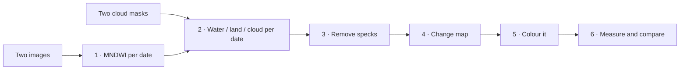

How to build REMI's water mask and before/after water change map **by hand in QGIS**, to see what each step does and to check the Python results. This repeats M2 step 2 from the [REMI M2 Preprocessing Report](page:8u0jq0qub6), for the Sentinel-2 pair **2024-03-31 → 2025-02-04**. Written for QGIS 3.44.

<callout icon="💡">

**This is for learning and checking, not for production.** `water_mask.py` does the same thing in 4 seconds, the same way every time. Use this walkthrough to understand the steps, then compare your result with the script's (step 6).

</callout>

<callout background="yellow" icon="⚠️">

**Install one package first.** Step 3 uses QGIS's **Sieve** tool, which runs a helper script (`gdal_sieve.py`) that isn't installed on this laptop. Without it, Sieve fails with *"Process gdal\_sieve.py failed to start"*. Install it once, then restart QGIS:

```bash
sudo dnf install gdal-python-tools
```

</callout>

<columns>

<column>

### 📂 You need

From `~/Downloads/REMI-test-data/`:

- `data/raw/s2_2024-03-31.tif`
- `data/raw/s2_2025-02-04.tif`
- `data/interim/s2_2024-03-31_cloudmask.tif`
- `data/interim/s2_2025-02-04_cloudmask.tif`

</column>

<column>

### 🔢 Band numbers

Every image has 6 bands:

1. blue
1. **green** ← used
1. red
1. nir
1. **swir16** ← used
1. scl

The Landsat files use the same order.

</column>

<column>

### 💾 Where to save

Make a folder for your results so they don't mix with the script's:

`~/Downloads/REMI-test-data/qgis/`

Save every output there as **GeoTIFF**.

</column>

</columns>



---

## 0 · Load the layers

1. Drag the four files listed above into QGIS.
1. Check the **Layers** panel names. QGIS names each layer after its file, without `.tif`: `s2_2024-03-31`, `s2_2025-02-04`, `s2_2024-03-31_cloudmask`, `s2_2025-02-04_cloudmask`. The expressions below use these names, so if yours differ, change the expressions to match.

## 1 · Compute the water index (MNDWI) for each date

MNDWI compares green light with short-wave infrared. Water reflects some green but almost no short-wave infrared, so water scores **above 0** and land below.

1. **Raster → Raster Calculator…** (use this one from the **Raster** menu; see Troubleshooting for the Toolbox version).
1. In **Raster calculator expression**, enter (for the "after" date):

```text
("s2_2025-02-04@2" - "s2_2025-02-04@5") / ("s2_2025-02-04@2" + "s2_2025-02-04@5")
```

1. **Output layer:** `~/Downloads/REMI-test-data/qgis/mndwi_2025-02-04.tif`. Leave the format as GeoTIFF and keep **Add result to project** ticked. Click **OK**.
1. Repeat for the "before" date, replacing both `2025-02-04` with `2024-03-31` and saving as `mndwi_2024-03-31.tif`.

<toggle>

Optional: look at the index before using it

Double-click `mndwi_2025-02-04` → **Symbology** → **Singleband pseudocolor**, choose a blue colour ramp, set **Min** `-0.5` and **Max** `0.5`, and click **Apply**. Rivers and ponds glow bright, forest is dark. Values are from −1 to 1.

</toggle>

## 2 · Turn the index into water / land / cloud

This marks water as **1** and land as **0**, but anything under cloud as **254**, meaning "unknown". That way a cloud can never look like water disappearing.

1. **Raster → Raster Calculator…** again, with:

```text
("mndwi_2025-02-04@1" > 0) * ("s2_2025-02-04_cloudmask@1" = 0) + 254 * ("s2_2025-02-04_cloudmask@1" = 1)
```

1. Save as `qgis/water_raw_2025-02-04.tif`, then repeat for `2024-03-31`.

<callout icon="💡">

**How it works:** in the Raster Calculator a comparison gives **1** if true and **0** if false. The first part is 1 only where the index says water *and* the sky is clear. The second part adds 254 wherever the cloud mask says cloud. Pixels the cloud mask marks as no data (255) stay empty automatically.

</callout>

## 3 · Remove specks

Single stray pixels are usually noise, not ponds. The script drops water patches smaller than **5 pixels** (0.05 ha). *Needs `gdal-python-tools`; see the yellow box at the top.*

1. Open **Processing → Toolbox** (`Ctrl+Alt+T`) and search for **Sieve** (under *GDAL → Raster analysis*).
1. **Input layer:** `water_raw_2025-02-04`. **Threshold:** `5`. Leave **Use 8-connectedness** *unticked* (the script also counts only side-by-side neighbours, not diagonal ones).
1. **Sieved:** save as `qgis/water_2025-02-04.tif`. Click **Run**.
1. Repeat for `water_raw_2024-03-31` → `qgis/water_2024-03-31.tif`.

<toggle>

Why your result will differ slightly from the script's

GDAL's Sieve removes small patches of **any** value: tiny water specks, but also tiny land holes inside ponds and tiny cloud patches, each merged into their neighbours. The script only removes water specks, and does it before adding the clouds. In testing this made a difference of only 1–2 ha (see step 6).

</toggle>

## 4 · Build the change map

Both Sentinel-2 images sit on exactly the same pixel grid, so they can be compared pixel by pixel.

1. **Raster → Raster Calculator…** with:

```text
("water_2024-03-31@1" = 1 AND "water_2025-02-04@1" = 1) * 1
+ ("water_2024-03-31@1" = 0 AND "water_2025-02-04@1" = 1) * 2
+ ("water_2024-03-31@1" = 1 AND "water_2025-02-04@1" = 0) * 3
+ ("water_2024-03-31@1" = 254 OR "water_2025-02-04@1" = 254) * 254
```

1. Save as `qgis/waterchange_2024-03-31__2025-02-04.tif`.

The result has one number per pixel:

| Value | Meaning |
| --: | --- |
| 0 | Land on both dates |
| 1 | Water on both dates |
| 2 | **New water** (land before, water after) |
| 3 | **Water lost** (water before, land after) |
| 254 | Cloud on either date: unknown |

## 5 · Colour it

1. Double-click the change map → **Symbology** → **Paletted/Unique values** → **Classify**.
1. Double-click each colour to set it, matching the report's maps:

| Value | Colour | Suggested label |
| --: | --- | --- |
| 0 | Transparent (or remove the row) | Land both |
| 1 | Blue | Water both |
| 2 | **Red** | New water |
| 3 | **Yellow** | Water lost |
| 254 | Grey | Cloud |

1. Click **OK**, then put an image underneath (true or false colour) to see where the changes are. Zoom in on the north-west mining corridor.

## 6 · Measure and compare with the script

1. In the Processing Toolbox, search for **Raster layer unique values report**, run it on your change map, and open the HTML report it makes.
1. It gives an **area in m²** for each value. Divide by 10,000 for hectares.
1. Compare with the script's result for the same pair. The middle column is what these exact steps gave when tested:

| Class | Script (`water_mask.py`) | QGIS steps, tested | Yours |
| --- | --: | --: | --: |
| Water both | 279 ha | 281 ha | TBD |
| New water | 144 ha | 144 ha | TBD |
| Water lost | 480 ha | 481 ha | TBD |
| Cloud on either date | 14,024 ha | 14,025 ha | TBD |

1. To see the script's map next to yours, load `data/interim/s2_2024-03-31__s2_2025-02-04_waterchange.tif` and give it the same colours (**Styles → Copy Style** on yours, then **Styles → Paste Style** on it). Tick each on and off to compare.

<callout background="green" icon="✅">

**Tested 2026-10-22** with QGIS 3.44's own processing engine (`qgis_process`) on copies of the data: the QGIS route gave the **same class as the script on 99.99 % of pixels**, with every total within 2 ha. If your numbers are far off, check the troubleshooting list below.

</callout>

---

## ✅ Checklist

- [x] Installed `gdal-python-tools` and restarted QGIS
- [x] Loaded the two images and two cloud masks
- [x] MNDWI for both dates
- [x] Water / land / cloud for both dates
- [x] Specks removed for both dates
- [x] Change map built and coloured
- [x] Areas measured and compared with the script

<toggle>

Doing the Landsat pair instead

Use `landsat_2024-02-21` and `landsat_2024-12-21` with their cloud masks; the band numbers are the same (2 green, 5 swir16). Pixels are 30 m, so a 5-pixel speck is 0.45 ha. The script's result to compare against: water both **168 ha**, new **159 ha**, lost **201 ha**, cloud **489 ha**. (The Landsat pair hasn't been tested through the QGIS steps.)

</toggle>

<toggle>

Troubleshooting

- **"Process gdal\_sieve.py failed to start":** `gdal-python-tools` isn't installed. Run `sudo dnf install gdal-python-tools` and restart QGIS.
- **"Layer not found" or the expression is greyed out:** a layer name in the expression doesn't match the Layers panel. Double-click a layer in the calculator's **Raster bands** list to insert its exact name.
- **Using "Raster calculator" from the Processing Toolbox instead of the Raster menu:** it names layers differently. The current one (*Raster analysis → Raster calculator*) calls the layers you pick **A**, **B** … in order, so step 2 becomes `("A@1" > 0) * ("B@1" = 0) + 254 * ("B@1" = 1)`. The older one, marked *deprecated*, gave empty results in testing; avoid it.
- **The change map is all one colour:** check you used band `@2` (green) and `@5` (swir16) in step 1, not `@1`.
- **Everything is grey:** the cloud masks are swapped between dates, or the "before" and "after" masks point at the same date.
- **Black or empty edges:** those are no-data pixels. On the image layer, set **Transparency → Additional no data value** to `0`.
- **Areas look 100× too big:** the report gives m²; divide by 10,000 for hectares.

</toggle>
