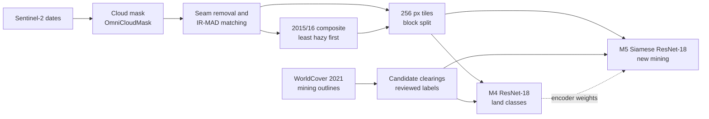

*Mapping new artisanal gold mining (galamsey) from Sentinel-2 imagery with weak labels, land classification and Siamese change detection: a pilot study around Prestea, Ghana*

Author: TBD · Working paper, draft of 27 November 2026 · Code: `github.com/MensahPrince/REMI`

## Abstract

Illegal small-scale gold mining (galamsey) clears forest and silts rivers across south-western Ghana, and the sites move faster than field surveys can follow them. We test whether free 10 m Sentinel-2 imagery and open label datasets can locate new mining in a 33 × 33 km pilot area around Prestea, Western Region. Images from 2015/16 (a haze-aware composite of five dry-season dates), March 2024 and February 2025 were cloud-masked with OmniCloudMask, freed of tile seams and matched in brightness with IR-MAD. Between 2016 and 2025, 1,820 ha of forest on low-haze pixels became bare, 57 % of it within 150 m of a river and 880 ha of it outside both published global mining maps. Weak labels from ESA WorldCover 2021 and two sets of mining outlines were corrected by reviewing 914 candidate clearings: 592 have the look of galamsey, 114 belong to industrial mines and 205 remain uncertain. A ResNet-18 trained on 160 m chips of the 2025 image reaches a test F1 of 0.72 for mining, against 0.65 for a linear model on chip statistics. A Siamese ResNet-18 that compares before and after chips detects new mining with a test F1 of 0.98, against 0.95 for the linear model and 0.80 for a rule on NDVI loss. These scores overstate field performance. The change labels derive from NDVI thresholds, the test excludes ambiguous chips, and when the model runs over the whole area it flags five to seven times more ground than the labelled new mining, mostly under cloud, under 2016 haze, and on clearings whose cause nobody has labelled. The main limit on this kind of monitoring is the supply of labels for non-mining change, more than the choice of model.

## 1 Introduction

Galamsey, the local name for unlicensed artisanal and small-scale gold mining, is widespread in the Western Region of Ghana. Miners dig pits along streams and in river beds, wash the gravel with pumps and sluices, and leave behind bare sand, turbid ponds and silted channels. Owusu-Nimo et al. (2018) surveyed the Western Region between December 2014 and April 2016 and counted 3,648 operations in Tarkwa-Nsuaem and 1,130 in Prestea-Huni Valley, concentrated along the Bonsa, Ankobra and Huni rivers. Enforcement continues: in July 2025 a task force destroyed eight floating dredges on the Ankobra near Himan (MLNR, 2025), inside the area studied here.

Satellite imagery can show where land was cleared and when. Global mining maps exist (Maus et al., 2022; Tang and Werner, 2023), but they were drawn by hand on imagery from 2019 to about 2021. Galamsey sites open and close within months, so these maps date quickly. A monitoring system needs to find change between recent dates, tell mining from other clearing, and give a person a location to check.

This paper reports the first stages of REMI, a project to build such a system. We address three questions:

1. How much new clearing appears in the pilot area between 2016 and 2025, and how much of it lies outside the published mining maps?
1. Can a convolutional network label 160 m chips of a single Sentinel-2 image as mining, and does it beat a linear model?
1. Can a Siamese network flag chips where new mining appeared between two dates, and how far can its test scores be trusted?

The design rule throughout is that every output is a suspected site for a person to verify. No model output in this paper is treated as proof of illegal mining.

## 2 Study area and data

### 2\.1 Study area

The pilot area is a 33 × 33 km box (about 1,100 km²) in the Prestea-Huni Valley and Tarkwa-Nsuaem districts of the Western Region, projected to UTM zone 30N. It contains the Ankobra river and its tributaries, the towns of Prestea, Bogoso and Himan, and the edge of the Gold Fields Tarkwa mine. In ESA WorldCover 2021, 85.2 % of the box is forest, 10.1 % other vegetation, 2.7 % built-up, 1.6 % bare ground and 0.3 % water. Most farming is cocoa, oil palm and plantain, which stay green all year.

### 2\.2 Imagery

| Image | Source | Role |
| --- | --- | --- |
| Sentinel-2 L2A, 2024-03-31 | Element 84 Earth Search | Before date, one-year pair |
| Sentinel-2 L2A, 2025-02-04 | Element 84 Earth Search | After date for both pairs |
| Sentinel-2 L2A, five dates from 2015-11-24 to 2016-01-23 | Microsoft Planetary Computer | 2015/16 composite, nine-year pair |
| Landsat 8/9 Collection 2 L2 | Microsoft Planetary Computer | Preprocessing tests only; not used in the models |

We use five bands at 10 m: blue, green, red, near infrared (NIR) and the 1.6 µm short-wave infrared band (SWIR, native 20 m, resampled). The 2024 before date falls at the start of the rains because no clear dry-season date was available. The 2015/16 dates are all partly cloudy (34 % to 72 % masked) and three of them carry Harmattan dust haze.

### 2\.3 Reference data

ESA WorldCover 2021 v200 (Zanaga et al., 2022) provides land cover at 10 m. Two sets of hand-drawn mining outlines cover the box. Tang and Werner (2023) has 170 outlines totalling 9,350 ha inside the box (8.5 %), and Maus et al. (2022) has 28 outlines and 13,041 ha (11.8 %). The two agree well: 88 % of the Tang and Werner area lies inside Maus et al. Together they cover 60 % of the ground that is bare in 2025. OpenStreetMap supplies roads and the main rivers, and a stream network computed from the 30 m Copernicus DEM adds the tributaries that OpenStreetMap lacks. Twelve news, government and research reports of galamsey in or near the box were located on their villages to give an independent check (Section 4.2).

## 3 Methods



*Figure 1. Processing chain. Dashed arrow: the change model starts from the land-classification encoder.*

### 3\.1 Cloud masking

Sentinel-2's scene classification layer (SCL) proved unsuitable. On 2025-02-04 it flagged 0.9 % of the box as cloud, while OmniCloudMask found 7.2 %, and at two places on the Tarkwa tailings it marked 56 % and 87 % of pixels as cloud where the image shows bare ground. A mask that hides bright bare ground would hide the scars this study looks for. We therefore masked every Sentinel-2 date with OmniCloudMask, run on red, green and NIR at 20 m, and widened each cloud and shadow by 50 m.

### 3\.2 Radiometric normalisation

Each Sentinel-2 date is a mosaic of four tiles whose haze corrections disagree. We fitted each tile to a reference tile (30NXM) with a per-band linear fit on the pixels both tiles see, which reduced the worst seam (blue, 2025-02-04) by a factor of about ten. We then matched the after date to the before date using pixels that IR-MAD (Canty and Nielsen, 2008) identifies as unchanged: 28,323 pixels for the Sentinel-2 pair, two thirds used for fitting and one third held out. Because 93 % of the unchanged pixels are forest, a slope fitted in the visible bands would rescale bright bare ground with no data to support it. Visible bands therefore receive only an offset, and NIR and SWIR a gain and offset. On held-out pixels the remaining bias is 0.0004 reflectance or less in every band. Before matching, the median NDVI change across the box was −0.059 and 26.2 % of the box appeared clearly less green; after matching these figures are +0.001 and 8.0 %.

NDVI (Tucker, 1979) and MNDWI (Xu, 2006) are used throughout:

```math
\mathrm{NDVI} = \frac{\rho_{NIR} - \rho_{red}}{\rho_{NIR} + \rho_{red}} \qquad \mathrm{MNDWI} = \frac{\rho_{green} - \rho_{SWIR}}{\rho_{green} + \rho_{SWIR}}
```

### 3\.3 A haze-aware 2015/16 composite

Each 2015/16 date was cloud-masked, freed of seams and matched to the 2025 image. Dates were ranked by haze using the red reflectance and NDVI of clear forest (2025: red 0.054, NDVI 0.69). The two low-haze dates are 2016-01-23 (red 0.055, NDVI 0.70) and 2015-11-24 (0.060, 0.71). For each pixel the composite takes the first date in that order that is clear there, and it records which date was used. The composite covers 96 % of the box, 67 % of it from low-haze dates. All measurements of change since 2016 use only low-haze pixels, because matching a hazy date corrects forest but over-corrects bare ground and water. A Landsat scene of 2015-12-29 was tested and rejected for the same reason.

### 3\.4 Tiles and data split

Each image pair was cut into aligned 256 × 256 pixel tiles (2.56 km). Tiles are assigned to train, validation and test by 7.68 km block, so that a mining corridor that spans neighbouring tiles cannot sit in both train and test. The block assignment was searched (20,000 random tries followed by hill-climbing) to give each split about 70 %, 15 % and 15 % of the land, of the reviewed galamsey area and of the reviewed industrial mining area, with at least 5 % of each in every split. Of 182 tile positions, 167 (166 for the 2016 pair) are kept; the rest are slivers at the image edge or mostly cloud.

### 3\.5 Candidate clearings and their review

WorldCover 2021 calls 40 % of the ground that is bare in 2025 forest, so it cannot supply mining labels on its own. We listed every patch that is bare on 2025-02-04 (NDVI \< 0.35, clear) and that WorldCover 2021 calls forest or other vegetation, after a 2 × 2 morphological opening and a minimum size of 0.5 ha. This gives 914 candidate patches, 2,467 ha in total. Each was then labelled from paired crops of the 2016 composite and the 2025 image. The categories are mining with the galamsey look (ragged pits and ponds along streams), mining (large-scale) for terraced pits, waste dumps and tailings dams of industrial mines, farm, road, settlement, quarry, cloud, other and unsure. A human analyst labelled 11 patches. An AI assistant (Claude) labelled the other 903 in a first pass, recording a reason for every uncertain call, and the human analyst then checked all 202 patches in the test split and accepted them. The labels describe what a site looks like; whether it is licensed requires concession data that we do not yet have.

### 3\.6 Land classification (M4)

The 2025 image is cut into 160 m chips (16 × 16 pixels, five bands). Pixel labels come from WorldCover 2021, merged into vegetation, bare ground and built-up, and overwritten by the reviewed candidates (mining and mining (large-scale) become mining; settlement becomes built-up; unsure is ignored). Pixels where WorldCover and the 2025 image clearly disagree are ignored. A chip is labelled mining when mining covers 30 % of its labelled pixels, and otherwise takes its majority class if that class covers 60 %. Mixed chips are left out. Water is excluded because rivers and ponds here rarely fill 60 % of a chip; it is taken from the pixel-level water mask instead. A first model showed that many chips labelled vegetation lay in mining ground, so 347 such chips were reviewed by eye (243 were mining, 36 built-up, 12 vegetation and 56 unsure) and their reviewed labels used.

The model is a ResNet-18 (He et al., 2016) trained from scratch, with five input bands and a 3 × 3, stride-1 first convolution suited to small chips. Training uses class-weighted cross-entropy (weights proportional to 1/√frequency), random flips and 90° rotations, AdamW (Loshchilov and Hutter, 2019) with a one-cycle schedule, and 25 epochs. Each epoch uses every non-vegetation chip and a fresh random sample of 6,000 vegetation chips. The epoch with the best validation macro F1 is kept. The baseline is a multinomial logistic regression on each chip's band means, standard deviations and NDVI statistics.

### 3\.7 Change detection (M5)

We use two pairs: the nine-year pair (2016 composite to 2025-02-04) and the one-year pair (2024-03-31 to 2025-02-04). A pixel has changed if it was green before (NDVI ≥ 0.5) and is bare after (NDVI \< 0.35), and is clear on both dates; for the 2016 composite it must also come from a low-haze date. A changed pixel counts as new mining if it lies inside a reviewed mining candidate or a published mining outline, and outside any unsure candidate. A 160 m chip is labelled new mining if it holds at least 25 new-mining pixels (0.25 ha), and no change if at most 2 of its pixels changed. Every other chip is left out: chips less than half clear, chips with a little change, and chips whose change lies outside every mining label.

| Pair | Split | New mining | No change |
| --- | --- | --: | --: |
| 2016 → 2025 | train / val / test | 1,114 / 197 / 231 | 14,373 / 2,774 / 3,285 |
| 2024 → 2025 | train / val / test | 701 / 170 / 95 | 23,258 / 4,232 / 5,645 |

*Table 1. Labelled chips for change detection.*

The model is a Siamese network in the style of Daudt et al. (2018). A single ResNet-18 encoder, initialised from the land-classification model, reads the before and after chips separately. A two-layer head classifies the concatenation of the before features, the after features and their absolute difference. Each epoch uses every new-mining chip and 6,000 no-change chips. Half of these are hard negatives, chips at least 10 % bare on the after date (old pits, towns, river sand), which the model must learn to leave alone. The same flip and rotation is applied to both dates. Training ran for 15 epochs on four CPU cores (about 70 minutes), and the epoch with the best validation average precision was kept.

Two baselines use the same labels. The NDVI-drop rule scores a chip by the share of its pixels whose NDVI fell by at least 0.2. The linear baseline is a logistic regression on band means and spreads of both dates, their difference, and NDVI statistics. For all three methods the alert threshold is the one with the best F1 on validation, and test is scored once at that threshold. We report precision, recall, F1 and average precision (AP) for the new-mining class.

## 4 Results

### 4\.1 Nine years of clearing

| Measure, low-haze pixels (66,967 ha, 61 % of the box) | Value |
| --- | --: |
| Bare ground, 2016 → 2025 | 4,134 → 4,944 ha (+20 %) |
| New clearing (green 2016, bare 2025) | 1,820 ha |
| of which within 150 m of a river | 57 % |
| of which outside both mining maps | 880 ha |
| Regrowth (bare 2016, green 2025) | 639 ha |
| of which inside the mining maps | 76 % |

*Table 2. Land change between the 2015/16 composite and 2025-02-04.*


Bare ground grew by only a fifth over nine years, but 1,820 ha of forest was newly cleared while 639 ha grew back. Mining moved more than it expanded, which is consistent with a boom that had already peaked around 2016 and 2017. New clearing follows the river corridors in the north-west and the edge of the Tarkwa mine. Almost half of it lies outside both global mining maps.

### 4\.2 Reviewed candidates

| Label | Patches | Area |
| --- | --: | --: |
| Mining, galamsey look | 592 | 1,564 ha |
| Mining, large-scale | 114 | 566 ha |
| Unsure | 205 | 326 ha |
| Settlement | 2 | 2 ha |
| Other | 1 | 10 ha |

*Table 3. Labels of the 914 candidate clearings.*


The two mining groups behave differently. Large-scale sites lie almost entirely inside the published maps (95 % inside Maus et al., 93 % inside Tang and Werner) at a median of 200 m from a river. Galamsey patches have a median distance to a river of 0 m, are the only group with new open water, and half of their area lies outside Maus et al. Of the 205 uncertain patches, 99 are village edges where roofs and bare ground mix and 54 are reddish bare soil without ponds, which could be a fresh farm clearing or fresh workings. No clear farm was found, which fits a landscape of tree crops that stay green.

The one report precise enough to test the candidates, the July 2025 raid near Himan, agrees with them: within 2 km of the site lie 81 ha of candidates, 2.9 times the average for a 2 km circle in the box, and the images show a galamsey field on a bend of the Ankobra growing between March 2024 and February 2025. Reports that name only a town cannot test anything, since the workings lie on the rivers around it.

### 4\.3 Land classification

| Test, 160 m chips | ResNet-18 v1 | ResNet-18 v2 | Linear baseline |
| --- | --: | --: | --: |
| Accuracy | 0\.90 | 0\.96 | 0\.96 |
| Macro F1 | 0\.57 | 0\.70 | 0\.69 |
| Mining F1 | 0\.60 | 0\.72 | 0\.65 |
| Mining precision / recall | 0\.47 / 0.82 | 0\.67 / 0.79 |  |
| Built-up F1 | 0\.74 | 0\.75 | 0\.65 |
| Bare ground F1 | 0\.39 | 0\.35 | 0\.47 |

*Table 4. Land classification on the test split. v1 used five classes and the original chip labels; v2 merges forest and other vegetation and uses the corrected labels.*

The first model (v1) scored no better than the linear baseline. Most of its false mining fell on ground that was mining in 2025 but forest in WorldCover 2021, and a labelling rule had dropped the bare pixels in such chips, so the green left between pits made them vegetation. After correcting the rule and reviewing 347 chips, the ResNet beats the linear model on mining (0.72 against 0.65) and built-up land (0.75 against 0.65). The reviewed chips were selected because v1 called them mining, which favours v1, so the fair comparison excludes them: on the remaining 6,275 test chips, mining F1 is 0.71 for v2 and 0.68 for v1. Most of the improvement therefore came from the labels. Bare ground remains weak, with only 54 test chips, most of them mine ground at Tarkwa that sits between bare and mining.


### 4\.4 Change detection

| Test (326 new mining, 8,930 no change) | AP | Precision | Recall | F1 | Bare but unchanged, flagged |
| --- | --: | --: | --: | --: | --: |
| NDVI drop | 0\.893 | 0\.70 | 0\.93 | 0\.80 | 1 of 783 |
| Linear | 0\.997 | 0\.99 | 0\.91 | 0\.95 | 0 of 783 |
| Siamese ResNet-18 | 0\.997 | 0\.99 | 0\.96 | 0\.98 | 2 of 783 |

*Table 5. New-mining detection on the test split, at thresholds chosen on validation.*

The Siamese model reaches F1 0.97 on the nine-year pair and 0.98 on the one-year pair. Its validation AP exceeded 0.98 from the first epoch, which suggests the encoder carried over most of what it needed from land classification. Its advantage over the linear model is a higher recall (0.96 against 0.91) at the same precision. None of the methods confuses old, unchanged mining with new mining.

Applied to every chip, the model gives a less favourable picture. It flags 4,283 chips (10,964 ha) on the nine-year pair and 2,087 chips (5,343 ha) on the one-year pair. On clear and low-haze pixels, the labelled new mining amounts to about 1,440 ha and 770 ha.

| Flagged chips | 2016 → 2025 | 2024 → 2025 |
| --- | --: | --: |
| Labelled new mining | 1,506 | 934 |
| Labelled no change | 16 | 1 |
| Unlabelled: less than half clear (cloud) | 728 | 604 |
| Unlabelled: clear, but 2016 date hazy | 1,000 |  |
| Unlabelled: clear, at least 25 pixels changed, cause unknown | 713 | 223 |
| Unlabelled: clear, 3 to 24 pixels changed | 320 | 325 |

*Table 6. Where the model's flags fall when it is run on every chip.*


## 5 Discussion

### 5\.1 Why the change scores overstate performance

The change labels are built from the same NDVI thresholds that a simple rule can compute, and every chip near the thresholds is left out of training and testing. The task the test measures is therefore easy, which is why a linear model reaches F1 0.95. The test shows that the Siamese model finds clear new pits; it cannot show that the model is better than a linear model on the cases that matter for monitoring.

Table 6 identifies those cases. Clouds and haze cause the largest share of false alerts, because no chip in training was cloudy or hazy and the model reads both as change. A further 936 clear chips (about 815 ha) show substantial clearing outside every mining label. These are the decisions a monitoring system has to make: some are galamsey that neither the published maps nor the candidate list contains, and others are farms, roads or new building. With almost no non-mining clearings among the reviewed candidates, the model has never been shown a new farm, and the test cannot measure whether it would flag one.

### 5\.2 Label quality and model choice

In both models, the largest gains came from correcting labels. Fixing the chip-label rule and reviewing 347 chips raised land-classification mining F1 from 0.60 to 0.72, and a deeper model added little on top. Global land cover and global mining maps are useful starting points, but in this area WorldCover 2021 misses 40 % of today's bare ground, and the mining outlines miss half of it while enclosing large areas of green land. Any system that trusts them without review will learn their errors.

### 5\.3 Limitations

- Most labels were made by an AI assistant from 10 m imagery and checked by one person only in the test split. They describe appearance, and none has been confirmed on the ground.
- The 2024 before date falls at the start of the rains, so some vegetation change between the one-year dates is seasonal.
- A third of the box is cloudy or hazy in the 2015/16 composite and is excluded from the nine-year figures; most of it lies in the east, where there is little mining.
- Many dug-out stream channels are narrower than a 10 m pixel and remain invisible to both the candidate rule and the models.
- Without concession boundaries, the system cannot say whether a site is licensed. The label mining (large-scale) records the look of an industrial mine, not its legal status.

## 6 Conclusion and further work

Free Sentinel-2 imagery, carefully masked and normalised, shows 1,820 ha of new forest clearing around Prestea between 2016 and 2025, nearly half of it outside the published global mining maps. A ResNet-18 labels mining at 160 m with test F1 0.72, and a Siamese ResNet-18 detects clear new mining with test F1 0.98, though a linear model comes close on the same labels and the full map shows many false alerts under cloud and haze and on unlabelled clearings.

The next steps follow from those failures:

1. Exclude chips that are cloudy or hazy before raising an alert, report them as unobserved, and add cloudy chips to training as negatives.
1. Label the roughly 900 chips of clearing with unknown cause, which would add a class for non-mining clearing and give a test where NDVI alone cannot decide.
1. Retrain and compare again with the linear baseline on that harder test.
1. Segment scars at pixel level with a U-Net (M6), and combine land class, change and the licence overlay into scored alerts for human verification (M7).

## References

- Canty, M. J. and Nielsen, A. A. (2008). Automatic radiometric normalization of multitemporal satellite imagery with the iteratively re-weighted MAD transformation. *Remote Sensing of Environment*, 112(3), 1025-1036.
- Daudt, R. C., Le Saux, B. and Boulch, A. (2018). Fully convolutional Siamese networks for change detection. *2018 IEEE International Conference on Image Processing (ICIP)*, 4063-4067.
- He, K., Zhang, X., Ren, S. and Sun, J. (2016). Deep residual learning for image recognition. *Proceedings of the IEEE Conference on Computer Vision and Pattern Recognition (CVPR)*, 770-778.
- Loshchilov, I. and Hutter, F. (2019). Decoupled weight decay regularization. *International Conference on Learning Representations (ICLR)*.
- Maus, V. et al. (2022). An update on global mining land use. *Scientific Data*, 9, 433. doi:10.1038/s41597-022-01547-4. Data: doi:10.1594/PANGAEA.942325.
- Ministry of Lands and Natural Resources, Ghana (2025). Galamsey fight: Prestea Blue Water Guards destroy 8 chanfang machines, seize 8 pumping machines near the Ankobra River. mlnr.gov.gh, 10 July 2025.
- Owusu-Nimo, F., Mantey, J., Nyarko, K. B., Appiah-Effah, E. and Aubynn, A. (2018). Spatial distribution patterns of illegal artisanal small scale gold mining (Galamsey) operations in Ghana: a focus on the Western Region. *Heliyon*, 4(2), e00534. doi:10.1016/j.heliyon.2018.e00534.
- Tang, L. and Werner, T. T. (2023). Global mining footprint mapped from high-resolution satellite imagery. *Communications Earth & Environment*, 4, 134. doi:10.1038/s43247-023-00805-6. Data: doi:10.5281/zenodo.7894216.
- Tucker, C. J. (1979). Red and photographic infrared linear combinations for monitoring vegetation. *Remote Sensing of Environment*, 8(2), 127-150.
- Xu, H. (2006). Modification of normalised difference water index (NDWI) to enhance open water features in remotely sensed imagery. *International Journal of Remote Sensing*, 27(14), 3025-3033.
- Zanaga, D. et al. (2022). ESA WorldCover 10 m 2021 v200. Zenodo. doi:10.5281/zenodo.7254221.
- Software: OmniCloudMask (github.com/DPIRD-DMA/OmniCloudMask); PyTorch and torchvision; rasterio, GeoPandas and pysheds.

<toggle>

Appendix A. Detailed results and project pages

- Preprocessing (cloud masks, seams, matching, tiles, 2015/16 composite): [REMI M2 Preprocessing Report](page:8u0jq0qub6)
- Weak labels, candidate list, review and reported sites: [REMI M3 Labelled Data Report](page:spbr0bdedd)
- Land classification, v1 and v2: [REMI M4 Land Classification Report](page:hyxwfpn7xd)
- Change detection: [REMI M5 Change Detection Report](page:56h06s9n5l)
- Every dataset, paper and report with licences: [REMI Sources](page:841cvgtq57)

</toggle>
