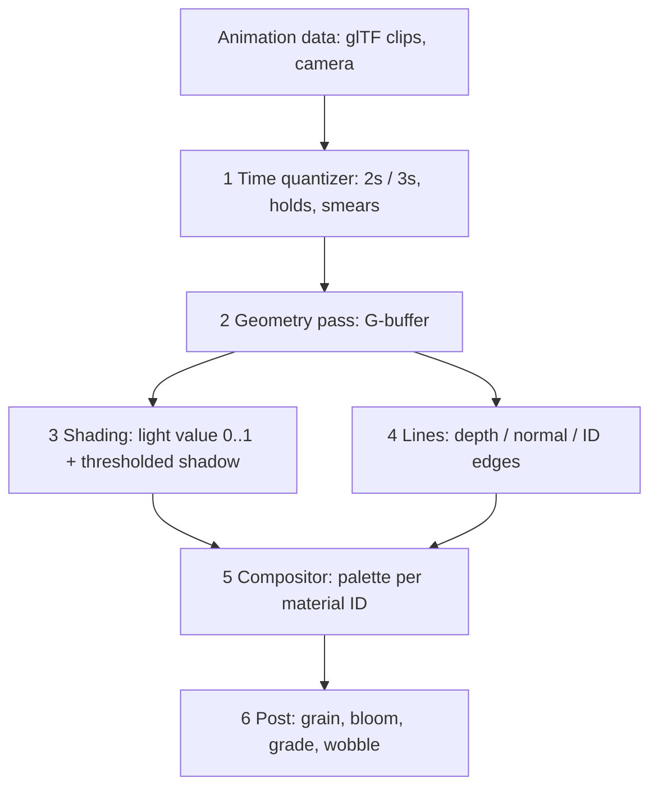

<callout icon="💡">

**Core idea:** hand-drawn 2D is a set of deliberate cheats (simplified shadows, pen-like lines, held poses, bent perspective), not one look. So Vellum doesn't render a picture. It renders **data about the picture**, and a 2D-style compositor decides how to draw it, like a 2D studio combining layers at the end.

</callout>

Source: *NPR 2D-from-3D Engine — Architecture Notes* (PDF). The working plan is `milestones.md` in the repo root, mirrored in [Vellum Project Hub](page:qo8zh49wt3) and [Vellum Task Tracker](page:mq2uz8r1n6).

## Why anime looks flat in one shot and 3D in the next

Characters are drawn by hand, while mechs and backgrounds are cel-shaded 3D. Their **line language, shading rules and timing don't match**. Vellum's job is to make all 3D content follow the same 2D rules, so a character and a machine in one shot look drawn by the same hand.

## The pipeline

| Stage | Why it exists | Watch for |
| --- | --- | --- |
| Time quantizer | The cheapest way to look 2D; everything downstream sees fewer, held poses | Quantize poses *and* camera; per-shot hold flags |
| G-buffer | Lines, shadows and mattes all come from it; restyle without re-rendering | Integer ID formats that never blend at edges |
| Shading | A scalar, not a colour: changing the look means swapping a ramp | Raw normals look noisy and 3D; use proxy normals, SDF maps for faces |
| Lines | Depth jumps make silhouettes, normal jumps creases, ID changes borders | Width from depth and curvature, taper, slight wobble |
| Compositor | Owns the look: flat palette regions per material | No PBR, gradients or realistic speculars |
| Post | Last, so it unifies characters and machines | Subtle; every pass is its own layer |

## Decisions

<columns>

<column>

<callout icon="📌">

**Engine first, port later.** The core is a library with no winit dependency. The preview window and headless renderer are front-ends.

</callout>

<callout icon="📌">

**glTF 2.0 only**, from Blender. Proxy normals are baked there as custom normals.

</callout>

</column>

<column>

<callout icon="📌">

**RON** for shot and override files. Overrides are Rust enums, and serde writes them directly.

</callout>

<callout icon="📌">

**Cast shadows are in scope:** a thresholded shadow map merged into the light value. The design notes leave them out.

</callout>

<callout icon="📌">

**Shots and overrides (M10, decided 2026-10-28).** Precedence: built-in default → Blender custom property → shot file (RON) → panel overrides. Keys are Blender names, not numeric IDs. File watching polls modification times (no `notify` pre-release). The panel saves to `<shot>.overrides.ron` and never rewrites the hand-written shot. M10 is split into M10a (data and hot reload) and M10b (egui panel; egui 0.37 matches wgpu 30). **Built in M10b:** the panel keeps its own override layer (same keys as the shot) and re-resolves the base glTF scene on every edit. Material edits rewrite the GPU material table in place, and only a change of meshes (smoothed normals) rebuilds the renderer. The overrides file is read at startup, and saving the shot file keeps unsaved panel edits.

</callout>

<callout icon="📌">

**24 fps clock, objects on twos, camera on ones (M9).** Each node is sampled at its own quantized time; a skeleton follows the step of the mesh it deforms. Skinning and shape keys run in a GPU compute pass, so every later pass still draws plain vertex buffers.

</callout>

<callout icon="📌">

**Refinement choices (M12, decided 2026-10-28).** Smears **stretch the mesh** automatically, rather than using authored smear shapes or screen-space streaks, so lines and shadows follow the smeared shape. Face shadows are built against a **character exported from Blender** (Mavis). **Shots can add scenes**, each with a transform, so a character and a machine from different glTF files share one shot.

**M12d, shading shapes** (from the shading notes PDF): proxy normals, object-space noise on the threshold, opt-in normal snapping, and a light authored per shot or object. Not a camera-locked light, because cast shadows are world-space. No hysteresis, because held poses already make shadows pop.

**Ink only where paint changes:** a border between two materials gets a line only if their palettes differ, so mesh seams within one colour stay clean.

</callout>

<callout icon="📌">

**Lamps only lift, and they cast shadows (M14, 2026-10-29).** Point and spot lights light hard-edged pools that never darken anything; a pixel takes the brightest of the key light and every lamp. Palettes stay as painted (coloured light was not chosen). Lamp shadows share one atlas of 512² tiles: a tile per spot and six per point light, up to 32 per frame.

</callout>

<callout icon="📌">

**Post belongs to the final frame (M11).** Bloom, grade and grain apply to `final` only. The layers that `vellum render` writes stay ungraded, the way a compositor applies post on top of the stacked layers. Grading works on sRGB-encoded values, where contrast and lift/gain behave the way painters expect. The bloom threshold sits just above paper white, so by default only highlights glow. ID mattes aren't written yet.

</callout>

<callout icon="📌">

**Palettes stay as painted (M8).** The sun's colour never tints them; colour grading is M11's job, applied to everything at once. Hand-picked colours are `"#rrggbb"` sRGB strings so there's no colour-space ambiguity.

</callout>

<callout icon="📌">

**No ECS (M4).** The scene is plain data (nodes, meshes, materials, lights) because scenes come from Blender, not gameplay code. A game port would bring its own ECS.

</callout>

</column>

</columns>

### G-buffer formats

| Target | Format |
| --- | --- |
| Depth | `Depth32Float` |
| Normal (view space) | `Rgba16Float` |
| Object ID / material ID | `R32Uint` / `R16Uint` |
| Motion vectors, UV | `Rg16Float` |

### Per-object override table

| Property | Example |
| --- | --- |
| Ramp / threshold | 2-tone for characters, 3-tone for mechs |
| Line weight scale | Thicker on silhouettes, thinner on interior creases |
| Normal source | Proxy mesh or custom normals |
| Smear / hold flags | Set per shot |
| Palette | Per material ID: base, shadow, highlight |

<callout background="yellow" icon="⚠️">

**Design the override table early.** Automatic settings get about 80% of the way; the rest is hand-tuning, and overrides are hard to add later.

</callout>

## Final checklist

- [ ] Shadow shapes are clean and simplified, not raw N·L
- [ ] Line weight varies with depth and curvature, with pen-like taper
- [ ] Poses are quantized to 2s or 3s, with holds and smear support
- [ ] Perspective can be bent per shot
- [ ] Textures are flat painted regions: no PBR, no smooth gradients
- [ ] Output is layered: base, shadow, highlight, line, ID mattes
- [ ] Every parameter can be overridden per object and per shot
- [ ] Characters and machines share the same ramps, lines and post stack

<toggle collapsed=true>

About Goo Engine

A Blender fork whose EEVEE keeps Shader-to-RGB and extra NPR controls that newer Blender versions dropped. Study it for **how it exposes toon shading to artists**, not as an architecture to copy.

</toggle>
