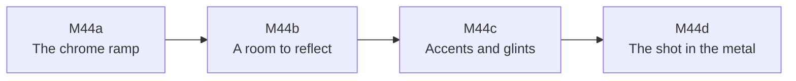

<callout icon="📌">

**Built 2026-11-11**, all four steps, on branch `m44-chrome`. The result is at the bottom of this page; what follows is the plan as it was written. Asked for on 2026-11-11 with a reference picture. Vellum's cel metal paints three tones by the height of the reflected ray; the reference is a drawn chrome with five tones, studio lights, wandering edges and glints. Four steps, each a picture to judge before the next. Tracked in [Vellum Project Hub](page:qo8zh49wt3) and `milestones.md` (M44).

</callout>

<columns>

<column>

</column>

<column>

</column>

</columns>

## What is missing

| The reference | Vellum today |
| --- | --- |
| Five flat tones: white, pale blue, mid grey, dark grey, black | Three: sky, one thin band, ground |
| Black against white: the horizon's dark line under the bright sky, grey ground, light bouncing up from below | Everything under the horizon is one black |
| Flat slabs carry stripes and blocks along their length | A flat face reflects one way and comes out one tone |
| White rectangles and long streaks: a studio's windows and strip lights | No lights in the reflection, only sky and ground |
| Edges wander like liquid, with drops and islands of tone | Band edges are the geometry's, exactly |
| A red patch in one slab | Greys only, unless a whole panorama is painted |
| Glints: dots, teardrops, a four-point star | The roughness highlight, one spot |
| The slabs show each other | Nothing in the shot shows in metal |
| A thin white line just inside the outline | `edge_highlight` on bevel lines only |

## The steps

### M44a: the chrome ramp

<callout icon="✅">

**Built 2026-11-11** on branch `m44-chrome`. The five tones turned out to need no new pass: they are light bands and the highlight's cover, so the compositor and the layers take them as they are. `contrast` was dropped (presets and tones cover it); Blender properties wait for M44d.

</callout>

The slabs' flat faces are one tone each, as expected: that is M44b's job.

- [ ] `metal: (…)` on a material: stops down the reflected ray's height, each one of the palette's tones: sky, glare at the horizon, the horizon's dark line, ground, bounce
- [ ] `horizon` (height and tilt), `line` (the dark line's width), `bounce`, `contrast`
- [ ] Presets: Chrome, Steel, Gunmetal, Black chrome, Gold
- [ ] `metallic` from 0.5 with no `metal` stays today's three bands, so golden images are unchanged
- [ ] A sample to judge on: a bust with slab hair and a collar, built by script in Blender, and `shots/chrome_head.ron`

### M44b: a room to reflect

- [ ] `room`: the reflection found where the ray meets a box round the object, not by direction alone, so a flat slab runs through several stops along its length
- [ ] `windows`: hard white panels in the room (count, size, height, turn)
- [ ] `wobble` and `stretch`: noise bending the ray so edges wander and break into drops, drawn out along one axis so stripes follow the form; boiling per drawing

### M44c: accents and glints

- [ ] `accent`: one coloured patch in the room (colour, direction, size)
- [ ] Glints on the highlight's brightest points: dot, teardrop, four-point star. Shares its drawing with M33b's light flares
- [ ] An inner highlight line just inside the outline of metal

### M44d: the shot in the metal

- [ ] The mirror pass (M24) feeding metal: what the frame holds near the surface, cut into the ramp's tones
- [ ] Panel (Material › Metal, with presets), Blender properties, the manual, golden images

<callout icon="✅">

**Done when:** the chrome bust beside the reference reads as the same kind of drawing: five tones, black against white, stripes along the slabs, wandering edges, one accent, glints.

</callout>

## Open questions

- ❓ Are the stylised eyes and lashes on the face part of this? They are drawn lines (M20c), not metal.
- ❓ Should the look hold still as the camera moves (a matcap-like room fixed to the view) or slide as chrome does? The plan slides by default.

## Why this order

M44a is the biggest change for the least work: the black line against white and the bounce from below are what make it read as chrome, and they need no new pass. M44b fixes the flat slabs, which is most of the reference's hair. M44c and M44d are finish.

## The result

| Step | What it became | Commit |
| --- | --- | --- |
| M44a | `metal` ramp, tones from the palette, five presets, the bust sample | `5562b81` |
| M44b | `room`, `windows`, `wobble`, `stretch`, `boil` | `430340d` |
| M44c | `accent`, `inline`, `glints` (star, dot, drop) | `b86bf84` |
| M44d | `shows` through the mirror pass; Blender `vellum_metal*`, add-on 0.6.0 | not committed yet |

<callout icon="⚠️">

**Still to judge:** the bust is a scripted stand-in, so the look wants trying on a real character. What `shows` draws is rougher than the ramp. Dropped from the plan: `contrast`, a box-shaped room, panes across windows, a `metal` pass of its own in a PSD.

</callout>
