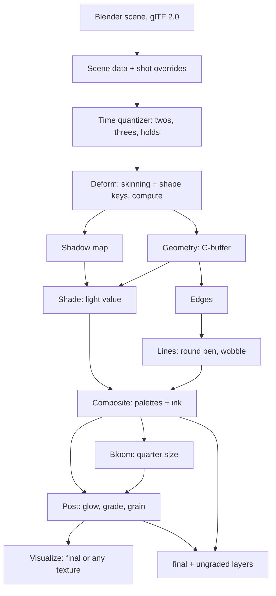

The map of Vellum Engine: a Rust engine that renders 3D scenes as **genuine hand-drawn 2D**, in the anime cel style. This page covers what it is made of, how one frame turns a Blender scene into flat palette regions and ink lines, and where each part lives in the code and in the notes. Start here; every page links back.

<callout icon="🎯">

**Working on Vellum?** Status, tasks, charts and risks are on the [Vellum Project Hub](page:qo8zh49wt3); the tasks themselves are in [Vellum Task Tracker](page:mq2uz8r1n6). The reasoning behind the pipeline is in [2D-from-3D Pipeline](page:lgjayicicv). This page is the map.

</callout>

---

## 1\. What Vellum is for

In anime, characters are drawn by hand, while mechs and backgrounds are often cel-shaded 3D, and the two rarely match. Vellum makes 3D content follow **2D rules**, so a character and a machine in one shot look drawn by the same hand: held poses on twos and threes, clean simplified shadow shapes, pen-like lines and flat painted palettes.

It doesn't render a picture directly. It renders **data about the picture** (light values, IDs, edges), and a 2D-style compositor decides how to paint it, the way a studio combines layers at the end.

### Goals

- **One look, applied to everything**: the same ramps, lines, palettes and timing for every object in a shot.
- **Art-directable**: every setting can be overridden per material, per object and per shot, and changed live ([Scripting and Hot Reload](page:sa5xujelgo)).
- **Layered output**: base, mid, shadow, rim, highlight and line come out as separate layers for compositing, next to the finished frame.
- **Engine first, port later**: the core library has no windowing dependency; the preview window and the headless renderer are thin front-ends.
- **Understand every layer**: write the renderer and passes ourselves, and use crates only for what isn't the point (windowing, maths, file formats).

### Non-goals

- Photorealism or PBR. Lighting gives a value from 0 to 1, never a colour.
- An editor. Scenes are authored in Blender; Vellum has a preview window with an override panel.
- An ECS or gameplay. The scene is plain data loaded from glTF; physics and audio are parked ([Physics and Collision](page:5fqpz0e5pw), [Audio](page:5iz8644rwn)).
- Hatching, halftone and paper. They are **parked** because they aren't part of the anime look ([Hatching and Painterly Rendering](page:6vwu9pwosr)).

---

## 2\. One frame

Passes run through a small hand-written **frame graph**: each declares the named textures it reads and writes, the graph checks the wiring, and any texture can be viewed (`V`) or dumped (`P`).

| Stage | What it does | Code | Notes |
| --- | --- | --- | --- |
| Scene | Node tree, meshes, materials, cameras, lights from glTF; stable object and material IDs | `scene.rs`, `gltf_import.rs` | [Asset Pipeline](page:s79wv0aek9) |
| Shots | RON shot files and panel overrides layered over Blender's settings | `shot.rs` | [Scripting and Hot Reload](page:sa5xujelgo) |
| Time quantizer | Each node sampled at its own stepped time on a 24 fps clock; holds | `timing.rs`, `animation.rs` | [Game Loop and Timing](page:kom1zxtzlw) |
| Deform | GPU skinning and shape keys; keeps last frame's vertices for motion vectors | `deform.rs` |  |
| Shadow | 2048² reverse-Z shadow map, fitted to the draws | `passes/shadow.rs` | [Toon Shading](page:m2km9l0szv) |
| Geometry | The G-buffer in one draw (§3) | `passes/geometry.rs` | [Rendering with wgpu](page:hpy2x2spuf) |
| Shade | 2- or 3-tone ramp, cast shadow, rim and highlight masks into `light` | `passes/shade.rs` | [Toon Shading](page:m2km9l0szv) |
| Edges and lines | Silhouettes, object and material borders, creases; width from depth, taper, wobble | `passes/edge.rs`, `passes/line.rs` | [Outlines and Edges](page:sof6p2vevn) |
| Composite | Paints each pixel from its material's palette, then lays ink over it | `passes/composite.rs`, `palette.rs` |  |
| Output | Final image to the window; PNG/EXR dumps and straight-alpha layers | `renderer.rs`, `layers.rs` |  |
| Post | Quarter-size bloom, sRGB colour grade, per-frame grain; the frame before post is `painted` | `passes/bloom.rs`, `passes/post.rs`, `post.rs` |  |
| Headless | `vellum render shot.ron` writes `<out>/<layer>/<frame>.png`, ID mattes and `ids.json` | `crates/vellum-cli` |  |

Rust shapes all of it: who owns the scene, how passes borrow resources, what can cross threads. Those patterns are in [Rust Patterns for Engines](page:7nta66y9tk).

---

## 3\. The G-buffer is the heart

Lines, shadows, mattes and picking all need to know, per pixel, **what is there**, not only what colour it is. The geometry pass draws it once per frame and every later pass shares it.

| Target | Format | Used by |
| --- | --- | --- |
| Depth | `Depth32Float` (reverse-Z) | Silhouette edges, line width by distance |
| Normal (view space) | `Rgba16Float`: octahedral normal in xy, lens offset in zw | Creases and lines; shadow-map offset; undoing the lens before shadow lookups (M12b) |
| Shading normal (view space) + noise | `Rgba16Float` | Bands, rim and highlight: proxy or snapped normals, band-edge noise in w (M12d) |
| Object ID | `R32Uint` | Object borders, click-to-select in the panel ([Input Handling](page:oaumtmnlq4)) |
| Material ID | `R16Uint` | Material borders, palette lookup, layer split |
| Motion vectors | `Rg16Float` | Smears (M12) |
| UV | `Rg16Float` | Textures and SDF face maps (M12) |

IDs use integer formats so they never blend at edges. Object ID = glTF node index + 1, material ID = glTF material index + 1, and 0 is the background.

---

## 4\. Where the look comes from

Every setting resolves in one order, later winning:

1. Vellum's built-in default
1. The **Blender custom property** on the object or material (`vellum_lines`, `vellum_step`, `vellum_base` …), exported in glTF extras
1. The **shot file** (`shots/*.ron`, reference in `docs/shots.md`)
1. The **override panel** in the preview, saved to `<shot>.overrides.ron`

<columns>

<column>

**Per material**

- Ramp: 2- or 3-tone, band edges
- Lines: all, outer only, off; line scale
- Palette: base, mid, shadow, highlight, rim, line
- Proxy shape, shadow noise, snapping, own light

</column>

<column>

**Per object**

- Step: ones, twos or threes
- Normals: exported or smoothed
- Smears on fast new drawings
- Proxy shape for the whole object
- Shape-key corrections and an exaggerated lens
- Its own copy of any material setting

</column>

<column>

**Per shot**

- Scene, clip, frame range, camera
- Added scenes (`with`), placed and scaled
- Object and camera steps, holds
- Default tones, helper ground
- Post: glow, grade, grain
- Key light direction

</column>

</columns>

Proxy normals for clean shadow shapes are baked in Blender as custom normals (`docs/blender-export.md`).

---

## 5\. Build order (milestones)

Each milestone ends with something visible on screen. The full lists are in `milestones.md` in the repo; progress is in [Vellum Task Tracker](page:mq2uz8r1n6), with charts on the [Vellum Project Hub](page:qo8zh49wt3).

1. ✅ **Window and loop**: winit window, frame time. → [Game Loop and Timing](page:kom1zxtzlw)
1. ✅ **Lit mesh**: library and preview workspace, frame graph, a glTF mesh with Lambert. → [Rendering with wgpu](page:hpy2x2spuf)
1. ✅ **Camera**: orbit, pan and zoom; glTF cameras. → [Math for Games](page:l0adi79jhz), [Input Handling](page:oaumtmnlq4)
1. ✅ **Scene**: plain scene data with stable object and material IDs.
1. ✅ **Prepass**: the G-buffer, viewable and dumpable.
1. ✅ **Cel shading**: ramped light value, hard cast shadows, custom normals. → [Toon Shading](page:m2km9l0szv)
1. ✅ **Lines**: depth, normal and ID edges with width, taper and wobble. → [Outlines and Edges](page:sof6p2vevn)
1. ✅ **Palette compositor**: flat palette regions plus lines, the first recognizably 2D image, with layered output.
1. ✅ **Animation and timing**: glTF clips, GPU skinning, twos and threes, holds.
1. ✅ **Shots and overrides**: RON shot files, hot reload, the egui override panel. → [Scripting and Hot Reload](page:sa5xujelgo)
1. ✅ **Post and output**: grain, bloom, grade; `vellum render shot.ron` writes layered frame sequences.
1. ✅ **Refinement**: smears, perspective cheats, shading shapes, shared shots and ID mattes. SDF face shadows wait for a painted map.
1. ✅ **Measure**: GPU time per pass in the overlay, golden images in CI. → [Performance and Profiling](page:tmmt1jyud5)

---

## 6\. Code layout

| Path | What's there |
| --- | --- |
| `crates/vellum` | The core library: scene, shots, timing, renderer and passes. No winit. |
| `crates/vellum/src/shaders` | WGSL, one file per pass; reloaded live in dev builds |
| `crates/vellum/examples/snapshot.rs` | Headless render of a glTF or shot to PNG |
| `crates/vellum-preview` | The preview window: camera, playback, hot reload, override panel |
| `crates/vellum-cli` | The `vellum` command: `vellum render` writes a shot as a layered image sequence |
| `crates/vellum/tests/golden*` | Golden-image tests: test shots and reference images, rendered on lavapipe |
| `.github/workflows/ci.yml` | CI: fmt, clippy, all tests on software Vulkan |
| `shots/` | Example shot files |
| `docs/` | `shots.md` (shot file reference), `blender-export.md` (export and custom properties) |
| `milestones.md` | The plan and its decisions |

---

## 7\. Crates

| Need | Crate | Why this one |
| --- | --- | --- |
| Window and events | `winit` 0.30 | The standard; only the preview depends on it |
| GPU | `wgpu` 30 (pinned) | One API over Vulkan, Metal, DX12 and WebGPU; WGSL validated by its naga |
| Maths | `glam` | Fast, simple types (`Vec3`, `Mat4`, `Quat`) |
| GPU-safe bytes | `bytemuck` | `#[repr(C)]` structs to `&[u8]` without `unsafe` |
| Models | `gltf` | glTF 2.0: meshes, skins, clips, morph targets, cameras, lights, extras |
| Shot files | `serde`, `ron` | Human-editable, and overrides map straight onto Rust enums |
| Dumps | `png`, `exr`, `half` | PNG views and layers; float G-buffer textures as EXR |
| Override panel | `egui`, `egui-wgpu`, `egui-winit` 0.37 | Matches wgpu 30 and winit 0.30 exactly |

Hot reload polls file modification times instead of using `notify`, whose current release is a pre-release. More in [Resources and Prior Art](page:9yb80j0oyb).

<toggle>

What changed from the first plan

Vellum started as a general NPR "workshop for looks": cel, ink, pencil hatching, halftone, watercolour and Gooch shading, built on an ECS. On 2026-10-28 it narrowed to one target, the anime 2D-from-3D look, following the *NPR 2D-from-3D Engine* architecture notes. As a result:

- **No ECS**: scenes come from Blender, so the scene is plain data ([Entity Component System](page:vj3mm21ptz) is background reading).
- **Screen-space lines only**: inverted-hull outlines were dropped.
- **Hatching, halftone, paper and painterly filters are parked** until after M12.
- **Style presets became shot files** with a per-object override table and a live panel.

</toggle>
