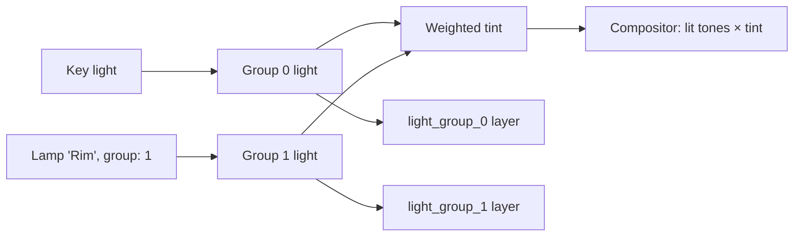

<callout icon="💡">

A hands-on walkthrough of **light groups** (M19d) and **face shadow maps** (M20 items 1–2). Each part has short steps you can follow in the preview, plus what you should see. Status is on the [Vellum Project Hub](page:qo8zh49wt3); the full reference is `docs/shots.md` in the repo.

</callout>

## Part 1 · Light groups

### The idea

With M19's coloured light, the **brightest light wins** each pixel's colour, so a warm key and a cool rim never mix. Light groups keep **one light value per group** (up to 4). Each pixel's tint is every group's colour, **weighted by how much that group lights it**. Where the warm key and the cool rim overlap, the colour blends.

The light value that cuts the palette's bands doesn't change. Groups only decide the **colour**.



### Step 1: Put lamps in groups

The key light is always in **group 0**. A lamp joins a group in one of three ways:

| Where | How |
| --- | --- |
| Shot file | `group: 1` on the lamp |
| Preview | Properties → **Light** tab → `group` row |
| Blender | Integer custom property `vellum_light_group` (0–3) on the light object or its light data |

### Step 2: Turn groups on and colour them

Add `light_groups` to the shot. As soon as it is there, groups are on:

```ron
lamps: {
    "Rim": (position: (1.8, 0.6, -1.2), radius: 6.0, group: 1),
},
light_groups: {
    0: (colour: "#ffb070"),              // warm key
    1: (colour: "#6090ff"),              // cool rim
},
```

- With groups on, colours come from the **groups**. A lamp's own `colour` is ignored.
- A group without a colour is **white**, except group 0, which takes the key's `light_colour`.
- Materials with `tint: false` stay as painted.

### Step 3: Bands or Tint

Each group has a `mode`:

<columns>

<column>

**`Bands`** (default)

The group's lamps light as lamps always have. They cut bands, add pools and draw rims, and they also colour.

</column>

<column>

**`Tint`**

The group's lamps **only colour** what other lights already lit. They never move a shadow shape, add a pool or draw a rim of their own. This is useful for a coloured fill that shouldn't change the drawing.

</column>

</columns>

```ron
light_groups: {
    0: (colour: "#ffb070"),
    1: (colour: "#6090ff", mode: Tint),
},
```

### Step 4: Relight in compositing

`vellum render` writes `light_group_0` … `light_group_3`: each group's light per pixel, in grey.

```bash
vellum render crates/vellum/tests/golden/light_groups.ron --out renders/lg --frame 0
```

To rebalance or recolour, follow these steps in your compositor:

1. Multiply each `light_group_N` layer by its colour and a gain.
1. Add them up.
1. Divide by the sum of the gained layers.
1. Use the result in place of the `tint` layer.

### ✅ Try it

- [ ] Open `crates/vellum/tests/golden/light_groups.ron` in the preview. The front should be warm, the far ear and the ground cool, and the top of the head a blend of both.
- [ ] Select **Rim**, open the Light tab and switch `group` from 1 to 0. The blue should turn warm.
- [ ] Add `mode: Tint` to group 1 and save. The rim's blue pool on the ground should vanish, and its blue should show only where the key already lights.
- [ ] Render the layers and check that `light_group_0` looks like the key alone and `light_group_1` like the rim alone.
- [ ] In Blender, give a lamp `vellum_light_group = 1` and confirm it lands in group 1.
- [ ] Open a shot without `light_groups` (for example `shots/truck_night.ron`) and confirm it looks exactly as before.

## Part 2 · Face shadow maps

### The idea

Real anime faces aren't shaded by N·L. The artist decides the shapes: a clean diagonal across the cheek, no nose blob, no lip shadow. A **face map** is a grey image painted on the face's UVs. Each texel says **how far the light may turn round the head** before that texel goes into shadow.

| Grey | Lit until the light is… |
| --- | --- |
| Black | never lit |
| Mid grey (0.5) | square to the side (90°) |
| White | straight behind (180°) |

The engine measures the key light's turn around the head, $\\text{around} = \\arccos(\\hat{l}\_{flat}\\cdot\\hat{f})/\\pi$, and lights a texel when `map > around`. Only the turn counts, not the light's height.

### Step 1: Paint the map

- Paint it **for a light on the head's left** (the head's local **+X**; the head faces local **+Z**, the way Blender exports a model facing −Y).
- When the light is on the right, the engine reads the map **mirrored** (u → 1 − u). The face's UVs must therefore be **mirror-symmetric** around the middle of the UV square.
- A common way to paint it is to work from the front (black = 0°) and sweep a gradient so each shadow shape you want appears at the right angle. Smooth gradients give clean edges.

💡 **Don't start from nothing.** Bake a starting map from a proxy ellipsoid, then paint over it:

```bash
vellum face-map character.gltf --material Face --head Head --size 1024 --out face_shadow.png
```

It gives the same clean crescent as the ellipsoid proxy, as a map. Then push the edge where the drawing wants it: a diagonal across the cheek, a triangle under the eye.

### Step 2: Point the material at it

There are three ways, and each layers over the one before it:

| Where | How |
| --- | --- |
| Blender | String material properties `vellum_face_map` (image path relative to the `.gltf`) and `vellum_face_head` (head bone or object name) |
| Shot file | `face_map: (image, head)` on the material, as below |
| Preview | Material tab → Shadow shape → **Face map** (editing the material, not the object): image with Browse…, and a head picked from the scene's nodes |

In the shot:

```ron
materials: {
    "Face": (face_map: (image: "face_shadow.png", head: "Head")),
},
```

- `image` is relative to the shot file.
- `head` names the node the face turns with (a head bone or object). Without it, or with a name that isn't found (which warns), the world's axes are used.
- `image: ""` in an overrides file removes the map.

### What it changes

- On that material, the face map **replaces N·L and the key light's cast shadows**, so the nose and lips throw no stray shapes.
- Lamps still light the face as usual.
- In 3-tone, the mid-tone reaches a tenth of a half-turn (18°) further round.

### ✅ Try it

- [ ] Open the scratchpad test shot `face_90.ron` (Suzanne with a throwaway map). Set the light's `azimuth` to 10, 50, 90 and 130. The shadow edge should sweep cleanly across the face.
- [ ] Bake a map with `vellum face-map` and render a sweep with it.
- [ ] In the preview, select the face, open Material → Shadow shape → **Face map**, browse to the map and pick the head node. The shadow should switch over live.
- [ ] In Blender, set `vellum_face_map` / `vellum_face_head` on the material, export, and check it loads with no shot settings.
- [ ] On a head with **symmetric UVs**, paint a quick map, set `head:` to the head bone, and check that turning the head turns the shadow with it.
- [ ] Move the light to the right side and check that the shadow mirrors properly.
- [ ] Add a lamp near the face and check that it still lights it, and that 3-tone still shows a mid band.

<callout background="yellow" icon="⚠️">

**Known limits for now**

- The baked map is a **stand-in**. It is baked in the rest pose, and it uses the ellipsoid fitted to the whole material, so ears widen it and the shadow reaches the face late.
- The head axes are assumed to be **+Z forward, +X left**. A Blender head *bone* may use different axes; this hasn't been verified yet.
- Suzanne's UVs aren't symmetric, so a light on her right gives nonsense with the test map. A real head is needed.

</callout>

<toggle>

How it works inside the engine

1. **Face pass** (after the G-buffer): for face-mapped materials, it writes two values to an `Rg16Float` `face` target: the map at the UV, and the map at the mirrored UV.
1. **Shade pass**: per frame, a storage buffer gets each face material's head `forward` and `left` (from the named node's world transform, orthogonalised). For each pixel, it flattens the light direction onto the head's horizontal plane, works out `around`, picks the straight or mirrored sample from `dot(dir, left)`, and compares.
1. Light groups use a fourth target, `group_light` (`Rgba16Float`). Each lamp writes into its group's channel with `max`, and the rim counts the light reaching round the edge.

</toggle>
