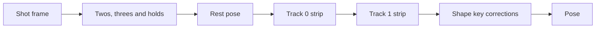

<callout icon="📌">

**Decided 2026-11-14:** a shot plays several clips as **strips on tracks**, as Blender's Nonlinear Animation editor does, with a timeline along the bottom of the window to arrange them. **Both parts are built (2026-11-14)**: M47a, strips (branch `m47a-strips`), and M47b, the timeline (branch `m47b-timeline`). The same plan is in `milestones.md` under M47. Back to [Vellum Project Hub](page:qo8zh49wt3).

</callout>

## Why

Today a shot names one clip, and it loops from frame 0 for the whole shot. There is no way to play a walk, then a wave over it, then cut to a run, and no timeline: holds and speed lines are lists in the panel.

## Where the design comes from

I read Blender's source for how its strips work (`blenkernel/intern/nla.cc`, `anim_sys.cc` and `editors/space_nla`, at commit `049750f`).

<callout background="yellow" icon="⚠️">

**Design only.** Blender is GPL and Vellum is MIT, so none of Blender's code is used. What follows is its behaviour, written fresh.

</callout>

<columns>

<column>

### Taken from Blender

- Strips on **tracks**; a higher track is applied over those below
- Frame to clip time: wrap into the clip, the end of a whole repeat showing the last pose
- Influence as a straight ramp over blend-in and blend-out
- Replace mixing: under × (1 − influence) + strip × influence
- Hold or Nothing after a strip ends
- **Auto blend**: overlapping two strips makes the cross-fade
- Mute per strip
- The editor's look: named bars, a ramp line, ticks at repeats

</column>

<column>

### Left out for now

- Blend modes besides Replace (Add, Subtract, Multiply, Combine)
- Transition and meta strips
- Playing backwards
- Using part of a clip
- Influence drawn as a curve
- Solo

All can be added later without changing the shot file.

</column>

</columns>

## M47a: clip strips

The shot gets `clips`, a list of strips. `clip: "Run"` stays as shorthand for one strip from frame 0 that repeats for the whole shot.

```ron
clips: [
    (clip: "Walk"),
    (clip: "Wave", track: 1, start: 24, repeat: 1, blend: 4, blend_out: 6, after: Nothing),
    (clip: "Run",  start: 48, blend: 6),
]
```

| Field | Meaning | Unset |
| --- | --- | --- |
| `clip` | The clip's name | required |
| `track` | Which row; 0 is the bottom | 0 |
| `start` | Shot frame it begins on | 0 |
| `speed` | Playback rate | 1 |
| `repeat` | How many times it plays; fractions allowed | for the whole shot |
| `blend` | Frames its influence ramps up over at the start | 0, a cut |
| `blend_out` | Frames it ramps down over at the end | 0 |
| `after` | `Hold` keeps its last pose; `Nothing` shows what is under it | Hold |
| `mute` | Contributes nothing | false |

A strip's end is worked out: start + clip length × repeat ÷ speed.

### How a frame is posed



- **Tracks from the bottom up.** On each, the strip the frame is in, or the one held before it.
- **Clip time** is (frame − start) × speed, wrapped into the clip's length.
- **A strip writes only the nodes its clip animates.** So a wave on the arm plays over a walk on the legs, and on the same nodes the higher track wins, as a cut or eased in.
- **Rotations blend by the shorter arc.**
- **Before its start a strip does nothing.**
- **Two strips overlapping on one track** is a mistake the loader warns of.

### Also in M47a

- [x] The shot's frame range, when it sets none, runs to the end of the last strip that ends
- [x] Added scenes' clips stay as they are: one each, looping from frame 0
- [x] The overrides file carries `clips`
- [x] The header's clip menu edits the one strip while there is one, and gives way to the timeline when there are more (until M47b it shows "3 clips" and `N` does nothing)
- [x] Manual ("Clips on tracks" in `docs/shots.md`), a sample shot (`shots/fox_strips.ron`), a golden image of a blend half way (`fox_strips_16`)
- [x] Tests: speed, repeat, the end of a repeat, influence, `after`, mute, tracks' order

<callout icon="✅">

**Built 2026-11-14.** `Strip` in `timing.rs`, read from the shot's `ShotStrip` by `shot::strips`; `Clip::blend` mixes a clip over the pose by an influence. A full influence writes the values exactly as before, so every older golden image is unchanged. Decided while building: a strip that blends out has faded to nothing by its end, so it holds nothing after it. Not yet checked in the window: the header with several strips.

</callout>

## M47b: the timeline

A strip along the bottom of the window in every tab, that folds away.

- [x] **Ruler and playhead:** click or drag to scrub, the frame in a box; the shot's frame range as a bracket to drag
- [x] **Clips rows**, a track each: a bar per strip with its name, a line for its influence ramp, ticks where it repeats, grey when muted
- [x] **Dragging:** a bar to move its start (snapping to frames and to other bars' ends), up or down to change track, its right edge to change how often it repeats
- [x] **Right-click:** speed, blend, after, mute, remove. **Add** lists the scene's clips
- [x] **Auto blend:** overlapping a strip on the track above or below sets the blend to the overlap; a blend set by hand is kept
- [x] **Holds** and **Speed lines** rows: bars for what the panel lists now
- [x] Added scenes' clips shown as bars that can't be moved
- [x] In the Paint tab it sits under the studio's angle strip

<callout icon="✅">

**Built 2026-11-14** in `timeline.rs`: a bottom panel under the view, sized to its rows. Its edits go into the overrides (`clips`, `frames`, holds, and a new `speed_lines`), so Undo takes back a whole drag and Save keeps it. Auto blend gives only the higher strip a blend; if the one under faded too, the rest pose would show through mid cross-fade. Checked by screenshot in Layout and in Paint with the studio open; dragging is tested through egui's input events but **not yet tried by hand**. Not done: zoom and pan, dragging a strip's left edge, selecting several bars.

</callout>

No keyframe editor: keys stay in Blender.

## M47c: the timeline, second round

<callout icon="📌">

**Planned 2026-11-14**: playback in the timeline, a ruler that zooms, and ways to bring animations onto it. About three sessions; the parts stand alone and go in this order. Full list in `milestones.md` under M47c.

</callout>

| Part | What | Size |
| --- | --- | --- |
| Playback in the timeline | Back, play, forward, jump to start and end, the frame box and the clip menu move from the view's header into the timeline's header row, which stays when folded. Shift+← and Shift+→ jump to the range's ends | A quarter of a session |
| A ruler that zooms | Ctrl+wheel zooms about the pointer, wheel and middle-drag pan, Home fits the shot; pages on while playing | Half a session |
| A clip shelf | The scene's clips down the timeline's left; drag one onto a track (a ghost bar shows where), or double-click for the playhead | Half a session |
| Clips from another file | Add → Clips from file… loads a glTF's animations by node name, so actions on the same rig come in without re-exporting the model. A new `animations` list in the shot. No retargeting | About a session |
| From Blender's NLA | The add-on writes the scene's NLA tracks into the shot's `clips`, so an arrangement made in Blender opens arranged | Half a session |

Left out: retargeting between skeletons, editing keys, FBX or BVH except through Blender.

<callout icon="✅">

**Built 2026-11-14:** playback in the timeline and the zooming ruler. The buttons, frame box and clip menu moved from the view's header into the timeline's header row; Shift+← and Shift+→ jump to the range's ends. The playhead is a hairline with its frame on its head, dragged from anywhere along it. The wheel zooms about the pointer (as Blender's), Shift+wheel or a middle-drag pans, and Home or a fit button shows the whole shot. Next: the clip shelf, clips from another file, Blender's NLA.

</callout>

## Order and size

M47a first, since the timeline has nothing to show without strips. About one session for M47a, one to two for M47b.

<toggle collapsed=true>

Blender's strip fields, for reference

| Blender | Meaning | Vellum |
| --- | --- | --- |
| start, end | Where the strip sits | `start`; end worked out |
| action start, end | Part of the clip used | left out |
| scale | Time stretch (2 is half speed) | `speed`, the other way up |
| repeat | Times the clip plays | `repeat` |
| reversed | Plays backwards | left out |
| blend in, blend out | Influence ramps | `blend`, `blend_out` |
| blend mode | Replace, Add, Subtract, Multiply, Combine | Replace only |
| extrapolation | Hold, Hold Forward, Nothing | `after`: Hold or Nothing |
| muted | No contribution | `mute` |
| auto blend | Blends set from overlaps | in the timeline |

</toggle>
