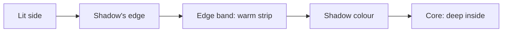
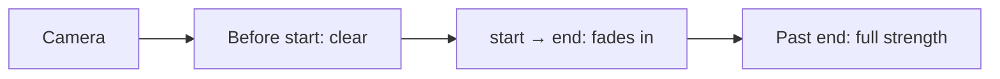
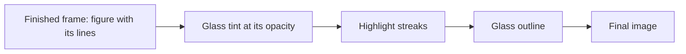

<callout icon="📘">

**The Vellum user manual:** how to use the engine's features, written for artists and anyone driving the app. Each chapter covers one feature: what it's for, how to set it up in a shot file, in the window and from Blender, and what to watch out for. Engine internals live in the [Vellum Project Hub](page:qo8zh49wt3) and the technical notes.

</callout>

## Chapters

1. **Light linking**: make a lamp, or the key light's cookie, affect only chosen materials and objects.
1. **Edge bands, core shadows and SSS**: paint a warm strip along a shadow's edge, or a darker core inside it, for the look of light scattering under skin and cloth.
1. **Distance haze**: let far things fade into the background, as the air does in a painted background, while the figure in front stays clear.
1. **Glass**: windows, visors and bottles drawn as anime draws glass: a flat tint with highlight streaks and its own outline, over what's behind.
1. **Contact shadows**: a painted shadow where things meet, so a figure stands on the ground instead of floating.
1. **Painted reflections**: chrome, eyes and windows that reflect a painted image, cut into the material's own tones.
1. **Painted backdrop**: a background painting behind everything, as a plate fixed to the frame or a panorama that pans with the camera.
1. **The Outliner and History**: find, rename, hide and lock what's in the scene, undo, and bring back what you deleted.
1. **Highlight shapes**: design a material's highlights as shapes, such as the band of light across anime hair, a star in an eye or a gleam pinned to a cheek, instead of one round glint.
1. **Edge highlights**: ink the edges that face the light in a bright colour, as cel mecha catch light along their bevels.
1. **Water**: anime water on any mesh, from a preset: steps of colour by depth, foam where things meet it, drifting waves, sparkles, refraction and a mirror of what's above it.
1. **Emission and the painted shine**: make a material glow in its own colours or an image, and turn the soft shine VRoid paints on hair into hard cel highlights.
1. **Face shadow maps**: draw a face's shadow, or any mesh's, as a designed shape (a clean diagonal across the cheek, no specks from the nose, lips or hair) that sweeps with the light. Covers baked maps, shadow maps on any mesh, drawn keys, and the shadow map studio with its brushes, stamps and UV view.
1. **Speed lines**: ink strokes over the frame for the frames you name, closing in on a point or streaking across, flickering as drawn ones do.
1. **Mirrors**: a wet street or polished floor that reflects what stands on it, softened and smeared as anime paints it.

More chapters will be added here as the manual grows.

---

## Light linking

Light linking makes a light reach some things and not others: a rim light on one character only, a warm spot on the hero that leaves the set alone, or leaf-dappled light on a character while the ground stays plain.

<callout icon="💡">

**It works with names.** You give a light a name like `"Character"`, and give the same name to the materials or objects it should reach. Names are any text you like, and one scene can use up to 23 of them.

</callout>

### The rules

| The light | Reaches a linked material | Reaches an unlinked material |
| --- | :-: | :-: |
| Lamp **with** `links: ["Character"]` | ✅ if it shares a name | ❌ |
| Lamp **without** links | ✅ | ✅ |
| Key light's cookie **with** `links: ["Character"]` | ✅ dappled | ❌ gets the key light whole |
| Key light's cookie **without** links | ✅ | ✅ |

- A lamp with no links lights everything, exactly as before linking existed. Linking a material never stops the unlinked lamps from lighting it.
- `links: []` takes links away again, on a lamp, a material, an object or a cookie.
- An object's links cover all of its materials. A material's links cover it wherever it's used.

### Set it up in a shot file

Put the same name on the light and on what it should reach. This is a rim light that only touches the character:

```ron
Shot(
    scene: "my_scene.glb",
    lamps: {
        "Rim": (
            position: (0.0, 3.0, -2.0),
            colour: "#9fc4ff",
            links: ["Character"],      // lights only what is linked to "Character"
        ),
    },
    objects: {
        "Body": (links: ["Character"]),
        "Face": (links: ["Character"]),
        "Hair": (links: ["Character"]),
    },
)
```

The same keys work in a `.overrides.ron` file, which the window writes when you save.

### Set it up in the window

1. **Select the lamp**, open the **Light** tab and type names into the **links** row, separated by commas.
1. **Select the object** and open the **Material** tab. Type the same names into **light links** under Light bands.
1. Press **Enter** or click away to apply. Edits show in the view at once and can be undone.
1. **Save** with Ctrl+S to keep them in the overrides file.

### Set it up from Blender

Add a string custom property **`vellum_links`** (names separated by commas, e.g. `hero, sidekick`) to the light, and the same property to the material or mesh object it should reach. glTF can't carry Blender's own light linking, so this property stands in for it.

### Dapple only the character with a linked cookie

A cookie is a grey image the key light projects, such as leaf shadows. Linking it puts the dappled light on the character while everything else, like the ground, gets the key light without the pattern.

```ron
Overrides(
    cookie: Cookie(
        image: "../assets/textures/leaf_cookie.png",
        scale: 3.5,
        soften: 0.1,
        links: ["Character"],         // the leaves fall only on "Character"
    ),
    objects: {
        "Body": ObjectOverrides(links: ["Character"]),
        "Face": ObjectOverrides(links: ["Character"]),
        "Hair": ObjectOverrides(links: ["Character"]),
    },
)
```

In the window, the cookie's names go in the **links** row under the cookie's **drift** in the **Render** tab.

<callout icon="📌">

**Only the key light's cookie takes links of its own.** A spot's cookie always follows the spot's own `links`, so to limit a spot's cookie, link the spot. Giving a spot's cookie `links` shows a warning saying so.

</callout>

### Limits

<callout background="yellow" icon="⚠️">

**Links don't change shadows.** A linked lamp's shadows still fall on what it lights, cast by every object, linked or not.

</callout>

- **The key light and the fill can't be linked.** They always light everything. Only the key light's **cookie** takes links.
- **Up to 23 names** per scene. Names past that link nothing, and the window says so.

<toggle>

Warnings you may see, and what they mean

- **"light link "X": no material or object has it, so its lamps light nothing (and a cookie linked to it falls on nothing)"**: a lamp or cookie uses a name that no material or object has. Check the spelling, or add the name to what it should reach.
- **"light link "X": no lamp or cookie links to it"**: a material or object has a name that nothing uses. Harmless, but usually a typo.
- **"lamp "Spot" cookie: links are for the key light's cookie; a spot's cookie follows the spot's own links"**: move the names from the spot's cookie to the spot itself.
- **"N light link names: only the first 23 by name link anything"**: too many names in one scene. Reuse names across lamps.

</toggle>

<toggle>

Tips

- Use **one name per role** (`"Character"`, `"Set"`, `"Props"`) rather than one per object. It keeps you well under 23 and makes shots easy to read.
- A **rim or kicker light on the character only** is the classic use: link it to the character so it doesn't flare on walls and floors behind.
- To check what a lamp reaches, set its `colour` to something loud like `"#ff00ff"` for a moment.

</toggle>

---

## Edge bands, core shadows and SSS

Anime shadows are rarely one flat tone. Skin often has a warm, saturated strip just inside the shadow's edge, where light seems to glow through, and a large shadow may darken deeper inside. Vellum paints both by **distance from the shadow's edge**, so they follow every edge in the frame: cast shadows, cookie patterns, lamp pools, proxy normals and painted vertex shadow.

This is how to fake **subsurface scattering (SSS)** in the cel look: a thin warm band where light turns to shadow reads as light passing under the surface.

<callout icon="💡">

**The short version for SSS:** set `edge_band` narrower than the shadows it sits in, keep `band_blur` at about a quarter of it, pick an `edge` colour clearly warmer or brighter than the shadow, and keep the light **cel**, not soft.

</callout>

### The settings

| Setting | What it does | Default |
| --- | --- | --- |
| `edge_band` | Width of the strip along the inside of the shadow's edge, painted in the `edge` colour | 0 (off) |
| `core_shadow` | Deeper inside the shadow than this, it's painted in the `core` colour | 0 (off) |
| `band_blur` | How wide the blend out of the edge band and into the core is | 0 (crisp) |
| `band_space` | `Screen`: widths in pixels of a 1080p frame. `Object`: centimetres on the surface | `Screen` |
| `edge` | The band's colour, as `"#rrggbb"` | Derived: the base turned warm, halfway to the shadow |
| `core` | The core's colour | Derived: the shadow, darker and a little richer |

Set them on a material or an object (an object's settings cover all its materials). With `Screen`, a band keeps its drawn width as the camera zooms, and 6 means 12 pixels at 4K. With `Object`, it grows and shrinks with the object, which suits small details like a face.



### Set it up in a shot file

A warm SSS rim on a character's skin and sweater, with a narrow band on the face:

```ron
Overrides(
    objects: {
        "Body": ObjectOverrides(
            edge_band: 8.0,          // 8 px at 1080p
            band_blur: 2.5,          // about a third of the band
        ),
    },
    materials: {
        "Sweater": Look(
            shadow: "#aaa3cf",
            edge: "#e8b3c4",         // warm pink against a lavender shadow
        ),
        "Skin": Look(
            shadow: "#e59a8c",
            edge: "#f0907c",         // soft red-orange
        ),
        "Face Skin": Look(
            shadow: "#e59a8c",
            edge: "#ff7466",
            edge_band: 1.2,          // centimetres: the face's shadows are small
            band_blur: 0.4,
            band_space: Object,
        ),
    },
    soft_key: SoftKey(on: false),    // bands need a cel key light
)
```

Use your scene's real material and object names; these are examples.

### Set it up in the window

1. **Select the object** and open the **Material** tab.
1. Open the **Bands** section. Drag **edge band** (and **core shadow** if you want a core). Their rows appear as soon as a width is above 0.
1. Set **blur**, choose **measured**: *screen* or *object*, and pick an **edge colour** (and **core colour**).
1. Edits show in the view at once. **Save** with Ctrl+S.

`V` cycles the views to **shadow distance**, which shows exactly where the edges are: shadow in blue, light in orange, the edge white, with a contour every 8 pixels. Use it when a band doesn't show where you expect.

### Set it up from Blender

Custom properties on the material: `vellum_edge_band`, `vellum_core_shadow` and `vellum_band_blur` (numbers), `vellum_band_space = "object"` for centimetres, and `vellum_edge` / `vellum_core` (`"#rrggbb"`) for the colours.

### Why can't I see my edge band?

The band is almost always there, just hidden. Check these in order:

<callout background="yellow" icon="⚠️">

**1. Its colour matches the shadow.** Without an `edge` colour, the band's colour is derived from the base and shadow. On a white or pale material with no shadow colour set, that comes out barely different from the shadow. **Set `edge` explicitly**, or at least set a `shadow` colour so the derived one has contrast. A quick test: set `edge: "#ff00ff"` and look again.

</callout>

<callout background="yellow" icon="⚠️">

**2. The band is wider than the shadow.** A band wider than the shadow it sits in fills the whole shadow, so you see a recoloured shadow instead of a strip. Small shadows, like a hand's shadow on a face, need narrow bands: a few pixels, or about **1 cm in `Object` space**. Keep the band under about **half the width** of the shadow.

</callout>

<callout background="yellow" icon="⚠️">

**3. The blur is as wide as the band.** `band_blur` blends the strip out. At or above the band's width, with no core shadow, it smears into a faint tint over the whole shadow. Keep blur at about **a quarter to a third** of `edge_band`. Vellum warns about this.

</callout>

<callout background="yellow" icon="⚠️">

**4. The light is soft.** Bands follow the **cel** shadow edge. Under the soft key (`soft_key`) or a strong soft lamp, the visible shading is a smooth gradient that doesn't turn where that edge is, so the band lands where the surface looks lit. Turn the soft key off (`soft_key: SoftKey(on: false)`) or set `soft: false` on the lamp. A weak soft lamp (below 0.5 strength) is fine. Vellum warns about this too.

</callout>

### What to expect

- **Only the shadow side gets bands.** In 3-tone, the mid-tone counts as lit, so the band sits at the mid-tone to shadow edge.
- **Silhouettes and borders between objects aren't shadow edges,** so a shadow running off the edge of a shape keeps its core instead of getting a band.
- **On textured materials,** a hand-picked `edge` colour multiplies the texture, like a hand-picked shadow does. A bright magenta on a green leaf comes out dark purple, so pick colours with the texture in mind.
- **Distances are measured up to 128 pixels** at 1080p. Anything farther from an edge counts as deep, so a wholly shadowed object is all core.
- **Cost:** the shadow-distance pass only runs when a material uses bands, and then costs about 4.7 ms at 1080p on an Intel HD 620.
- **Compositing:** `vellum render` writes the bands as their own `edge` and `core` layers.

<toggle>

Warnings you may see, and what they mean

- **"… (band\_blur X is as wide as edge\_band Y): the band smears into a faint tint over the whole shadow instead of a strip along its edge"**: lower `band_blur` to about a quarter of `edge_band`. With a `core_shadow` set, a wide blur is a deliberate soft gradation into the core, so there's no warning.
- **"…: edge and core bands follow the cel shadow edge, but the soft key shades a gradient that doesn't turn there"** (or "a soft lamp"): make the light cel, as in point 4 above.

</toggle>

<toggle>

Recipes

- **Skin SSS:** `edge` a saturated red-orange a little brighter than the skin's shadow (e.g. shadow `#e59a8c`, edge `#f0907c` to `#ff7466`); band 6–8 px on the body, about 1 cm in `Object` space on the face; blur a quarter to a third of the band.
- **Cloth glow:** on a pale fabric with a cool shadow, a warm pink edge (`#e8b3c4` on lavender `#aaa3cf`) reads as sunlight bleeding through.
- **Deep shadow on large forms:** `core_shadow` around 14–48 px with a darker `core`, plus a wide `band_blur` for a soft gradation inside the shadow.
- **Dappled light:** bands follow cookie shapes too, so each leaf-shaped patch of light gets its own warm rim. Combine with a linked cookie (see *Light linking*) to keep it on the character.

</toggle>

---

## Distance haze

Haze is the air between the camera and what's far away. In anime backgrounds, distant buildings, trees and hills are painted paler and closer to the sky's colour, so the figure in front pops and the set recedes. Vellum paints this from each surface's distance to the camera: the farther something is, the more it fades into the haze colour.

<callout icon="💡">

**Haze belongs to the world, not the lens.** You set it once for the shot (World tab), and every camera sees it from where it stands, so the far mountains stay just as hazy when you cut between cameras. A camera only changes it when one shot needs a cheat, like a close-up that shouldn't haze its subject.

</callout>

### The settings

| Setting | What it does | Default |
| --- | --- | --- |
| `colour` | What far things fade into, as `"#rrggbb"` | The background's colour, so things fade into what's behind them |
| `start` | Distance from the camera where haze begins, in scene units (metres for most scenes) | Twice the scene's radius |
| `end` | Distance where it reaches full strength | Six times the scene's radius |
| `strength` | How much it covers at `end`: 0 none, 1 hides what's there | 0\.7 |
| `steps` | Flat bands of haze instead of a smooth ramp, like painted backgrounds: 3 gives three bands | 0 (smooth) |
| `on` | `false` turns a shot's haze off | On when `haze` is set |



### Set it up in a shot file

A street that fades into a pale blue sky, with the fox in front staying clear:

```ron
Shot(
    scene: "street.glb",
    background: (colour: "#c9d8e8"),           // the haze takes this colour unless set
    haze: (start: 4.0, end: 30.0, strength: 0.7),
)
```

Painted bands instead of a smooth fade:

```ron
    haze: (start: 4.0, end: 30.0, strength: 0.8, steps: 3),
```

### Set it up in the window

1. Open the **World** tab (the globe) and find the **Haze** section (the cloud).
1. Setting **any** value turns haze on. Drag **start** and **end** until the figure is clear and the far set fades, then set **strength**.
1. Pick a **colour** only if you want something other than the background's.
1. Untick **on** to switch it off without losing the values. The section's reset clears everything.
1. **Save** with Ctrl+S.

### Cheat it for one camera

A shot camera can change `start`, `end` or `strength` for its own shot; everything else keeps the world's haze.

```ron
    cameras: {
        "Close": (
            eye: (0, 1.5, 2), target: (0, 1.4, 0),
            haze: (start: 10.0),               // push it back: the close-up's subject stays clear
        ),
    },
```

In the window: select the camera, open its **Camera** tab and set the values under **Haze**. Unset rows show the world's values.

<callout icon="📌">

**Which camera's haze is used:** the view uses the camera you're looking through; **F12**, **Render Animation** and `vellum render` use the **active camera** (the one renders look through). Cameras from the glTF can't take their own haze; add a camera in the window (Add → Camera) if a shot needs a cheat.

</callout>

### What to expect

- **Ink fades too.** Haze covers colour and lines alike, so far lines go pale as in a painted background. Glows dim behind it as well.
- **The background gets none.** Only surfaces are hazed; the world behind everything stays as set.
- **Fade into the background.** If the haze colour differs from the background, the horizon shows a seam where the far ground meets it. The default (the background's colour) avoids that.
- **Distances are in scene units.** A model in centimetres (like the Fox on its own) needs start and end in centimetres too.
- **Compositing:** `vellum render` writes a `haze` layer (colour over transparency) to lay over the `line` layer. It's written only when the shot has haze.
- **Cost:** about 1.5 ms a frame at 1080p on an Intel HD 620, and nothing when off.

<toggle>

Recipes

- **Summer street:** background a pale sky blue, `start` just past the figure, `end` at the far buildings, `strength` 0.6–0.7.
- **Night city:** background a deep navy, `strength` 0.4–0.5, so neon still reads through the haze but the far blocks sink into the dark.
- **Painted look:** `steps: 3` or `4`, so the set falls into flat value bands like layered background paintings.
- **Close-up:** give the close-up camera a `haze` `start` beyond its subject, so only the far background fades.

</toggle>

<toggle>

Warnings you may see

- **"haze colour "X" is not #rrggbb"**: write the colour as six hex digits, like `"#c9d8e8"`.
- **"haze: end E isn't past start S, so it starts all at once"**: `end` must be farther than `start`; otherwise the haze jumps straight to full strength at `start`.

</toggle>

---

## Glass

Glass in anime isn't a reflection; it's drawn. Usually it's a pale tint laid over what's behind it, a couple of hard white streaks across it, and a line around it. Vellum draws glass that way. A figure behind a window keeps its own shapes and lines, just tinted, and the window gets streaks and an outline of its own.

<callout icon="💡">

**Glass is opt-in per material.** Nothing changes until you mark a material as glass. Alpha-blended materials from Blender stay cut out (hair cards, leaves) unless they carry `vellum_glass`.

</callout>

### The settings

| Setting | What it does | Default |
| --- | --- | --- |
| `opacity` | 0 clear to 1 solid | The base colour's alpha; 0.3 if that was fully opaque |
| `streak` | How bright the two diagonal highlight streaks are, 0 none to 1 solid | 0\.6 |
| `shadows` | `Off`: none. `Solid`: as if it weren't glass. `Tinted`: the key light through it takes its colour | `Off` |
| `on` | `false` makes it solid again | On once `glass` is set |

The tint comes from the material's own colours: its **base** where the key light reaches the pane, its **shadow** colour on the side turned away. The streaks use its **highlight** colour, and the outline its **line** colour, so you colour glass the same way as anything else.



### Set it up in a shot file

```ron
Shot(
    scene: "room.glb",
    materials: {
        "Window": (
            base: "#bfe3ff",                 // the tint
            glass: (opacity: 0.3, streak: 0.7),
        ),
        "Visor": (glass: ()),                // glass with the defaults
    },
)
```

`glass` also works on an **object** (`objects: { "Bottle": (glass: (opacity: 0.4)) }`), but that makes **every** material on the object glass, frame and all. For a window with a frame, set it on the pane's material.

### Set it up in the window

1. **Select the object** and open the **Material** tab. Pick the pane's material at the top if the object has several.
1. Open the **Glass** section and tick **glass**.
1. Set **opacity** and **streaks**, and pick **shadows**: *off*, *solid* or *tinted*. The tint is the **Colours** section's base.
1. Click the glass in the view to select it again later; clicks land on glass before what's behind it.
1. **Save** with Ctrl+S.

### Set it up from Blender

1. In the material's **Settings**, set **Blend Mode** to **Alpha Blend**. The Base Color's **Alpha** becomes the opacity.
1. Add the custom property **`vellum_glass`** = `1`.
1. Optional: `vellum_glass_streak` (0 to 1), and `vellum_glass_shadows`: `1` for a solid shadow, `"tinted"` (or `2`) for tinted light.
1. **Unwrap the pane corner to corner.** The streaks run diagonally across the UVs, so a pane whose UVs fill 0 to 1 gets two clean streaks. A pane without UVs gets none.

### What to expect

- **What's behind keeps its lines.** The glass is laid over the finished picture, so a figure behind it keeps its own ink, tinted.
- **Glass in front of glass** tints twice where the panes overlap, and the near pane's outline is drawn over the far one.
- **Haze** covers glass by its own distance, like everything else.
- **Compositing:** `vellum render` writes a **`glass`** layer, the glass alone over transparency, to lay on top of everything else (above `haze`).
- **Cost:** about 2.2 ms a frame at 1080p on an Intel HD 620, plus about 1.5 ms when some glass tints the light, and nothing in shots without glass.

### Coloured light through glass

With `shadows: Tinted`, light passing through the glass takes its colour. An amber pane throws an amber patch on the floor behind it, and anyone standing in that patch is lit amber.

```ron
    materials: {
        "Stained": (base: "#ff9a3c", glass: (opacity: 0.5, shadows: Tinted)),
    },
```

- **Only lit tones are tinted.** It works like a coloured lamp: the lit side takes the colour, while shadows (including a figure's own shadow inside the patch) stay as painted.
- **The more opaque the glass, the stronger the colour.** Clear glass at 0.2 gives a faint wash; 0.5 and up reads as stained glass.
- It works for the **key light** only, and the **nearest pane** to the light sets the colour.

<callout background="yellow" icon="⚠️">

**Current limits.** Glass is sorted per object, so two overlapping panes in **one** object can draw out of order; split them into separate objects. A far pane's edges hidden behind a near pane aren't outlined. Tinted light comes from the **key light only**, through the nearest pane; lamps don't see glass yet, and with **light groups** on the tint is left out.

</callout>

<toggle>

Recipes

- **Shop window:** base a pale cool blue (`#bfe3ff`), opacity 0.25–0.35, streak 0.6–0.8. Leave shadows off so the shop's floor stays lit.
- **Helmet visor:** a darker tint (`#4a5a78`), opacity 0.6, streak 1.0 for a sharp glint.
- **Bottle or jar:** set it on the object if the whole thing is glass; opacity 0.4, and a `shadow` colour a little deeper than the base, so the side turned from the light reads.
- **Tinted car window:** opacity 0.7 with a dark grey base, so the driver is a silhouette with their lines just showing.

</toggle>

---

## Contact shadows

When the key light is high or behind, a figure's cast shadow can all but vanish, and it seems to float. Animators fix that with a small dark shape where things touch: under the feet, in the gap beneath a car, where a cup stands on a table. Vellum paints the same thing. Wherever a point is closed in by surfaces near it, it's pushed into its **shadow tone**, as a flat shape like any other shadow.

<callout icon="💡">

**It's a shadow, not a smudge.** Contact shadows go through the same bands as everything else, so they take each material's own shadow colour, and its edge band and core if it has them. There's no grey ambient-occlusion haze.

</callout>

### The settings

| Setting | What it does | Default |
| --- | --- | --- |
| `radius` | How far round each point to look, in scene units: wider spreads the shadow further from where things touch | A sixth of the scene's radius |
| `threshold` | How closed in a point must be to turn to shadow, 0 to 1: lower spreads it, higher keeps it to tight corners | 0\.3 |
| `darkness` | How far towards the shadow tone: 1 all the way, 0.5 the mid-tone in 3-tone | 1 |
| `on` | `false` turns a shot's contact shadows off | On once `contact` is set |
| `contact: false` (on a material or object) | Keeps them off that material: eyes, glowing things | Every material takes them |

### Set it up in a shot file

```ron
Shot(
    scene: "street.glb",
    contact: (radius: 0.5, threshold: 0.3),
    materials: { "Eyes": (contact: false) },
)
```

### Set it up in the window

1. Open the **World** tab and find **Contact shadows**. Setting any value turns them on.
1. Press **V** until the view shows **contact**: how closed in each point is, white open and black enclosed. Raise **radius** until the dark reaches as far from the feet as you want.
1. Back on the finished view (**V** again), move **threshold** until the shape is right. **Darkness** 0.5 gives a softer mid-tone version in 3-tone.
1. To keep them off a material, select it and untick **contact shadows** in the Material tab's **Surface** section.
1. **Save** with Ctrl+S.

From the command line, `vellum render shot.ron --frame 12 --view contact --out c.png` writes the contact view as a still.

### What to expect

- **Inside corners darken on both sides.** At the foot of a wall, both the ground and the bottom of the wall turn to shadow, as an inside corner does in drawings.
- **Only what the camera sees counts.** It's measured from the picture's depth, so something just out of frame or hidden behind another object doesn't cast a contact shadow.
- **Close-ups reach at most 48 pixels.** Past that, the shadow stops growing, to keep it cheap.
- **Cost:** about 5 ms a frame at 1080p on an Intel HD 620, about a quarter of that at the preview's usual size, and nothing when off.

<toggle>

Recipes

- **Characters on a floor:** radius about a foot's length (0.2–0.3 for a human in metres), threshold 0.3.
- **Vehicles:** radius a little more than the gap under the body (0.5–1 m for a car or train), so the whole underside reads as one shape.
- **Soft look in 3-tone:** darkness 0.5, so contact lands on the mid-tone rather than the full shadow.
- **Busy interiors:** raise the threshold to 0.4–0.5 so only the tightest corners darken.

</toggle>

---

## Painted reflections

Anime doesn't render reflections; it paints them. Chrome gets bold bands of sky and ground, an eye holds a little picture of the window or sky, and a car door shows a streak of skyline. Vellum lets a material reflect **a painted image** that way. The image is read by the direction a view ray bounces off the surface, then its greys are cut into the material's own tones: light greys become the lit colour, dark ones the shadow colour.

<callout icon="💡">

**It's cel metal with your own picture.** Without a reflection, `metallic` bands a surface by an imagined sky and ground. A reflection does the same with an image you painted, so a hero's armour can reflect the actual street they're standing in. Like metal, it **slides across the surface as the camera moves**, which is what makes it read as shiny.

</callout>

### The settings

| Setting | What it does | Default |
| --- | --- | --- |
| `image` | The picture it reflects, relative to the shot file. `""` takes it away | None |
| `space` | `World`: a panorama of the world round it, which stays put as the camera moves. `View`: a matcap, a picture of a lit ball, which turns with the camera | `World` |
| `strength` | 1 replaces the lighting's bands; below 1 mixes towards them | 1 |
| `colours` | 0 uses only the image's greys, so the palette paints it. 2 or more also tints the lit tones with the image's colours, posterised to that many levels | 0 |
| `turn` | Degrees to turn a panorama round the up axis, to bring a part of it into view | 0 |

### When to use it, and which kind

Reach for a reflection where anime **paints** one rather than working it out: chrome and polished armour, eyes, a car's body, a blade. It is not for a wet street that should hold the neon and the figure standing in it; that needs the scene itself, which a painted image never shows. Use a **mirror** for that (see the Mirrors chapter).

<columns>

<column>

**`World` (panorama)**

For anything that sits in a place: a car, armour, a helmet. The reflection belongs to the surroundings, so it slides as the camera or the object moves.

</column>

<column>

**`View` (matcap)**

For a look that should hold whatever the camera does: an eye's painted sparkle, a stylised chrome that always reads the same. The image is a picture of a ball lit the way the surface should look.

</column>

</columns>

<callout icon="🚀">

**Try it in a minute.** Open any shot, select a curved object and its material, and in **Reflection** pick `assets/textures/sky_panorama.png`. Orbit to watch the bands slide, then drag **turn** to bring the sun round to the side you see.

</callout>

- **Too strong?** Lower `strength`: at 0.5 the picture and the lighting's own shading are mixed half and half.
- **Palette or picture?** Leave `colours` at 0 while the palette should paint the surface; raise it to 2–4 when the picture's own colours belong there, as the sky's blue in an eye.
- **On water** a reflection is drawn as strips broken by the waves instead of bands, and stands in for the sky where the water's mirror finds nothing. See the Water chapter.

### Painting the image

- **A panorama** (`World`) is a wide image, twice as wide as tall: left to right goes once round you, the top is straight up, the middle row is the horizon, the bottom is straight down. Any equirectangular image works.
- **Paint in flat areas whose greys sit clearly apart**: a mid-grey sky, a light horizon and sun, a dark ground. Then the reflection reads as clean bands rather than noise.
- In 2-tone the cut is at 50% grey; in 3-tone at a third and two thirds.
- `assets/textures/sky_panorama.png` is a ready-made one: blue sky, a white horizon, a skyline with lit windows, a warm street and a sun. `make_sky_panorama.py` beside it shows how it was painted.

### Set it up in a shot file

```ron
Shot(
    scene: "hero.glb",
    tones: Three,
    materials: {
        "Armour": (base: "#b8c4d6", reflection: (image: "textures/street_panorama.png")),
        "Eyes": (reflection: (image: "textures/sky_panorama.png", colours: 4)),
    },
)
```

### Set it up in the window

1. **Select the object**, open the **Material** tab and pick the material.
1. Open the **Reflection** section and click the **folder** next to *image* to pick the picture.
1. Choose **panorama** or **matcap**, and set **strength**, **colours** and **turn**.
1. Orbit the camera: the reflection slides across the surface.
1. **Save** with Ctrl+S. A Save As to another folder re-points the image for you.

### Set it up from Blender

Add the custom property **`vellum_reflection`** to the material, naming the image relative to the glTF. Optional: `vellum_reflection_space` = `"view"` for a matcap, `vellum_reflection_strength`, `vellum_reflection_colours` and `vellum_reflection_turn`.

### What to expect

- **Shadows still win.** A reflective surface in a cast shadow is painted in shadow, as metal is.
- **Curved surfaces show it best.** A flat panel reflects one direction and comes out as one flat band. Bevels, spheres and Suzanne-like shapes read well.
- **Solid materials only, for now.** See-through glass keeps its own highlight streaks and doesn't read a reflection image yet.
- **It reflects the picture, not the scene.** Other objects don't show up in it. For a wet street that reflects what stands on it, use a **mirror** instead (see the Mirrors chapter).
- **Cost:** about nothing. Shots without reflections compile them out of the shading entirely.

<toggle>

Recipes

- **Chrome:** a pale cool base (`#b8c4d6`), 3-tone, the sky panorama, `colours: 0`. The palette's highlight and rim still sit on top.
- **Anime eye:** `colours: 3`–`4` so the iris holds the sky's blue and a light window shape. Keep `contact: false` on eyes too.
- **Car paint:** a coloured base with `strength: 0.6`, so the body colour and its shading still read under the street reflection.
- **Bring a feature into view:** use `turn` to swing the panorama until the sun or a bright window lands where you want the glint.

</toggle>

---

## Painted backdrop

In anime, the characters are drawn cels laid over a **background painting**. Vellum can do the same: instead of a flat colour, a painting fills everything behind the scene. A painting on a mesh plane catches light, cast shadows and ink lines; a backdrop never does.

<callout icon="💡">

**Two ways to lay it.** A **plate** is fixed to the frame like a painted background, and stays put when the camera moves. A **panorama** wraps round the whole scene, so it pans and tilts as the camera turns, like a skybox. One panorama can also be what a chrome material reflects (see *Painted reflections*).

</callout>

### The settings

They sit on the shot's `background`, beside its colour.

| Setting | What it does | Default |
| --- | --- | --- |
| `image` | The painting, relative to the shot file. `""` takes it away | None (the flat colour) |
| `space` | `Screen`: a plate fixed to the frame, scaled to cover it and centred. `World`: a panorama round the scene | `Screen` |
| `turn` | Degrees to turn a panorama round the up axis | 0 |
| `brightness` | Multiplies the painting: 0 black, 1 as painted; past 1 it glows under bloom | 1 |

### Set it up in a shot file

A station painting behind the train, fixed to the frame:

```ron
Shot(
    scene: "station.glb",
    ground: false,
    background: (image: "backgrounds/station.png"),
)
```

A city panorama that the camera can turn to look around:

```ron
    background: (image: "backgrounds/city_panorama.png", space: World, turn: 40),
```

### Set it up in the window

1. Open the **World** tab. In **Background**, click the **folder** next to *image* and pick the painting.
1. Choose **plate** or **panorama**. For a panorama, drag **turn** until the part you want is behind the subject.
1. Press **G** to hide the helper ground if it covers the lower half of the painting.
1. **Save** with Ctrl+S.

### Painting it

- **A plate** can be any size and shape. It's scaled to cover the frame and cropped evenly, so keep what matters near the middle.
- **A panorama** is twice as wide as it is tall: left to right goes once round, the top is straight up, the middle row is the horizon. `assets/textures/sky_panorama.png` is an example.
- Match the painting's light to the scene's key light, so the drawn objects sit in it.

### What to expect

- **Haze fades into the painting.** Unless the haze sets its own colour, far things fade into the backdrop's colour: a panorama's horizon, or a plate's average. That keeps a distant building from standing out against the sky behind it.
- **Shadows don't land on it.** It's a painting, not geometry. Keep a ground mesh (or the helper ground) where objects need to cast shadows.
- **Compositing:** `vellum render` writes a **`backdrop`** layer, the painting where nothing is drawn, to put under every other layer.
- **Orthographic cameras** look along one direction, so a panorama shows a single colour; use a plate with them.
- **Cost:** nothing in shots without one.

---

## The Outliner and History

The **Outliner** (top of the right-hand panel) lists everything in the scene in one list: the **Sun** (the key light) first, then the objects, lamps and cameras in the order the file has them. **History**, in the menu bar beside File, is where you undo and bring back what you deleted.

<callout icon="💡">

**Hiding and locking are for working, not for the shot.** The eye and the arrow only change what you see and can click in the window. Renders still draw everything, and neither is saved: they reset when you reopen the file.

</callout>

### Each row

| Part | What it does |
| --- | --- |
| Icon | What it is: box for an object, zap or target for a point or spot lamp, sun for the key light. A camera's icon is a button: click it to look through that camera |
| Name | Click to select it, as clicking it in the view does. Double-click to rename |
| 👁 Eye | Hides it from the view. A hidden lamp also stops lighting the view. The Sun's eye hides only its icon; the key light stays on |
| ↖ Arrow | Dimmed, clicks in the view pass it by: it can't be selected or dragged there. The Outliner can still select it |

Right-click a row for **Rename**, **Delete**, and for cameras **Set active camera** and **Look through**.

<callout icon="💡">

**Names show without their paths.** Some exporters name a mesh or material after the file it came from, like `..\..\textures\tron_tree_02__leaves`. The Outliner and the Properties title show only the part after the last `\` or `/` (`tron_tree_02__leaves`). Hover the row to see the full name. A name too long for the panel is cut short with "…", so the panel keeps its width and the view's navigation buttons stay in their corner. Overrides still use the full name, so nothing in the shot file changes.

</callout>

### Rename

1. **Double-click** the row, press **F2** with it selected, or right-click → **Rename**.
1. Type the new name. **Enter** or clicking away keeps it; **Esc** cancels.
1. Clear the field to go back to the name from the file.
1. For a name with a path, the field starts from the short name, and keeping it saves the short name as the row's label.
1. **Save** with Ctrl+S.

<callout icon="📌">

**A new name is only for the window.** It's stored in the overrides file under `labels`, and shows in the Outliner, History and the header's camera picker. The glTF and the shot file still call it by its own name, so overrides, shot files and Blender properties keep using that. Objects with no name in Blender can't be renamed.

</callout>

```ron
Overrides(
    labels: { "Wheels.001": "Rear wheels", "Spot": "Neon spill" },
)
```

### History

- **Undo** (Ctrl+Z) and **Redo** (Ctrl+Shift+Z or Ctrl+Y) cover every edit the window makes, renames included.
- **Deleted** lists what you took out of the shot. Click one to restore it exactly as it was.

| Deleted with X or Delete | What happens | Back from |
| --- | --- | --- |
| An object from the glTF | Marked `deleted`; the glTF keeps it | History |
| A lamp the window added | Moved to `deleted_lamps` in the overrides | History |
| A camera the window added | Moved to `deleted_cameras` in the overrides | History |
| A lamp from the shot or Blender | Switched off instead (only its file can remove it); stays in the Outliner, greyed | Its **on** row in the Light tab |
| A camera from the shot or glTF | Can't be deleted here | — |
| A model placed with Add to shot | Removed as a whole | Undo |

Restoring a camera that was the active camera doesn't make it active again: pick it again with right-click → **Set active camera**.

### Choices are dropdowns

Every setting with two or more options, such as a backdrop's *plate* or *panorama*, glass shadows, a reflection's *panorama* or *matcap*, and the header's *2-tone* or *3-tone*, is a dropdown. Hover the dropdown to see what the chosen option does, or hover an option in the open list. **T** still switches the bands.

<toggle>

Tips

- **Lock the set, work on the character:** turn off the arrow on the floor, walls and props, so clicks in the view only pick up the character.
- **Check one lamp at a time:** hide the others with their eyes. Their light goes too, so you see that lamp's pool alone.
- **Long image paths** show only the file name in the panel. Hover it for the whole path.

</toggle>

---

## Highlight shapes

By default a material's highlight is one round glint, sized by `roughness`. Anime draws highlights as **designed shapes**: a ring of light across hair with a jagged edge, a four-point star in an eye, a crescent on a cheek. `highlights` gives a material up to four such shapes in place of the glint.

<callout icon="💡">

**Shapes are measured in degrees, not centimetres.** Each shape sits on the sphere of directions around the object. A pixel is in the highlight when the way its surface faces falls inside the shape. That suits rounded forms: heads, hair, eyes and bottles. A flat face points one way, so a shape covers all of it or none of it.

</callout>

### The settings

| Setting | What it does | Default |
| --- | --- | --- |
| `shape` | `Circle`, `Box`, `Star`, `Crescent`, `Band` or `Mask` (a painted grey image, with `image`) | `Circle` |
| `anchor` | What its centre follows. `Light`: the key light's glint, sliding as the light or camera moves. `View`: always facing the camera. `Object`: pinned to the object's front (+Z), turning with it | `Light` |
| `around`, `up` | Degrees off the anchor: round the object's up axis, then towards it | 0 |
| `turn` | Degrees the shape turns about its own centre; a band tilts | 0 |
| `size` | `(across, up)` in degrees. A `Band` 360 across rings the object | 20 × 20; a band 360 × 8 |
| `teeth` | `(count: 14, depth: 0.6)`: a zig-zag edge, along a band's or box's long edges or round other shapes | None |
| `round`, `points`, `bite` | A box's corners (0 square to 1 round), a star's points, a crescent's bite (0 to 1) | 0\.3, 4, 0.5 |
| `lit_only` | Only where the key light reaches | On, except for `View` |

`highlights: []` takes the highlight away entirely; leaving `highlights` out keeps the glint. Shapes are painted in the material's **highlight** colour, into the one `highlight` layer.

### Set it up in a shot file

```ron
materials: { "Hair": (highlights: [
    // The hair band: level round the head, 20° above the glint, zig-zagged.
    (shape: Band, up: 20.0, size: (360.0, 10.0), teeth: (count: 14, depth: 0.6)),
]) },
```

```ron
materials: { "Eyes": (highlights: [
    // A star that always faces the camera, in shadow too.
    (shape: Star, points: 4, anchor: View, around: -25.0, size: (14.0, 14.0)),
]) },
```

### Set it up in the window

1. Select the object, open the **Material** tab and open **Highlights** (after Surface).
1. Until something sets a list, it says the round glint is in use. Click **Add shape** to start with a circle on the glint.
1. Each shape has its own rows: shape, follows, around, up, turn, size, teeth, its own setting, and lit only. The **×** removes it.
1. **None** removes the highlight. The section's reset goes back to the shot's shapes, or to the glint.
1. **To place a shape by clicking:** press its **target** button, then click the model where the highlight should sit. Keep the mouse button down and drag to size it and turn it by the drag's angle (a band takes its height from the drag). Release to finish, or press **Esc** to stop without placing. A `Light` shape is placed from where the light and camera are at that moment, so it still slides as they move. Try it in `shots/highlights.ron`.
1. **Save** with Ctrl+S.

### What to expect

- **Bands stay level.** A band is measured round the object's up axis, so it runs across the head however the camera turns. It tilts with the head when the head tilts.
- **Shared materials:** an `Object` shape turns with the last object drawn with that material. If two objects share a material and turn apart, give each object its own highlights under `objects`.
- **Water uses them too:** on a water material the waves break these shapes into sparkles (see *Water*).

<toggle>

Recipes

- **Anime hair band:** `Band`, `up` 15–25, `size` (360, 8–12), `teeth` (12–18, 0.5–0.7). Proxy normals (`proxy: Ellipsoid`) on the hair give the band a clean, rounded path.
- **Eye gleam:** `Star` or a small `Circle` with `anchor: View`, offset with `around` and `up` so it sits in the upper part of the iris.
- **Bottle streak:** a tall thin `Box` (size 4 × 60) on the `Light` anchor.
- **A shine painted on and pinned:** `anchor: Object` with `around` and `up` placing it, so it stays put as the light moves.

</toggle>

---

## Edge highlights

Cel mecha and hard-surface designs catch light along their edges: the top of a panel's bevel shines while the edges turned away stay inked. `edge_highlight` draws that. Inner lines on edges that face the key light are inked in the material's **highlight** colour instead of dark.

### The setting

| Setting | What it does | Default |
| --- | --- | --- |
| `edge_highlight` | How far an edge can turn from the light and still catch it: 0 off, 0.5 edges within 60° of the light, 1 every edge on the lit half | 0 (off) |

It works on creases, panel lines, bevel lines and material borders. Outlines stay dark, and edges inside a cast shadow stay dark. Coloured light tints the bright edges, as it tints highlights.

### Set it up

```ron
materials: { "Hull": (bevel_lines: true, edge_highlight: 0.5, highlight: "#f4f8ff") },
```

- **In the window:** the Material tab's **Inner lines** section has an **edge highlights** slider.
- **From Blender:** the custom property `vellum_edge_highlight` (0 to 1) on the material.

### What to expect

- **It needs inner lines to work on.** Use it with `panel_lines` or `bevel_lines` on hard surfaces, or with creases.
- **The `lines` view** (press `V`) shows edge highlights in gold, so you can see which edges catch the light.
- **Layers:** the `line` layer carries the highlight colour on those edges, so layers still stack back into the final frame.

---

## Water

Anime water isn't simulated; it's painted. It shows steps of colour from pale shallows to deep blue, a white band where it meets the shore, sparkles, drifting ripple lines and a broken mirror of what stands above it. `water` makes any material look like that: a plane for a pond or the sea, a river mesh, or a puddle decal.

<callout icon="💡">

**Start from a preset, then change what you want.** `water: (preset: River)` sets everything at once, and any setting beside it overrides the preset's value. `water: ()` is the `Pond` preset. To see it working, open `shots/pond.ron` (the Fox standing in a script-built pond) and press **Space**: the waves only move while the clock runs.

</callout>

### The presets

| Preset | Looks like |
| --- | --- |
| `Pond` | Still, clear-ish green-blue, soft foam (the defaults) |
| `River` | Quicker, teal, carried one way, a little choppy |
| `Ocean` | Deep blue, big choppy waves, broken pulsing surf |
| `Puddle` | A thin film over the ground: mostly a mirror, with an inked edge |
| `Pool` | Bright, clear, strongly refracting, no foam |
| `Stream` | A clear stream over rocks: a cyan cast over the bed that keeps each stone's own light and shadow, and white ribbons along the flow, gathering over shallow stones, on threes |

### The settings

| Group | Setting | What it does |
| --- | --- | --- |
| Colour | `shallow`, `deep` | Colours by depth, `"#rrggbb"` |
|  | `depth` | How deep (scene units) it turns fully `deep` |
|  | `bands` | Flat steps between them (1 is one flat colour) |
|  | `band_wobble` | How much the waves move the steps' edges |
| See-through | `clarity` | How see-through the shallowest step is, 0 to 1 |
|  | `murk` | How much deep water hides what's under it: 1 the deepest step is solid, 0 as clear as the shallowest |
|  | `refraction` | How far the waves bend what's seen through it, 0 to 1 |
|  | `tint` | `Over`: laid over what's under it, washing it towards the water's colour. `Multiply`: a colour cast on it that keeps its own light and shadow, like a coloured cel over a background painting |
| Streaks | `streaks` | White foam ribbons over the open surface, along the flow: how much they cover (0 none) |
|  | `streak_width`, `streak_stretch` | How wide a ribbon is, and how long it draws out along the flow |
|  | `streak_branching` | How much they wander, split and join |
|  | `streak_wrap` | How much they ring whatever breaks the surface |
|  | `streak_softness` | 0 a hard trailing edge, 1 fading out like a brush stroke |
|  | `streak_gather`, `streak_depth` | Ribbons gather where something is close under the surface (within `streak_depth`) and thin over deep water: 0 everywhere alike, 1 only there |
|  | `streak_opacity`, `streak_halo`, `streak_colour` | How solid they are, a pale band of the water's colour round each, and their colour |
| Foam | `foam`, `foam_colour` | The band where anything meets it, in scene units (0 none) |
|  | `foam_breakup` | 0 a clean band, 1 scattered |
|  | `foam_line` | The thin second shore line, in foam widths out (0 none) |
|  | `foam_pulse` | How much the foam pushes in and out with the waves |
|  | `shore_line`, `shore_colour` | An ink line where it meets things, in 1080p pixels (0 none) |
| Waves | `waves` | How far they tilt the surface |
|  | `wave_size`, `wave_speed` | Wave width and drift per second |
|  | `wave_direction` | Which way they drift, in degrees |
|  | `flow` | `World` (the surface's plane: ponds, the sea) or `Uv` (along the mesh's UVs: rivers, waterfalls) |
|  | `chop` | 0 rounded swells, 1 sharp choppy crests |
|  | `wave_step` | Clock frames each wave drawing holds: 2 is on twos |
| Ripples | `ripples`, `ripple_colour` | Lines along the wave crests, 1080p pixels (0 none) |
|  | `ripple_density` | How many lines a wave carries |
| Reflection | `mirror` | How strongly it mirrors what's on screen above it, upside down and broken by the waves: 0 none, 1 a clear mirror |
|  | `glance` | Where the reflection gets stronger: 0 everywhere, 1 only edge-on |
| Light | `shadows`, `shadow_colour` | The key light's cast shadows fall on it, multiplying it by this colour |

### Set it up in a shot file

```ron
materials: { "River": (
    highlight: "#ffffff",            // the sparkles' colour
    roughness: 0.1,                  // a small glint, which the waves break into sparkles
    water: (preset: River, wave_direction: 90.0, flow: Uv),
) },
```

### Set it up in the window

1. Water isn't selected by clicking it in the view. Click its object in the **Outliner**, then open the **Material** tab.
1. Open **Water** and tick **water**. Pick a **preset**: choosing one starts over from its settings.
1. Every setting has its own row with a reset. **Highlights** shapes the sparkles, and **Reflection** can give it a painted sky.
1. Press **Space** to see the waves, refraction and foam move. Orbit down towards the water to see the mirror; from high above, reflections are small.
1. **Save** with Ctrl+S.

### Set it up from Blender

Add the custom property **`vellum_water`** = `1` to the material. That gives the `Pond` defaults; a shot sets the rest.

### What to expect

- **Depth is measured from the surface to whatever is drawn behind it,** so the colour steps follow the floor and shelve up to the shore. The same distance puts foam wherever something meets the water: the shoreline, a rock, a character's legs.
- **The mirror only shows what's on screen.** Something above the top of the frame isn't mirrored. Where nothing is found, the scene's own sky shows at half strength, or the material's painted reflection if it has one.
- **Water isn't solid.** It casts no shadow, has no outline and isn't clicked in the view. What's under it keeps its own lines, tinted and bent.
- **Layers:** water goes into the `glass` layer, without the refraction bend or the mirror.

<callout background="yellow" icon="⚠️">

**Current limits.** Only the key light's shadows fall on water; lamps' don't yet. Glass behind water draws over it. There are no splashes yet. `flow: Uv` needs a mesh with UVs; without them, the waves fall back to the surface's plane.

</callout>

<toggle>

Recipes

- **Calm pond with a figure in it:** `Pond`, `mirror` 0.5–0.7, `foam` about a hand's width at the figure's scale (0.04–0.08 m).
- **River down a valley mesh:** `River` with `flow: Uv`, `wave_direction` 0 (downstream along +U), `wave_speed` 1–2.
- **Beach surf:** `Ocean`, `foam` 0.15–0.3, `foam_pulse` 0.6–0.9, `foam_line` 2.5.
- **Rainy street puddle:** `Puddle` on a thin decal mesh just above the ground, `mirror` 0.8–0.9, `shore_line` 1–1.5.
- **Swimming pool:** `Pool`, `refraction` 0.6–0.8, `ripples` 1.0 and `ripple_density` 7–10 for the bright lines across the tiles.
- **Clear stream over rocks:** `Stream`, with `highlights: []` on the material so the waves don't break a glint into sparkles. Point `wave_direction` downstream. Raise `streak_gather` towards 1 so the white water sits only over shallow stones, or lower `streaks` for a calmer stream. Try `shots/stream.ron`.

</toggle>

---

## Emission and the painted shine

**Emission adds light on top of a material as it's shaded.** Its cel light and shadow stay underneath, but the added light isn't shadowed, and past white it glows under bloom. That's different from **unlit**, which replaces the shading with the flat base colour.

|  | Unlit | Emission |
| --- | --- | --- |
| What it does | Paints the whole material flat in its base colour | Adds light over the shaded material |
| Where | Evenly over the material | Anywhere, or per pixel through an image |
| Shadows | None | Kept underneath; the added light isn't shadowed |
| Brighter than white | With `glow` | Past strength 1 |
| Good for | Screens, signs, a flat cartoon look | Lit windows, neon, glowing eyes |

### The settings

| Setting | What it does | Default |
| --- | --- | --- |
| `emission`, `emission_strength` | The light added, `"#rrggbb"`, and how strong; past 1 it glows | From Blender or glTF; black is none |
| `emission_image` | What colours it, multiplied by `emission`. `Base`: the material's own base-colour texture, so it glows in its painted colours. `File("textures/glow.png")`: another image. `Off`: no image, so the colour is even | The model's own emissive texture |
| `emission_highlight` | Cuts the emissive texture into a **hard cel highlight** in the material's `highlight` colour, only where the key light reaches, instead of adding it as light: how bright the texture must be, 0 to 1 | 0 (off) |

<callout icon="💡">

**For VRoid characters:** VRoid paints the hair's shine as soft white blobs in its emission map, so the hair glows softly, even in shadow. Set **`emission_highlight` to about 0.3** on the hair materials and that shine becomes hard anime highlights exactly where VRoid put them, on the lit side only. A lighter shade of the hair colour as `highlight` reads best. You don't need a highlight band on top: the hair already has its shine.

</callout>

### Set it up in a shot file

```ron
materials: {
    "Billboard": (emission: "#ffffff", emission_strength: 1.5, emission_image: Base),
    "N00_000_Hair_00_HAIR_01 (Instance)": (emission_highlight: 0.3, highlight: "#f2d7c0"),
},
```

VRoid names its hair materials `N00_000_Hair_00_HAIR_01 (Instance)` and similar; the Outliner and the Material tab show them. Set the shine on each.

### Set it up in the window

1. Select the object and open the **Material** tab, then the **Emission** section.
1. **image** picks what colours the emission: *model's*, *base colour*, *file* (then the folder button to pick it) or *none*. Picking an image on a material with black emission makes the emission white, so the image shows.
1. **painted shine** cuts the emissive texture into a highlight. Raise it until only the brightest parts of the painted shine are left.
1. **Save** with Ctrl+S.

### From Blender

Plug an image into the Principled BSDF's **Emission Color** and set the strength: glTF exports it as the emissive texture, and Vellum reads it. A shot then sets `emission_image` or `emission_highlight` on top.

### What to expect

- **A cut texture isn't light any more:** with `emission_highlight` on, the texture no longer glows or feeds bloom; it's a highlight.
- **Only where lit:** the painted shine follows the key light's cast shadows, like any highlight.
- **The face test:** in the VRoid test, angular light patches on the cheek came from light through gaps in the hair's cast shadow, not from emission. A face map on the face material fixes that (see the Light Groups and Face Maps tutorial).

---

## Face shadow maps

Anime faces aren't shaded by the light falling on the geometry. The artist decides the shadow's shape: a clean diagonal across the cheek, a small triangle of light under the far eye, nothing from the nose or lips. A **face map** (also called an SDF threshold map) lets you design that shape once and have it move believably as the light turns round the head.

<callout icon="💡">

**What the map is:** a grey image painted on the face's UVs. Each pixel says **how far round the head the light may turn before that pixel falls into shadow**. Vellum measures the key light's turn each frame and lights a pixel while the map is brighter than the turn. As the light swings round, the shadow sweeps across the face along the edges you painted.

</callout>


### What the greys mean


| Grey | 0–255 | Lit until the light has turned… |
| --- | --- | --- |
| Black | 0 | never lit |
| Quarter grey | 64 | 45° from the front |
| Mid grey | 128 | 90°: square to the side |
| Three-quarter grey | 191 | 135° |
| White | 255 | 180°: straight behind |

To find the grey for an angle, divide the angle by 180 and multiply by 255. Paint the values as you see them, because Vellum reads back exactly what you painted. Only the light's turn round the head counts, not its height.

<columns>

<column>

**Paint it for a light on the head's left.** That's the head's local +X. The head faces local +Z, which is how Blender exports a model facing −Y.

</column>

<column>

**A light on the right reads it mirrored** (u → 1 − u), so the face's UVs must be **mirror-symmetric** about the middle of the UV square. VRoid faces already are.

</column>

</columns>

### Step 1: Get symmetric UVs

- **VRoid and most VRM avatars:** already symmetric. Skip this step.
- **Your own head in Blender:** model half the face with a **Mirror** modifier (X axis, with **Mirror U** turned on), unwrap that half, then apply the modifier. Both halves then share mirrored UVs about u = 0.5.
- **A quick check:** a light on the right should give the mirror image of a light on the left. If it gives nonsense, the UVs aren't symmetric. Suzanne's aren't, for example.

### Step 2: Find the head and the face material

1. Open the model in the preview with logging on:

```sh
RUST_LOG=info vellum-preview character.vrm
```

The log names the **humanoid head bone**. For VRoid it's `J_Bip_C_Head`. For a Blender character, use the head bone or the head object's name.

1. Find the **face material** in the Outliner or the Material tab. For VRoid it's `N00_000_00_Face_00_SKIN (Instance)`. Only the skin gets the map: brows, eyelines and the mouth are separate materials and keep their own look.

### Step 3: Bake a starting map

Don't start from a blank canvas. Vellum can bake the clean crescent an egg-shaped head would get:

```sh
vellum face-map character.vrm --material "N00_000_00_Face_00_SKIN (Instance)" \
    --head J_Bip_C_Head --size 1024 --out face_shadow.png
```

It works on a `.gltf`, `.glb`, `.vrm` or a shot file, in the rest pose. On its own it already gets rid of the specks from the nose, lips and hair, so it's usable as it is. The rest of the chapter is about making the shape your own.

<callout icon="✅">

**Or let Vellum bake it for you.** `shadow_map: (image: "auto")`, or **Bake from shape** in the Shadow map section, bakes this same map every time the model loads, with no file to keep. **VRoid faces get it automatically**, so a VRoid character's face is already clean with nothing set up. Bake a file only when you want to paint over it.

</callout>


### Step 4: Paint your shape

Open `face_shadow.png` in Krita, Photoshop or any paint program, ideally with the face's UV layout as a guide layer. There are two ways to work.

<columns>

<column>

**A · Push the gradient**

Paint over the baked map with soft brushes:

- **Lighten** an area so it stays lit longer as the light goes round, like the far cheek's triangle of light.
- **Darken** an area so it falls into shadow sooner, like the side of the nose or under the cheekbone.

Smooth gradients give a shadow edge that glides as the light turns.

</column>

<column>

**B · Draw a shape for each angle**

Think like a key animator. Draw the lit area you want at a few light angles, say 30°, 60°, 90° and 120°, then stack them:

1. Fill everything lit at 30° with the grey for a bit past 30° (about 50).
1. On top, fill what's lit at 60° (about 92), then 90° (about 135), then 120° (about 177).
1. Each angle's lit area must sit **inside** the one before it.

</column>

</columns>

Way B gives an exact drawing at each angle you chose, but the edge **jumps** between them as the light moves. That's fine for held poses and a light that doesn't move. For a light that sweeps, blur the steps slightly, or blend them into a gradient by hand. That blend is what "SDF" tools automate: they measure each pixel's distance to each shape's edge and grade smoothly between the shapes. Vellum doesn't have one built in yet.

<callout background="yellow" icon="⚠️">

**Grow every shape from the lit side.** A bright patch standing alone, with darker map all round it, lights up as a **floating dot** before the main lit area reaches it. Keep the map getting steadily darker from the lit edge of the face towards the far side.

</callout>

### Step 5: Put it on the material

Each of these layers over the one before it:

| Where | How |
| --- | --- |
| Blender | String material properties `vellum_face_map` (the image, relative to the `.gltf`) and `vellum_face_head` (the head node) |
| Shot file | `face_map: (image, head)` on the material, as below |
| Window | Material tab → **Shadow shape** → **Face map** (editing the material, not the object): Browse… for the image, and pick the head from the list |

```ron
materials: {
    "N00_000_00_Face_00_SKIN (Instance)": (
        face_map: (image: "face_shadow.png", head: "J_Bip_C_Head"),
    ),
},
```

`image` is relative to the shot file. `image: ""` takes the map away again.

### Step 6: Check it with a light sweep

Render the face with the light at a few angles and look at them side by side:

```ron
Shot(
    scene: "character.vrm",
    camera: "Close",
    cameras: { "Close": (eye: (0, 1.40, 0.75), target: (0, 1.38, 0), fov: 22) },
    tones: Two,
    light: (azimuth: -70.0, elevation: 25.0),   // try -70, -35, 0, 35, 70
    materials: { "N00_000_00_Face_00_SKIN (Instance)": (face_map: (image: "face_shadow.png", head: "J_Bip_C_Head")) },
)
```

- [ ] The shadow edge sweeps across the face in one clean line, with no dots.
- [ ] At +70 you see the mirror image of −70.
- [ ] Turning the head (in a pose or an animation) carries the shadow with it.
- [ ] A lamp near the face draws the same shape, and 3-tone still shows a mid band.


In the window, save the image and the map reloads live, so you can paint and look at the same time.

### What to expect

- **It replaces the key light on that material:** both N·L and cast shadows. The nose, lips and hair throw nothing on the face, which is the point. Cel lamps draw the map's shape too, and soft lamps light it as usual.
- **3-tone:** the mid tone reaches 18° further round than the shadow.
- **VRM 0.x avatars** (most VRoid exports) face backwards inside the file. Vellum turns them round and reads their head the right way, so nothing is needed from you.
- **The baked map is a stand-in:** it's baked in the rest pose, from an egg shape fitted round the whole material, so the ears widen it and the shadow reaches the face a little late.
- More detail is in the [Light Groups and Face Maps Tutorial](page:7vycdx4qsy), Part 2.

### Beyond faces: shadow maps on any mesh

The same map works on any mesh: a hand, a fringe swept to one side, a cape, a prop. The setting is called **`shadow_map`** now; `face_map` still works. Two settings make it fit things that aren't faces:

| Setting | What it does | Default |
| --- | --- | --- |
| `mirror` | **On:** half the light's turn, read mirrored for the other side. Needs symmetric UVs. **Off:** the whole turn, so any UVs work. The map then has two channels (red and green) | on |
| `axis` | **`Up`:** the light going round the object, as round a face. **`Side`:** the light rising over it and falling behind, for things lit mainly from above or below. Round the side, the map always covers the whole turn | `Up` |

```ron
"Hand": (shadow_map: (image: "auto", head: "Hand.R", mirror: false)),
"Cape": (shadow_map: (image: "auto", head: "Spine", axis: Side)),
```


- **In the window:** the Material tab → Shadow shape → **Shadow map** has **axis** and **mirror** rows.
- **From Blender:** the material properties `vellum_shadow_mirror` (off is false or 0) and `vellum_shadow_axis` (`"Side"`).
- **Baking:** `vellum face-map … --no-mirror --axis side` bakes either kind to paint over, and `image: "auto"` bakes it on load.

<callout icon="💡">

A whole-turn map is harder to paint by hand, because red holds where the lit turn is centred and green how wide it is. Draw keys instead (below), and Vellum builds either kind of map for you.

</callout>

### Drawing keys instead of painting a gradient

Instead of painting the grey gradient, draw a few plain **black-and-white masks**, one per light angle: white where the mesh is lit when the light is there. Vellum works out the gradient in between, so at each angle the shadow edge is exactly where you drew it, and between angles it moves smoothly from one drawing to the next. This is how studios build "SDF" face maps.

1. **Write starting keys** cut from the baked shape:

```sh
vellum shadow-map keys character.vrm --material "N00_000_00_Face_00_SKIN (Instance)" \
    --angles 0,45,90,135 --out face.shadowmap.ron
```

This writes `face.shadowmap.ron` and a `face_keys/` folder with one mask per angle (`000.png`, `045.png`…).


1. **Draw over the masks** in any paint program, in pure black and white. For example, add a lit triangle under the far eye in `090.png`, and it appears on the shadowed cheek as the light reaches the side.


1. **Point the material at the keys file.** Vellum builds the map on load:

```ron
"N00_000_00_Face_00_SKIN (Instance)": (shadow_map: (image: "face.shadowmap.ron")),
```

1. **Keep drawing.** Save a mask and the window rebuilds the map straight away.

<callout icon="💡">

**Rules that keep it clean:**

- **Mirrored maps** (the default) take angles from 0° (front) to 180°. Each key's lit area is clipped to sit inside the previous key's, so a patch can't light up on its own.
- **Whole-turn maps** (`mirror: false` on the material and in the keys file) take angles all the way round, 0° to 360°, at least two of them.
- **Paint past the UV islands' edges** where the surface should stay lit, because an island's edge counts as a shadow's edge.
- `vellum shadow-map build face.shadowmap.ron` writes the finished map as an image, if you want a plain PNG.

</callout>

### The shadow map studio

The studio does all of this in the window, so you design while watching the model.


1. Select the object, open the **Material** tab → **Shadow shape** → **Shadow map**, and press **Design…**. If the material has no keys yet, Vellum writes starting keys beside your shot and points the material at them.
1. **Drag along the strip** at the bottom of the view to swing the light round the face (or whatever the material's node is), from 0° in front. The diamonds are your keys; the marker snaps to them.
1. **Sweep** turns the light round and round. **Other side** puts the light on the right, to check the mirrored half. **Map view** shows the map itself on the model, with a line every 15°, and the line under the strip tells you what the map holds under the cursor.
1. Where the shadow should look different, stop at that angle and press **Add key**. Vellum cuts a mask from the map as it is now, in the keys folder named under the strip. Open it in a paint program, draw where it's lit in white, and save: the map rebuilds in a moment.
1. **Or paint on the model.** At a key, pick a brush in the strip: **Light** paints where it's lit, **Shadow** where it's dark, and **Smooth** rounds off jagged edges. Drag on the face; `[` and `]` change the brush size. When you let go, the shadow updates. With **Other side** on, you paint the half the light from the right uses. **Ctrl+Z** takes the last stroke back.
1. **Stamp the classic shapes.** The strip's **Stamp** row has **Cheek triangle** (the lit triangle on the shadowed cheek), **Nose wedge** and **Line** (a thin stroke of shadow, as under the eye). At a key, click the face to put one down, or keep the button down and drag to size it and turn it the way you drag.
1. **Paint flat in the UV view.** **UV view** opens the key's mask laid flat, with the mesh's UV edges drawn in red over it. Paint and stamp there for edges that must sit exactly against a seam. It shows the mask as it really is, so Other side doesn't mirror it.
1. **Remove key** takes out the key you're at (its file stays). **Done** or Esc closes the studio and gives the key light back to the shot. Press **Ctrl+S** to keep the material pointed at the keys.

<callout icon="💡">

While the studio is open, the light you see is the studio's, not the shot's: nothing about the shot's light is changed or saved.

</callout>

---

## Speed lines

A drawn shot lays ink strokes over a fast move or a moment of focus. **`speed_lines`** does the same: sets of lines over the frame, each on the frames you name, so a shot can open on streaks and cut to focus lines.

<callout icon="💡">

**Nothing to paint.** Every line is worked out from its place, so the lines are sharp at any frame size, and they are **redrawn every couple of frames** so they flicker the way hand-drawn ones do. Pause, and they hold still.

</callout>

<columns>

<column>

**`Radial`**

Wedges closing in on a point from the frame's edges, with a clear middle. For focus, shock and zooms.

</column>

<column>

**`Parallel`**

Streaks across the frame at an angle. For motion: a run, a dash, a fall.

</column>

</columns>

### The settings

| For | Setting | What it does | Default |
| --- | --- | --- | --- |
| Both | `frames` | The first and last frame it shows on, as `(first, last)` | The whole shot |
|  | `kind` | `Radial` or `Parallel` | `Radial` |
|  | `density` | How many places there are for a line: round the centre, or up the frame's height | 90 radial, 40 parallel |
|  | `cover` | The share of those places that hold a line, 0 to 1 | 0\.6 |
|  | `weight` | A line's width at its widest, as a share of its place | 0\.5 |
|  | `taper` | How much of a line narrows to a point: 0 blunt, 1 all of it | 0\.6 |
|  | `colour`, `opacity` | `"#rrggbb"`, and how solid | Black, 1 |
|  | `step` | Redrawn every this many frames; 0 never | 2 (on twos) |
|  | `seed` | Another number draws another set | 0 |
|  | `behind` | Drawn only where nothing is, so the objects stand in front | `false` |
| Radial | `centre` | Where the lines point: across and down the frame, 0 to 1 | `(0.5, 0.5)` |
|  | `clear` | The radius round the centre kept clear, in frame heights | 0\.3 |
|  | `ragged` | How unevenly the lines stop short of the clear middle, 0 to 1 | 0\.5 |
| Parallel | `angle` | Degrees the streaks are turned anticlockwise from level | 0 |
|  | `length` | A streak's length, in frame widths | 0\.5 |

### Set it up in a shot file

```ron
Shot(
    scene: "../assets/models/fox/Fox.gltf",
    clip: "Run",
    frames: (0, 36),
    speed_lines: [
        (frames: (0, 17), kind: Parallel, behind: true),
        (frames: (18, 36), centre: (0.5, 0.45)),
    ],
)
```

That is `shots/speed_lines.ron`: open it in the preview and press Space. Edit the file and save while the preview runs to see a change.

<callout icon="⚠️">

**Shot file only, for now.** The window has no section for speed lines yet, and they can't be set from Blender.

</callout>

### What to expect

- **They start and end on a cut.** Frames are on the shot's 24 fps clock, as holds are; nothing fades in.
- **`behind` goes by what's drawn.** Every object stands in front, the helper ground included, so over a ground the lines show only above its horizon. Use `ground: false`, or leave `behind` off, to run them over everything. Glass and water don't count: lines show through them.
- **Four sets at once.** A shot with more showing on one frame says so and leaves the later ones out.
- **Post takes them** like the rest of the frame: they get the grade and the grain, and white lines brighter than the glow's threshold glow.
- **Their own layer.** `vellum render` writes them alone as `effect`, on top of the stack in a layered PSD, in shots that set any.
- **The centre is a place on the frame**, not an object: if the subject moves across the frame, the lines don't follow it yet.

<toggle collapsed=true>

Recipes

- **Focus on a face:** `Radial`, `centre` on the face, `clear: 0.4`, `ragged: 0.3` for an even ring.
- **Shock:** `Radial` with `density: 140`, `cover: 0.8`, `weight: 0.7`, `clear: 0.25`, on for 6 to 8 frames.
- **A dash to the right:** `Parallel`, `angle: 0`, `behind: true`, `length: 0.7`, with `ground: false` so they fill the frame.
- **A fall:** `Parallel`, `angle: 90`.
- **White lines on a dark shot:** `colour: "#ffffff"`; lower `opacity` if they glow too much.
- **Held, not flickering:** `step: 0`.

</toggle>

---

## Mirrors

A **mirror** makes a material reflect what the frame shows: the figure, the neon and the lit windows upside down in a wet street, lines and all. Where a painted reflection shows a picture you made, a mirror shows the scene.

<callout icon="💡">

**Wet ground in one word.** `mirror: ()` on the street's material is wet ground as it comes: half strength, a little soft, dragged down the frame, cut into four flat steps and darker. Every setting below only adjusts that.

</callout>

### The settings

| Setting | What it does | Default |
| --- | --- | --- |
| `strength` | How much of the reflection shows: 0 none, 1 a mirror | 0\.5 |
| `blur` | How soft it is: 0 sharp | 0\.3 |
| `smear` | How far it is dragged down the frame, as wet ground is painted | 0\.4 |
| `levels` | The flat steps its brightness is cut into; 0 leaves it as drawn | 4 |
| `darken` | How much darker than what it mirrors | 0\.25 |
| `glance` | Where it shows: 0 at every angle, 1 only seen edge-on | 0\.3 |
| `on` | `false` takes off a mirror the material came with |  |

### Set it up in a shot file

```ron
Shot(
    scene: "../assets/models/neon-corner/NeonCorner.gltf",
    ground: false,
    materials: {
        "Street": (mirror: ()),
    },
)
```

`shots/wet_street.ron` is the neon corner after rain: open it in the preview.

### Set it up in the window

1. **Select the floor**, open the **Material** tab and pick its material.
1. Open the **Mirror** section and tick **mirror**.
1. Set **strength** first, then **smear** and **blur** for how wet it looks.
1. **Save** with Ctrl+S.

### Set it up from Blender

Add the custom property **`vellum_mirror`** = `1` to the material, or tick it in the Vellum panel's **Mirror** section. Optional: `vellum_mirror_strength`, `vellum_mirror_blur`, `vellum_mirror_smear`, `vellum_mirror_levels`, `vellum_mirror_darken` and `vellum_mirror_glance`.

### What to expect

<callout icon="⚠️">

**Only what's on screen can be mirrored.** A sign above the top of the frame has no reflection, and neither has the back of anything. Towards the frame's edges the reflection fades out instead of ending in a hard line.

</callout>

- **The helper ground can't mirror.** It has no material to set, and it can lie over your own floor and hide it. Give the scene a floor and set `ground: false`.
- **The sky or backdrop shows** where the reflection finds nothing drawn, a little weaker.
- **Glass and water aren't mirrored**, and don't mirror this way: they are drawn afterwards. Water has its own `mirror` setting.
- **Flat or gently curved surfaces read best.** A bumpy one mirrors in fragments.
- **The surface keeps its own shading** underneath: shadows and lines still show through at lower `strength`.
- **Its own layer.** `vellum render` writes it alone as `reflection`, over `haze` and under `glass`.
- **Cost:** about 16 ms of a 128 ms frame at 1080p on an Intel HD 620. Shots without a mirror skip it.

<toggle collapsed=true>

Recipes

- **Wet street at night:** `mirror: ()`, with a dark base colour so the neon reads.
- **Puddle-heavy, after a downpour:** `strength: 0.8`, `smear: 0.6`, `glance: 0.1`.
- **Polished floor:** `strength: 0.6`, `blur: 0.1`, `smear: 0.0`, `levels: 0`, `darken: 0.1`.
- **A plain mirror, to check what it finds:** `strength: 1.0`, `blur: 0.0`, `smear: 0.0`, `levels: 0`, `darken: 0.0`, `glance: 0.0`.

</toggle>
