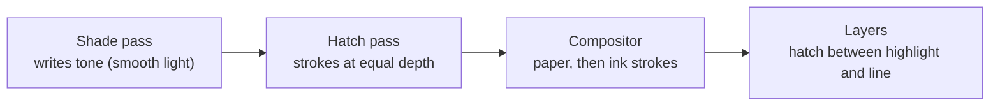

<callout icon="📌">

**Pen-and-ink shading beside the cel look, per material.** Brought back from Parked on 2026-11-07. Hatching is built on branch `m35-hatching`; cross-hatching, stippling and pointillism, and halftone come in later rounds.

</callout>

## How it works

- **Tone**: 0.5 on the lit band's edge, graded by N·L either side. A cast shadow stays below 0.5, so it's always hatched. The fill light is left out, or it would lift every shadow out of its hatching. `V` → `tone` shows it, with the edge in red.
- **Strokes**: every other stroke comes in first, and the rest join a third of the way into the dark. Noise makes them wander and break, and they boil on each drawing. Strokes closer than about two pixels apart fade to even grey instead of moiré.

## Settings

<columns>

<column>

### Mode

- `Over`: ink over the palette's tones
- `Alone`: the material painted in paper, so only strokes and lines show the light

</column>

<column>

### Space

- `Object`: slices through the rest shape, so strokes wrap the form and stay on it (default, cm)
- `Uv`: along the UVs (hundredths of the square)
- `Screen`: a screentone (1080p pixels)

</column>

</columns>

Also: `spacing`, `angle`, `start`, `weight`, `wobble`, `taper`, `boil`, `colour`, `paper`. From Blender: `vellum_hatch` and `vellum_hatch_*`.

## Status

- [x] Tone target and view
- [x] Shot, object and Blender settings
- [x] Hatch pass, compositor, layers
- [x] Panel section, Manual chapter, `shots/hatching.ron`, golden images
- [ ] Tried by the user in the window
- [ ] Next rounds: cross-hatching, stippling and pointillism, halftone

<toggle collapsed=true>

Cost

The hatch pass takes 3.4 ms at 1080p on the Intel HD 620, and only runs when some material hatches. The compositor compiles hatching in only when it's used.

</toggle>

## Cross-hatching (M36)

\<callout icon="✅">Built 2026-11-07 on `m35-hatching`: up to three crossing layers of strokes, each deeper into the dark.\</callout>

- **`layers`** 1–3 (default 1). **`cross_angle`** (default 90°): how far the second layer turns; the third turns half as far. **`cross_start`** (default 0.42): the tone the second begins at; the third begins as far again below it.
- Most of a form's shadow side lies between tone 0.5 and 0.35, so `cross_start` must stay near `start` for crossing to show (0.3 barely appeared in testing).
- Each layer has its own strokes, wander and breaks; covers combine as ink over ink.
- Shader: `hatch_cover` per layer; antialiasing width from `dpdx`/`dpdy` of the position, taken once in uniform control flow so layers can branch.
- Cost: 4.2 ms at 1080p on the HD 620 with two layers (3.4 ms with one).
- Blender: `vellum_hatch_layers`, `vellum_hatch_cross_angle`, `vellum_hatch_cross_start`.

**Next rounds:** stippling and coloured pointillism, halftone screentone; then ink-wash and paper grain.
