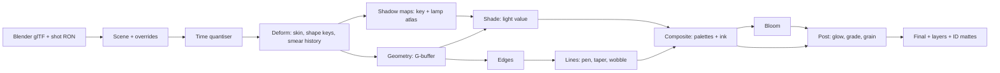

Mensah Nana Prince · Vellum Engine · Technical report, 29 October 2026, revised 27 November 2026 · Code: `MensahPrince/VellumEngine` (private), version 0.5.0 at `0ad6a22`; §4.15 describes work on the branch `m48a-projection`

## Abstract

We present Vellum, a real-time renderer written in Rust on WebGPU that renders 3D scenes authored in Blender so that they read as hand-drawn 2D animation in the anime cel style. Vellum does not shade pixels physically. It renders data about the picture (light values, object and material identities, edges), and a 2D-style compositor paints those data with flat palettes that an artist can choose by hand. The conventions of hand drawing become explicit controls. Animation is quantised to twos and threes with holds. Shadow shapes come from thresholds, proxy normals, noise and painted face maps instead of raw N·L. Ink lines come from discontinuities in depth, normal and identity, with width, taper and wobble. Fast motion produces mesh smears, and perspective can be bent per object. Lamps light hard-edged pools, Blender's roughness, metallic and emission are translated into cel equivalents, and glass, water, chrome, hatching, screentone and painted backgrounds are available as material options. Every setting resolves through four levels of precedence (default, Blender property, shot file, interactive panel), and the output is a layered image sequence with ID mattes. Since the first version of this report, Vellum has gained face shadow maps with an interactive design tool, a Blender add-on, a Blender-style editor with painting in layers and a timeline, background materials, ambient light and occlusion, and paintings cast from a camera onto background models. We report GPU timings per pass and a regression suite of 567 automated tests, 76 of them golden images rendered on a software Vulkan device in continuous integration.


## 1\. Introduction

In much contemporary anime, characters are drawn by hand while vehicles, mechanical props and backgrounds are cel-shaded 3D. The two rarely match. Hand drawing holds poses, simplifies shadows into designed shapes and inks lines with intent, whereas a renderer moves smoothly, shades every facet and outlines mechanically. This mismatch is what makes the 3D parts read as 3D.

Our premise is that the hand-drawn look consists of a set of deliberate cheats, and that a renderer can expose each cheat as a separate stage an artist directs. The contributions of this work are:

1. A deferred pipeline that separates what is where (a G-buffer of light values, identities, motion and two normals) from how it is painted (a palette compositor), so the look can change without the geometry being rendered again.
1. Per-node temporal quantisation of animation (ones, twos, threes, holds), with automatic mesh smears on fast new drawings.
1. Designed shadow shapes through thresholded ramps, proxy-shape normals, surface-anchored threshold noise, normal snapping and painted face shadow maps, kept apart from the normals that drive line art.
1. Ink lines from depth, normal and identity discontinuities, with a rule that inks a material border only where the paint changes, and extensions for panel lines, textured and painted ink, distance fading and inverted-hull outlines.
1. Cel translations of lighting and materials: hard-edged lamp pools with an atlas of cube-map shadows, roughness as highlight size, metal banded by reflection, emission, glass, water and painted reflections.
1. Pen-and-ink shading styles (hatching, cross-hatching, screentone and stippling) available per material beside the cel bands.
1. Paintings cast from a camera onto background geometry, so a painted background keeps its brushwork flat on the picture while characters pass in front of and behind it.
1. A production workflow: RON shot files layered over Blender properties, a Blender add-on that exports on save, an editor laid out like Blender with painting, a timeline and saved looks, headless layered output with ID mattes, and golden-image regression tests in CI.

## 2\. Background

Non-photorealistic rendering (NPR) has long separated geometric information from depiction. Saito and Takahashi's G-buffers \[1\] made per-pixel depth and normals the basis for comprehensible line drawing. Decaudin \[2\] and Lake et al. \[4\] established hard-banded toon shading, and Gooch et al. \[3\] showed that lighting can be remapped for legibility instead of realism. Mitchell et al. \[6\] described art-directed illustrative shading in a shipping game, and Motomura \[7\] documented how *Guilty Gear Xrd* achieves a convincing 2D look from 3D through edited normals, stepped animation and per-shot cheats; it is the closest precedent for Vellum's goals. Bénard and Hertzmann \[10\] survey line extraction from 3D models. Praun et al.'s tonal art maps \[5\] represent the image-based branch of hatching; Vellum's hatching (§4.14) is procedural, and tonal art maps remain parked. Shadow maps follow Williams \[9\], unit vectors in the G-buffer use the octahedral encoding surveyed by Cigolle et al. \[8\], casting an image from a camera is projective texture mapping as introduced by Segal et al. \[13\], and the ambient occlusion of §4.11 is a horizon scan in screen space in the manner of Bavoil et al. \[14\].

Vellum's design follows two internal notes: *NPR 2D-from-3D Engine — Architecture Notes* \[11\], which defines the pipeline, and *Making an NPR 3D Engine Look Hand-Drawn* \[12\], whose recommendations (proxy normals, threshold noise, normal snapping, authored light) became milestone M12d. See also [2D-from-3D Pipeline](page:lgjayicicv) and [Engine Overview](page:3vibzoegdx).

## 3\. System overview

Vellum is a Rust workspace. Its core library (`vellum`) is independent of any window system. Three front-ends use it: an interactive editor (`vellum-preview`, built on winit and egui), a command-line renderer (`vellum-cli`, the `vellum render` command) and an installer (`vellum-installer`). The painting tools reuse brush, colour and tablet crates from PhotoCraft, which is licensed MIT or Apache-2.0. The core never touches a window: a front-end hands it a WebGPU device and a texture to render into, so the same code drives the editor, headless rendering and the tests.

Each frame runs through a small frame graph. Passes declare the named textures they read and write; the graph validates the wiring, allocates the textures and records the passes in order. Any intermediate texture can be viewed or dumped.



*Figure 2. One frame. Light is a scalar until the compositor; colour enters only through palettes and painted images.*

The G-buffer is written in one geometry draw:

| Target | Format | Content |
| --- | --- | --- |
| Depth | `Depth32Float` | Reverse-Z depth |
| Normal | `Rgba16Float` | Mesh normal (octahedral, xy) and lens offset (zw) |
| Shading | `Rgba16Float` | Shading normal (proxy or snapped), inner-line width scale and threshold noise |
| Object ID / material ID | `R32Uint` / `R16Uint` | Identities; integer formats never blend at edges |
| Motion | `Rg16Float` | Screen-space motion |
| Albedo | `R32Uint` | The painted image's colour as packed sRGB, and the outline's width scale |
| Panel | `R16Uint` | The mesh panel a pixel belongs to, for panel lines |

Keeping a mesh normal for lines and a separate shading normal for light is central to the design: a face can be shaded as a smooth ellipsoid while its nose and lips are still inked. The G-buffer occupies exactly WebGPU's portable limit of 32 bytes per pixel for colour attachments. Meeting that limit required packing the mesh normal octahedrally \[8\] and the albedo into one integer, since WebGPU counts an RGBA8 target as eight bytes.

## 4\. Methods

### 4\.1 Temporal quantisation

Hand-drawn animation shows a new drawing every one, two or three frames of a 24 fps clock. Vellum samples each node's animation only on its drawing frames:

```math
t'_n = \left\lfloor \frac{t \cdot f}{n} \right\rfloor \frac{n}{f}, \qquad f = 24,\; n \in \{1, 2, 3\}
```

Steps resolve per node, from a Blender custom property, the shot or the panel. A skeleton follows the mesh it deforms, and the camera has its own step, so characters can be on twos while a camera move stays on ones. Holds freeze everything, or one object, over a range of frames. Line wobble is seeded again with each new drawing, so lines boil between drawings and hold within one.

### 4\.2 Designed shadow shapes

The shade pass writes a light value, not a colour: two or three hard bands, a cast-shadow mask, and rim and highlight masks. A band is a thresholded N·L, antialiased over about one pixel with screen-space derivatives:

```math
\text{lit} = \operatorname{aa\_step}\!\left(e_{\text{lit}},\; \mathbf{n}_s \cdot \mathbf{l} + \nu(\mathbf{p}_{\text{rest}})\right)
```

where **n**ₛ is the shading normal and ν a smooth value noise. Four controls decide the shape in place of the mesh.

*Proxy normals.* A sphere or ellipsoid is fitted to the bounds of what it covers (a material's primitives, or an object's mesh), and its gradient replaces the mesh normal for shading. For an ellipsoid with centre **c** and radii **r**:

```math
\mathbf{n}_{\text{proxy}}(\mathbf{p}) = \operatorname{normalize}\!\left(\frac{\mathbf{p} - \mathbf{c}}{\mathbf{r}\odot\mathbf{r}}\right)
```

Proxy normals are computed per vertex when a shot is applied and are skinned with the mesh, so they turn with the head (Figure 3).

*Threshold noise.* Two octaves of value noise on the rest position make band edges wobble like a brush stroke while staying anchored to the surface as it moves and bends. Noise on UVs was rejected because it breaks at seams.

*Normal snapping* to 6, 14 or 26 directions in object space produces flat planes of tone that stay on the object, which suits machines.

*Authored light*, per shot or per material, replaces a light locked to the camera, which would swing the cast shadows across the world.


Cast shadows from the key light come from a 2048² reverse-Z orthographic shadow map fitted to the frame's draws, thresholded into a hard edge. Painted vertex colour adds a fifth control: red moves the band edge by up to 2 in N·L, so red 0 is always in shadow and red 1 always lit, and green scales line width. Shadow-aware edge bands and core shadows (M19b) are drawn by distance from the shadow's edge, and an edge band can bleed onto the lit side as a glow across that edge (M39).

### 4\.3 Ink lines

An edge pass marks one-pixel edges of four kinds, strongest first. Silhouettes are depth steps beyond the planar prediction 2d − d\_behind, which is exact on any plane under reverse-Z. The others are object borders, material borders and creases; a crease is a bend in the normal, with strength growing from 25° to 60° so that creases taper out. Widths depend on the kind, the distance and a per-material scale, and a line pass then draws each mark with a round antialiased pen and a small wobble.

A material border is inked only where the two materials are painted differently. When the base, mid, shadow and line colours agree, the border is a mesh seam, which an artist would not ink (Figure 4).


### 4\.4 Palette compositing and layers

Each material has a palette of six slots (base, mid, shadow, highlight, rim, line), derived from its base colour with hue-shifted, more saturated shadows, or picked by hand in Blender or the shot. When an image paints the material, the slots are derived from each texel in the same way, and a colour picked by hand works on the image by a chosen operation (multiply, add, screen, mix or replace), as a layer in a paint program would. The compositor paints each pixel from its band, then lays ink in the colour of the material the line was drawn from. Because colour enters only here, the same frame splits exactly into straight-alpha layers that stack back into the painted image, together with object and material ID mattes.

### 4\.5 Smear frames

When an object marked for smears gets a new drawing after a fast move, each vertex compares its current position **p** with its position on the previous drawing, **p**\_prev, and vertices on the trailing side are pulled back:

```math
\mathbf{m} = \mathbf{p} - \mathbf{p}_{\text{prev}}, \quad a = \max(0, -\hat{\mathbf{n}}_w \cdot \hat{\mathbf{m}})\, \operatorname{smoothstep}(s_0, s_1, \lVert\mathbf{m}\rVert), \quad \mathbf{p}' = \mathbf{p} - a\,\mathbf{m}
```

The thresholds s₀ and s₁ are proportional to the object's radius, so parts that barely moved do not smear. The trailing test uses welded smooth normals, skinned alongside the mesh; with per-face normals, a low-poly mesh tore into spikes at shared corners. A pose change defines a new drawing, and a smear lasts at most three frames, so a hold after a fast move is drawn clean. Smears are applied in both the geometry and the shadow passes (Figure 5).


### 4\.6 Perspective cheats

Shots can override shape-key weights per object, and the override wins over the animation on every frame. A per-object lens exaggerates perspective about the object's centre, in view space, leaving depth untouched:

```math
\mathbf{s}' = \mathbf{s}_c + (\mathbf{s} - \mathbf{s}_c)\left(\frac{d_c}{d}\right)^{k-1}
```

where **s** is a point's screen position, **s**\_c the centre's, d and d\_c their depths and k the lens factor. Because the lens moves pixels, the shade pass's reconstruction of world positions would miss the shadow map. The geometry pass therefore records each pixel's lens offset in the spare channels of the normal target, and shading removes it (Figure 6).


### 4\.7 Lamps

Point and spot lights, from Blender or added by a shot, light hard-edged pools. A surface is lit within a reach derived from the lamp's intensity (the pool ends where illuminance falls to 4 lx), inside a spot's cone and where it faces the lamp, with a mid-tone rim in three-tone shading. Lamps only lift: a pixel takes the brightest of the key light and every pool, and palettes stay as painted. Shadows come from an atlas of 512² tiles, one per spot and six per point light as a cube, with 32 tiles per frame. The shading loop over lamps is free of branches, so the antialiasing based on derivatives remains valid (Figure 7).


### 4\.8 Materials

Blender's Principled values are translated into cel terms. Roughness sizes a hard highlight on the Blinn-Phong half vector, with angular radius θ = 4° + 20° · roughness and none above 0.85 (Figure 8). Metallic at 0.5 or above gives cel metal, banded by the elevation of the reflected view ray instead of by the light: the sky is bright, a mid band lies just above the horizon and the ground is dark. The bands slide with the camera, which is what reads as chrome (Figure 9). Emission is added over the lit colour, as Blender's Principled BSDF adds it, through the emissive texture when there is one. An unlit material is painted flat in its base colour and can glow: its fill is multiplied by 1 + glow before the ink is drawn, so bloom catches the fill while the lines stay crisp (Figure 10).

When metallic and roughness come from a texture, neutral values are used in place of glTF's default of fully rough metal.


### 4\.9 Post

Post-processing applies to the finished frame only, as in a compositing package: a quarter-resolution bloom whose threshold sits just above paper white, a grade in sRGB-encoded space (exposure, contrast, saturation, warmth, lift and gain), and monochrome film grain seeded by the 24 fps frame. The layers stay ungraded.

### 4\.10 Face shadow maps

Proxy normals give a face one clean shadow, but anime faces carry shadows whose shapes are designed per angle of the light. Vellum reads a threshold map on any mesh (M20): each texel stores the angle of the light's turn round the head at which it becomes lit, and the shade pass compares that angle with the light's. A map covers half the turn and is read mirrored for the other side, or covers the whole turn in two channels, round the head's up axis or its side axis. Maps can be painted, baked on load from an egg shape fitted round the material (`image: "auto"`), or built from keys drawn at a few angles and interpolated with distance fields (`.shadowmap.ron`). The shadow map studio in the editor (M29, M30) has an angle strip, a sweep of the light, a check of the mirrored half that marks in red what a key lights that earlier keys leave dark, brushes, stamps and a UV view. Hair casts a drawn shadow onto face-mapped materials by a short ray towards the light (M31). Figure 12 compares the result with thresholded N·L.


### 4\.11 Light beyond the key

Light colour was ignored in the first version, since the palettes are painted for the scene. It is now an opt-in per material (M19), so a lamp can tint the lit tones of one material and leave a painted character as drawn. Lamps can be grouped (M19d), linked to named materials and objects (M20b), shaped by projected cookies such as a leaf canopy, and softened (M20d). Two terms light the shadow side (M59). Ambient light from the world is stepped into the same bands as the key light, so a dark blue world makes a night without smooth gradients. Ambient occlusion reuses the contact-shadow pass: its horizon scan runs a second time at its own reach \[14\], and the result is cut at a threshold into a flat darkening of the world's light (Figure 15, right).

### 4\.12 Lines, extended

Hard-surface models need lines that follow the modeller's intent. Panel lines (M18b) ink the borders of the panels a modeller marked sharp; bevel lines find panels from the shape, so a bevel is inked once down its middle however it was shaded. Line textures thin and break outlines and inner lines as a dry brush would, in UV, object or screen space. Painted ink stores, per texel, the distance to a painted stroke's centre line and the stroke's weight, so lashes and wrinkles drawn on a texture are inked at the pen's width at any zoom (M20c), and the editor draws such strokes directly on the model (M61). Lines thin with distance between a thinnest and a thickest scale and fade out in the distance, inner lines before outlines, as background art drops its ink (M53). An inverted hull (M58) offers a second kind of outline: the object is drawn again, pushed out along its welded normals and culled inside out, in pixels at 1080p or in scene units.

### 4\.13 Materials, extended

Glass (M25) is left out of the G-buffer and drawn over the finished frame as a flat tint with two highlight streaks, its own outline and tinted shadows. Cel water (M28) is drawn the same way, with depth bands, foam and presets, and streams follow ribbons along their flow. Painted reflections (M23) read a panorama or a matcap in place of the bands, and screen-space reflections (M24) mirror what is on screen for wet streets and polished floors. Cel metal was extended (M44) into a room it reflects, with windows, an accent colour, wandering edges, glints and an inner highlight line. Highlights can take designed shapes placed by clicking on the model (M27). Light ramps take any number of bands, each step hard or soft, from a list of steps or a painted strip, and a Blender Color Ramp arrives as bands (M51). Highlight and rim thresholds are set per material (M55). Figure 14 shows glass, water and chrome.


Textures were not loaded in the first version. They now paint the base colour, and three controls bring a photographic texture into the palette (M52). Strength washes the image towards its average colour. Simplify reads it from a smaller mip level fixed to the texture, so the remaining shapes stay on the object as the camera moves, and posterises lightness and colour round the image's average. A fade loses strength and detail with distance. Background materials (M57) are lit by a gradient from a darker foot instead of by bands, by height or up the frame, and can be weathered with rust streaks, grime and peeling paint from noise on the rest pose, cut hard in a painterly mode. Distance haze (M26) fades far objects towards a colour or the backdrop's average.


### 4\.14 Shading styles

Pen-and-ink styles are options per material beside the cel bands (M35 to M37). The shade pass writes a smooth tone, 0.5 on the lit band's edge, and a hatch pass draws procedural strokes where the tone is dark: over the colours or on paper, in object, UV or screen space, with spacing, angle, weight, wobble, taper and boil. Cross-hatching adds up to three layers, each starting deeper in the dark. Screentones and stippling use built-in tileable tones, generated on load with their greys spread evenly so that weight is coverage, or painted tone images, graded into the dark or cut flat to the shadow (Figure 13). Each style has its own layer in the layered output.


### 4\.15 Paintings cast from a camera

A model with a painted image laid on by its UVs still reads as 3D, because the painting bends and foreshortens with every surface. Background artists paint flat on the picture instead. Vellum can cast a material's image from a named camera, as a projector casts a slide \[13\] (M48a). With **P** and **V** the camera's projection and view matrices, the image's aspect a = w/h fixing the frame, and **p** a surface point in world space:

```math
(x, y, z, w)^{\top} = \mathbf{P}_a \mathbf{V}\, \mathbf{p}, \qquad (u, v) = \left(\tfrac{1}{2} + \tfrac{1}{2}\tfrac{x}{w},\; \tfrac{1}{2} - \tfrac{1}{2}\tfrac{y}{w}\right)
```

The vertex shader outputs the clip coordinates (x, y, z, w), which interpolate linearly, and the division happens per pixel, so the image lands exactly as the camera frames it. A point is painted where (u, v) lies in the unit square, w > 0, and the surface faces the camera, that is **n** · **t** > 0 with **t** = **e** − **p** for a perspective camera at **e** and **t** = −**f** for an orthographic camera looking along **f**. Elsewhere the surface takes the image's average colour. The camera matrices sit in a table of their own beside the material table, bound once per scene, and the lookup goes through the same function as UV-mapped images, so strength, simplify, fade and the full-size image path apply unchanged. Images larger than 1024² keep a second copy at up to 2048² for this purpose (M48b), so a painting across a 1920 × 1080 frame stays sharp.

From the projecting camera the render reproduces the painting inside the silhouettes. From nearby, the painting stays on the surfaces with real parallax, and because the geometry remains in the depth buffer, characters are hidden by painted pillars and stand in front of painted walls (Figure 16).


### 4\.16 Effects

Speed lines (M33a) are drawn over the frame on their own drawing frames of the 24 fps clock, either radial, as wedges closing in on a centre with a clear middle, or parallel, as streaks along an angle, with density, cover, weight, taper and a seed.

## 5\. Art direction and tooling

Every setting resolves in one order, with later levels winning: built-in default, Blender custom property, shot file, panel override. Shot files are RON and are keyed by Blender names, so they survive re-exports; misspelt fields are errors and unknown names warnings. A shot can add further glTF scenes with a transform, and their object IDs move to a block of their own so that mattes stay stable. The panel never rewrites the hand-written shot; it saves a layered `<shot>.overrides.ron`. Shots, scenes, textures and, in development builds, shaders reload when saved. Whole looks (bands, frame-wide scales, post, haze, ambient light) are saved under a name and taken by a shot with `look: "name"`, four of them built in (M54).

A Blender add-on (M38) exports the glTF on every save with fixed settings and shows a panel for each `vellum_*` custom property, so nothing has to be typed by hand. Blender's cameras and lights arrive as set there, with lens shift, sensor fit and animated focal length (M40). A `.vellum` file packs a shot with its models, images and paintings (M41), and loading and export run off the main thread (M43).

The editor is laid out like Blender (Figure 11): a header with menus and playback, an Outliner with collections (M45), a Properties editor with Object, Material, Light, Camera, World and Render tabs, and 3D views that render only between the panels. The window can be cut into areas, each an editor of its own (M49). Each 3D view shades Solid, which runs the geometry pass only, or Rendered (M60). A Paint workspace (M46, M46b, M50) paints a material's colour, ink and shine on the model or on the image, in layers kept as OpenRaster beside a flattened PNG, with brushes and tablet input from PhotoCraft; UV islands can be moved (M50b). Clips can be placed together on a timeline as strips (M47). Render Image (F12) renders the current frame at an output resolution independent of the window. Headless, `vellum render` writes a layered image sequence, a single still or a video through ffmpeg. Vellum installs from an RPM on Linux and a setup program on Windows (R6), and from an installer of its own (R7); a macOS package has not been made.


## 6\. Evaluation

### 6\.1 Performance

GPU timestamp queries bracket every pass and are read back through a ring of buffers, so measurement never stalls rendering. The timings below were taken for the first version of this report, on Figure 1's shot at 1920 × 1080 on an Intel HD Graphics 620 (integrated, Vulkan, Mesa):

| Pass | GPU ms |
| --- | --- |
| Geometry (G-buffer, 6 targets) | 10\.6 |
| Lines | 6\.3 |
| Shade | 4\.9 |
| Composite | 2\.7 |
| Edges | 2\.5 |
| Bloom | 2\.1 |
| Post | 2\.1 |
| Visualize | 1\.3 |
| Shadow (key) | 0\.7 |
| Deform | 0\.1 |
| Total | ≈ 33 |

A shadowed point lamp adds about 1.5 ms for its six cube faces. Geometry and lines dominate. On the same GPU at 960 × 540, frames take 17 to 33 ms depending on the passes a scene needs; passes that no material uses (hatching, glass, ink, ambient light) are skipped. Casting a painting from a camera adds one matrix product per vertex and one division per pixel. The Solid view exists for scenes too heavy to orbit in the full render.

### 6\.2 Correctness and regression

The workspace has 567 automated tests: unit tests for parsing, layering, quantisation, tile allocation, proxy normals, face maps, projection and the editor's panels, tests of the Blender add-on run inside Blender, and 76 golden-image tests that render reference shots and compare them with stored images. At the first version of this report there were 87 tests and eight golden images. To make references reproducible across machines, they are rendered on the software Vulkan adapter (Mesa's lavapipe) both locally and in CI. A pixel differs when any channel differs by more than 16/255, and a case fails when more than 1% of its pixels differ; changing the Fox's base colour, for example, fails the suite with 5.8% differing pixels. GitHub Actions runs formatting, Clippy with warnings as errors, and all tests on Linux, Windows and macOS. A change that alters the look must be accepted explicitly by rendering the references again, and each milestone's notes record that the earlier golden images were unchanged.

### 6\.3 Qualitative evaluation

The final checklist of the architecture notes \[11\] was reviewed with the author on 29 October 2026. Seven of its eight items were met: clean shadow shapes; line weight with taper; twos and threes with holds and smears; per-shot perspective; flat painted regions; layered output with ID mattes; and characters and machines sharing one stack. The eighth, every parameter overridable per object and per shot, is mostly met (§7). Two planned evaluations are still outstanding: a timed workflow from Blender export to an approved look by someone other than the author (M17), and a side-by-side comparison of a hero frame against Blender's toon shading, Freestyle and a real anime frame, judged by a viewer familiar with anime (M22).

## 7\. Limitations

- Post-processing is set per shot only, and the shadow bias is a constant, so a few parameters still have no per-object override.
- Motion vectors ignore the lens, and lamp shadows are limited to 32 atlas tiles per frame.
- A painting cast from a camera is taken from where the camera stands unanimated. Surfaces the camera does not see take a flat colour, so a large camera move shows flat patches. The painting's transparency can cut into a shape but cannot extend it, cut-out shadows still use the UV-mapped alpha, and brushing in the Paint workspace follows the UVs.
- Face shadow maps do not change with expression; an open mouth or closed eyes keep the neutral face's map. This follows most anime references, which keep one designed face shadow through expressions, and a shot can swap the map where a cut needs another.
- Cloth folds come from a painted fold mask (M56a, on the branch `m56-cloth`): its red moves the shadow edge and its green marks pleat highlights. Fold direction does not yet follow a painted tangent, and pleats are not found from the mesh.
- Vellum has been measured only on an integrated Intel GPU; it has not been run on an NVIDIA or AMD GPU.
- Performance on integrated GPUs is about 30 fps at 1080p for a two-object shot.

## 8\. Future work

Planned work comprises the rest of cloth shading, with fold direction from a painted tangent, pleats found from the mesh's creases and fold lines (M56b); the remainder of the timeline (M47c); the workflow baseline and the side-by-side comparison of §6.3; a run on discrete GPUs; and a painting cast from a camera that also cuts shadows. A larger step under consideration is Vellum inside Blender: first as a render engine in the existing add-on, with the core built as a Python extension module that draws Blender's viewport and final renders from Blender's own data, and a fork of Blender with Vellum beside Cycles only if the add-on proves insufficient.

## 9\. Conclusion

Vellum decomposes the hand-drawn look of anime into stages an artist directs: time, shadow shape, line, paint, smear, perspective, light and material, now joined by face maps, pen-and-ink styles and paintings cast from a camera. They sit on a deferred renderer whose colour enters only at the end. The system has been built milestone by milestone, with golden images guarding the look at each step. It renders characters, machines and painted backgrounds in one visual language, in real time on modest hardware.

## References

1. Saito, T., & Takahashi, T. (1990). Comprehensible rendering of 3-D shapes. *Proceedings of SIGGRAPH '90*, 197–206.
1. Decaudin, P. (1996). *Cartoon-looking rendering of 3D-scenes*. INRIA Research Report 2919.
1. Gooch, A., Gooch, B., Shirley, P., & Cohen, E. (1998). A non-photorealistic lighting model for automatic technical illustration. *Proceedings of SIGGRAPH '98*, 447–452.
1. Lake, A., Marshall, C., Harris, M., & Blackstein, M. (2000). Stylized rendering techniques for scalable real-time 3D animation. *Proceedings of NPAR 2000*, 13–20.
1. Praun, E., Hoppe, H., Webb, M., & Finkelstein, A. (2001). Real-time hatching. *Proceedings of SIGGRAPH 2001*, 581–586.
1. Mitchell, J., Francke, M., & Eng, D. (2007). Illustrative rendering in Team Fortress 2. *Proceedings of NPAR 2007*, 71–76.
1. Motomura, J. (2015). *GuiltyGearXrd's Art Style: The X Factor Between 2D and 3D*. Game Developers Conference.
1. Cigolle, Z. H., Donow, S., Evangelakos, D., Mara, M., McGuire, M., & Meyer, Q. (2014). A survey of efficient representations for independent unit vectors. *Journal of Computer Graphics Techniques*, 3(2), 1–30.
1. Williams, L. (1978). Casting curved shadows on curved surfaces. *Proceedings of SIGGRAPH '78*, 270–274.
1. Bénard, P., & Hertzmann, A. (2019). Line drawings from 3D models: A tutorial. *Foundations and Trends in Computer Graphics and Vision*, 11(1–2), 1–159.
1. *NPR 2D-from-3D Engine — Architecture Notes* (internal PDF, 2026).
1. *Making an NPR 3D Engine Look Hand-Drawn* (internal PDF, `npr_shading_guide.pdf`, 2026).
1. Segal, M., Korobkin, C., van Widenfelt, R., Foran, J., & Haeberli, P. (1992). Fast shadows and lighting effects using texture mapping. *Proceedings of SIGGRAPH '92*, 249–252.
1. Bavoil, L., Sainz, M., & Dimitrov, R. (2008). Image-space horizon-based ambient occlusion. *SIGGRAPH 2008 Talks*.

<toggle>

Appendix A. Milestones

| Milestone | Delivered |
| --- | --- |
| M1–M3 | Window and loop; lit mesh with frame graph; orbit and glTF cameras |
| M4–M5 | Scene data with stable IDs; G-buffer with debug views and dumps |
| M6–M8 | Cel shading with cast shadows; ink lines; palette compositor and layers |
| M9 | Animation, GPU skinning, time quantiser |
| M10 | Shot files, overrides, hot reload; override panel |
| M11 | Post stack; headless layered rendering |
| M12a–d | Smears; perspective cheats; added scenes and ID mattes; shading shapes |
| M13 | GPU timings; golden images in CI |
| M14 | Point and spot lights; lamp shadow atlas |
| M15–M16 | Roughness and metal; unlit and emissive |
| M18, M18b | Painted vertex data; panel and bevel lines for hard surfaces |
| M19–M19d | Opt-in coloured light; shadow-aware bands; lamp shadow fixes; light groups |
| M20–M20d | Face shadow maps; light linking and cookies; drawn lines; soft lights |
| M21, M23–M28b | Hero shot; painted reflections; screen-space reflections; glass; distance haze; highlight shapes; cel water and streams |
| M29–M32 | Shadow map studio and its second round; hair shadows on the face; paint-over and hand-off |
| M33a | Speed lines |
| M35–M37, M39 | Hatching; cross-hatching; screentone and stippling; edge band bleed |
| M38, M40–M43 | Blender add-on; Blender cameras and lights; the `.vellum` file; file menu and browser; threads |
| M44–M47 | Chrome; collections; workspace tabs and painting; clips and a timeline |
| M48a, M48b | Paintings cast from a camera; large images at full size |
| M49–M50b | Areas; painting in layers; moving UV islands |
| M51–M55 | Ramps; texture strength and simplification; line distance fade; looks and presets; thresholds and edge cleanup |
| M57–M61 | Background materials and weathering; inverted hull; world ambient and occlusion; Solid and Rendered views; drawing ink on the model |
| Release | 0\.1.0; installers (R6, R7) and 0.4.0; 0.5.0 |

Progress is tracked in [Vellum Task Tracker](page:mq2uz8r1n6) and [Vellum Project Hub](page:qo8zh49wt3).

</toggle>
