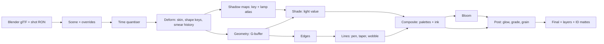

**Mensah Nana Prince** · Vellum Engine · Technical report, 29 October 2026 · Code: `MensahPrince/VellumEngine` (private), `main` at `3e81fdf`

<callout icon="📄">

**Abstract.** We present Vellum, a real-time renderer in Rust and WebGPU that renders 3D scenes authored in Blender so they read as hand-drawn 2D animation in the anime cel style. Rather than shading pixels physically, Vellum renders *data about the picture* (light values, object and material identities, edges) and paints it with a 2D-style compositor using flat, hand-pickable palettes. Hand-drawn conventions are made explicit and controllable: animation is quantised to "twos" and "threes" with holds; shadow shapes are decided by thresholds, proxy normals and noise rather than raw N·L; ink lines come from depth, normal and identity discontinuities with width, taper and wobble; fast motion produces mesh smears; perspective can be bent per object. Point and spot lights light hard-edged pools with cube-map shadows, and Blender's roughness, metallic and emission are translated into cel equivalents. Every setting resolves through a four-level precedence (default → Blender property → shot file → interactive panel), and output is a layered image sequence with ID mattes for compositing. A character and a machine rendered together share one visual language (Figure 1). We report GPU timings per pass and a golden-image regression suite that runs in continuous integration on a software Vulkan device.

</callout>


## 1\. Introduction

In much contemporary anime, characters are drawn by hand while vehicles, mechanical props and backgrounds are cel-shaded 3D. The two rarely match: hand drawing holds poses, simplifies shadows into designed shapes and inks lines with intent, while a renderer moves smoothly, shades every facet and outlines mechanically. The mismatch is what makes 3D read as 3D.

Vellum's thesis is that hand-drawn 2D is not a single shading model but **a set of deliberate cheats**, and that a renderer can expose each cheat as an explicit, art-directable stage. Our contributions are:

1. A deferred pipeline that separates *what is where* (a G-buffer of light values, identities, motion and two normals) from *how it is painted* (a palette compositor), so the look can change without re-rendering geometry.
1. Per-node temporal quantisation of animation (ones, twos, threes, holds) with automatic **mesh smears** on fast new drawings.
1. Designed shadow shapes through thresholded ramps, **proxy-shape normals**, surface-anchored threshold noise and normal snapping, kept separate from the normals that drive line art.
1. Ink lines from depth, normal and identity discontinuities, with a rule that inks a material border only where the **paint** changes.
1. Cel translations of lighting and materials: hard-edged lamp pools with an atlas of cube-map shadows; roughness as highlight size; metal banded by reflection; unlit, glowing emission.
1. A production workflow: RON shot files layered over Blender properties, a live override panel in a Blender-style window, headless layered output with ID mattes, and golden-image regression tests in CI.

## 2\. Background

Non-photorealistic rendering (NPR) has long separated geometric information from depiction. Saito and Takahashi's G-buffers \[1\] made per-pixel depth and normals the basis for comprehensible line drawing; Decaudin \[2\] and Lake et al. \[4\] established hard-banded "toon" shading; Gooch et al. \[3\] showed that lighting can be re-mapped for legibility rather than realism. Mitchell et al. \[6\] described art-directed illustrative shading in a shipping game, and Motomura \[7\] documented how *Guilty Gear Xrd* achieves a convincing 2D look from 3D through edited normals, stepped animation and per-shot cheats, the closest precedent for Vellum's goals. Bénard and Hertzmann \[10\] survey line extraction from 3D models. Praun et al.'s tonal art maps \[5\] represent the hatching branch of NPR, which Vellum deliberately parks. Shadow maps follow Williams \[9\]; unit vectors in the G-buffer use the octahedral encoding surveyed by Cigolle et al. \[8\].

Vellum's design follows two internal notes: *NPR 2D-from-3D Engine — Architecture Notes* \[11\], which defines the pipeline, and *Making an NPR 3D Engine Look Hand-Drawn* \[12\], whose recommendations (proxy normals, threshold noise, normal snapping, authored light) became milestone M12d. See also [2D-from-3D Pipeline](page:lgjayicicv) and [Engine Overview](page:3vibzoegdx).

## 3\. System overview

Vellum is a Rust workspace of three crates: a windowing-independent core library (`vellum`), an interactive preview (`vellum-preview`, winit + egui), and a command-line front-end (`vellum-cli`, the `vellum render` command). The core never touches a window: front-ends hand it a WebGPU device and a texture to render into, which is what lets the same code drive the preview, headless rendering and tests.

Each frame runs through a small **frame graph**: passes declare the named textures they read and write, the graph validates the wiring, allocates textures, and records the passes in order. Any intermediate texture can be viewed or dumped.



*Figure 2. One frame. Light is a scalar until the compositor; colour enters only through palettes.*

The G-buffer is written in one geometry draw:

| Target | Format | Content |
| --- | --- | --- |
| Depth | `Depth32Float` | Reverse-Z depth |
| Normal | `Rgba16Float` | Mesh normal (octahedral, xy) and lens offset (zw) |
| Shading | `Rgba16Float` | Shading normal (proxy or snapped) and threshold noise |
| Object ID / material ID | `R32Uint` / `R16Uint` | Identities; integer formats never blend at edges |
| Motion, UV | `Rg16Float` | Screen-space motion; first UV set |

Keeping a **mesh normal** for lines and a separate **shading normal** for light is central: a face can be shaded as a smooth ellipsoid while its nose and lips are still inked. The whole G-buffer fits WebGPU's portable limit of 32 bytes per pixel for colour attachments, which required packing the mesh normal octahedrally \[8\].

## 4\. Methods

### 4\.1 Temporal quantisation

Hand-drawn animation shows a new drawing every one, two or three frames of a 24 fps clock. Vellum samples each node's animation only on its drawing frames:

```math
t'_n = \left\lfloor \frac{t \cdot f}{n} \right\rfloor \frac{n}{f}, \qquad f = 24,\; n \in \{1, 2, 3\}
```

Steps resolve per node (from a Blender custom property, the shot, or the panel); a skeleton follows the mesh it deforms, and the camera has its own step, so characters can be on twos while a camera move stays on ones. Holds freeze everything, or one object, over a frame range. Line wobble is re-seeded with each new drawing, so lines "boil" between drawings and hold within one.

### 4\.2 Designed shadow shapes

The shade pass writes a light *value*, not a colour: 2 or 3 hard bands, a cast-shadow mask, rim and highlight masks. A band is a thresholded N·L, antialiased over about one pixel with screen-space derivatives:

```math
\text{lit} = \operatorname{aa\_step}\!\left(e_{\text{lit}},\; \mathbf{n}_s \cdot \mathbf{l} + \nu(\mathbf{p}_{\text{rest}})\right)
```

where **n**ₛ is the shading normal and ν a smooth value noise. Four controls decide the shape instead of the mesh:

- **Proxy normals.** A sphere or ellipsoid is fitted to the bounds of what it covers (a material's primitives, or an object's mesh), and its gradient replaces the mesh normal for shading. For an ellipsoid with centre **c** and radii **r**:

```math
\mathbf{n}_{\text{proxy}}(\mathbf{p}) = \operatorname{normalize}\!\left(\frac{\mathbf{p} - \mathbf{c}}{\mathbf{r}\odot\mathbf{r}}\right)
```

Proxy normals are computed per vertex when a shot is applied and skinned with the mesh, so they turn with the head (Figure 3).

- **Threshold noise.** Two octaves of value noise on the *rest* position, so band edges wobble like a brush stroke but stay anchored to the surface as it moves and bends; noise on UVs was rejected because it breaks at seams.
- **Normal snapping** to 6, 14 or 26 directions in object space, producing flat planes of tone that stay on the object (suited to machines).
- **Authored light**, per shot or per material, instead of a camera-locked light, which would swing world-space cast shadows.


Cast shadows from the key light come from a 2048² reverse-Z orthographic shadow map fitted to the frame's draws, thresholded into a hard edge.

### 4\.3 Ink lines

An edge pass marks one-pixel edges of four kinds, strongest first: **silhouettes** (a depth step beyond the planar prediction 2d − d\_behind, exact on any plane under reverse-Z), **object borders**, **material borders** and **creases** (normal bends, with strength growing from 25° to 60° so creases taper out). Widths depend on kind, distance and a per-material scale; a line pass then draws each mark with a round antialiased pen and a small wobble.

A material border is inked only where the two materials are *painted differently*: same base, mid, shadow and line colours mean the border is a mesh seam, not a colour change an artist would ink (Figure 4).


### 4\.4 Palette compositing and layers

Each material has a palette of six slots (base, mid, shadow, highlight, rim, line), derived from its base colour with hue-shifted, more saturated shadows, or hand-picked in Blender or the shot. The compositor paints each pixel from its band, then lays ink in the colour of the material the line was drawn from. Because colour enters only here, the same frame splits exactly into straight-alpha **layers** that re-stack into the painted image, plus object and material **ID mattes**.

### 4\.5 Smear frames

When an object marked for smears gets a new drawing after a fast move, each vertex compares its position now, **p**, with its position on the previous drawing, **p**\_prev; vertices on the trailing side are pulled back:

```math
\mathbf{m} = \mathbf{p} - \mathbf{p}_{\text{prev}}, \quad a = \max(0, -\hat{\mathbf{n}}_w \cdot \hat{\mathbf{m}})\, \operatorname{smoothstep}(s_0, s_1, \lVert\mathbf{m}\rVert), \quad \mathbf{p}' = \mathbf{p} - a\,\mathbf{m}
```

with thresholds s₀, s₁ proportional to the object's radius, so parts that barely moved do not smear. The trailing test uses **welded** smooth normals, skinned alongside the mesh: with per-face normals, a low-poly mesh tore into spikes at shared corners. A pose change defines a new drawing; a smear lasts at most three frames, so a hold after a fast move is drawn clean. Smears are applied in both the geometry and shadow passes (Figure 5).


### 4\.6 Perspective cheats

Shots can override shape-key weights per object, winning over the animation on every frame. A per-object **lens** exaggerates perspective about the object's centre, in view space, leaving depth untouched:

```math
\mathbf{s}' = \mathbf{s}_c + (\mathbf{s} - \mathbf{s}_c)\left(\frac{d_c}{d}\right)^{k-1}
```

where **s** is a point's screen position, **s**\_c the centre's, d and d\_c their depths and k the lens factor. Because the lens moves pixels, shading's world-position reconstruction would miss the shadow map; the geometry pass records each pixel's lens offset in the normal target's spare channels and shading removes it (Figure 6).


### 4\.7 Lamps

Point and spot lights (Blender lamps, or lamps a shot adds) light **hard-edged pools**: lit within a reach derived from intensity (the pool ends where illuminance falls to 4 lx), cut by a spot's cone, on surfaces that face the lamp, with a mid-tone rim in three-tone shading. Lamps only lift: a pixel takes the brightest of the key light and every pool, and palettes stay as painted. Shadows come from an atlas of 512² tiles (one per spot, six per point light as a cube, 32 per frame); the shading loop over lamps is branch-free so derivative-based antialiasing remains valid (Figure 7).


### 4\.8 Materials

Blender's Principled values are translated into cel terms:

- **Roughness** sizes a hard highlight on the Blinn-Phong half-vector, with angular radius θ = 4° + 20° · roughness and none above 0.85 (Figure 8).
- **Metallic** ≥ 0.5 gives **cel metal**, banded by the elevation of the reflected view ray instead of by the light: sky bright, a mid band just above the horizon, ground dark. The bands slide with the camera, which is what reads as chrome (Figure 9).
- **Emission** makes a material **unlit**, painted flat in its emission colour, and **glowing**: its fill is multiplied by 1 + glow before the ink is drawn, so bloom catches the fill while lines stay crisp (Figure 10).

When metallic and roughness come from a texture (not loaded by Vellum), neutral values are used rather than glTF's default of fully rough metal.


### 4\.9 Post

Post applies to the finished frame only, as a compositor would: a quarter-resolution bloom whose threshold sits just above paper white, a grade in sRGB-encoded space (exposure, contrast, saturation, warmth, lift and gain), and monochrome film grain seeded by the 24 fps frame. Layers stay ungraded.

## 5\. Art direction and tooling

Every setting resolves in one order, later winning: **built-in default → Blender custom property → shot file → panel override**. Shot files are RON, keyed by Blender names so they survive re-exports; misspelt fields are errors, unknown names warnings. A shot can add further glTF scenes with a transform, whose object IDs move to a block of their own so mattes stay stable. The panel never rewrites the hand-written shot; it saves a layered `<shot>.overrides.ron`. Shots, scenes and (in development builds) shaders hot-reload on save.

The preview is laid out like Blender (Figure 11): a header with menus and playback, an Outliner, a Properties editor with Object, Material and Render tabs, and a 3D view that renders only between the panels. **Render Image** (F12) renders the current frame at an output resolution independent of the window. Headless, `vellum render` writes a layered image sequence or a single still.


## 6\. Evaluation

### 6\.1 Performance

GPU timestamp queries bracket every pass and are read back through a ring of buffers so measurement never stalls rendering. Figure 1's shot at 1920×1080 on an Intel HD Graphics 620 (integrated, Vulkan, Mesa):

| Pass | GPU ms |
| --- | --- |
| Geometry (G-buffer, 6 targets) | 10\.6 |
| Lines | 6\.3 |
| Shade | 4\.9 |
| Composite | 2\.7 |
| Edges | 2\.5 |
| Bloom | 2\.1 |
| Post | 2\.1 |
| Visualize | 1\.3 |
| Shadow (key) | 0\.7 |
| Deform | 0\.1 |
| **Total** | **≈ 33** |

A shadowed point lamp adds about 1.5 ms (six cube faces). Geometry and lines dominate and are the first targets for optimisation.

### 6\.2 Correctness and regression

The workspace has 87 automated tests: unit tests for parsing, layering, quantisation, tile allocation, proxy normals and more, plus **golden-image tests** that render eight reference images (finished frames, light and line views, lamps, metal and glow) and compare them with stored references. To make references reproducible across machines, they are rendered on the software Vulkan adapter (Mesa's lavapipe) both locally and in CI; a pixel differs past 16/255 in any channel, and a case fails past 1% differing pixels. Changing the Fox's base colour fails the suite with 5.8% differing pixels. GitHub Actions runs formatting, Clippy with warnings as errors, and all tests on every push; Ubuntu's lavapipe matched references rendered on Fedora's.

### 6\.3 Qualitative

The final checklist from the architecture notes \[11\] was reviewed with the author on 29 October 2026: seven of eight items are met (clean shadow shapes; line weight with taper; 2s/3s with holds and smears; per-shot perspective; flat painted regions; layered output with ID mattes; characters and machines sharing one stack). The eighth, *every parameter overridable per object and per shot*, is mostly met (§7).

## 7\. Limitations

- **SDF face shadows** are not implemented; they await a hand-painted threshold map. Proxy normals cover the common case.
- **Textures are not loaded**; looks come from palettes. Values held in textures fall back to neutral defaults.
- **Light colour is ignored** by design (palettes stay as painted); coloured light would need an opt-in.
- **Flat metal panels** reflect one direction and read flat; painted streaks would be needed.
- **Motion vectors ignore the lens**, and lamp shadows are limited to 32 atlas tiles per frame.
- Some parameters (post per object, line widths per kind, rim and highlight thresholds, shadow bias) have no override yet.
- Performance on integrated GPUs is about 30 fps at 1080p for a two-object shot.

## 8\. Future work

SDF face-shadow maps from painted masks; shot-level settings (post, key light, lamps) in the Render tab; a timeline editor; optimisation of the geometry and line passes; optional coloured light; painted metal streaks; and pinning the Rust toolchain so CI is reproducible across compiler releases.

## 9\. Conclusion

Vellum shows that the "hand-drawn" look of anime can be decomposed into explicit, art-directable stages (time, shadow shape, line, paint, smear, perspective, light and material) layered on a deferred renderer whose colour enters only at the end. Built milestone by milestone with tests and golden images guarding the look, it renders characters and machines that share one visual language, and it does so in real time on modest hardware.

## References

1. Saito, T., & Takahashi, T. (1990). Comprehensible rendering of 3-D shapes. *Proceedings of SIGGRAPH '90*, 197–206.
1. Decaudin, P. (1996). *Cartoon-looking rendering of 3D-scenes*. INRIA Research Report 2919.
1. Gooch, A., Gooch, B., Shirley, P., & Cohen, E. (1998). A non-photorealistic lighting model for automatic technical illustration. *Proceedings of SIGGRAPH '98*, 447–452.
1. Lake, A., Marshall, C., Harris, M., & Blackstein, M. (2000). Stylized rendering techniques for scalable real-time 3D animation. *Proceedings of NPAR 2000*, 13–20.
1. Praun, E., Hoppe, H., Webb, M., & Finkelstein, A. (2001). Real-time hatching. *Proceedings of SIGGRAPH 2001*, 581–586.
1. Mitchell, J., Francke, M., & Eng, D. (2007). Illustrative rendering in Team Fortress 2. *Proceedings of NPAR 2007*, 71–76.
1. Motomura, J. (2015). *GuiltyGearXrd's Art Style: The X Factor Between 2D and 3D*. Game Developers Conference.
1. Cigolle, Z. H., Donow, S., Evangelakos, D., Mara, M., McGuire, M., & Meyer, Q. (2014). A survey of efficient representations for independent unit vectors. *Journal of Computer Graphics Techniques*, 3(2), 1–30.
1. Williams, L. (1978). Casting curved shadows on curved surfaces. *Proceedings of SIGGRAPH '78*, 270–274.
1. Bénard, P., & Hertzmann, A. (2019). Line drawings from 3D models: A tutorial. *Foundations and Trends in Computer Graphics and Vision*, 11(1–2), 1–159.
1. *NPR 2D-from-3D Engine — Architecture Notes* (internal PDF, 2026).
1. *Making an NPR 3D Engine Look Hand-Drawn* (internal PDF, `npr_shading_guide.pdf`, 2026).

<toggle>

Appendix A. Milestones

| Milestone | Delivered |
| --- | --- |
| M1–M3 | Window and loop; lit mesh with frame graph; orbit and glTF cameras |
| M4–M5 | Scene data with stable IDs; G-buffer with debug views and dumps |
| M6–M8 | Cel shading with cast shadows; ink lines; palette compositor and layers |
| M9 | Animation, GPU skinning, time quantiser |
| M10 | Shot files, overrides, hot reload; override panel |
| M11 | Post stack; headless layered rendering |
| M12a–d | Smears; perspective cheats; added scenes and ID mattes; shading shapes |
| M13 | GPU timings; golden images in CI |
| M14 | Point and spot lights; lamp shadow atlas |
| M15–M16 | Roughness and metal; unlit and emissive |
| UI / output | Blender-style window; Render Image |

Progress is tracked in [Vellum Task Tracker](page:mq2uz8r1n6) and [Vellum Project Hub](page:qo8zh49wt3).

</toggle>
