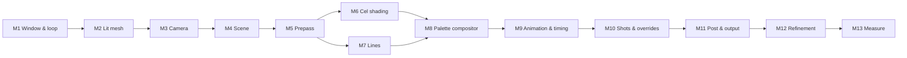

<callout icon="🎯">

**Goal:** a non-photorealistic engine in Rust that renders 3D scenes as **genuine hand-drawn 2D** (anime-style cel look): held poses, clean shadow shapes, pen-like lines, flat palettes. The pipeline is in [2D-from-3D Pipeline](page:lgjayicicv); the plan is `milestones.md` in the repo root, and this page is where the work is tracked.

</callout>

<columns>

<column>

### 📍 Where it stands

**Phase:** M1–M13 built (2026-10-28): the whole plan, except the SDF face map, which waits for a painted map.

**Code:** `main` on GitHub at `MensahPrince/VellumEngine` (private), pushed 2026-10-28. The milestone history was merged over the earlier Vellum commits, which stay in history; the MIT licence was kept.

**M1 built (2026-10-28):** `ApplicationHandler` loop in `src/app.rs`; frame time averaged in `src/frame_timer.rs` and shown in the window title; softbuffer clears to paper colour (Wayland needs a presented buffer). Waiting on a visual check.

**M2 built (2026-10-28):** workspace `crates/vellum` (core, no winit) + `crates/vellum-preview`; wgpu 30 on Vulkan (Intel HD 620); frame graph with wiring checks; glTF loader; Lambert into `color` + reverse-Z `depth`, blitted to the screen. A headless `snapshot` example renders offscreen. Test model: Khronos Suzanne (CC0).

**M3 built (2026-10-28):** orbit, pan and zoom (`camera::Orbit`), glTF perspective and orthographic cameras, `C` to cycle cameras and `F` to frame. The camera reaches passes through `FrameData` each frame. Test model: Khronos Cameras (CC0).

**M4 built (2026-10-28):** scene as plain data (no ECS; scenes come from Blender), world transforms propagated each frame, per-draw object data in a storage buffer. Object ID = glTF node index + 1 and material ID = glTF material index + 1, with 0 = background. Sun light from glTF. `I` shows the object or material IDs. Test model: Cesium Milk Truck (CC BY 4.0, geometry only).

**M5 built (2026-10-28):** deferred split. A geometry pass writes the G-buffer (depth, view-space normal, object and material IDs, motion vectors, UV) in one draw; a fullscreen shade pass lights it; a visualize pass shows the final image or any texture (`V`). `P` dumps every view as PNG and the float textures as EXR.

**M6 built (2026-10-28):** the shade pass writes a `light` texture (2/3-tone ramp, cast-shadow, rim and highlight masks) instead of a colour. A 2048² reverse-Z shadow map gives hard cast shadows. Rim is limited to silhouettes. A helper ground plane catches shadows (`G`), `T` toggles 2/3-tone, and the Blender proxy-normal workflow is in `docs/blender-export.md`.

**M7 built (2026-10-28):** an edge pass marks silhouettes, object and material borders and creases, each with its own width (scaled by distance; creases taper). A line pass draws them with a round pen and slight wobble. A composite pass lays ink over colour. Per-material masks come from the Blender custom property `vellum_lines`. 1080p frame: 19 ms on the HD 620.

**M8 built (2026-10-28) — first recognizably 2D image.** Each material has a palette (base, mid, shadow, highlight, rim, line), derived from the base colour with hue-shifted cool shadows or hand-picked via Blender `vellum_*` hex properties. The shade pass outputs only light values, and the compositor paints with palettes and coloured ink. Every dump includes straight-alpha layers (base, mid, shadow, rim, highlight, line) that re-stack into the final frame.

**M9 built (2026-10-28):** glTF clips (step, linear and cubic), GPU skinning and shape keys in a compute pass (which keeps last frame's vertices for motion vectors), and the time quantizer on a 24 fps clock: objects on twos and camera on ones by default, `vellum_step` per object, and holds. Verified pixel-exact on the Fox. Preview: Space, ←/→, `N`, `1`–`3`, `K`.

**M10a built (2026-10-28):** RON shot files (`docs/shots.md`, examples in `shots/`) with a per-object and per-material override table: ramp, line mask and scale, palette, step, holds, smoothed normals, smear flag. Shots and, in dev builds, shaders hot-reload on save; a broken shader logs its error and the last good renderer keeps running. Decisions are on [2D-from-3D Pipeline](page:lgjayicicv).

**M10b built (2026-10-28):** an egui overlay in the preview, with an Overrides window (`O`) and the on-screen frame-time readout deferred from M1. Clicking the view reads the object-ID texture to select an object. The panel edits every override of that object and its materials live, and each row shows the value in effect with a reset back to the shot, Blender or the default. Save (Ctrl+S) writes `<shot>.overrides.ron`, which is layered over the shot whenever it opens; the hand-written shot file is never touched. Material edits rewrite the GPU material table in place, and only smoothed normals rebuild the renderer. Checked live: slider edits apply while dragging and survive a restart.

**M11 built (2026-10-28):** a post stack at the end of the frame graph, shared by every object. Bloom works at a quarter of the output size, with a threshold just above paper white. The grade (exposure, contrast, saturation, warmth, lift and gain) works in sRGB space, and grain changes every frame of the 24 fps clock. A `post` section in shot files sets it all, with subtle defaults; `V` shows `painted`, the frame before post. The new `vellum` command (`crates/vellum-cli`) runs `vellum render shot.ron [--out] [--size] [--frames]` and writes `<out>/<layer>/<frame>.png` for `final` and each ungraded layer. Checked: the fox's 37 frames render in 33 s (debug, 960×540), and held drawings stay identical on threes.

**M12 is split in four:** M12a smears, M12b perspective cheats, M12c face shadows, ID mattes and a shared character-and-machine shot, and M12d shading shapes (added 2026-10-28 from the shading notes PDF: proxy normals, threshold noise, normal snapping, an authored light). M12d can come before M12c, which waits for Mavis's face map.

**Line fix (2026-10-28):** borders between materials are only inked where the materials are painted differently, so Mavis's skin split into head, body, arms and legs no longer shows seams at the neck, shoulders and hips.

**M12a built (2026-10-28):** smear frames that stretch the mesh. An object marked `smear` (Blender `vellum_smear`, the shot or the panel) stretches on a new drawing after a fast move: vertices on the trailing side are pulled back toward the previous drawing, so lines and the cast shadow follow. A smear lasts at most three frames, so holds stay clean. Smoothed normals, skinned in the deform pass, keep the low-poly fox from tearing into spikes. Checked on the fox running on threes.

**M12d built (2026-10-28):** shading shapes. A second G-buffer normal, `shading`, drives the bands while lines keep the mesh's normals. Proxy normals (sphere or ellipsoid, per material or object) give Mavis's head one clean crescent while keeping her eye, nose and lip lines. Shadow noise anchored to the surface gives brush-like band edges. Opt-in snapping to 6, 14 or 26 directions gives flat planes of tone; on the Milk Truck the hood becomes facets. Lights are authored per shot (replacing the sun) or per material/object. All of it is in the override panel. Checked on Mavis and the Milk Truck.

**M12c built (2026-10-28):** shots add scenes with `with: [(scene, position, turn, scale, clip)]`. Added objects get IDs in a block of their own, and their clips play alongside the shot's. `vellum render` now writes `object_id` and `material_id` mattes plus an `ids.json` key. The test shot `shots/fox_and_truck.ron` has the Fox, on threes with smears, running past the Milk Truck, with its snapped body and turning wheels, under one light, ink and grain. The SDF face map waits for a painted map.

**M12b built (2026-10-28):** perspective cheats. Shots set shape keys per object by Blender name or index, and these win over the animation on every frame. A per-object `lens` exaggerates perspective around the object's centre, so near parts grow and far parts shrink, with depth, lines and overlaps intact. Shading undoes the lens before the shadow lookup, using an offset stored in the G-buffer's normal texture, which is now octahedral to fit WebGPU's 32-byte limit. Checked on the Fox with `lens: 2` and on the morph cube.

**M13 built (2026-10-28):** every pass, deform included, is timed with GPU timestamp queries, read back without stalling and shown in the overlay; `vellum render` prints the averages. First readings for Fox and Truck at 1080p on the HD 620: 33 ms of GPU time, with geometry at 10.6, lines at 6.3 and shade at 4.9. Golden-image tests render three test shots (five images) on lavapipe and compare them with stored references. CI (`.github/workflows/ci.yml`) runs fmt, clippy with warnings as errors, and every test on each push. **CI is green** (2026-10-28): GitHub's lavapipe matches the reference images within tolerance. The first run failed only on a lint that is new in Rust 1.99's clippy. Shot rendering without a window moved into the core library (`headless::ShotRenderer`).

**Plan reviewed (2026-10-29):** the final checklist is ticked, except that a few parameters still lack per-object or per-shot overrides. The plan continues with M14 (point and spot lights), M15 (basic materials: roughness sets the highlight, metallic gives a metal look) and M16 (unlit and emissive).

**M14 built (2026-10-29):** Blender's point and spot lights, and lamps a shot adds (`lamps: { ... }`), light hard-edged pools: cut by a spot's cone, mid-tone at the edge in 3-tone, never darkening anything, with palettes kept as painted. Reach follows Blender's Power (1000 W reaches about 3.7 m). `shots/truck_night.ron` is a night lit only by lamps, and it is a golden image in CI.

**M14b built (2026-10-29):** lamps cast shadows through a shadow atlas: one 512² tile per spot, six per point light, 32 shared per frame, with `shadows: false` to opt out. Anything between a lamp and a surface cuts its shape out of the pool, and smears cast smeared shadows. Checked on the night truck and a low "campfire" point light between the Fox and the Truck. Costs about 1.5 ms per shadowed point light at 1080p on the HD 620.

**M15 built (2026-10-29):** basic materials from Blender's values. Roughness sizes a hard highlight, from a glint at 0 to none above 0.85. Metallic from 0.5 gives cel metal, banded by what it reflects (bright sky, a mid band, dark ground) and sliding with the camera. Values held in an unloaded texture fall back to neutral ones.

**M16 built (2026-10-29):** `unlit` paints a material flat, untouched by light and shadow but keeping its ink, and `glow` paints it past white so bloom catches it. Blender's Emission maps to both. The night truck's windows glow.

**Blender-style window (2026-10-29):** a header with menus, playback, steps, tones, camera and frame time; the Outliner on the left; Properties on the right with Object, Material and Render tabs; and the 3D view rendering only between the panels.

**Render Image (2026-10-29):** F12, or Render → Render Image, renders the frame on screen at the Render tab's resolution (720p to 4K, independent of the window) and saves it to `renders/<shot>/<frame>.png`, optionally with layers and ID mattes. The result opens in a Render window, like Blender's. From the command line, `vellum render shot.ron --frame 12 --out still.png` writes one still.

**Planned from the direction assessment (2026-10-29):** six milestones drawn from what `Vellum_Assessment.pdf` gets right, easiest first, with anything another milestone needs placed before it. **M17** workflow baseline: time one shot from Blender to an approved look. **M18** per-vertex authored data: painted vertex colours set the shadow threshold offset and the line width. **M19** opt-in coloured light per lamp, kept in a tint layer so colour still enters only at the compositor. **M20** face shadow maps, which need a minimal texture path and complete M12c. **M21** the hero shot: a face turning in a coloured night scene, on twos, with a smear. **M22** a side-by-side of Vellum, Blender toon, Freestyle and a real anime frame, shown to an anime-literate viewer.

**M17 started (2026-10-29):** the protocol, a look brief and a dry run of the expected friction are in `docs/workflow-baseline.md`. The brief is a night shot of the Fox running through a lamp's pool past the truck. The timed session waits for a tester.

**File → Open and Add to shot (2026-10-29):** Open (Ctrl+O) loads another shot or glTF in the same window through a file browser drawn in the window. Add to shot places a glTF beside the scene, scaled by a power of ten when the sizes are far apart (the Fox in centimetres gets 0.01 beside the truck). It's kept in a new `with` list in the overrides file, so `vellum render` sees it and the hand-written shot is never touched. The Outliner's Added to shot section moves, turns, scales and removes it.

**Delete and selection outline (2026-10-29):** X, Delete, Object → Delete or right-click in the Outliner takes the selected object out of the shot with a `deleted` override, which the Outliner's Deleted section restores; a model placed with Add to shot is removed as a whole. The selected object gets Blender's orange outline in the view only, never in renders or dumps.

**Navigation buttons (2026-10-29):** orbit, pan, zoom and frame-all buttons in the 3D view's top-right corner, as in Blender.

**Base-colour textures (2026-10-29):** a material's base-colour texture now paints its base per pixel, and its shadow, mid-tone, highlight and rim are derived from each texel, so every painted region gets its own shadow. Ink comes from the texture's average. A hand-picked base paints the material flat. Tested on `SuzannePainted.gltf` (a generated striped texture) with a new golden image. The repo's Fox and truck ship without their image files, so they still paint flat.

**M18 built (2026-10-29):** painted vertex colours (glTF `COLOR_0`) give local control. **Red** moves the shadow edge: 0.5 leaves it alone, 0 is always in shadow and 1 always lit, and it works under proxy normals. **Green** scales line width, where 1 is full and 0 is no line. The paint follows skinning and shape keys. Blender exports the colour as linear numbers; Vellum turns them back into the sRGB values the artist picked. Shots and the panel scale the paint or switch it off per object or material with `vertex_shadow` and `vertex_lines`. The line width needed a new 1-byte G-buffer target. Reordering the targets fits it under WebGPU's 32-byte limit (31 bytes used). It costs about 0.7 ms in the geometry pass at 1080p on the HD 620 (10.6 → 11.3 ms), with no measurable change to the frame. Tested against a real Blender 5.1 export (Vertex Color → Active) and with a new golden image, `SuzanneVertexPaint.gltf` (a cheek pushed into shadow, one half's lines thinned). The steps are in `docs/blender-export.md`.

**M18b started (2026-10-29), hard surface in the cel-mecha style:** panel lines ink the panels a modeller divides with sharp edges (Mark Sharp, Smooth by Angle), at any angle, including a 10° fold that screen-space creases miss. UV seams don't divide panels. Panel lines are opt-in per material (`vellum_panels` in Blender, `panel_lines` in shots and the panel), so characters are unchanged. `inner_line_scale` gives a heavy outline over fine inner lines. Tested on `PanelProp`, a CC0 prop built by a Blender script in the repo, with new golden images. Known gap: bevels made with Harden Normals or Weighted Normal join faces without a split, so a bevelled edge gets no panel line. Panel lines worked on the user's mech; its bevels showed as soft strips with no line. **Bevel lines** (`vellum_bevels` / `bevel_lines`) fix that by finding panels from the shape. Flat faces are panels, and each narrow bevel strip goes to the face it leans towards, so a bevel is one line down its middle whether it was exported smooth, flat or weighted. Tested on the user's three bevelled cubes, which are now a golden image. Edge highlights and a crevice tone are still to come.

**M19b planned (2026-10-29):** shadow-aware shading. A jump-flooding pass after shade gives each pixel its signed distance to the nearest shadow edge, and the direction to it. The compositor uses that to paint a darker core shadow inside the shadow and a warm band along its edge, at drawn (screen-pixel) widths. It's off by default. Per-shape IDs, reflected light, hatching inside shadows and ink along shadow edges come later. The M21 hero shot uses it.

**M19 built (2026-10-30):** opt-in coloured light. A lamp is coloured with `colour: "#hex"` or `coloured: true` (shot, panel, or Blender `vellum_coloured`), and the key light takes `light_colour`, so moonlight can be blue. The shade pass writes the colour of the light that wins each pixel into a tint target, while the light value stays a scalar. The compositor multiplies lit tones by it (lit full, mid half, rim and highlight full); shadow tones and ink stay as painted. Materials opt out with `tint: false` (`vellum_tint = 0`). `vellum render` writes a `tint` layer so compositing can redo it. New golden image `coloured`: the night truck under a cool moon with a warm campfire. Every other golden image is unchanged.

**M19b built (2026-10-30):** shadow-aware shading. A shadow-distance pass gives each pixel its signed distance to the nearest shadow edge and the direction to it. It works by jump flooding at quarter size, with seeds placed to a fraction of a pixel; silhouettes and object borders don't count as shadow edges. Materials can paint a darker **core** deep in the shadow (`core_shadow`) and a warm **edge band** along its edge (`edge_band`), in 1080p pixels or centimetres on the object (`band_space`), with `core`/`edge` palette slots derived or hand-picked. These are set in shots, the panel, and Blender (`vellum_core_shadow`, `vellum_edge_band`). `V` shows the distance, `P` dumps it, and `vellum render` writes `core` and `edge` layers. The pass is skipped unless used and costs about 4.7 ms at 1080p on the HD 620 when on (half size cost 14 ms). New golden image `shadow_bands`, and every other golden image is unchanged. A turning-head check waits for a committable head model.

**Weighted outlines (2026-10-30):** `outline_weight` makes the outline heavier on the side turned from the key light and lighter towards it, and `outline_taper` thins a silhouette out where the gap behind it closes (brows into the forehead, an ear into the head). Both are per material or object, from shots, the panel and Blender, and off by default. New golden images `outline` and `outline_lines`. `shots/suzanne.ron` renders Suzanne as a flat cartoon (Rick and Morty style) to test them.

**Comparisons and the EEVEE brief (2026-10-30):** a Rick and Morty frame is about 70% reachable with settings alone; the gap is interior lines on soft bends and drawn-on detail lines. An anime frame (dappled leaf light, soft glow) is 50–60% reachable; the gaps are light cookies, painted ink and face shadow maps. `Vellum_EEVEE_Lighting.pdf` was reviewed. Keep: light linking, scalar occlusion (the crevice tone), sun cascades later, and its catch that lamp shadows offset along the shading normal. Skip: ambient, LTC area lights, virtual shadow maps, light culling, probes, and copying GPL code.

**Plan from there:** **M19c** lamp shadow fixes (mesh-normal offset, 512² tile stair-steps), **M20** face shadow maps, **M20b** light linking and cookies, **M20c** drawn lines (crease sensitivity, painted ink), then the M21 hero shot and M22 comparison. Later: sun cascades, cached shadow maps, shaped hair highlights, light groups.

**Open saved overrides and Save As (2026-10-31):** File → Open and the command line now take a saved `name.overrides.ron` and open the shot or glTF it was saved for, which brings the overrides along. **File → Save As** (Ctrl+Shift+S) saves what's open, panel edits and all, as a new shot file with its overrides beside it, then opens it; the original keeps what it last saved, and nothing is ever overwritten. Saved into the same folder, the shot is copied as written; elsewhere, every file it names is re-pointed from the new folder. Properties also keep the last object shown when the selection is cleared. Pushed to `main`.

**M19d built (2026-10-31), light groups:** each lamp goes in a group 0–3 (`group`, the panel's Light tab, Blender `vellum_light_group`); the key light is in group 0. The shade pass writes each group's light into a new RGBA16F `group_light` target. When a shot sets `light_groups` (a colour and a mode, `Bands` or `Tint`, per group), each pixel is tinted by every group's colour, weighted by its light, so a warm key and a cool rim both show where they overlap. `vellum render` writes `light_group_0`–`3` layers for relighting in compositing. New golden image `light_groups`; every other golden image is unchanged. Not committed yet.

**M20 started (2026-10-31), face shadow maps:** items 1–2 are built. A grey map on the face's UVs (`face_map: (image, head)` per material in a shot) loads into the texture array. A face pass after the G-buffer samples it, straight and mirrored, and the shade pass compares it with how far the key light has turned round the head (the head node's +Z forward, +X left). That replaces N·L and the key light's cast shadows on that material. Checked on Suzanne with a throwaway map: a clean shadow edge sweeps across the face. Committed with M19d on `m19d-light-groups` (4ed17a6).

**M20 items 3–4 built (2026-10-31):** face maps set from Blender (`vellum_face_map`, `vellum_face_head` on the material), shots, and the panel (Material → Shadow shape → Face map: the image with Browse…, the head picked from the scene's nodes). `vellum face-map <scene> --material <name> [--head <node>]` bakes a starting map from an ellipsoid proxy, to paint over; checked on Suzanne. Walkthrough in [Light Groups and Face Maps Tutorial](page:7vycdx4qsy). Committed (f1fa01c) and pushed to `main` with M19d, 2026-10-31.

**M20 done (2026-10-31):** a committable test head, `assets/models/face-head` (CC0, made by `make_face_head.py`): an egg with a nose, lips, brows and eye sockets, on UVs that mirror across the middle of the face, and a designed map (the crescent, a lit triangle on the far cheek, a small shadow beside the nose). New golden images: `face_map` (light to the left: one clean terminator), `face_map_right` (the same map read mirrored) and `face_map_nl` (N·L, where the nose and lips break the terminator). Every other golden image is unchanged. Not committed yet.

**M20d built (2026-10-31), soft lights:** EEVEE-like lights as **another kind of light beside the cel ones**; cel lights and every existing golden image are unchanged. A lamp with `soft: true` (shots, the Light tab, Blender `vellum_soft`) fades smoothly with distance, shades as a gradient, blends at a spot's cone edge and casts soft shadows (`size`, metres). Soft light **adds** to the other light on a pixel, so it moves a surface smoothly through the palette, and light past the base tone brightens it until bloom makes it glow (`strength`). `soft_key: (strength, angle)` makes the key light soft, with shadows sharp at the caster and softer away from it. `fill: (sky, ground, strength)` is light from all round that lifts the shadow side. New golden images `soft_lamps`, `soft_key` and `fill_cel`. The soft key costs about 5 ms in shade at 1080p on the HD 620. Not committed yet.

**NeonCorner scene (2026-10-31), for M21:** `assets/models/neon-corner/make_neon_corner.py` builds the hero-shot scene in Blender 5.1 (saves a `.blend`, exports the glTF, paints the face map): a character turning to a neon sign at night, with a face map on the Head bone, proxy-normal hair with vertex paint, twos and smears, moonlight, a pink coloured spot and a soft street lamp. `shots/neon_corner.ron`. Not committed yet.

**VRM avatars (2026-11-01):** `.vrm` (VRM 0.x and 1.0) opens wherever a glTF does. MToon's shade colour becomes the shadow slot, its outline colour (with the lighting mix) the ink, and its rim colour the rim. VRM 0.x avatars are turned round to face +Z. To render them, the engine gained **alpha cutout** (glTF MASK/BLEND, in the image and in cast shadows) and **double-sided materials**. Every golden image is unchanged. "glTF only" in the decisions is now "glTF and VRM". Spring bones, constraints and expressions are not read yet. Docs in `docs/vrm.md`. Not committed yet.

**Committed and pushed (2026-11-01):** M20 item 5, M20d soft lights and VRM avatars went to `main` as 3b547f4. The "Not committed yet" notes above for those are out of date; NeonCorner is still local.

**M20b built (2026-11-01), light linking and cookies:** a lamp with `links: ["hero"]` lights only the materials and objects that share one of its names, and lamps without links light everything. It's set from shots, the panel (Light tab, Material tab) and Blender (`vellum_links`). **Cookies** are grey images that a spot or the key light projects: leaves' dappled light, with `scale`, `drift` (leaves moving in the wind) and `soften`, from shots, Blender (`vellum_cookie*`) and the panel for spots. New golden images `light_link`, `leaf_dapple` (plus drifted and softened versions) and `spot_cookie`; every existing golden image is unchanged. Committed on `m20b-light-linking` (dc07240, 1900cbd), not pushed yet.

M20b was pushed to `main` (1900cbd) on 2026-11-01.

**M21 built (2026-11-01), hero shot:** NeonCorner (CC0, built by its Blender script) and `shots/neon_corner.ron`: a face turning to a neon sign at night, on twos with smears, under moonlight, a pink cel spot, a soft street lamp, a fill and a cool rim light linked to the character only. Checked frame by frame (73 frames): held frames are identical, and lines change only by boil. Three things broke and were fixed, each with a golden image:

- **The last frame snapped back:** a frame at the end of a clip now shows its last pose (`hero_72`).
- **The pink spot's pool dented round the eye socket:** cel lamps now draw the face map's shape too, while soft lamps stay gradients (`face_map_lamp`, `hero_36`).
- **A lone speck appeared on the cheek mid-turn:** the map's cheek shape now grows from the lit side (`hero_26`).

A leaf cookie on the moon was tried and left out: it only blotched the face. GPU time is 29 ms a frame at 960×540 on the HD 620. Committed on `m21-hero-shot` (81650ca), not pushed yet.

M21 was pushed to `main` (81650ca) on 2026-11-01.

**Planned (2026-11-01), reflections and transparency**, by difficulty:

- **M23, painted reflections:** an environment image read by the reflected direction, banded like cel metal.
- **M24, screen-space reflections:** wet streets and floors, posterised.
- **M25, transparency:** cel glass drawn after compositing, with its own outline and a `glass` layer. It comes last because it touches the most systems.

Planar reflections wait under Later.

**Release 0.1 planned (2026-11-01):** the plan for a first public release. Reflections, transparency and the timeline can ship later as known limits.

- **R1, undo and redo:** over every edit in the window.
- **R2, Render tab:** every shot setting editable in the window.
- **R3, robustness:** GPU loss handled, limits reported, Windows and other GPUs tried, the flaky golden tests fixed, minimum hardware stated.
- **R4, video output:** through ffmpeg.
- **R5, housekeeping:** `.gitignore`, licences and third-party notices, toolchain pin, metadata, a README for strangers, a tag and binaries.

**Also open:** M22, the side-by-side comparison (needs Blender toon, Freestyle and an anime reference frame, and an outside viewer), and the M17 timing on the hero shot when a tester is found. Also: the golden tests sometimes segfault on lavapipe when run in parallel (at the last commit too). Still open from before: shot settings (post, key light, lamps) in the Render tab; a timeline at the bottom; speeding up the geometry and line passes; pinning the Rust version.

**Band warnings and cookie links (2026-11-03):** shots now warn when an edge band can't read as a band: blurred as wide as it is with no core shadow, or under the soft key or a soft lamp of strength 0.5 or more (58be68e). The key light's cookie takes light links (`cookie: (..., links: ["Character"])`), so leaves dapple a character while the ground stays plain; it's editable under the cookie in the Render tab (6e2128f). Both are committed on `r3-robustness`, not pushed. How to use light linking is in the new [Manual](page:fmd6idm4a3).

**R4 built (2026-11-03), video output with Camera from view first:** a shot with no glTF camera used to render from a default framing, not the view set up in the window. Now there are **cameras in the window, as in Blender**. Shots and overrides add named cameras (`cameras: { "Wide": (eye, target, fov) }`), which become scene cameras beside the glTF's. The shot's `camera` is the **active camera**: F12, Ctrl+F12 and `vellum render` all look through it, and looking through a camera in the header only changes the view. **Add → Camera** places one at the view. Cameras are drawn in the view as Blender's frustums (filled up-triangle on the active one), clicked to select and moved with the gizmo. A **Camera** tab sets field of view, position and target, with Set active, Look through and Move to view. **Ctrl+Alt+0** moves the active camera to the view (or adds one), and `0` looks through it. **`vellum render shot.ron --video out.mp4`** sends frames to ffmpeg at 24 fps: `.mp4`/`.mov`/`.mkv` as H.264 (x264 tuned for animation, with fallbacks), `.webm` as VP9 and `.gif` with one palette for the whole clip. If ffmpeg is missing, it says how to get it before rendering anything. **Render Animation** (Ctrl+F12) in the preview renders the shot's frames on a thread of its own, with unsaved edits included, into a video or PNG frames, with a progress bar and Cancel. Fox run check: 24 frames at 960×540 in 5 s on the HD 620. Every golden image is unchanged. Committed as c08ad27 on `r4-video` and merged into `main` and pushed (2026-11-03).

**M26 built (2026-11-03), distance haze:** haze belongs to the **world**, measured from the camera that's rendering, and a camera can cheat it for its own shot. `haze: (colour, start, end, strength, steps)` sits on the shot and in the World tab. Colour defaults to the background's, so far things fade into what's behind them. Start and end default to 2 and 6 scene radii, and `steps` gives flat painted bands. Shot cameras can override start, end and strength (the Camera tab's Haze). A haze pass turns depth into colour and cover; the compositor lays it over colour and ink, and the background gets none. `vellum render` writes a `haze` layer. It costs 1.5 ms at 1080p on the HD 620 when on and nothing when off. New golden images `haze` and `haze_steps`; every other golden image is unchanged. Committed as a70e703 on `m26-haze`, merged into `main` and pushed (2026-11-03).

**M25 built (2026-11-03), glass:** see-through materials drawn as anime draws glass. They're opt-in: glTF Alpha Blend with `vellum_glass`, `glass: (opacity, streak, shadows)` in shots, or the Material tab's Glass section. Glass is left out of the G-buffer and shadows, then drawn over the finished frame, farthest object first, through the same vertex stage, so skinning and smears carry over. It's a flat tint (base where lit, shadow slot turned away) with two hard highlight streaks across its UVs. What's behind keeps its lines, tinted. An ID buffer of the nearest glass gives it an outline of its own. Haze covers glass by its own distance, clicks select glass, and `vellum render` writes a `glass` layer. It costs 2.2 ms at 1080p on the HD 620 and nothing without glass. Test window `assets/models/glass-window` (CC0, script-built). New golden images `glass` and `glass_stack`; every other golden image is unchanged. **Tinted glass shadows built (2026-11-03):** `shadows: Off | Solid | Tinted` (Blender `vellum_glass_shadows`: 1 solid, "tinted" or 2). Tinted glass is drawn into a 1024² map from the key light (nearest pane's depth and transmitted colour), and shade tints the key light behind it, on lit tones only. New golden image `glass_tint`; the others are unchanged. It costs about 1.5 ms at 1080p when used. Key light only; lamps and light groups don't see it yet. Committed as b9874bc, merged into `main` and pushed (2026-11-03).

**R5 housekeeping done except the tag (2026-11-03):**

- `.gitignore` covers `target/`, `renders/` and `dumps/` only, as asked.
- Rust: `rust-version = "1.95"`, checked by building on 1.95, with a CI job to keep it true; `rust-toolchain.toml` pins 1.97.1, which CI now installs.
- Workspace metadata: MIT, authors, repository, keywords.
- crates.io: `vellum`, `vellum-cli` and `vellum-core` are taken by placeholder crates, so the crates are `publish = false` (`vellum-engine`, `vellum-render` and `vellum-npr` were free).
- Licences: the bevelled cubes and the two textures are now CC0 (the cubes by your choice). `assets/ATTRIBUTION.md` lists every model made for Vellum. `THIRD_PARTY_LICENSES.md` covers 415 crates with their licence texts, egui's font licences included, generated by `tools/third_party_licenses.py`.
- History skim: clean. No paths, keys or local-only files, 18 MB.
- README rewritten for strangers: showcase images, download or build, a first-ten-minutes walkthrough, docs, the command line, known limits.
- `release.yml` builds Linux, Windows and macOS packages on a `v*` tag into a draft release. A local dry run of the Linux package rendered a sample shot.

Committed as 30ba1f7, merged into `main` and pushed (2026-11-03). Tagging v0.1.0 and going public wait for the go-ahead.

**Contact shadows built (2026-11-04), the crevice tone from M18b:** a horizon scan at half size (6 directions × 3 steps) plus a blur that keeps to one surface. Shade cuts it at a threshold, so where things meet becomes a flat shape in each material's shadow tone, taking its bands. Shot `contact: (radius, threshold, darkness)` in the World tab, `contact: false` per material, a `V` view `contact`, and a new `vellum render --view <name>` for debug stills. Golden image `contact`. It costs 5 ms at 1080p on the HD 620 when on.

**M23 painted reflections built (2026-11-04):** a material reflects a painted image, either a world panorama (it slides as the camera moves) or a matcap. The image's greys are cut into the material's tones, with `strength`, optional posterised `colours` tinting the lit tones, and `turn`. Set it in shots, the Material tab (with Browse…) or Blender (`vellum_reflection*`). Test image `sky_panorama.png` (CC0, script-built). Golden images `reflection` (chrome Suzanne) and `reflection_eye`. It's for solid materials only; glass doesn't read reflections yet.

**Performance:** shade is now compiled in variants, with contact shadows and reflections compiled in or out, so shots without them pay nothing. As runtime branches they had cost 2.9 ms at 1080p. Every other golden image is unchanged. Committed as 09c2118, merged into `main` and pushed (2026-11-04). How-tos are in the [Manual](page:fmd6idm4a3).

**Painted backdrop built (2026-11-04):** `background: (image, space: Screen | World, turn)`. A **plate** is fixed to the frame and scaled to cover it; a **panorama** is read by each pixel's view direction, so it pans with the camera. The compositor paints it wherever nothing is drawn, so it never catches light, shadow or ink. Haze fades into its colour (a panorama's horizon, a plate's average). There's a `backdrop` layer and a World tab picker. Golden images `backdrop_screen` and `backdrop_world`; the others are unchanged. The compositor is compiled with the backdrop in or out, because as a branch it cost 0.9 ms at 1080p. This closes the last engine gap in `improvements.md`. Merged into main as 6d3dcf8. Glass itself was committed as 6372748 on `m25-transparency`, merged into `main` and pushed (2026-11-03). How to use it is in the [Manual](page:fmd6idm4a3)'s Glass chapter. How to use it is in the [Manual](page:fmd6idm4a3)'s Distance haze chapter. A camera keyed in the window (a timeline) is under Later.

**Window clean-up (2026-11-04), Outliner, History and dropdowns:**

- **Sidebar fits:** a long backdrop path used to push the side panel to its widest and the buttons off screen, because a grid cell grows to fit what's in it. Image rows now show only the file name, cut to the width left (the full path on hover).
- **Dropdowns:** every choice of two or more options is a dropdown, the header's 2-tone / 3-tone too.
- **One Outliner list:** the Sun, then the objects, lamps and cameras in file order, no longer split by type. Each row can be **renamed** (double-click, F2, right-click), kept as `labels` in the overrides so the glTF's names and every other override still match. The **eye** hides a row from the view, and a lamp's light with it; renders still draw it. The **arrow** stops clicks in the view selecting it. Both last for the session.
- **History menu** (beside File, replacing Edit): Undo, Redo, then everything deleted (objects, and lamps and cameras the window added, which now wait in `deleted_lamps` / `deleted_cameras`) to restore as it was.

Committed as 3d88a91, merged into `main` and pushed. Checked by screenshot; the toggles and rename weren't tried by hand. How to use it is in the [Manual](page:fmd6idm4a3)'s Outliner and History chapter.

**Outliner names and the nav buttons (2026-11-04):** some exporters name meshes after a file path (`..\..\users\…\texture\tron_tree_02__…`). One such name in the Properties title widened the sidebar to its maximum. The window then took the whole frame as the 3D view, so the orbit, pan and zoom buttons sat on top of the sidebar and didn't respond.

- **Names without paths:** the Outliner and the Properties titles show only the part after the last `\` or `/`, with the full path on hover. The real name is kept, so overrides still match. A rename starts from the short name and saves it as a label.
- **"…" for long names:** titles (object, light, material, camera) and Outliner rows cut long names short instead of widening the sidebar, so the nav buttons are back in the view's corner.
- New tests check that a long title leaves the sidebar its width and that dragging the orbit button orbits.

Committed as 07a3e28, merged into `main` and pushed. Not yet checked in the running app.

**M27 planned (2026-11-04), highlight shapes:** a general highlight designer replaces the single round glint, and the hair band, eye gleams and glass streaks become presets of it. Each highlight is a 2D shape on the sphere of directions around the object. It has an anchor (`light` follows the key light, `view` faces the camera, `object` is pinned and turns with it), an offset and turn, a size, a shape (circle, box, star, crescent, band or a painted mask) and an optional zig-zag edge (`teeth`). Up to 4 per material, set from shots, the panel, and a place-highlight tool in the view. The default circle reproduces today's glint, so golden images stay unchanged. It suits rounded forms; UV decals and strand-following bands are later ideas. Work is on `m27-highlights`.

**M27 items 1–3 built (2026-11-04):** the glint is now the default shape in a highlight table (binding 4 of the scene group: four shapes and the object's rotation per material, rewritten each frame). Every golden image is byte-identical to a baseline rendered before the change. `highlights: [...]` works in shots per material or object, with all six shapes, the three anchors, offsets, turn, size, teeth and `lit_only`; it's documented in `docs/shots.md`. New golden image `highlight_shapes`: a zig-zag hair band, a star facing the camera and a crescent pinned to Suzanne's brow. Not checked in a render yet: `Mask`. Next: the panel's Highlights section, then the place-highlight tool. Not committed yet.

**Edge highlights built (2026-11-04), the last M18b item:** with `edge_highlight` set, inner lines (creases, panel, bevel and material borders) on edges that face the key light are inked in the **highlight colour** instead of dark, as cel mecha catch light along their bevels. The edges turned away, and any in a cast shadow, stay dark; outlines are unchanged. The number is how far round from facing the light an edge still catches it (0.5 is within 60°). Coloured light tints them. It's set from shots, the Material tab's Inner lines (a slider) and Blender (`vellum_edge_highlight`), and it's off by default. The `line` layer carries the colour, and the `V` view `lines` shows these edges in gold. New golden images `edge_highlight` and `edge_highlight_lines` (the bevelled cubes); every other golden image is byte-identical. Committed with M27 items 1–3 as 8df378e on `m27-highlights` and merged into `main` (fast-forward) and pushed (2026-11-04).

**M27 item 4 built (2026-11-04), the Highlights panel:** the Material tab has a **Highlights** section after Surface. Each shape has rows for shape, what it follows, around, up, turn, size, teeth, its own setting (round, points, bite or a mask image with Browse…) and lit only, plus a cross to remove it. Below them are **Add shape** (up to four) and **None**. Until a list is set it says the round glint is in use. The first edit copies the list in effect, so a shot's shapes get edited rather than replaced, and the header's reset goes back to them. An egui test clicks through it (open, add twice, switch to a band, None). It hasn't been tried by hand in the window: driving the window from a script on KDE Wayland goes through the remote-input portal, so that was stopped. Not committed yet.

**M28 built (2026-11-04), cel water:** anime water painted, not simulated: a `water` material drawn over the finished frame like glass.

- **Depth bands:** flat steps from shallow to deep, measured from the surface to whatever is drawn behind it, and see-through where it's shallow.
- **Foam:** wherever something meets the water (shores, rocks, legs), with its edge broken by the waves and a thin second line further out.
- **Waves:** drifting on twos, they tilt the surface, so the highlight shapes break into **sparkles** and the painted reflection into **strips**.
- **Ripple lines:** along the wave crests.

It's set from shots (`water: (...)`, or `water: ()` for the defaults), Blender (`vellum_water`) and the Material tab's **Water** section. Test scene: `assets/models/pond` (CC0, script-built), with `shots/pond.ron` putting the Fox in the shallows. New golden images `water` and `water_6`; every other golden image is byte-identical. Shaders can now `// #include` each other, and the highlight code moved into `highlight.wgsl` for water to share. Refraction and cast shadows came in the settings round below. On `m28-water`, not committed.

**M28 settings round (2026-11-04), so water is easy to make with settings alone:**

- **Presets:** `Pond`, `River`, `Ocean`, `Puddle` and `Pool` set everything at once; the other fields then change it.
- **Refraction:** what's seen through the water is bent by the waves, read from a copy of the frame taken before water is drawn.
- **Cast shadows:** the key light's shadows fall on water now (`shadows`, `shadow_colour`).
- **Waves:** `wave_direction`, `flow: Uv` (waves follow the mesh's UVs, for rivers) and `chop` (rounded swells to sharp crests).
- **Foam and shore:** `foam_breakup`, `foam_line` (the second shore line), `foam_pulse`, and a `shore_line` ink with its own colour.
- **Tuning:** `ripple_density`, `band_wobble`, `murk` (deep water hiding what's under it) and `glance` (where the reflection gets stronger).

The panel's Water section has every setting plus a preset dropdown. New golden image `water_ocean`; `water` and `water_6` were re-blessed with refraction and shadows, and every other golden image is byte-identical. Not yet: lamps' shadows on water, glass behind water, splashes.

**Water mirror (2026-11-04):** water now reflects the scene itself, not only a painted panorama. The `mirror` setting is a screen-space reflection inside the water shader: the ray off the waves is marched through the frame drawn before the water, so the Fox, rocks and bank show upside down, broken by the waves. Where the ray finds nothing, the sky as drawn shows at half strength, and only if no painted reflection is set. Every preset sets `mirror` (Puddle 0.85, Pool 0.25), and it's in the panel. `shots/pond.ron` no longer uses the city panorama, so the pond reflects its own sky. Only what's on screen can be mirrored.

**How-tos (2026-11-04):** the [Manual](page:fmd6idm4a3) has three new chapters: **Highlight shapes**, **Edge highlights** and **Water** (presets, every setting, recipes and limits).

**Where M27 and M28 stand:** M27's highlight shapes and edge highlights are pushed to `main` (8df378e). The Highlights panel, all of M28 water and the first round of M28b (multiply tint, flow streaks, the `Stream` preset, the stream scene and golden image `water_stream`) were committed as 031ab1e, merged into `main` and pushed (2026-11-04).

**M28b second round built (2026-11-06), from the side-by-side with the reference:**

- **Gathering:** `streak_gather` and `streak_depth` make ribbons gather where stones come close under the surface and thin over deep water.
- **Ribbon opacity and halo:** `streak_opacity` sets how solid the ribbons are, and `streak_halo` adds a pale band of the water's colour round each.
- **A brighter cast:** the multiply tint now keeps the brightness of what's under it (a colour blend, 30% multiplied), so submerged stones read as light cyan with teal shadows.
- **A paler Stream preset**, mirroring more of the sky at a glance.

Outlining stone tops by their depth was tried and dropped, because faceted stones gave star patterns and dotted edges. Every tint and streak setting is now in shot files, the Material tab's Water section and the Manual. Golden image `water_stream` was re-blessed, and every other image is byte-identical against a baseline rendered from the commit. Committed as b8ef769, merged into `main` and pushed (2026-11-06).

**R3: Windows tried (2026-11-06).** The user ran Vellum on Windows and it was fine. An NVIDIA or AMD GPU is still to try.

**R5: v0.1.0 release (2026-11-06), with the repo kept private.** The README now lists the highlights and water and says Vellum has run on Windows. `docs/releases/v0.1.0.md` holds the release notes. Tagging `v0.1.0` runs `release.yml`, which builds the Linux, Windows and macOS packages into a draft release; it's then published with those notes. In a private repo the release is visible only to people with access. Going public still waits for the go-ahead.

**v0.1.0 released (2026-11-06):** tagged on `main` (b8ef769) after CI passed on every job. The release workflow built Linux, Windows and macOS packages (13–16 MB each). The Linux package was downloaded and rendered `shots/stream.ron` correctly, and it holds none of the local-only models, PDFs or override files. The release was published with `docs/releases/v0.1.0.md` as its notes: https://github.com/MensahPrince/VellumEngine/releases/tag/v0.1.0. The repo is still **private**.

**M27 place-highlight tool built (2026-11-06):** each shape in the Highlights section has a **target** button. Press it, click the model where the highlight should sit, and drag to size and turn it. Release finishes; Esc stops without placing. The click reads the surface's shading normal under the cursor and works out `around` and `up` from the shape's anchor (the light's glint, the camera, or the object's front) round the clicked object's up axis. Tested: the maths against the shader's own rotations, and the panel's placing state. Tried by hand by the user (2026-11-06): it does well. `shots/highlights.ron` is the demo. Committed as 26e3b6c, merged into `main` and pushed (2026-11-06).

**Hair test on a VRoid character (2026-11-06):** the hair already carried a highlight, painted as soft white blobs in its emission map, so a band drawn on top made two. Emission is added as light, so that shine stayed soft and glowed in shadow too. Two settings came out of it:

- **`emission_image`** (`Base`, `File(...)` or `Off`): choose what colours a material's emission, such as its own base-colour texture for a glowing screen or sign, with Browse… in the panel.
- **`emission_highlight`** ("painted shine" in the Emission section): cut the emissive texture into a hard cel highlight in the highlight colour, only where the key light reaches. At about 0.3, VRoid's hair shine becomes hard anime highlights where the model put them.

New golden image `painted_shine`; every other image is byte-identical. The test also showed angular lit patches on the face, which are light through gaps in the hair's cast shadow; a face map on the face material is the fix. The hair band still needs `proxy: Ellipsoid` on hair cards to read as one band. Highlight presets aren't made yet. The Manual has a new chapter, **Emission and the painted shine**. Committed with the place-highlight tool as 26e3b6c, merged into `main` (fast-forward) and pushed (2026-11-06). **M27 is closed (2026-11-06):** the highlight presets (hair band, eye gleam, glass streak) moved to Later. For M28: lamps' shadows on water, glass behind water, and splashes.

**M28b planned (2026-11-04), stream water from the user's reference:** a clear stream over rocks, drawn as lines and light rather than a volume. Sparkles were left out at the user's call.

1. **Multiply tint** (`tint: Multiply`): the water's colour laid on what's under it as a cast, so submerged rocks keep their own cel light and shadow, and the dry/wet waterline becomes an edge of colour.
1. **Flow streaks** (`streaks`): white foam ribbons over the open surface, stretched along the flow and warped so they branch, with a hard leading edge and a soft trailing one, gathering and bending round rocks. They slide and morph slowly, on the waves' steps.
1. **A `Stream` preset:** a multiply tint, near-total clarity, slight refraction, no depth steps or ripple contours, thin foam hugging the rocks, streaks on, on threes.
1. **Panel and Manual:** every new setting in the Water section and the Water chapter.
1. **A rocky stream test scene** (script-built, CC0) with `shots/stream.ron`, a golden image, and a side-by-side with the reference.

**First 2D image:** M8.

**Stack:** Rust, winit, wgpu, glam, egui.

</column>

<column>

### 🧭 Start here

- [Manual](page:fmd6idm4a3) (how to use the app)
- [Technical report](page:zsylji8vwy)
- [Light Groups and Face Maps Tutorial](page:7vycdx4qsy)
- [2D-from-3D Pipeline](page:lgjayicicv)
- [Engine Overview](page:3vibzoegdx)
- [Rendering with wgpu](page:hpy2x2spuf)
- [Toon Shading](page:m2km9l0szv)
- [Outlines and Edges](page:sof6p2vevn)
- [Hatching and Painterly Rendering](page:6vwu9pwosr)

</column>

<column>

### 🛠️ Working notes

- [Game Loop and Timing](page:kom1zxtzlw)
- [Entity Component System](page:vj3mm21ptz)
- [Asset Pipeline](page:s79wv0aek9)
- [Scripting and Hot Reload](page:sa5xujelgo)
- [Performance and Profiling](page:tmmt1jyud5)

</column>

</columns>

## Tasks

The full tracker is [Vellum Task Tracker](page:mq2uz8r1n6): a board by status, a table by milestone, a board by area and a calendar on Due. Rows from the original plan that were dropped are **Superseded**, and hatching and halftone are **Parked**.

<database-view db="cjd38lyxzv" view="zc7p395zb1"/>

<columns>

<column>

### Progress

<database-chart by="b3y77ry59x" chart="donut" colors="color" db="cjd38lyxzv"/>

</column>

<column>

### Estimated hours per milestone

<database-chart by="j4bdet05lt" chart="bars-across" db="cjd38lyxzv" measure="sum" value="rkqqcl5xef"/>

</column>

</columns>

## Milestones

Each milestone ends with something visible on screen. The full task lists are in `milestones.md`. **Rule of thumb:** M8 gives a recognizably 2D image; don't polish earlier passes until the whole chain runs end to end.

<toggle>

What "done" means for each milestone

1. **Window & loop:** a window that closes cleanly, frame time in ms on screen.
1. **Lit mesh:** lib/preview workspace split, frame-graph skeleton, a glTF model with plain Lambert, surviving resizes.
1. **Camera:** orbit, pan and zoom, and looking through the glTF camera.
1. **Scene:** a multi-object glTF scene, each object with stable object and material IDs.
1. **Prepass:** depth, normals, IDs, motion vectors and UV, each viewable and dumpable to disk.
1. **Cel shading:** a ramp light value with hard cast shadows and custom normals; no raw N·L noise.
1. **Lines:** depth/normal/ID edges with width from depth and curvature, taper, wobble and per-material masks.
1. **Palette compositor:** flat palette regions plus lines; **the first recognizably 2D image**, with layered outputs.
1. **Animation & timing:** glTF clips and skinning on 2s/3s with holds; the camera steps on its own.
1. **Shots & overrides:** RON shot files, a per-object override table, hot reload, an egui panel.
1. **Post & output:** grain, bloom and grade; a headless renderer writes layered frame sequences.
1. **Refinement:** smears, perspective cheats, SDF face shadows.
1. **Measure:** GPU time per pass in the overlay; golden images checked in CI.

**Parked:** hatching, halftone and paper (the old M8 Marks). Not part of the anime look.

</toggle>

## Risks

<callout background="yellow" icon="⚠️">

**Builds on a 7 GB machine.** wgpu and naga are heavy to compile: build with `CARGO_BUILD_JOBS=1`, keep dependencies at `opt-level = 3` in dev, and watch disk space in `target/`.

</callout>

<callout background="yellow" icon="⚠️">

**wgpu's API moves between releases.** Pin one version, and check snippets in the notes against its docs before copying them.

</callout>

<callout background="yellow" icon="⚠️">

**Temporal coherence is the hard part.** Hatching and paint that look good in a still can swim or pop in motion. Test every style with the camera moving, not on screenshots.

</callout>

## Open questions

- [ ] Which test models? (A character for cel shading and hulls, a hard-surface prop for creases, a landscape for hatching scale.)
- [ ] Rename the notes still titled for games: "Math for Games", "Game Loop and Timing", "Rust Patterns for Engines".
- [ ] Set Due dates on the M1–M3 tasks once a pace is clear.
- [ ] Keep or delete the parked [Physics and Collision](page:5fqpz0e5pw) and [Audio](page:5iz8644rwn) notes?

<toggle>

All Vellum notes

- [Engine Overview](page:3vibzoegdx)
- [Game Loop and Timing](page:kom1zxtzlw)
- [Entity Component System](page:vj3mm21ptz)
- [Rendering with wgpu](page:hpy2x2spuf)
- [Math for Games](page:l0adi79jhz)
- [Asset Pipeline](page:s79wv0aek9)
- [Input Handling](page:oaumtmnlq4)
- [Toon Shading](page:m2km9l0szv)
- [Outlines and Edges](page:sof6p2vevn)
- [Hatching and Painterly Rendering](page:6vwu9pwosr)
- [Performance and Profiling](page:tmmt1jyud5)
- [Scripting and Hot Reload](page:sa5xujelgo)
- [Rust Patterns for Engines](page:7nta66y9tk)
- [Resources and Prior Art](page:9yb80j0oyb)
- [Physics and Collision](page:5fqpz0e5pw) (parked)
- [Audio](page:5iz8644rwn) (parked)

</toggle>

**M12c face map on a real character (2026-11-06):** tried on the user's VRoid avatar (VRM 0.x) instead of Mavis. VRM 0.x bones face their local −Z, so a face map read the light from the wrong side; a new `faces_back` flag on nodes, set on import for VRM 0.x, turns the head's frame round. With a map baked by `vellum face-map` on `Face_00_SKIN` (head `J_Bip_C_Head`), turning the light gives one clean terminator that mirrors side to side, where N·L gave angular patches through the hair's shadow. A unit test covers the turned head; every test and golden image passes. `docs/vrm.md` updated. On `m28-water`, not committed. A painted map over the baked one is still to make.

**M29 planned (2026-11-06), shadow map studio:** design a material's shadow as drawn shapes, in the window, on **whatever mesh is selected** (a face, a hand, a fringe, a prop), not only heads. You draw the lit area on the model at a few light angles (keys) and Vellum blends between them with distance fields into the threshold map, as studios build SDF face maps, so nobody paints a gradient by hand. Steps:

- **A. Automatic start:** `face_map: Auto` bakes the proxy map on load; VRM faces use the head bone, and it's the default for VRoid faces.
- **B. General shadow maps:** `shadow_map` on any material and node; `mirror` on (0–180°, read mirrored) or off (two channels, start and end of the lit turn over 0–360°); `axis: Up | Side`.
- **C. Keys to map:** lit-area masks per angle, nested, distance-field graded; kept in `.shadowmap.ron`; `vellum shadow-map build`.
- **D. The studio:** Material tab → Shadow map → Design…; an angle strip with keys, sweep, mirror check, map view.
- **E. Brushes on the model:** light, shadow, smooth; undo.
- **F.** Shape stamps, a UV view, the Manual chapter, a try by the user.

3D painting comes first, the UV view later. About 3 days. Branch `m29-shadow-maps`.

**M29 A built (2026-11-06), automatic face maps:** `face_map: (image: "auto")` bakes the clean egg-shaped map on load instead of reading a file, and **Bake from shape** in the panel's Face map section sets it. VRMs now remember their head bone, and a face map without a head turns with it. VRoid faces (`…Face_00_SKIN`) get the baked map with nothing set up, so the patchy light through the hair's shadow is gone by default; `image: ""` brings N·L back. Checked on the user's VRoid with no shot settings. Tests added, and every test and golden image passes. Not committed yet. Next: B, general shadow maps on any mesh.

**M29 B built (2026-11-06), shadow maps on any mesh:** `shadow_map` replaces `face_map` as the setting's name (the old name still reads). **`mirror: false`** reads the map over the light's whole turn, so UVs needn't be symmetric. It's a two-channel map: red is the middle of the lit turn, stored so its wrap-around sits at the back; green is the width. **`axis: Side`** measures the light rising and falling instead of going round, and always uses the whole turn. Both kinds are baked by `image: "auto"` and `vellum face-map --no-mirror --axis side`. Blender has `vellum_shadow_mirror` and `vellum_shadow_axis`, and the panel's Shadow map group has axis and mirror. New golden images `shadow_map_whole` and `shadow_map_side`; every test and golden image passes. Not committed yet. Next: C, keys to map.

**M29 C built (2026-11-06), keys to map:** a shadow map can now be built from drawn keys instead of painted as a gradient. A key is a light angle plus a black-and-white mask on the UVs showing where the mesh is lit at that angle. Vellum measures every texel's distance to each key's edge (an exact distance transform) and grades between keys, so the edge sits where it was drawn at each key and moves smoothly between drawings. Mirrored maps nest each key inside the one before, so no floating dots; whole-turn maps keep each texel's longest lit stretch. Keys live in a `.shadowmap.ron` file, which a shot can name directly as the shadow map's image: it's built on load and rebuilt when a mask is saved. CLI: `vellum shadow-map keys` writes starting masks, and `vellum shadow-map build` writes the map. Tried on the user's VRoid: a lit triangle drawn on the far cheek in the 90° key shows under the eye at 85° and mirrors to the other side. Every test and golden image passes. Not committed yet. Next: D, the studio in the window.

**M29 D built (2026-11-06), the shadow map studio in the window:** **Design…** in the Shadow map section opens it on the material. It uses the material's keys file, or makes `<material>.shadowmap.ron` beside the shot with starting keys, and points the material at it. While open, it takes over the key light: a strip along the bottom of the view swings the light round the material's node, with the keys as diamonds to snap to. **Sweep** turns it round on a loop, **Other side** is the mirror check, **Map view** is a new view mode that shows the map on the model with a line every 15°, and a readout says what the map holds under the cursor ("lit until 72°"). **Add key** cuts a mask from the current map to draw over, and **Remove key** takes one out. Saving a mask rebuilds just the map, with no scene reload. Done or Esc closes it. Tests added, including an egui click test; every test and golden image passes. **Not tried by hand in the window yet.** Not committed yet. Next: E, brushes on the model.

**M29 E built (2026-11-06), brushes on the model:** the studio strip has **Light**, **Shadow** and **Smooth** brushes. With the light at a key, drag on the material to paint that key's mask right on the model; `[` and `]` size the brush. The face pass now also carries each pixel's UVs, so the window reads where on the mesh the brush is. The stroke shows over the model while you paint; on release the mask is written and the map rebuilt. With **Other side** on, strokes go to the mirrored half. Ctrl+Z takes strokes back before panel edits. Tests added, including a headless readback on Suzanne; every test and golden image passes. **Not tried by hand in the window yet.** Not committed yet. Next: F, shape stamps, a UV view, and a try by the user.

**M29 F built (2026-11-06), stamps and the UV view:** the studio strip now has a tools row. **Paint:** Light, Shadow, Smooth. **Stamp:** Cheek triangle (lit), Nose wedge and Line (shadow), placed with a click and sized and turned with a drag. **UV view** opens a window with the key's mask laid flat and the mesh's UV edges in red, painted on with the same tools. The Manual's face-map chapter covers everything from the baked map to the studio. Every test and golden image passes. **M29 is complete except the hands-on try:** D, E and F haven't been used by hand in the window yet. Not committed yet.

**Pushed (2026-11-06):** M12c's VRM face fix and M29 A–F are committed as 177ff17, 35ba026, 01e6b55, 4136a95, 58d4aa1 and 9ebfdfc, merged into `main` (fast-forward) and pushed. Still open for M29: the hands-on try in the window.

**M36 cross-hatching (2026-11-07):** tried by the user in the window and committed as `26dc442` on `m35-hatching`. Not merged or pushed yet.

**M37 screentone and stippling built (2026-11-07):** at the user's request, manga noise comes from a **tone image**: `screentone: (image, fill, space, size, …)`, with Blender `vellum_tone_*` and the panel under Material › Screentone. The image is a threshold where dark texels ink first. **Graded** gathers into the dark; **Flat** cuts one sheet to the shadow's shape. The built-in tones are `sand`, `grain`, `stipple`, `dots` and `lines`, and any grey PNG works too. The tone draws in the hatch pass, ink over ink with the strokes. At 1080p on the HD 620 the pass takes 2.7 ms for the tone and 2.4 ms for the strokes (down from 3.4). Three new golden images; every other image is unchanged. **Not tried by hand yet; not committed.** Sample: `shots/screentone.ron`.

**Pushed (2026-11-07):** M35 hatching, M36 cross-hatching and M37 screentone and stippling, all tried by the user in the window. They are committed as 4301400, 26dc442 and 5f1c559, plus e724daf (Cargo.lock cleanup), merged into `main` (fast-forward) and pushed.

**M38 Blender add-on planned (2026-11-08):** at the user's request. Vellum reads only what Blender's glTF exporter writes (image textures on Base Color and Emission; no procedural nodes). The add-on will export on save to the watched `.glb`, bake procedural textures to PNGs as it exports, and add a Vellum panel for the `vellum_*` properties. A live socket link is under Later.

**M31 hair shadows built (2026-11-08, branch `m31-hair-shadows`):** the fringe throws a hard shadow in the shadow tone on face-mapped materials, moving with the key light. Hair is marked by `hair: true`, Blender `vellum_hair`, or VRM material names containing "hair". A world-space ray towards the light was tried first and gave only a sliver, so it now marches across the screen at the face's depth, as game pipelines do. `hair_shadow: (reach, soften)` on the face, 0.03 m by default (tuned on the VRoid avatar), about 1 ms at 1080p on the HD 620. The new FaceHair asset gives two golden images; every other image is unchanged. Sample: `shots/hair_shadow.ron`. Committed as `a43f70b` (with the M38 plan), merged into `main` (fast-forward) and pushed on 2026-11-08. **Not tried by hand yet.** Open: the shadow stops at the eye and brow materials, which have no face map.

**M38a export on save built (2026-11-08, branch `m38-blender-addon`):** `tools/blender/vellum` is a Blender extension (4.2 and later, tested on 5.1.1, GPL-3.0-or-later as Blender add-ons are). After every save it exports to the `.glb` the preview reads, beside the `.blend` by default, with `docs/blender-export.md`'s settings fixed. It writes atomically and keeps the last good file when an export fails. The panel is Sidebar › Vellum: path, export on save, Export now, last export status. Tested in headless Blender through `cargo test --test blender_addon`, which also loads the export in Vellum. Installed in the user's Blender (user\_default repo, enabled). Committed as `491573d`, merged into `main` (fast-forward) and pushed on 2026-11-08. **Not tried in Blender's window yet.**

**M38b procedural colours baked built (2026-11-08, branch `m38-blender-addon`):** Base Color and Emission fed by anything but an image (Noise, Color Ramp, Mix, RGB…) are baked with Cycles as emission to sRGB PNGs in `<name>_bakes/` and wired in for the export. Baking runs in a background Blender on the saved file (or a session copy for Export now), so the user's nodes are never touched. A fingerprint per input (only the nodes feeding it, plus UVs and size) means only changes rebake: on the test scene, a first bake took 4.3 s, an unchanged save 0.4 s, one changed input 1.5 s. Warnings for missing or overlapping UVs. Add-on 0.2.0 is installed in the user's Blender. Committed as `f6c833c` (with the M38e flipbook plan), merged into `main` (fast-forward) and pushed on 2026-11-08. **Not tried in the window yet.** Next: M38c the property panel.

**M39 edge band bleed built (2026-11-08, branch `m39-band-bleed`):** the user's reference, a painted sunset station, has the warm edge band glowing *across* each cast shadow's edge, so light warms into orange and then into shadow with no hard line. `band_blur` softens only the band's inner side, and the soft key moves the shading off the cel edge that the bands follow, so neither could produce it. The new `band_bleed` on materials and objects (Blender `vellum_band_bleed`; panel Material › Bands › bleed) spreads the edge band that far onto the lit side. It is at full colour on the edge and falls off quadratically, like a glow; a smoothstep was tried first and read as a neon outline. The bleed is packed into the edge colour's `w`, the shadow-distance pass now resolves lit pixels for materials that bleed, and the `edge` layer carries the bleed, so the layers still stack back into the frame. One new golden image, `shadow_bands_bleed`; every other image is unchanged. Tried on the user's Station NPR scene with `edge_band: 12, band_blur: 8, band_bleed: 28`. Committed as `35e74b3`, merged into `main` (fast-forward) and pushed on 2026-11-08. **Not tried in the window yet.**

**M38c Vellum panels built (2026-11-10, branch `m38c-blender-panel`):** every `vellum_*` custom property Vellum reads now has a field in Blender's Properties editor, in a **Vellum** panel. The Material tab has lines, line textures, painted ink, palette, shadow bands, face map, hair, hatching, screentone, water, glass, reflection and links. The Object tab has step, smear and links. A light's Object Data tab has soft, strength, angle or size, coloured, group, links and cookie. Fields are getter/setter views onto the custom properties and store nothing themselves, so the export carries only what was set. Unset fields show Vellum's default greyed out, × removes a property, hand-typed values show in the fields, unreadable ones are shown in red, and unknown `vellum_*` names are listed. Tested by `tools/blender/tests/panel.py` and `cargo test --test blender_addon`, and checked by screenshot in a Blender window. Add-on 0.3.0. Not yet tried by the user.

**M38d sample and panel guide built (2026-11-10, branch `m38d-blender-golden`):** `assets/models/noise-ramp/NoiseRamp.blend` is a ball with a Noise → constant Color Ramp base colour, a ground, a sun and a camera. Saved with the add-on, it bakes and exports `NoiseRamp.glb`, rendered by the new golden image `blender_noise_ramp` (orange patches on teal). `cargo test --test blender_addon` also exports the `.blend` afresh and checks the render against the same image, which covers M38's "done when" end to end. The image comparison now lives in `tests/support`. `docs/blender-export.md` has a new "The Vellum panels" guide with two screenshots. M38 is complete apart from M38e (flipbooks) and the user's own tries in Blender.

**M38e flipbooks built (2026-11-10, branch `m38e-flipbooks`):** procedural colours that change over time (a driven Noise W, keyframed Ramp colours, in the material or its node groups) now bake one image per drawing over the frame range, on twos by default (Sidebar › Vellum › Flipbooks). The add-on detects them by stepping through the range and comparing node settings. Drawings land on the frames Vellum's steps fall on (0, 2, 4…), so they change with the rest of the drawing. They go in `<name>_flipbooks/`, which must stay with the export, and the export names them in a `vellum_flipbook` material property. Vellum loads them into the texture array, and each object's GPU record carries the layer for its own drawing time (`Pose::times`, so `vellum_step` and holds apply); the range loops. Base Color and Emission are both covered. Only changed drawings rebake, at most 48 drawings with a warning past that. New sample `assets/models/noise-boil` and golden images `blender_noise_boil_2` and `_4`, with frame 3 checked to hold frame 2 exactly. Add-on 0.4.0. Not yet tried by the user.

**M40 planned (2026-11-10; built the same day, see the end of this page):** at the user's request, Blender's cameras and lights should arrive as set in Blender. glTF only carries a camera's field of view, aspect, clip start and orthographic size, and a light's colour, power, range and spot cone. So the add-on will write the rest as properties on the export, and Vellum will read them. For cameras: sensor and fit, lens shift, clip end, render resolution, the active camera, animated focal length, and depth of field. For lights: sun Angle, Radius, spot Blend, shadow on/off, custom distance, temperature, area lights, and animated colour and strength. Done when a shifted camera frames what Blender's camera view frames, and soft lights need no typed properties.

**M41 planned (2026-11-10; built the same day, see the end of this page):** a `.vellum` file. It's a zip container, like `.kra`, holding a manifest plus the shot, overrides, shadow map keys and masks, painted ink and flipbook drawings that sit loose beside each other today. The scene is linked by default (so Blender's export on save still reloads it) or packed. The preview opens and saves it, the CLI renders it, and `vellum unpack` turns one back into loose files. It also gets a format version, Linux MIME type, .desktop entry and thumbnail, and the Blender add-on can export straight into one.

**M30 shadow map studio, second round built (2026-11-10, branch `m30-studio`):**

- **On the model:** a red warning for what a mirrored build clips, and onion skins of the neighbouring keys (blue before, orange after). Both are drawn by the output pass from a UV-space `SurfaceOverlay`.
- **Fills:** Lasso and Polygon, lit or shadow. On the model they fill through the UVs read back under each pixel; in the UV view they fill the mask directly.
- **Views:** front, three-quarter and profile beside the view, rendered by a second small frame graph that shares the uploaded scene.
- **Export:** for lilToon and Poiyomi (`--format` and a studio menu), with the conventions taken from their shader sources. lilToon's border is fitted, since its SDF mode reaches only a third of a turn per border. UTS has no SDF face shadow.
- **Not built:** pen pressure, because winit 0.30 has no tablet input on Linux.
- Not yet tried by the user.

**M32 paint-over and hand-off built (2026-11-10, branch `m32-paint-over`, merged into main and pushed):**

- **PSD:** `vellum render --out f.psd` writes one frame, and `--psd` writes `<out>/psd/<frame>.psd` for every frame. Layers from the bottom: `backdrop`, the band layers, `hatch`, `line`, `haze` and `glass`. Above them sit `final` (hidden) and an empty `paint` layer. A hidden `passes` folder holds the tint (set to Multiply), the light groups and the ID mattes. Krita 5 opens it with every name and the folder, and its flattened export matches the frame before post. The `backdrop` layer is now written for every shot.
- **SVG:** `--out lines.svg` or `--svg` traces the line layer back into round-capped strokes, with each stroke's width measured from the ink and one group per ink colour. Limits: ink fainter than about 38% isn't traced, and lines a pixel apart trace as one.
- **Not built:** the in-window paint layer (the PSD covers that), and PSD output from the preview's F12.
- Not yet tried by the user in Krita, Clip Studio Paint or an SVG editor.

**Preview surface fix (2026-11-10, on `main`):** a Windows log flooded with "Surface is not configured for presentation". The preview configured the surface while still holding a suboptimal frame, which wgpu refuses and which drops the configuration. It now presents first, configures again when the surface has none, and logs once. Not yet confirmed on Windows.

**M40 Blender's cameras and lights built (2026-11-10, branch `m40-blender-cameras-lights`, not committed yet):**

- **How:** the add-on writes what glTF can't carry as custom properties for the length of an export only (`extras.py`: `vellum_camera`, `vellum_light`, `vellum_scene`), so the `.blend` is never changed. A `vellum_*` property set by hand still wins.
- **Cameras:** sensor fit and lens shift (`SensorFit`, `Camera::shift`), the active camera for a shot that names none, the render size for `vellum render` and the Render tab (a **Blender** button), and an animated focal length or shift on the camera's step. Depth of field and Clip End are read and kept, not applied.
- **Lights:** the sun's Angle and a lamp's Radius as soft-light angle and size, spot Blend, Shadow off for lamps, Color Temperature, Exposure, area lights as soft spots, and animated power and colour.
- **Found on the way:** Blender 5.1's exporter writes a 1000 W lamp as about 54,000 cd, a thousand times what "1000 W reaches 3.7 m" assumed. Add-on exports now work reach out from the watts; older exports are read as before.
- **Checked against Blender itself:** 180 points (four cameras, three picture sizes, three frames) land within 0.0002 of where Blender's own `world_to_camera_view` puts them. Sample in `assets/models/cameras-lights`, golden images `blender_cameras_lights_1` and `_9`.
- **Not built:** the sun's Shadow switch, Clip End applied, a blur from the depth of field, a rectangle lighting differently from a disk.
- Not yet tried by the user on a real scene.

**M41 the `.vellum` file built (2026-11-10, same branch, not committed yet):**

- **What it is:** a zip container like `.kra`: `mimetype`, `manifest.ron`, `shot.ron`, `shot.overrides.ron`, a thumbnail, and every file the shot names (shadow map keys and masks, painted ink, line textures, cookies, backdrops, screentone images). Guide: `docs/vellum-file.md`.
- **Scene:** linked beside the file by default, so the add-on's exports still reload it; **Pack scene** puts the glTF inside with its buffers, images and flipbooks.
- **Preview:** File › Open, Save (Ctrl+S), Save As .vellum…, Pack scene; the title shows the file. It is worked on unpacked in a session folder and packed again on Save, written beside the file and moved into place.
- **Command line:** `vellum pack`, `vellum unpack`, `vellum thumbnail`, and `vellum render shot.vellum`.
- **Also:** a format version (a newer file is refused with which Vellum wrote it), Linux desktop files in `tools/linux/` (MIME type, launcher, thumbnailer, `install.sh`), and the add-on's **Vellum file** option (add-on 0.5.0).
- **Checked:** a shot with overrides, a keyed shadow map, a line texture and a flipbook, packed, copied away alone, renders pixel for pixel as the loose shot.
- **Not built:** Save As a loose shot from an open `.vellum` (`vellum unpack` does it), Windows and macOS file associations, a warning before closing with unsaved session edits.
- Not yet tried by the user in the window; `tools/linux/install.sh` has not been run on this machine.

**M42 the File menu and the file browser built (2026-11-11, branch `file-menu-picker`, not committed yet):** asked for before M33.

- **File → New…** (Ctrl+N) picks a glTF and writes `<scene>_shot.ron` beside it, numbered where the name is taken, then opens it.
- **File → Open Recent** lists the last twelve files opened; one that has gone is greyed; Clear empties it.
- **Kept between runs** in `preview.ron` in the configuration folder (`~/.config/vellum/`, or `VELLUM_CONFIG_DIR`): recent files, bookmarks, recent folders, the browser's view and order. Tests read and write none of it.
- **Places** down the browser's left: the shot's folder, the working folder, home and its usual folders, bookmarks (the ribbon pins the folder shown) and recent folders.
- **Details and sorting**: size and when it changed; Name, Size and Modified order the files, folders first; a search box, a Show choice of kinds in Open, an eye for hidden files.
- **Thumbnails**: a grid view, and on hover in the list, for images and a `.vellum` file's stored render, read on a thread of their own.
- **Checked** by the preview's tests (57 pass) and by screenshots of the list, the grid and Save As in the window.
- ❓ **Not done:** thumbnails for shots and glTFs, arrow keys and type-to-jump, new folder and rename, overwriting in Save As, and a prompt before unsaved edits are dropped.
- ⚠️ **CI on main is red since the 2026-11-10 push** (`0cf7940`): the `blender_noise_ramp` golden image is 4.91% off after `NoiseRamp.glb` changed, and a Windows-only test in `shadow_keys.rs` puts a backslash path in a RON string. Neither is fixed yet.

**M33a speed lines built (2026-11-11, branch `m33-anime-effects`, not committed yet; it carries the uncommitted M42 work too):**

- `speed_lines: [...]` in a shot: sets of lines, each on its own `frames` of the 24 fps clock, `Radial` (wedges closing in on `centre`, a `clear` middle) or `Parallel` (streaks along `angle`).
- Drawn from a hash of each line's place in a new **effects pass** (`effects.wgsl`), after glass and before the glow, so post takes them as the rest of the frame. No image is read.
- Redrawn every `step` frames (2 by default) and held while the clock is stopped; `behind: true` keeps them off the objects, using the object ID and line textures.
- An **`effect`** layer in `vellum render`, on top of a layered PSD's stack. Up to four sets on a frame, with a warning past that.
- **Checked:** new unit tests, two golden images and a layer test pass; the other 58 golden images are unchanged apart from `blender_noise_ramp`, which was already failing; seen in the preview window on `shots/speed_lines.ron`.
- ❓ **Not done:** the centre following an object, the angle from its motion, a panel section and timeline marks, glass and water in front of `behind` lines, Blender properties. Impact frames are M33b and flares come after.

**M24 screen-space reflections built (2026-11-11, branch `m24-reflections`, not committed yet; it carries the uncommitted M42 and M33a work too):**

- **`mirror` on a material**: `strength`, `blur`, `smear`, `levels`, `darken`, `glance`; `mirror: ()` is wet ground. Named `mirror`, as water's is, so `reflection` stays the painted image.
- **The mirror pass** (`mirror.wgsl`), after the compositor and before water and glass: the bounced ray stepped through the composited frame against the depth buffer at half size, then refined onto the hit; the sky or backdrop where it runs out.
- **Cel treatment**: gathered down the frame (smear) and across (blur) only from mirroring pixels, brightness cut into flat steps, darkened; fading at the frame's edges instead of holes.
- **Set from** shots, the Material tab's Mirror section, and Blender (`vellum_mirror*`, in the add-on's panel). A `reflection` layer over `haze` and under `glass`.
- **Checked:** unit tests, golden images `mirror` and `mirror_sharp`, a layer test, and the add-on's panel test in Blender pass. Measured on the HD 620 at 1080p: 15.8 ms of a 127.8 ms frame. The Mirror section in the preview window was not clicked through by hand.
- ❓ **Not done:** glass and water in the reflection; the helper ground mirroring; what's off the frame (planar reflections stay under Later); the add-on zip `vellum.0.5.0.zip` is not rebuilt with the Mirror fields.

**M43 threads built (2026-11-11, branch `m43-threading`, not committed yet):** asked for after a read of the code found the window freezing on every load and a render's GPU idle while one core cut and encoded each frame.

- **Export in two halves**: a frame is captured on the GPU (`Renderer::capture_layers`) and developed on the CPU (`CapturedFrame::develop`), so writer threads (`headless::FrameWriter`) cut layers and encode PNGs while the next frame renders. One writer a core, fewer when the frames in hand would pass a gigabyte.
- **Measured**: 24 layered frames of `fox_run` at 1080p on the HD 620 and four cores, **50.2 s before, 19.0 s after**, every file identical byte for byte.
- **Loading on a thread** (`load_job.rs`): File → Open, New, Open Recent, Add to shot, Save As's reopening, and reloads. The window keeps drawing and playing; the status line and title name what is loading; a failed load leaves the open shot.
- **Checked:** all 364 tests pass (61 golden images unchanged), clippy and fmt clean. In the window, opening the 18 MB VRoid avatar took 17.8 s in a debug build with 583 frames drawn meanwhile; Add to shot the same way.
- ❓ **Not done:** the renderer's rebuild after a load still runs on the window's thread; picks, lasso fills and F12 still wait on the GPU; PNG encoding is now most of a render's time.

**M44 chrome planned (2026-11-11):** cel metal's second round, from a reference picture the user gave. Four steps: the chrome ramp, a room to reflect, accents and glints, the shot in the metal. The comparison and the plan are in [Chrome: Cel Metal, Second Round (M44)](page:ploie0714k).

**M44 chrome built (2026-11-11, branch `m44-chrome`; M44a–c committed, M44d not committed yet):** cel metal's second round, all four steps. M43 is committed too (`ab02c7a`).

- **M44a, the ramp** (`5562b81`): `metal: (…)` paints flat tones down the reflection (zenith, sky, glare, the horizon's dark line, ground, bounce) from the material's palette; presets Chrome, Steel, Gunmetal, BlackChrome, Gold. No new pass: the tones are light bands and the highlight's cover.
- **M44b, the room** (`430340d`): the ramp read on a round room fitted to what the material covers, so flat slabs run through the tones; `windows`; `wobble`, `stretch`, `boil` for wandering edges.
- **M44c, accents and glints** (`b86bf84`): one coloured `accent` through the light's tint, an `inline` highlight line inside the outline, and `glints` (star, dot, drop) drawn by the effects pass.
- **M44d, the shot in the metal**: `shows` draws what the frame holds along the bounced ray in the metal's own tones, through the mirror pass; Blender `vellum_metal*` and the add-on's Metal section (add-on 0.6.0, its zip built again).
- **Checked:** lint clean; 373 tests pass, 63 golden-image tests among them (five new metal images); the add-on's fields pass in Blender. A golden image caught two shaders that size the material table by hand; a test now holds them to it.
- ❓ **Not done:** judged on a real character (the bust is a scripted stand-in); what `shows` draws is rougher than the ramp; the Metal panel rows were not clicked through in the window.

The plan, the comparison and the result are in [Chrome: Cel Metal, Second Round (M44)](page:ploie0714k).

**M45 collections built (2026-11-12, branch `m45-collections`, committed as `a833709`, merged into main and pushed):** collections as in Blender. Objects in a collection share its settings (lens, outline, lines, tones, colours, timing...), and each object's own settings go on top.

- **Shot file:** `collections: { "cast": (members: ["fox", "Cesium_Milk_Truck"], lens: 1.6, outline_weight: 0.7) }`. A collection takes any object setting except `position` and `shape_keys`, so settings added later work in collections automatically.
- **Children are in too:** hair, eyes or a held prop parented under a member share the collection's settings. A collection's lens bends each member and everything under it around one centre, so a truck's wheels bend with it (a per-object lens leaves them behind).
- **Panel:** the Object tab has a Collections section (tick in or out, New collection, each collection's lens, step and smear). The Material and Lines tabs get a third Edit scope, *collection*. The Outliner lists collections with their members and an eye that hides everything a collection holds, and an object's right-click menu has Collection.
- **Checked:** clippy and fmt clean, 380 tests pass, the 63 golden images unchanged. Seven new tests cover the core and the panel. `shots/collections.ron` renders the Fox and the truck as one cast.
- ❓ **Not done:** reading Blender's own collections from glTF, nested collections, renaming collections in the Outliner, trying it in the window.

**Release prep for 0.2.0 (2026-11-12, pushed to main as `9f7b521` and `ffd3b61`, not tagged yet):**

- **Logo:** `scripts/build_brand.py` cuts the logo out of its source picture into `assets/brand/` (logo for dark and light pages, mark, wordmark, icon, .ico, banner). The README opens with it, the preview window uses it as its icon, and the Linux desktop entry installs it.
- **Build:** `scripts/build.sh` builds the release programs and packages them for this machine into `dist/`.
- **Version 0.2.0**, with release notes in `docs/releases/v0.2.0.md`.
- **Output folders:** renders default to `Pictures/Vellum/<shot>/` and dumps to `~/.cache/vellum/dumps`, no longer the folder Vellum was started from. `VELLUM_RENDERS_DIR` and `VELLUM_DUMPS_DIR` move them.
- ❓ **Open:** the Windows `.exe` and the macOS app have no icon yet.

**2026-11-13 · M45 Collections, round 2** (committed as `c7bd315`, merged into main and pushed; to be tried in the window)

- The Outliner shows collections as Blender does: the Scene Collection, each collection a folding row holding its objects, the rest below.
- A collection's rows in the Object tab also share normals and proxy, so every setting but position and shape keys can be shared from the window.
- Colours on a textured material work on the image instead of replacing it: a picked base multiplies it; a picked highlight or rim lightens it towards the colour.
- Also in round 2: objects dragged between collections in the Outliner (Ctrl links into both), Blender's own collections coming with the export (add-on 0.7.0), colours by operation (`blend`: Multiply, Add, Screen, Mix or Replace per colour; `image: File("…")` or `Off`), and light linking by ticking (a lamp's **lights**, a material's **lit by**).

**2026-11-13 · Version 0.3.0** (committed as `33da0be`, tagged `v0.3.0`, merged into main and pushed)

- **Blend operations from Blender:** `vellum_blend_base`, `vellum_blend_mid`, `vellum_blend_shadow`, `vellum_blend_highlight` and `vellum_blend_rim`, each Multiply, Add, Screen, Mix or Replace; `vellum_image = 0` paints the material flat. The add-on (0.8.0, zip rebuilt) has them under **Colours on the image**.
- **Picking a light's objects in the view:** **Pick** on a light's links row, then clicks in the view tick objects in and out of the light. Esc or selecting something else ends it. The key light's cookie takes links the same way, so they are no longer typed.
- **Launch video:** made with `/brag` and kept in the repo as `brag-output/brag.mp4`, with its poster `brag.jpg` and the post text `share-copy.txt`.
- ❓ **Open:** no `docs/releases/v0.3.0.md` yet; nested collections; all of M45 still to be tried in the window.

**2026-11-13 · M46 Workspace tabs and the Paint tab** (built on `m46-paint`, uncommitted; to be tried in the window and with the Wacom)

- **Top bar with tabs, as Blender's workspaces:** the menus, then **Layout** and **Paint**; playback, bands and the camera moved to a view header under it. Ctrl+PageDown and Ctrl+PageUp turn the tabs.
- **Paint tab:** a column of tools down the left of the view. One mode so far, **Shadow map**: it lists the materials that have one, with **Start one on…** for the rest, and holds the shadow map studio's brushes (now with a size slider), stamps, fills and view toggles. The angle strip stays along the bottom of the view.
- **The studio lives in the tab:** **Design…** in Properties turns to it; turning to Layout puts it away and gives the key light back; coming back opens the same material.
- **Pen pressure:** pressure sizes the brush down to a floor (0.2 of its size), and the eraser end paints the other way. Read with `octotablet` beside winit 0.30, which has no tablet events. Linux under Wayland only.
- **Checked:** clippy and fmt clean, 401 tests pass, the 63 golden images unchanged; the preview starts on KDE Wayland with the tablet listener bound and no errors.
- ⚠️ **Not seen on a tablet yet.** Nothing in the pen path has been tried with a pen. `VELLUM_PEN=off` turns it off if a pen misbehaves.
- ❓ **Not done:** pens under X11, on Windows and on macOS (they paint as a mouse); the pen's side buttons; tilt; the UV view docked beside the model.

**2026-11-14 · Version 0.3.1** (`053e0b8`, tagged `v0.3.1`, on main and pushed)

- ✅ **Pens on X11, Windows and macOS**, read by PhotoCraft's tablet crate (MIT OR Apache-2.0), kept in `crates/photocraft-tablet`. Windows Ink drives the cursor; X11, macOS and WinTab (`VELLUM_PEN=wintab`) sample pressure beside the mouse.
- ✅ **First installer build.** The Release workflow, run by hand on main, built the Windows setup `.exe` and the RPMs for the first time, green on all three systems. The `v0.3.1` tag then started a draft release with them attached.
- ⚠️ **Not run:** the pen on Windows or macOS; no pen has painted through the X11 reader; the setup `.exe` has not been installed on a PC.

**2026-11-14 · M46b Colour mode** (built on `m46b-brush`, committed as `8392a30`, not merged or pushed)

- ✅ **PhotoCraft's brush engine** (`crates/paint` with `raster`, `color`, `cms`, `geom`, 31,000 lines) kept as upstream in `crates/photocraft-*`, outside the workspace.
- ✅ **Paint tab › Colour:** pick a material and paint its image on the model with PhotoCraft's built-in brushes; colour, size, opacity, flow, hardness, smoothing, pen pressure to size and opacity; the eraser end paints the image back; Ctrl+Z per stroke.
- 📌 **How it paints:** the engine runs the stroke in the view's pixels, and each pixel is carried onto the texels under it, so a stroke is whole across UV seams. The image is a copy beside the shot, `<material>.colour.png`; the model's file is never written.
- ⚠️ **Checked with a scripted stroke and a render** (one soft stroke across Suzanne's face, eyes and ear); not yet painted by hand or with a pen.
- ❓ **Not done:** Ink and Shine modes; the mixer brush and blend modes; the engine's other settings in the column; images larger than 1024².

**Planned next (2026-11-13):**

- **M46b, painting colour, ink and shine:** the brush lifted out of the studio to paint the base image, painted ink and the emission map; paint saved as a copy beside the shot; strokes projected from the screen so colour doesn't break at UV seams.
- **M47, clips together and a timeline:** designed 2026-11-14 after reading Blender's Nonlinear Animation code (design only; Blender is GPL). Strips on tracks with start, speed, repeat, blend in and out, hold or nothing after, and mute; then a timeline along the bottom with rows for clips, holds and speed lines, and auto blend from overlaps. No keyframe editor: keys stay in Blender. **Built 2026-11-14:** M47a (strips, branch `m47a-strips`) and M47b (the timeline, branch `m47b-timeline`). Full design: [M47 Clips and Timeline](page:w7azvhhx9u).
- **R7, Vellum's own installer, and version 0.4.0** (2026-11-14, branch `r7-installer`): a window like PeekaProd's installer, built with egui (Welcome with what's new, Licence, Options, Install, Done), with an uninstaller. Installed and uninstalled for real on Linux; the Windows parts type-checked but not yet run. Waiting on the user's try on both systems; the Inno Setup installer stays until then.

**2026-11-15 · M49a Areas** (built on `m49-areas`, not committed)

- ✅ **The window cut into areas, as Blender's screens:** under the top bar, every panel is an area with an editor menu (3D View, Outliner, Properties, Timeline, Paint Tools) and an Area menu (Vertical / Horizontal Split, Join, Swap, Maximise with Ctrl+Space, Close); the edges between areas drag. Each workspace keeps its own screen.
- ✅ **Several 3D views at once:** each its own camera ("looks through" in its header) and its own frame graph drawing into its rectangle; the view under the pointer is the active one.
- 📌 **Designed after reading Blender's screen code** (`editors/screen`, design only; Blender is GPL). A tree of splits instead of Blender's shared corners and edges: the same layouts, and join works on the two halves of a split.
- ⚠️ **Checked by tests and a screenshot** (three views of `fox_and_truck.ron` at 38 fps); not yet clicked through by hand.
- ❓ **Next:** M49b (corner gestures, numpad and ortho views, Quad View) and M49c (the screens saved in the `.vellum`).

**2026-11-15 · M50 Painting on the image, in layers** (built on `m50-image-paint`, not committed)

- ✅ **Image Paint editor:** the painted material's image, flat, with the selected model's UVs over it; the same brush paints there and on the model; zoom about the pointer, pan, Fit.
- ✅ **Layers like Krita's:** add, copy, delete, move, merge down, flatten, eye, lock, opacity, rename; every change undoable. Kept as OpenRaster (`<material>.colour.ora`) beside the flat PNG, and packed into a `.vellum`.
- ✅ **Colour picker after Blender's:** hue/saturation circle, value bar, RGB/HSV, hex, eyedropper, recent colours.
- 📌 **Designed after reading Krita's layer and OpenRaster code and Blender's picker** (design only; both GPL). The image is painted at its own size (2048 for a new one).
- ⚠️ **Checked by tests and screenshots**, not yet painted by hand. Not done: blend modes, alpha lock, groups and masks; layer thumbnails; redo.

**2026-11-15 · The anime rendering blueprint compared** (planned, in `milestones.md`)

- 📌 **The user's *Anime Rendering Engine* blueprint compared with Vellum:** its architecture, compositor and screen-space lines are Vellum's already. Full comparison: [Anime Blueprint Comparison](page:twet3v9vld).
- ❓ **Planned from the gaps:** M51 ramps with any number of bands, M52 texture strength and simplification, M53 lines fading with distance, M54 a look panel with presets, M55 highlight and rim thresholds and edge cleanup, M56 cloth folds and pleats, M57 background materials, M58 inverted-hull outlines. 18 tasks in the tracker.
- 💡 **Ambient light from the world:** the World tab's sky/ground fill is there already. Taking it from Blender's World is about ½ day, from the panorama 1–2 days (about 0.05 ms), ambient occlusion 3–5 days (1–3 ms). **Planned as M59:** the panorama's light stepped into the ramp's bands (4 tasks).
