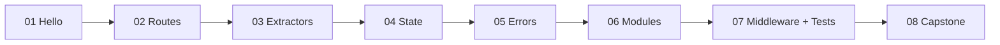

<callout background="green" icon="🌐">

**Build a real JSON web API in Rust with Actix Web, one hands-on step at a time.** Every lesson adds a piece to the **same project**: a bank API with accounts, deposits and withdrawals, the web version of the bank you built in plain Rust.

</callout>

**Level:** 🟢 → 🟡 · **Time:** about 1–2 evenings per lesson · **Version:** `actix-web 4`, Rust 1.89+

## How each lesson works

<columns>

<column>

### 🔨 Build

Numbered steps. Type the code yourself and run `cargo run` after each one.

</column>

<column>

### 💥 Break it

Toggles that make the common mistake on purpose, so you recognise the error message later.

</column>

<column>

### 🏋️ Exercise

A small task that pushes the bank further, plus a checklist to tick off.

</column>

</columns>

## The path

| \# | Lesson | You'll learn | The bank gets… |
| --- | --- | --- | --- |
| 01 | [Actix 01 Hello, Server](page:gvpkmmg2hn) | project setup, the app factory, `curl` | a running server |
| 02 | [Actix 02 Routes and Handlers](page:xa3snk8iq3) | macros vs `.route()`, methods, `web::scope`, 404/405 | the `/accounts` route map |
| 03 | [Actix 03 Extractors: Path, Query, Json](page:caj66ugnge) | `Path`, `Query`, `Json`, serde | reads ids and JSON bodies |
| 04 | [Actix 04 App State](page:o0yhl6fhvd) | `web::Data`, `Mutex`, worker threads | stores accounts in memory |
| 05 | [Actix 05 Errors and Status Codes](page:8uyl4dfwco) | `ResponseError`, `Result` handlers, `?` | deposit, withdraw, proper 4xx errors |
| 06 | [Actix 06 Project Layout with Modules](page:2o447fwgl4) | splitting into `lib.rs` + modules, `ServiceConfig` | a clean project structure |
| 07 | [Actix 07 Middleware and Testing](page:uv1mhmaebb) | `Logger`, `wrap_fn`, `actix_web::test` | request logs and automated tests |
| 08 | [Actix 08 Capstone: Bank API](page:j1fe8ewx0p) | everything together | the full reference code + challenges |

## My progress

- [ ] 01 Hello, Server
- [ ] 02 Routes and Handlers
- [ ] 03 Extractors: Path, Query, Json
- [ ] 04 App State
- [ ] 05 Errors and Status Codes
- [ ] 06 Project Layout with Modules
- [ ] 07 Middleware and Testing
- [ ] 08 Capstone: Bank API

## Before you start

<callout background="yellow" icon="📌">

**Rust you should be comfortable with first.** Structs and enums ([04 Structs, Enums and Pattern Matching](page:fn56do8fw7)), `Result` and `?` ([05 Collections, Strings and Errors](page:ubfingfdn1)), and especially `mod`, `use` and `crate::` ([06 Modules, Crates and Cargo](page:x4l9tlfa1i)), which lesson 06 relies on. You **don't** need to know async in depth: [11 Async Rust](page:m5cbwfmofv) explains it properly, but here you only write `async fn` and `.await`.

</callout>

**Your setup:** two terminals, one for `cargo run` (the server) and one for `curl` (requests). Every lesson's examples use `curl`. Add `-i` to see status codes.

## curl cheat sheet

| What | Command |
| --- | --- |
| GET | `curl localhost:8080/accounts` |
| see status + headers | `curl -i localhost:8080/accounts/1` |
| POST JSON | `curl -X POST localhost:8080/accounts -H 'content-type: application/json' -d '{"name":"Ama","age":25}'` |
| POST plain text | `curl -X POST localhost:8080/echo -d 'ping'` |
| other methods | `-X PUT`, `-X DELETE`, `-X PATCH` |
| query string | `curl 'localhost:8080/accounts?min_balance=50'` (quote it) |

## When something goes wrong

| Symptom | Usual cause | Lesson |
| --- | --- | --- |
| `404` for a route you wrote | forgot `.service(handler)`, or a trailing `/` | 01, 02 |
| `405 Method Not Allowed` | right path, wrong method (`GET` vs `POST`) | 02 |
| `400 Content type error` | missing `-H 'content-type: application/json'` | 03 |
| `400 Json deserialize error…` | the body doesn't match your struct | 03 |
| `500 Requested application data is not configured correctly` | state not registered with `.app_data`, or a type mismatch (watch for `mod` in `main.rs`) | 04, 06 |
| Counter or accounts behave differently on each request | state created **inside** `HttpServer::new` | 04 |
| `Address already in use` | the server is already running in another terminal | 01 |
| `curl: (52) Empty reply from server` | the handler panicked (overflow, `unwrap`) | 05 |

## Resources

- [Actix Web docs](https://actix.rs/docs/): the official guide
- [API reference on docs.rs](https://docs.rs/actix-web/latest/actix_web/): every type and trait
- [actix/examples](https://github.com/actix/examples): official example projects (databases, auth, websockets)
- [serde.rs](https://serde.rs): everything about `Serialize` and `Deserialize`

<toggle>

Where did the old "Getting started" content go?

The original installation and Hello World guide that used to be on this page is now [Actix 01 Hello, Server](page:gvpkmmg2hn), expanded with explanations of every line and a "break it" section.

</toggle>

---

↑ [Rust Learning Hub](page:7jlv8afgwm)
