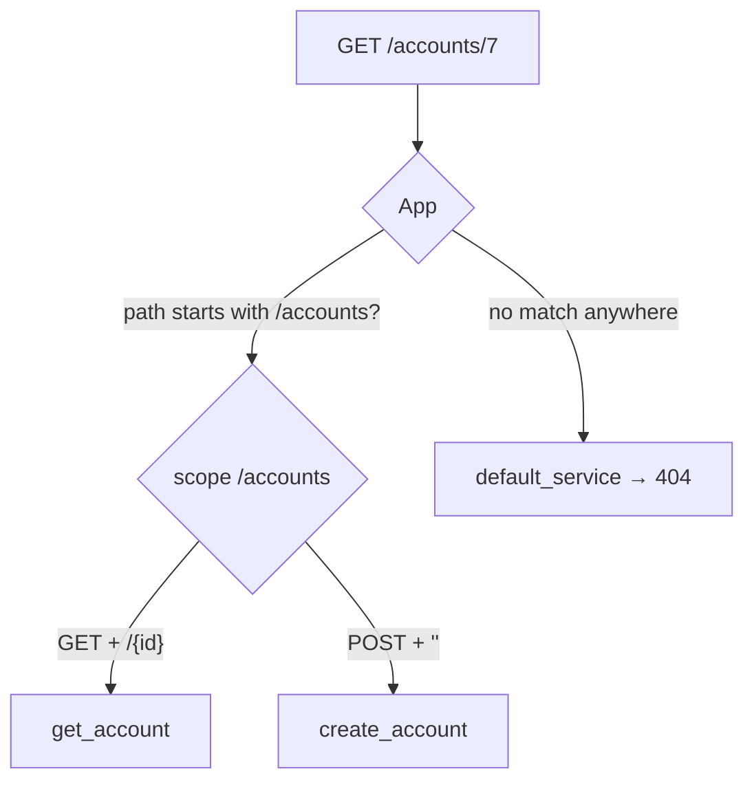

<callout background="green" icon="🧭">

**Decide which function answers which request.** A route is a method plus a path (`GET /accounts`) mapped to a handler. You'll learn the two ways to register routes, how to group them under a prefix, and what happens when nothing matches.

</callout>

**Level:** 🟢 Basics · **Needs:** [Actix 01 Hello, Server](page:gvpkmmg2hn)

## How a request finds its handler



A route matches on **both** the HTTP method and the path. `GET /echo` and `POST /echo` are different routes.

## Step 1: two ways to register

<columns>

<column>

**A. Routing macros**

```rust
#[get("/hello")]
async fn hello() -> impl Responder {
    "hi"
}

App::new().service(hello)
```

The method and path sit **on the function**. Register it with `.service(...)`.

</column>

<column>

**B. Manual `.route()`**

```rust
async fn hello() -> impl Responder {
    "hi"
}

App::new()
    .route("/hello", web::get().to(hello))
```

The function is plain, and the method and path live where the app is built.

</column>

</columns>

Both do the same thing. **Pick macros** for this course: you can see the URL right next to the code that handles it.

Methods: `#[get]`, `#[post]`, `#[put]`, `#[patch]`, `#[delete]`, or with `.route`: `web::get()`, `web::post()`, `web::put()`, `web::delete()`.

<toggle>

What can a handler return?

Anything that implements **`Responder`**. Common choices:

- `&'static str` or `String`: a 200 with that text, as in `"hi"` or `format!(...)`
- `HttpResponse`: full control over status, headers and body, as in `HttpResponse::Created().body("made")`
- `web::Json<T>`: a 200 with `T` as JSON (lesson 03)
- `Result<T, E>`: success or a typed error (lesson 05)

`impl Responder` as the return type means "some type that implements Responder, and the compiler can work out which".

</toggle>

## Step 2: try methods

Add to your `main.rs` from lesson 01:

```rust
use actix_web::{delete, get, post, put, web, App, HttpResponse, HttpServer, Responder};

#[get("/item")]
async fn get_item() -> impl Responder { "GET item" }

#[post("/item")]
async fn create_item() -> impl Responder { HttpResponse::Created().body("POST item") }

#[put("/item")]
async fn update_item() -> impl Responder { "PUT item" }

#[delete("/item")]
async fn delete_item() -> impl Responder { HttpResponse::NoContent().finish() }
```

Register all four with `.service(...)`, then run:

```bash
curl -i localhost:8080/item              # 200 GET item
curl -i -X POST localhost:8080/item      # 201 POST item
curl -i -X PUT localhost:8080/item       # 200 PUT item
curl -i -X DELETE localhost:8080/item    # 204 (no body)
curl -i -X PATCH localhost:8080/item     # 405 Method Not Allowed
```

`405` is not the same as `404`. **404** means "no route has this path". **405** means "this path exists, but not for this method".

## Step 3: group routes with `web::scope`

All bank routes start with `/accounts`. Instead of repeating that prefix, **scope** them:

```rust
#[get("")]                       // GET  /accounts
async fn list_accounts() -> impl Responder {
    "no accounts yet"
}

#[post("")]                      // POST /accounts
async fn create_account() -> impl Responder {
    HttpResponse::Created().body("would create an account")
}

// in main:
App::new().service(
    web::scope("/accounts")
        .service(list_accounts)
        .service(create_account),
)
```

Paths inside a scope are **relative** to it. `#[get("")]` means exactly `/accounts`, and `#[get("/{id}")]` (next lesson) means `/accounts/7`.

<toggle>

Gotcha: `/accounts` vs `/accounts/`

They're different paths. With `#[get("")]` in the `/accounts` scope, `curl localhost:8080/accounts/` (trailing slash) is a 404. Use the exact path, or add `.wrap(actix_web::middleware::NormalizePath::trim())` to the `App` to strip trailing slashes.

</toggle>

## Step 4: a custom 404

When nothing matches, Actix returns an empty 404. Give it a body:

```rust
App::new()
    .service(web::scope("/accounts").service(list_accounts).service(create_account))
    .default_service(web::to(|| async {
        HttpResponse::NotFound().body("no such page")
    }))
```

`curl -i localhost:8080/nope` now returns `404 no such page`.

## Step 5: scopes can nest

Versioning an API is a common use:

```rust
App::new().service(
    web::scope("/api/v1")
        .service(web::scope("/accounts").service(list_accounts))
)
// → GET /api/v1/accounts
```

<callout background="blue" icon="🏋️">

**Exercise 2.1: the bank's route map**

Inside a `/accounts` scope, add stub handlers (returning plain text for now) for these routes, and check each one with `curl -i`:

- `GET /accounts`: "list"
- `POST /accounts`: 201 "create"
- `GET /accounts/1`: "one account" (hard-code the `1` in the path for now; lesson 03 shows `{id}`)
- `POST /accounts/1/deposit`: "deposit"

Add a `default_service` that returns `404 {"error":"not found"}` with `HttpResponse::NotFound().content_type("application/json").body(...)`.

</callout>

## Checklist

- [ ] I can register a handler with a macro + `.service()` and with `.route()`
- [ ] I know a route is method **and** path
- [ ] I grouped routes with `web::scope` and understand relative paths
- [ ] I set a `default_service` for unmatched requests

---

[Actix Web hub](page:4oh6zeq50g) · Next → [Actix 03 Extractors: Path, Query, Json](page:caj66ugnge)
