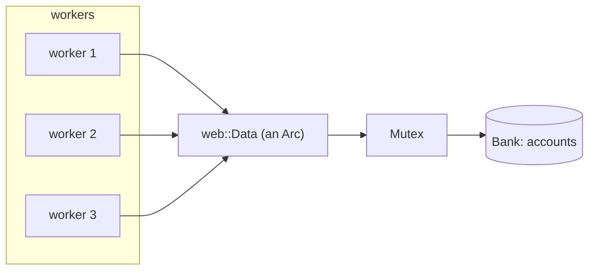

<callout background="green" icon="🏦">

**Give the server a memory.** So far every request forgets everything. Here the bank's accounts live in shared state that every handler can read and change, safely, even when many requests arrive at once.

</callout>

**Level:** 🟡 Intermediate · **Needs:** [Actix 03 Extractors: Path, Query, Json](page:caj66ugnge), [10 Fearless Concurrency](page:8nzk05a62m)

## The problem

Actix runs your app on **several worker threads at once**, usually one per CPU core. Two people could deposit into the same account at the same moment, on two threads. So the shared bank must be:

1. **Shared**: every worker sees the *same* bank, not its own copy.
1. **Locked while changing**: only one thread edits it at a time.



- **`web::Data<T>`** is Actix's wrapper around an `Arc<T>`, a pointer that many threads can share. Cloning it copies the *pointer*, not the bank.
- **`Mutex<T>`** is a lock. `.lock()` waits until no one else holds it, then gives you access.

## Step 1: a counter, to see the idea

Before the bank, try the smallest version in a fresh `main.rs` handler:

```rust
use std::sync::Mutex;

#[get("/count")]
async fn count(counter: web::Data<Mutex<u32>>) -> impl Responder {
    let mut n = counter.lock().unwrap();   // take the lock
    *n += 1;                               // change the value
    format!("visit number {n}")
}                                          // lock released here, when `n` is dropped

#[actix_web::main]
async fn main() -> std::io::Result<()> {
    let counter = web::Data::new(Mutex::new(0u32));   // made ONCE, outside

    HttpServer::new(move || {
        App::new()
            .app_data(counter.clone())                 // each worker gets the same pointer
            .service(count)
    })
    .bind(("127.0.0.1", 8080))?
    .run()
    .await
}
```

Run `curl localhost:8080/count` a few times and you'll see `visit number 1`, `2`, `3`, …

<toggle>

Why `move` and `.clone()`?

`HttpServer::new(|| …)` takes a closure that it calls **once per worker thread** to build that worker's `App`. That's why it's called an *app factory*.

- **`move`** puts `counter` into the closure, so the closure owns it.
- **`counter.clone()`** gives each worker its own `Data` handle. Every clone points at the same `Mutex`.

Without `move` you'd get `closure may outlive the current function, but it borrows counter`.

</toggle>

<callout background="yellow" icon="⚠️">

**Break it on purpose:** move the `web::Data::new(Mutex::new(0u32))` *inside* the closure, as `.app_data(web::Data::new(Mutex::new(0u32)))`, and curl a few times. The numbers stop going up steadily, because now **each worker builds its own counter**. Shared state must be created **once, outside** `HttpServer::new`.

</callout>

## Step 2: the bank state

Now the real thing. Add these to `main.rs`:

```rust
use std::collections::HashMap;
use std::sync::Mutex;

#[derive(Serialize, Clone)]
struct Account {
    id: u32,
    name: String,
    balance: u64,
}

#[derive(Default)]
struct Bank {
    accounts: HashMap<u32, Account>,   // id → account
    next_id: u32,
}

#[derive(Default)]
struct AppState {
    bank: Mutex<Bank>,
}
```

`#[derive(Default)]` lets you write `AppState::default()` to get an empty bank: no accounts, `next_id` 0.

In `main`:

```rust
let state = web::Data::new(AppState::default());

HttpServer::new(move || {
    App::new()
        .app_data(state.clone())
        .service(
            web::scope("/accounts")
                .service(list_accounts)
                .service(create_account)
                .service(get_account),
        )
})
```

## Step 3: create an account

Change `create_account` from lesson 03 so it **stores** the account:

```rust
#[post("")]
async fn create_account(
    state: web::Data<AppState>,
    body: web::Json<NewAccount>,
) -> impl Responder {
    let mut bank = state.bank.lock().unwrap();
    bank.next_id += 1;
    let account = Account { id: bank.next_id, name: body.name.clone(), balance: 0 };
    bank.accounts.insert(account.id, account.clone());
    HttpResponse::Created().json(account)
}
```

- **Extractor order doesn't matter.** `web::Data<AppState>` is just another extractor, like `Json` and `Path`.
- **`.clone()` on the account**: one copy goes into the map, and one goes back to the client as JSON.

## Step 4: read accounts back

```rust
#[get("")]
async fn list_accounts(state: web::Data<AppState>) -> impl Responder {
    let bank = state.bank.lock().unwrap();
    let list: Vec<Account> = bank.accounts.values().cloned().collect();
    HttpResponse::Ok().json(list)
}

#[get("/{id}")]
async fn get_account(state: web::Data<AppState>, path: web::Path<u32>) -> impl Responder {
    let id = path.into_inner();
    let bank = state.bank.lock().unwrap();
    match bank.accounts.get(&id) {
        Some(account) => HttpResponse::Ok().json(account),
        None => HttpResponse::NotFound().body("no such account"),
    }
}
```

## Step 5: try it

```bash
curl -X POST localhost:8080/accounts -H 'content-type: application/json' -d '{"name":"Ama","age":25}'
# {"id":1,"name":"Ama","balance":0}
curl -X POST localhost:8080/accounts -H 'content-type: application/json' -d '{"name":"Kofi","age":30}'
# {"id":2,"name":"Kofi","balance":0}

curl localhost:8080/accounts        # both accounts
curl localhost:8080/accounts/2      # just Kofi
curl -i localhost:8080/accounts/9   # 404 no such account
```

Stop the server with Ctrl+C and start it again, and the accounts are gone. The state lives **in memory only**. (Saving to disk is a capstone challenge.)

<toggle>

Error: "Requested application data is not configured correctly" (500)

The handler asks for `web::Data<AppState>`, but no `AppState` was registered with `.app_data(...)`, or a *different* type was registered (for example `web::Data<Mutex<Bank>>`). Actix finds state **by its exact type**, at runtime. Check that `.app_data(state.clone())` is there and that the types match.

</toggle>

<toggle>

Can I hold the lock across an `.await`?

Avoid it. `std::sync::Mutex` blocks the whole worker thread while it waits. These handlers lock, do quick work and return without awaiting anything, which is fine. If you ever need to `.await` (a database call, say) while holding a lock, use `tokio::sync::Mutex` instead, or better, release the lock before awaiting.

</toggle>

<callout background="blue" icon="🏋️">

**Exercise 4.1: reject under-18s and filter by balance**

1. In `create_account`, if `body.age < 18`, return `HttpResponse::BadRequest().body("must be 18 or older")` without creating anything.
1. Give `list_accounts` a `web::Query<ListQuery>` with `min_balance: Option<u64>`, and only return accounts with at least that balance. (Everyone has 0 for now. Lesson 05 adds deposits.)

</callout>

## Checklist

- [ ] I can explain why state needs both `web::Data` (sharing) and `Mutex` (locking)
- [ ] I create state **once**, outside `HttpServer::new`, and `.clone()` it inside
- [ ] Accounts I `POST` show up in `GET /accounts`
- [ ] I've seen what happens when the state is registered wrongly (500)

---

[Actix Web hub](page:4oh6zeq50g) · Next → [Actix 05 Errors and Status Codes](page:8uyl4dfwco)
