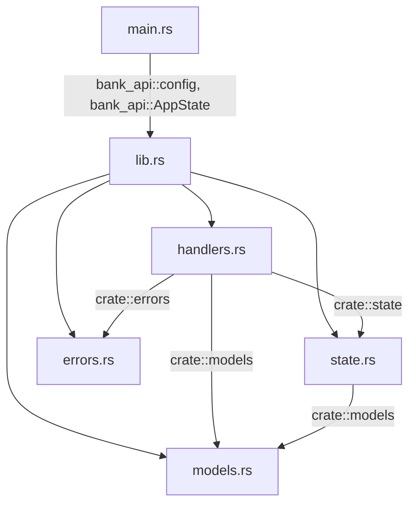

<callout background="green" icon="🗂️">

**Split the one big `main.rs` into a library with modules.** Nothing about how the API behaves changes. You'll move code into files and fix the paths, and that's what makes testing possible in lesson 07.

</callout>

**Level:** 🟢 Basics · **Needs:** [Actix 05 Errors and Status Codes](page:8uyl4dfwco), [06 Modules, Crates and Cargo](page:x4l9tlfa1i)

<callout background="yellow" icon="📌">

**The rules from the modules lesson, applied here**

1. `pub mod x;` lines go in **`lib.rs` only**, never in `main.rs`.
1. Inside the library, other modules are `crate::models::Account`.
1. In `main.rs` (and `tests/`) the library is `bank_api::…`, the package name `bank-api` with `-` turned into `_`.
1. Handlers, structs and **their fields** all need `pub`, or other modules can't see them.

</callout>

## Where everything goes

```text
src/
├── lib.rs        declares the modules, has config()
├── main.rs       only starts the server
├── models.rs     Account, NewAccount, Amount      (the JSON shapes)
├── state.rs      Bank, AppState                   (what's in web::Data)
├── errors.rs     BankError + its ResponseError
└── handlers.rs   the async fns with #[get]/#[post]
```



## Step by step

Do one file at a time and run `cargo build` after each step.

### Step 1: `models.rs`

Move `Account`, `NewAccount` and `Amount` out of `main.rs`, with their `use serde::…` line. Mark every struct **and every field** `pub`:

```rust
// src/models.rs
use serde::{Deserialize, Serialize};

#[derive(Serialize, Clone)]
pub struct Account {
    pub id: u32,
    pub name: String,
    pub balance: u64,
}

#[derive(Deserialize)]
pub struct NewAccount {
    pub name: String,
    pub age: u16,
}

#[derive(Deserialize)]
pub struct Amount {
    pub amount: u64,
}
```

Create `src/lib.rs` with one line:

```rust
pub mod models;
```

### Step 2: `state.rs`

```rust
// src/state.rs
use std::collections::HashMap;
use std::sync::Mutex;

use crate::models::Account;     // ✅ crate::, not bank_api::

#[derive(Default)]
pub struct Bank {
    pub accounts: HashMap<u32, Account>,
    pub next_id: u32,
}

#[derive(Default)]
pub struct AppState {
    pub bank: Mutex<Bank>,
}
```

Add `pub mod state;` to `lib.rs`.

<toggle>

Error: cannot find module or crate `bank_api` in this scope

You wrote `use bank_api::models::Account;` inside the library. A crate can't name itself, so use `crate::models::Account`.

</toggle>

### Step 3: `errors.rs`

Move `BankError`, its `Display` impl and its `ResponseError` impl from lesson 05 into `src/errors.rs`, and make the enum `pub`. Add `pub mod errors;` to `lib.rs`.

### Step 4: `handlers.rs`

Move all the handler functions here and mark each one **`pub`**. The imports at the top:

```rust
// src/handlers.rs
use actix_web::{get, post, web, HttpResponse};

use crate::errors::BankError;
use crate::models::{Account, Amount, NewAccount};
use crate::state::AppState;

#[post("")]
pub async fn create_account(
    state: web::Data<AppState>,
    body: web::Json<NewAccount>,
) -> Result<HttpResponse, BankError> {
    // … same body as before
}
```

<toggle>

Why `pub` if it compiles without it?

The `#[get]` and `#[post]` macros turn your function into a public struct with the same name, so `lib.rs` can register it even without `pub`. Write `pub` anyway. It says what you mean, and plain helper functions in `handlers.rs` (no macro) *do* need it.

</toggle>

### Step 5: `config()` in `lib.rs`

Move route registration out of `main.rs` into one function in the library. `ServiceConfig` is the same builder `App` uses, but you can pass it around:

```rust
// src/lib.rs
pub mod errors;
pub mod handlers;
pub mod models;
pub mod state;

use actix_web::web;

pub use state::AppState;      // lets main.rs write bank_api::AppState

pub fn config(cfg: &mut web::ServiceConfig) {
    cfg.service(
        web::scope("/accounts")
            .service(handlers::list_accounts)
            .service(handlers::create_account)
            .service(handlers::get_account)
            .service(handlers::deposit)
            .service(handlers::withdraw),
    );
}
```

### Step 6: a thin `main.rs`

`main.rs` shrinks to this. It has **no `mod` lines**:

```rust
// src/main.rs
use actix_web::{web, App, HttpServer};
use bank_api::AppState;

#[actix_web::main]
async fn main() -> std::io::Result<()> {
    let state = web::Data::new(AppState::default());

    HttpServer::new(move || {
        App::new()
            .app_data(state.clone())
            .configure(bank_api::config)
    })
    .bind(("127.0.0.1", 8080))?
    .run()
    .await
}
```

Run `cargo run` and repeat your curl commands from lesson 05. Everything should behave exactly as before.

<callout background="red" icon="⚠️">

**The sneakiest bug in this lesson: a 500 that compiles fine**

Leave `mod state;` in `main.rs` and use `state::AppState` there, and it **compiles with no error**. But every request returns:

```text
Requested application data is not configured correctly. View/enable debug logs for more details. [500]
```

`state.rs` was compiled twice, so there are two different `AppState` types. `main.rs` stored *its* copy with `app_data`, but the handlers ask for `bank_api::state::AppState`, the other copy. Actix looks state up **by type at runtime**, finds nothing, and returns 500.

Fix: delete every `mod` line from `main.rs` and use `bank_api::AppState`. It's the same trap as Step 5 of [06 Modules, Crates and Cargo](page:x4l9tlfa1i), except here it shows up at runtime instead of as a compile error.

</callout>

## Why bother?

<columns>

<column>

### Before

- One 200-line `main.rs`
- Tests would have to start a real server
- Hard to find anything

</column>

<column>

### After

- Each file has one job
- `tests/` can call `bank_api::config` directly (lesson 07)
- `main.rs` is 15 lines

</column>

</columns>

<callout background="blue" icon="🏋️">

**Exercise 6.1: a new module**

Add a `GET /health` route that returns `{"status":"ok"}`, in its **own** module `src/health.rs`, outside the `/accounts` scope. Register it in `config()`. Then add `ListQuery { min_balance: Option<u64> }` to `models.rs` and make `GET /accounts?min_balance=50` filter the list.

</callout>

## Checklist

- [ ] `lib.rs` has every `pub mod`, and `main.rs` has none
- [ ] Library files use `crate::…`, and `main.rs` uses `bank_api::…`
- [ ] All handlers, structs and fields that other modules use are `pub`
- [ ] Routes are registered in `config()`, and `main.rs` calls `.configure(bank_api::config)`

---

[Actix Web hub](page:4oh6zeq50g) · Next → [Actix 07 Middleware and Testing](page:uv1mhmaebb)
