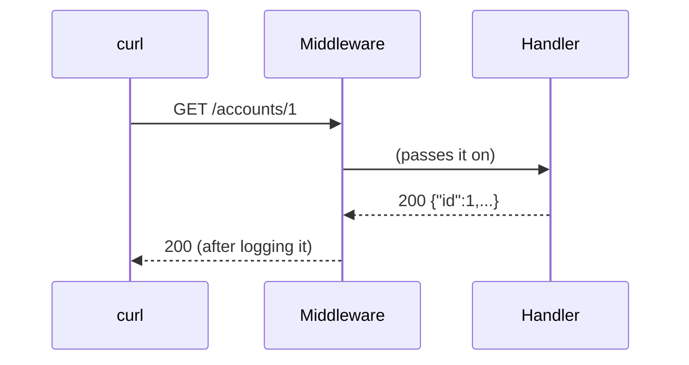

<callout background="green" icon="🧪">

**See every request, and prove your API works without curl.** Middleware wraps every request (logging, timing, auth). Actix's test tools call your handlers in-process, with no server and no port.

</callout>

**Level:** 🟡 Intermediate · **Needs:** [Actix 06 Project Layout with Modules](page:2o447fwgl4)

## Part 1: middleware

Middleware sits **between the server and your handlers**. Every request passes through it on the way in, and every response on the way out.



### Step 1: the built-in Logger

```bash
cargo add env_logger
```

`Logger` writes one line per request, but it needs a **logger backend** to print anywhere, and `env_logger` is the usual one. In `main.rs`:

```rust
use actix_web::{middleware::Logger, web, App, HttpServer};

#[actix_web::main]
async fn main() -> std::io::Result<()> {
    env_logger::init_from_env(env_logger::Env::default().default_filter_or("info"));

    let state = web::Data::new(bank_api::AppState::default());

    HttpServer::new(move || {
        App::new()
            .app_data(state.clone())
            .wrap(Logger::default())          // ← every request goes through this
            .configure(bank_api::config)
    })
    .bind(("127.0.0.1", 8080))?
    .run()
    .await
}
```

Run it, `curl localhost:8080/accounts`, and the terminal shows something like:

```text
[INFO  actix_web::middleware::logger] 127.0.0.1 "GET /accounts HTTP/1.1" 200 2 "-" "curl/8.9.1" 0.000241
```

That's the client IP, the request line, the status, the body size in bytes, the user agent and the time taken in seconds.

<toggle>

Nothing is printed?

You forgot the `env_logger::init_from_env(...)` line, or it runs after `HttpServer::new`. Without a backend, log messages go nowhere. `default_filter_or("info")` means "show info and above unless the `RUST_LOG` environment variable says otherwise", so `RUST_LOG=debug cargo run` shows much more.

</toggle>

### Step 2: write your own with `wrap_fn`

For small things you can write middleware as a closure. It gets the request and `srv`, the rest of the app:

```rust
use actix_web::dev::Service;   // brings .call() into scope

App::new()
    .wrap_fn(|req, srv| {
        println!("--> {} {}", req.method(), req.path());
        let fut = srv.call(req);          // pass the request on
        async move {
            let res = fut.await?;         // wait for the handler's response
            println!("<-- {}", res.status());
            Ok(res)
        }
    })
```

The code **before** `srv.call` runs on the way in, and the code **after** `fut.await` runs on the way out.

<toggle>

Error: no method named `call` found

`call` comes from the `Service` trait. Trait methods can only be used when the trait is in scope, so add `use actix_web::dev::Service;`.

</toggle>

<callout icon="💡">

Middleware runs in **reverse order of `.wrap()`**: the last `.wrap()` you add is the outermost layer and sees the request first.

</callout>

## Part 2: testing

This is the payoff from lesson 06. Because the routes live in `bank_api::config`, a test can build the **same app** without starting a server.

### Step 3: your first test

Make `tests/api.rs`. Files in `tests/` are **integration tests**: each one is a separate crate that uses your library from outside, just like `main.rs` does.

```rust
// tests/api.rs
use actix_web::{test, web, App};
use bank_api::AppState;

#[actix_web::test]
async fn missing_account_is_404() {
    let app = test::init_service(
        App::new()
            .app_data(web::Data::new(AppState::default()))
            .configure(bank_api::config),
    )
    .await;

    let req = test::TestRequest::get().uri("/accounts/42").to_request();
    let resp = test::call_service(&app, req).await;
    assert_eq!(resp.status(), 404);
}
```

Run `cargo test`:

```text
running 1 test
test missing_account_is_404 ... ok
```

- **`#[actix_web::test]`**: like `#[test]`, but it starts the async runtime, the same way `#[actix_web::main]` does for `main`.
- **`init_service`**: turns your `App` into something you can call directly.
- **`TestRequest`**: builds a fake request: `get()`, `post()`, `.uri(…)`, `.set_json(…)`.
- **`call_service`**: sends it and gives back the response.

### Step 4: read the JSON body

`call_and_read_body_json` sends the request and parses the response body. With `serde_json::Value` you don't need a struct for it:

```rust
use serde_json::{json, Value};

#[actix_web::test]
async fn create_then_deposit() {
    let state = web::Data::new(AppState::default());
    let app = test::init_service(App::new().app_data(state).configure(bank_api::config)).await;

    let req = test::TestRequest::post()
        .uri("/accounts")
        .set_json(json!({ "name": "Ama", "age": 25 }))
        .to_request();
    let created: Value = test::call_and_read_body_json(&app, req).await;
    assert_eq!(created["id"], 1);

    let req = test::TestRequest::post()
        .uri("/accounts/1/deposit")
        .set_json(json!({ "amount": 100 }))
        .to_request();
    let acc: Value = test::call_and_read_body_json(&app, req).await;
    assert_eq!(acc["balance"], 100);
}
```

`set_json` also sets the `content-type: application/json` header for you.

<callout background="yellow" icon="⚠️">

**Each test gets fresh state.** You create a new `AppState` inside each test, so tests never see each other's accounts and can run in any order.

</callout>

<callout background="blue" icon="🏋️">

**Exercise 7.1: test every error**

Write one test per error case: under 18 → `400`, depositing `0` → `400`, unknown id → `404`, overdraw → `409`. Then add a `wrap_fn` middleware that adds a header `x-bank: demo` to every response (`res.headers_mut().insert(...)`), and test that the header is there.

</callout>

<toggle>

Hint: inserting a header

```rust
use actix_web::http::header::{HeaderName, HeaderValue};

let mut res = fut.await?;
res.headers_mut().insert(
    HeaderName::from_static("x-bank"),
    HeaderValue::from_static("demo"),
);
Ok(res)
```

In the test: `assert_eq!(resp.headers().get("x-bank").unwrap(), "demo");`

</toggle>

## Checklist

- [ ] I added `Logger` and saw one log line per request
- [ ] I wrote a `wrap_fn` that prints before and after the handler
- [ ] I can write a test with `init_service`, `TestRequest` and `call_service`
- [ ] `cargo test` passes with a test for every error case

---

[Actix Web hub](page:4oh6zeq50g) · Next → [Actix 08 Capstone: Bank API](page:j1fe8ewx0p)
