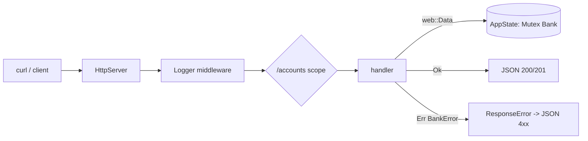

<callout background="green" icon="🏁">

**Everything together.** This is the complete bank API you built across lessons 01–07, as one reference you can compare your code against. The page ends with challenges to extend it.

</callout>

**Level:** 🟡 Intermediate · **Needs:** all of lessons 01–07

## What the finished API does

| Method | Path | Body | Success | Errors |
| --- | --- | --- | --- | --- |
| `GET` | `/accounts?min_balance=50` | none | `200` list of accounts | none |
| `POST` | `/accounts` | `{"name":"Ama","age":25}` | `201` new account | `400` under 18, bad JSON |
| `GET` | `/accounts/{id}` | none | `200` the account | `404` no such id |
| `POST` | `/accounts/{id}/deposit` | `{"amount":100}` | `200` updated account | `400` amount 0, `404` |
| `POST` | `/accounts/{id}/withdraw` | `{"amount":40}` | `200` updated account | `409` insufficient funds, `404` |



## Try the whole flow

Start it with `cargo run` in one terminal, then in another:

```bash
# create an account (201)
curl -i -X POST localhost:8080/accounts \
  -H 'content-type: application/json' -d '{"name":"Ama","age":25}'

# deposit 100, then withdraw 40
curl -X POST localhost:8080/accounts/1/deposit  -H 'content-type: application/json' -d '{"amount":100}'
curl -X POST localhost:8080/accounts/1/withdraw -H 'content-type: application/json' -d '{"amount":40}'
# {"id":1,"name":"Ama","balance":60}

# the errors
curl -i -X POST localhost:8080/accounts/1/withdraw -H 'content-type: application/json' -d '{"amount":999}'
# 409 {"error":"insufficient funds"}
curl -i localhost:8080/accounts/42
# 404 {"error":"account not found"}
curl -i -X POST localhost:8080/accounts -H 'content-type: application/json' -d '{"name":"Kofi","age":12}'
# 400 {"error":"invalid data: must be 18 or older"}
```

Then `cargo test`, which should report 3 passed.

## The full code

<callout icon="💡">

This code was compiled and tested with `actix-web 4`, `serde 1`, `serde_json 1` and `env_logger 0.11`. Open each toggle to see one file.

</callout>

```text
bank-api/
├── Cargo.toml
├── src/
│   ├── lib.rs        pub mod … + config()
│   ├── main.rs       starts the server
│   ├── models.rs     Account, NewAccount, Amount, ListQuery
│   ├── state.rs      Bank, AppState
│   ├── errors.rs     BankError + ResponseError
│   └── handlers.rs   the five handlers
└── tests/
    └── api.rs
```

<toggle>

Cargo.toml

```toml
[package]
name = "bank-api"
version = "0.1.0"
edition = "2024"

[dependencies]
actix-web = "4"
env_logger = "0.11"
serde = { version = "1", features = ["derive"] }
serde_json = "1"
```

</toggle>

<toggle>

src/lib.rs

```rust
pub mod errors;
pub mod handlers;
pub mod models;
pub mod state;

use actix_web::web;

pub use state::AppState;

/// Registers every route. main.rs and the tests both call this.
pub fn config(cfg: &mut web::ServiceConfig) {
    cfg.service(
        web::scope("/accounts")
            .service(handlers::list_accounts)
            .service(handlers::create_account)
            .service(handlers::get_account)
            .service(handlers::deposit)
            .service(handlers::withdraw),
    );
}
```

</toggle>

<toggle>

src/main.rs

```rust
use actix_web::{middleware::Logger, web, App, HttpServer};
use bank_api::AppState;

#[actix_web::main]
async fn main() -> std::io::Result<()> {
    env_logger::init_from_env(env_logger::Env::default().default_filter_or("info"));

    let state = web::Data::new(AppState::default());

    println!("listening on http://127.0.0.1:8080");
    HttpServer::new(move || {
        App::new()
            .app_data(state.clone())
            .wrap(Logger::default())
            .configure(bank_api::config)
    })
    .bind(("127.0.0.1", 8080))?
    .run()
    .await
}
```

</toggle>

<toggle>

src/models.rs

```rust
use serde::{Deserialize, Serialize};

#[derive(Serialize, Clone)]
pub struct Account {
    pub id: u32,
    pub name: String,
    pub balance: u64,
}

#[derive(Deserialize)]
pub struct NewAccount {
    pub name: String,
    pub age: u16,
}

#[derive(Deserialize)]
pub struct Amount {
    pub amount: u64,
}

#[derive(Deserialize)]
pub struct ListQuery {
    pub min_balance: Option<u64>,
}
```

</toggle>

<toggle>

src/state.rs

```rust
use std::collections::HashMap;
use std::sync::Mutex;

use crate::models::Account;

#[derive(Default)]
pub struct Bank {
    pub accounts: HashMap<u32, Account>,
    pub next_id: u32,
}

#[derive(Default)]
pub struct AppState {
    pub bank: Mutex<Bank>,
}
```

</toggle>

<toggle>

src/errors.rs

```rust
use std::fmt;

use actix_web::{http::StatusCode, HttpResponse, ResponseError};
use serde_json::json;

#[derive(Debug)]
pub enum BankError {
    NotFound,
    InsufficientFunds,
    InvalidData(String),
}

impl fmt::Display for BankError {
    fn fmt(&self, f: &mut fmt::Formatter) -> fmt::Result {
        match self {
            BankError::NotFound => write!(f, "account not found"),
            BankError::InsufficientFunds => write!(f, "insufficient funds"),
            BankError::InvalidData(msg) => write!(f, "invalid data: {msg}"),
        }
    }
}

impl ResponseError for BankError {
    fn status_code(&self) -> StatusCode {
        match self {
            BankError::NotFound => StatusCode::NOT_FOUND,
            BankError::InsufficientFunds => StatusCode::CONFLICT,
            BankError::InvalidData(_) => StatusCode::BAD_REQUEST,
        }
    }

    fn error_response(&self) -> HttpResponse {
        HttpResponse::build(self.status_code()).json(json!({ "error": self.to_string() }))
    }
}
```

</toggle>

<toggle>

src/handlers.rs

```rust
use actix_web::{get, post, web, HttpResponse};

use crate::errors::BankError;
use crate::models::{Account, Amount, ListQuery, NewAccount};
use crate::state::AppState;

#[get("")]
pub async fn list_accounts(
    state: web::Data<AppState>,
    query: web::Query<ListQuery>,
) -> HttpResponse {
    let bank = state.bank.lock().unwrap();
    let min = query.min_balance.unwrap_or(0);
    let list: Vec<Account> = bank
        .accounts
        .values()
        .filter(|a| a.balance >= min)
        .cloned()
        .collect();
    HttpResponse::Ok().json(list)
}

#[post("")]
pub async fn create_account(
    state: web::Data<AppState>,
    body: web::Json<NewAccount>,
) -> Result<HttpResponse, BankError> {
    if body.age < 18 {
        return Err(BankError::InvalidData("must be 18 or older".into()));
    }
    let mut bank = state.bank.lock().unwrap();
    bank.next_id += 1;
    let account = Account { id: bank.next_id, name: body.name.clone(), balance: 0 };
    bank.accounts.insert(account.id, account.clone());
    Ok(HttpResponse::Created().json(account))
}

#[get("/{id}")]
pub async fn get_account(
    state: web::Data<AppState>,
    path: web::Path<u32>,
) -> Result<HttpResponse, BankError> {
    let id = path.into_inner();
    let bank = state.bank.lock().unwrap();
    let account = bank.accounts.get(&id).ok_or(BankError::NotFound)?;
    Ok(HttpResponse::Ok().json(account))
}

#[post("/{id}/deposit")]
pub async fn deposit(
    state: web::Data<AppState>,
    path: web::Path<u32>,
    body: web::Json<Amount>,
) -> Result<HttpResponse, BankError> {
    if body.amount == 0 {
        return Err(BankError::InvalidData("amount must be above 0".into()));
    }
    let mut bank = state.bank.lock().unwrap();
    let account = bank.accounts.get_mut(&path.into_inner()).ok_or(BankError::NotFound)?;
    account.balance += body.amount;
    Ok(HttpResponse::Ok().json(account.clone()))
}

#[post("/{id}/withdraw")]
pub async fn withdraw(
    state: web::Data<AppState>,
    path: web::Path<u32>,
    body: web::Json<Amount>,
) -> Result<HttpResponse, BankError> {
    let mut bank = state.bank.lock().unwrap();
    let account = bank.accounts.get_mut(&path.into_inner()).ok_or(BankError::NotFound)?;
    if account.balance < body.amount {
        return Err(BankError::InsufficientFunds);
    }
    account.balance -= body.amount;
    Ok(HttpResponse::Ok().json(account.clone()))
}
```

</toggle>

<toggle>

tests/api.rs

```rust
use actix_web::{test, web, App};
use bank_api::AppState;
use serde_json::{json, Value};

#[actix_web::test]
async fn create_deposit_withdraw() {
    let state = web::Data::new(AppState::default());
    let app = test::init_service(App::new().app_data(state).configure(bank_api::config)).await;

    let req = test::TestRequest::post()
        .uri("/accounts")
        .set_json(json!({ "name": "Ama", "age": 25 }))
        .to_request();
    let created: Value = test::call_and_read_body_json(&app, req).await;
    assert_eq!(created["id"], 1);

    let req = test::TestRequest::post()
        .uri("/accounts/1/deposit")
        .set_json(json!({ "amount": 100 }))
        .to_request();
    let acc: Value = test::call_and_read_body_json(&app, req).await;
    assert_eq!(acc["balance"], 100);

    let req = test::TestRequest::post()
        .uri("/accounts/1/withdraw")
        .set_json(json!({ "amount": 500 }))
        .to_request();
    let resp = test::call_service(&app, req).await;
    assert_eq!(resp.status(), 409);
}

#[actix_web::test]
async fn missing_account_is_404() {
    let app = test::init_service(
        App::new().app_data(web::Data::new(AppState::default())).configure(bank_api::config),
    )
    .await;
    let req = test::TestRequest::get().uri("/accounts/42").to_request();
    let resp = test::call_service(&app, req).await;
    assert_eq!(resp.status(), 404);
}

#[actix_web::test]
async fn underage_is_400() {
    let app = test::init_service(
        App::new().app_data(web::Data::new(AppState::default())).configure(bank_api::config),
    )
    .await;
    let req = test::TestRequest::post()
        .uri("/accounts")
        .set_json(json!({ "name": "Kofi", "age": 12 }))
        .to_request();
    let resp = test::call_service(&app, req).await;
    assert_eq!(resp.status(), 400);
}
```

</toggle>

## Challenges

Each challenge uses something from an earlier lesson. Write a test for each one before you call it done.

- [ ] **Transfer money**: `POST /accounts/{id}/transfer` with `{"to": 2, "amount": 30}`. Both accounts must exist, and the sender needs enough money. Hold the lock once for the whole transfer, so nobody sees half of it.
- [ ] **Delete an account**: `DELETE /accounts/{id}` returns `204 No Content` (`HttpResponse::NoContent().finish()`), or `404`.
- [ ] **Rename**: `PUT /accounts/{id}` with `{"name": "…"}`. Reject an empty name with `400`.
- [ ] **Transaction history**: give each `Account` a `Vec` of transactions, recording the `TransactionType` enum from your Rust bank exercise, and add `GET /accounts/{id}/history`.
- [ ] **Overflow safety**: use `checked_add` in `deposit`, so a huge amount returns `400` instead of crashing.
- [ ] **Save to disk**: on every change, write the accounts to `bank.json` with `serde_json::to_string_pretty`, and load them at start-up.
- [ ] **Random IDs**: replace `next_id` with a 4-digit random ID from the `rand` crate, retrying if it's already taken (your `gen_id` from the Rust project).

<toggle>

Hint: the transfer lock

Lock once and use `get_mut` twice in sequence, not at the same time. Check everything first, then change both balances:

```rust
let mut bank = state.bank.lock().unwrap();
let from_balance = bank.accounts.get(&from).ok_or(BankError::NotFound)?.balance;
if !bank.accounts.contains_key(&to) { return Err(BankError::NotFound); }
if from_balance < amount { return Err(BankError::InsufficientFunds); }
bank.accounts.get_mut(&from).unwrap().balance -= amount;
bank.accounts.get_mut(&to).unwrap().balance += amount;
```

Two `get_mut` calls alive at once would be two mutable borrows of the same map, which the borrow checker rejects.

</toggle>

---

[Actix Web hub](page:4oh6zeq50g)
