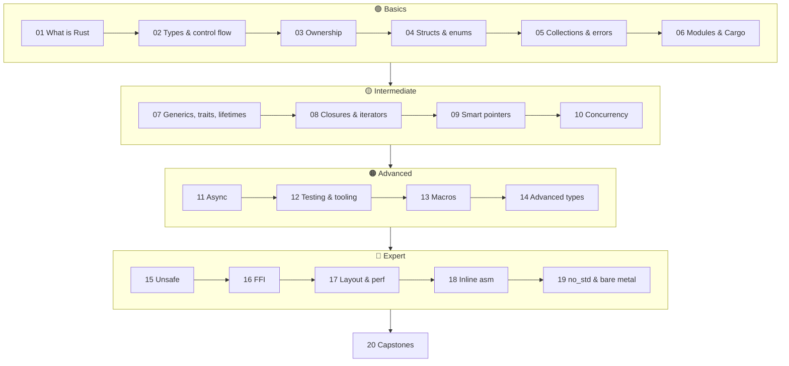

<callout background="orange" icon="🦀">

**Rust from zero to bare metal.** Twenty modules that go from *what is Rust?* to unsafe code, FFI, inline assembly and `no_std` kernels, with exercises after every section.

</callout>

## How to use this

1. Work through the modules **in order**. Each one builds on the last.
1. Every module has **🏋️ exercises in between the sections**. Do them before reading on; hints and solutions are hidden in toggles.
1. Just before each exercise there's a **Building up to it** section. It says what the exercise is asking in plain words, then works up to it in small steps with examples you can run. If an exercise doesn't make sense, read that section first.
1. Tick your progress in [Rust Exercises](page:nbnwy0q2zt): set *Status*, the date, and a note on what tripped you up.
1. Keep one scratch crate (`cargo new rust-playground`) for drills, and a fresh crate for each mini-project.

<callout icon="💡">

**Fast feedback loop:** `cargo check` on save (rust-analyzer does it for you), `cargo clippy` before you call an exercise done, and [play.rust-lang.org](https://play.rust-lang.org) for one-off experiments. For the assembly modules, keep [godbolt.org](https://godbolt.org) open.

</callout>

## Roadmap

## Modules

<columns>

<column>

### 🟢 Basics

- [01 What Is Rust](page:yfq54za15s): why Rust, toolchain, Cargo, how it compiles
- [02 Variables, Types and Control Flow](page:9ll61je1wh): types, overflow, expressions, loops
- [03 Ownership and Borrowing](page:acpvbrr41r): moves, borrows, slices ⭐ *the key module*
- [04 Structs, Enums and Pattern Matching](page:fn56do8fw7): data modelling, `match`
- [05 Collections, Strings and Errors](page:ubfingfdn1): `Vec`, `HashMap`, UTF-8, `Result` and `?`
- [06 Modules, Crates and Cargo](page:x4l9tlfa1i): project layout, dependencies, workspaces

### 🟡 Intermediate

- [07 Generics, Traits and Lifetimes](page:8s3iybt7d1): generic code, traits, lifetime annotations
- [08 Closures and Iterators](page:ch1buo23yl): `Fn` traits, iterator chains
- [09 Smart Pointers and Interior Mutability](page:p7tycay9d0): `Box`, `Rc`, `RefCell`, `Weak`
- [10 Fearless Concurrency](page:8nzk05a62m): threads, channels, `Arc<Mutex>`, atomics

</column>

<column>

### 🟠 Advanced

- [11 Async Rust](page:m5cbwfmofv): futures, tokio, wakers, your own executor
- [12 Testing and Tooling](page:m4szna8wnq): tests, proptest, clippy, benchmarks
- [13 Macros](page:4s3fizqndu): `macro_rules!` and proc macros
- [14 Advanced Types and Traits](page:olti30ae4p): typestate, `PhantomData`, GATs

### 🔴 Expert

- [15 Unsafe Rust](page:fnp814n35n): raw pointers, UB, Miri, building `Vec` by hand
- [16 FFI: Rust and C](page:zrjvts0nzd): calling C, exposing Rust to C
- [17 Memory Layout and Performance](page:ap65audlmt): `repr`, niches, allocators, profiling
- [18 Inline Assembly](page:nes55qk0m4): reading asm, `asm!`, syscalls, naked functions, SIMD
- [19 no\_std and Bare Metal](page:qa2zkcsrl1): kernels and microcontrollers

### 🏁 Finish

- [20 Capstone Projects](page:vs9mlsqw3d): HTTP server, interpreter, emulator, OS kernel

</column>

</columns>

## Progress

<columns>

<column width=0.5519>

<database-chart by="9xw8e8s6xs" chart="donut" colors="color" db="q2tq4m969r"/>

</column>

<column width=0.4481>

<database-chart by="8gnkp85mko" chart="stacked" colors="color" db="q2tq4m969r" series="9xw8e8s6xs"/>

</column>

</columns>

<database-view db="q2tq4m969r" view="pa3qi9zd65"/>

## Resources

<columns>

<column>

### 📘 Core books (free)

- [The Rust Programming Language](https://doc.rust-lang.org/book/) ("the Book")
- [Rust by Example](https://doc.rust-lang.org/rust-by-example/)
- [Rustlings](https://github.com/rust-lang/rustlings): small fix-the-code drills
- [Comprehensive Rust](https://google.github.io/comprehensive-rust/) (Google's course)
- [std docs](https://doc.rust-lang.org/std/)

</column>

<column>

### 🔬 Going deep

- [The Rustonomicon](https://doc.rust-lang.org/nomicon/): the unsafe book
- [Rust Atomics and Locks](https://marabos.nl/atomics/) by Mara Bos (free online)
- *Rust for Rustaceans* by Jon Gjengset
- [The Rust Reference: inline assembly](https://doc.rust-lang.org/reference/inline-assembly.html)
- [Writing an OS in Rust](https://os.phil-opp.com/) (blog\_os)
- [The Embedded Rust Book](https://docs.rust-embedded.org/book/)
- [Asynchronous Programming in Rust](https://rust-lang.github.io/async-book/)

</column>

</columns>

<toggle>

Related notes elsewhere in the workspace

- [Winit-Rust](page:6v7lwwxlhd): windowing with winit
- [Rust Patterns for Engines](page:7nta66y9tk) and the [Vellum Project Hub](page:qo8zh49wt3): a real Rust project to apply all of this to

</toggle>
