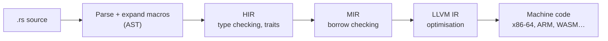

<callout background="green" icon="🦀">

**Rust is a systems programming language with the speed and control of C and C++, but memory safety guaranteed at compile time** (no garbage collector). If it compiles, a whole class of crashes and security bugs simply can't happen.

</callout>

**Level:** 🟢 Basics · **Needs:** nothing, just a terminal

## Why Rust exists

Around **70% of serious security bugs** in large C and C++ codebases (Microsoft, Chromium, Android) are memory-safety bugs: use-after-free, buffer overflows, data races. Languages with a garbage collector avoid them but pay in speed, memory and unpredictable pauses. Rust's bet: **check memory safety at compile time** through *ownership* (module 03), and get both.

<columns>

<column>

### What you get

- ⚡ C-level speed, no runtime, no GC pauses
- 🛡️ No null, no dangling pointers, no data races (in safe code)
- 🧰 Cargo: build, test, docs, dependencies in one tool
- 💬 The friendliest compiler errors anywhere
- 🌍 Runs on servers, browsers (WASM), microcontrollers, kernels

</column>

<column>

### What it costs

- 📈 A steep start: the borrow checker rejects code that "looks fine"
- 🐢 Slower compile times than Go or C
- 🧠 More concepts up front (lifetimes, traits, ownership)
- 📦 A younger ecosystem in some areas (GUI, some scientific libraries)

</column>

</columns>

## Where it's used

- **Operating systems:** Linux kernel drivers, Android, Windows kernel components
- **Infrastructure:** Cloudflare's proxy, AWS Firecracker (Lambda's micro-VMs), Discord, Dropbox sync
- **Developer tools:** ripgrep, fd, bat, uv and ruff (Python tooling), Deno, Zed editor
- **Browsers and WASM:** Firefox's style engine, front-end apps compiled to WebAssembly
- **Games and graphics:** Bevy, wgpu (see [Vellum Project Hub](page:qo8zh49wt3))
- **Embedded:** microcontroller firmware with Embassy

## A taste

```rust
fn main() {
    let names = vec!["Ada", "Grace", "Linus"];
    for (i, name) in names.iter().enumerate() {
        println!("{i}: Hello, {name}!");
    }
    let total: usize = names.iter().map(|n| n.len()).sum();
    println!("{total} letters in total");
}
```

## Install the toolchain

```bash
# Linux / macOS (Windows: download rustup-init.exe from rustup.rs)
curl --proto '=https' --tlsv1.2 -sSf https://sh.rustup.rs | sh

rustc --version
cargo --version
rustup update            # update later
rustup doc --book        # the Book, offline
```

| Tool | Does |
| --- | --- |
| `rustup` | installs and switches toolchains (stable, beta, nightly) and targets |
| `rustc` | the compiler (you rarely call it directly) |
| `cargo` | build system and package manager: you use this all day |
| `rust-analyzer` | the editor language server (VS Code, Zed, Neovim, Helix, RustRover) |
| `clippy`, `rustfmt` | linter and formatter, installed with rustup |

## Your first project

```bash
cargo new hello
cd hello
cargo run
```

```text
hello/
├── Cargo.toml      # name, version, edition, dependencies
├── Cargo.lock      # exact versions resolved (created on first build)
├── src/
│   └── main.rs
└── target/         # build output (don't commit)
```

```toml
[package]
name = "hello"
version = "0.1.0"
edition = "2024"

[dependencies]
```

### Cargo commands you'll use daily

| Command | Does |
| --- | --- |
| `cargo check` | type-check only, very fast: use constantly |
| `cargo build` | debug build into `target/debug/` |
| `cargo run` | build and run |
| `cargo build --release` | optimised build into `target/release/` |
| `cargo test` | run tests |
| `cargo fmt` / `cargo clippy` | format / lint |
| `cargo doc --open` | docs for your code and every dependency |
| `cargo add serde` | add a dependency |

### Building up to 1.1

**The goal in plain words:** get Rust onto your machine, make a project, change one line, and see it run. Nothing to design yet. The point is to see the whole loop once.

**Step 1: install.** Run the `curl … | sh` line from *Install the toolchain* and accept the defaults. Open a **new** terminal (the installer adds `~/.cargo/bin` to your `PATH`, and only new shells see it), then check:

```bash
rustc --version    # rustc 1.xx.x (…)
cargo --version
```

**Step 2: editor support.** Install the **rust-analyzer** extension for your editor (in VS Code, search the extensions panel for "rust-analyzer"). You'll know it works when you hover over a variable in a `.rs` file and see its type.

**Step 3: make and run the project.**

```bash
cargo new hello
cd hello
cargo run          # prints: Hello, world!
```

**Step 4: change the program.** Open `src/main.rs`. `println!` prints a line, and `{}` marks where a value goes:

```rust
fn main() {
    println!("My name is {}", "Ada");     // {} is filled with "Ada"
    println!("2 + 2 = {}", 2 + 2);        // any expression works
}
```

`2_u64.pow(40)` reads as "the number 2, as a `u64` (an unsigned 64-bit integer), raised to the 40th power". The `_u64` suffix sets the type. Without it, Rust picks `i32`, which is too small for 2⁴⁰ (about 1.1 trillion). Put your name and that value into `println!` lines and `cargo run` again. \<callout background="blue" icon="🏋️">

**Exercise 1.1 — Install Rust and run Hello, Cargo**

Install with rustup, set up rust-analyzer in your editor, then `cargo new hello` and change the program to print your name and the result of `2_u64.pow(40)`. Run it with `cargo run`.

\</callout>

### Building up to 1.2

**The goal in plain words:** Cargo can build your program in different ways. You'll measure how long each one takes and how big the program it makes is, so the difference between a *debug* and a *release* build is something you've seen for yourself.

**Step 1: timing a command.** Put `time` in front of any command. The `real` line is the wall-clock time:

```bash
time cargo check
# real  0m0.41s   ← this one
# user  0m0.20s
# sys   0m0.12s
```

Cargo skips work it has already done, so a second run is instant. To time a full build again, run `cargo clean` first.

**Step 2: the three builds.**

- `cargo check` only checks your code for errors and makes no program.
- `cargo build` makes a debug program in `target/debug/hello`: built quickly, runs slowly, easy to debug.
- `cargo build --release` makes an optimised program in `target/release/hello`: built slowly, runs fast.

**Step 3: compare sizes.** `ls -lh` lists files with readable sizes:

```bash
ls -lh target/debug/hello target/release/hello
```

**Step 4: what the three settings mean.** `[profile.release]` in `Cargo.toml` changes how `--release` builds:

| Setting | Means |
| --- | --- |
| `strip = true` | remove the debug symbols (names for debuggers) from the binary |
| `opt-level = "z"` | optimise for **size** instead of speed |
| `lto = true` | "link-time optimisation": optimise across all crates together, removing unused code |

Add them, run `cargo build --release` again, and repeat the `ls -lh`.

<callout background="blue" icon="🏋️">

**Exercise 1.2 — Explore check, build and release**

In `hello`: time `cargo check`, `cargo build` and `cargo build --release` (use `time`). Compare the sizes of `target/debug/hello` and `target/release/hello`. Then add to `Cargo.toml`:

```toml
[profile.release]
strip = true
opt-level = "z"
lto = true
```

and rebuild. How small does it get?

</callout>

<toggle>

What you should notice

`check` skips code generation, so it's much faster: that's what your editor runs. Release builds take longer but run far faster. The debug binary is bigger because of debug info; `strip`, `opt-level = "z"` (optimise for size) and `lto` shrink release binaries a lot.

</toggle>

## How Rust compiles



The **borrow checker** runs on MIR: that's where ownership errors come from. LLVM then optimises like a C compiler would. In [18 Inline Assembly](page:nes55qk0m4) you'll read the machine code at the end of this pipeline.

## Editions

Editions (2015, 2018, 2021, **2024**) let Rust make small breaking changes without splitting the ecosystem: each crate picks its edition, and crates of different editions work together. New projects use 2024; these notes assume it.

### Building up to 1.3

**The goal in plain words:** the compiler will be your main teacher, so learn to read what it says. Rust errors have a fixed layout, and once you know it, most errors tell you their own fix.

Here is an error broken into its parts (from a different mistake, so 1.3 is still yours to solve):

```text
error[E0425]: cannot find value `nmae` in this scope      ← 1. code and one-line summary
 --> src/main.rs:3:20                                     ← 2. file:line:column
  |
3 |     println!("{}", nmae);
  |                    ^^^^ help: a local variable with a similar name exists: `name`
  |                    ↑ 3. the exact spot          ↑ 4. the suggested fix
```

1. **The code** (`E0425`) names the *kind* of error. `rustc --explain E0425` prints a full explanation with examples.
1. **The location** tells you where to look. In most editors you can click it.
1. **The `^^^^` marks** underline the exact code, often with a short label next to them.
1. **`help:` and `note:` lines** suggest a fix or explain why. Read them before anything else.

For the exercise: run `cargo check`, find each of these four parts in the error you get, run `rustc --explain` with its code, then make the change the `help:` line suggests.

<callout background="blue" icon="🏋️">

**Exercise 1.3 — Read your first compiler error**

Paste this into `main.rs` and run `cargo check`. Read the **whole** error: the code (E…), the labels, the help line. Then run `rustc --explain` with the error code. Fix it.

```rust
fn main() {
    let x = 5;
    x = 6;
    println!("{x}");
}
```

</callout>

<toggle>

Answer

`error[E0384]: cannot assign twice to immutable variable 'x'`, with a help suggestion to write `let mut x`. Rust variables are immutable unless declared `mut` (module 02). Get used to treating compiler errors as a conversation: they usually tell you the fix.

</toggle>

## Checklist

- [ ] I can explain in one sentence what makes Rust different from C and from Python
- [ ] Rust, rust-analyzer, clippy and rustfmt are installed
- [ ] I know `cargo check`, `build`, `run`, `test` and `--release`
- [ ] I've read a compiler error and used `rustc --explain`

---

[Rust Learning Hub](page:7jlv8afgwm) · Next → [02 Variables, Types and Control Flow](page:9ll61je1wh)
