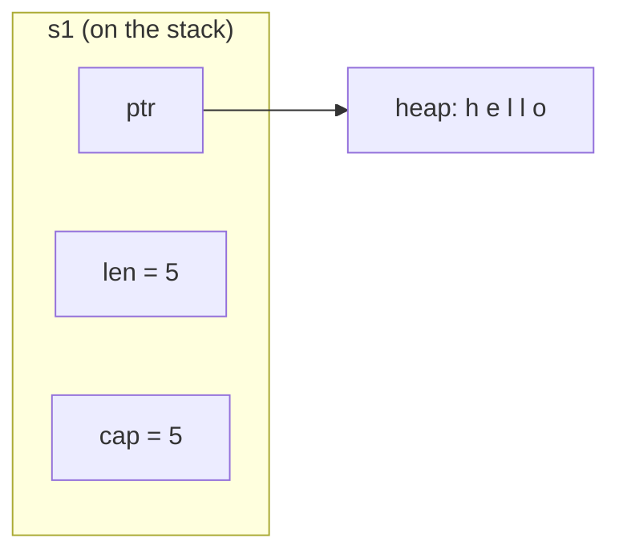

<callout background="green" icon="🔑">

**The idea that makes Rust Rust.** Every value has exactly one owner; when the owner goes out of scope the value is freed. You can lend it out as many read-only references **or** one mutable reference, never both. The compiler checks all of this, so there's no garbage collector and no use-after-free.

</callout>

**Level:** 🟢 Basics · **Needs:** [02 Variables, Types and Control Flow](page:9ll61je1wh)

<callout background="yellow" icon="⚠️">

This is the module where most people get stuck. That's normal. Do the exercises, read the compiler errors slowly (they're excellent), and come back to this page after module 09; it will read differently.

</callout>

## Stack and heap

- **Stack:** fixed-size values known at compile time (`i32`, `bool`, `[u8; 4]`, tuples of those). Fast, freed automatically when the function returns.
- **Heap:** data whose size can change or is only known at run time (`String`, `Vec`). You get a pointer to it.

A `String` is three words on the stack pointing at bytes on the heap:



## The three ownership rules

1. Each value has an **owner** (a variable).
1. There is **one owner at a time**.
1. When the owner goes **out of scope**, the value is **dropped** (freed).

### Move

```rust
let s1 = String::from("hello");
let s2 = s1;                    // the pointer is copied, ownership MOVES to s2
// println!("{s1}");            // ❌ error[E0382]: borrow of moved value: `s1`
println!("{s2}");
```

If both `s1` and `s2` owned the heap data, it would be freed twice. Rust makes `s1` unusable instead.

Passing to a function moves too:

```rust
fn take(s: String) { println!("{s}"); }   // s dropped at the end of take

let s = String::from("hi");
take(s);
// take(s);                     // ❌ s was moved
```

### Copy and Clone

- Simple stack types (`i32`, `f64`, `bool`, `char`, and tuples/arrays of them) are **`Copy`**: assignment copies, the old variable stays valid.
- For heap types, ask for a deep copy explicitly with **`.clone()`**. Seeing `clone()` tells the reader "this costs something".

## Borrowing

Passing ownership back and forth is tedious. Instead, **borrow** with a reference:

```rust
fn len(s: &String) -> usize { s.len() }   // borrows, doesn't own

let s = String::from("hello");
let n = len(&s);                          // lend s
println!("{s} has {n} bytes");            // s is still ours
```

Mutable borrow:

```rust
fn shout(s: &mut String) { s.push('!'); }

let mut s = String::from("hi");-
shout(&mut s);
```

### The borrowing rules

<columns>

<column>

✅ **Any number of `&T`**

```rust
let r1 = &s;
let r2 = &s;
println!("{r1} {r2}");
```

</column>

<column>

✅ **Exactly one `&mut T`**

```rust
let r = &mut s;
r.push('!');
```

</column>

<column>

❌ **Never both at once**

```rust
let r1 = &s;
let r2 = &mut s;   // E0502
println!("{r1}");
```

</column>

</columns>

And references must never outlive the value (no dangling pointers):

```rust
fn dangle() -> &String {          // ❌ E0106: missing lifetime specifier
    let s = String::from("hi");
    &s                            // s is dropped here; the reference would dangle
}
// Fix: return the String itself, transferring ownership.
```

A borrow lasts until its **last use**, not the end of the block ("non-lexical lifetimes"):

```rust
let mut s = String::from("x");
let r = &s;
println!("{r}");          // last use of r
let m = &mut s;           // ✅ fine: r is no longer live
m.push('y');
```

### Building up to 3.1

**The goal in plain words:** four small programs that don't compile, each breaking one ownership rule. For each one, find which rule it breaks and make the **smallest** change that fixes it. Don't rewrite the snippet.

**Step 1: get the error code.** Paste one snippet into `main` (snippet d's `fn` goes outside `main`) and run `cargo check`. Note the `E0…` code, and read the labels the compiler puts under the code. They point at *two* places: where the value was moved or borrowed, and where you then used it.

**Step 2: name the problem.** Every one of the four is one of these:

| Error | What it means | Usual smallest fixes |
| --- | --- | --- |
| E0382 | used a value after it **moved** away | `.clone()` before the move, borrow with `&` instead, or use the new owner |
| E0502 | a `&` borrow is still in use when you take a `&mut` (or the other way round) | copy the value out, or move the last use of the `&` earlier |
| E0499 | two `&mut` borrows of the same thing are in use at once | finish with the first before making the second |
| E0106 | returning a reference to something that dies when the function ends | return the owned value (`String`) instead |

**Step 3: find the "last use".** A borrow lasts until the last line that uses it, so moving one line up or down is often the whole fix. In this example, the error goes away just by swapping the last two lines:

```rust
let mut names = vec!["a".to_string()];
let first = &names[0];
names.push("b".to_string());   // ❌ E0502: `first` is still used below
println!("{first}");
```

Ask yourself in each snippet: "which borrow is still alive here, and does it need to be?"

<callout background="blue" icon="🏋️">

**Exercise 3.1 — Fix the borrow errors**

Each snippet fails to compile. Fix each with the **smallest** change, and write down the error code:

```rust
// a
let v = vec![1, 2, 3];
let w = v; // fix: let w = v.clone();
println!("{:?}", v); // fix: println!("{:?}", &v);

// b
let mut v = vec![1, 2, 3];
let first = &v[0]; // fix: let first = v[0].clone();
v.push(4); 
println!("{first}");

// c
let mut s = String::from("a");
let a = &mut s; 
a.push('b');
let b = &mut s; //two  mut directly follow each other. 
                //Cannot borrow a mutable more than once at a time
b.push('c');

// d
fn make() -> &str { let s = String::from("hi"); &s }
// fix: fn make() -> String { ... } 
```

</callout>

<toggle>

Answers

- **a** E0382 (use after move): `let w = v.clone();` or use `w` instead of `v`.
- **b** E0502: `push` may reallocate the vector, leaving `first` dangling. Copy the value (`let first = v[0];`) or print before pushing.
- **c** E0499 (two `&mut`): finish with `a` before creating `b`.
- **d** E0106: return `String` instead: `fn make() -> String { String::from("hi") }`. (Or return a literal: `fn make() -> &'static str { "hi" }`.)

</toggle>

##

## Error Codes and what they mean.

```
error[E0382]: When a value has been called after it is dropped.

eg

let s1 = String::from("Hello"); //String has been assigned to the value s1
let s2 = s1; // It has been reassigned to s2 so s1 gets dropped.
             // Fix: let s2 = &s1; //Borrow from s1

println!("{s1}"); // This generated the error[E0382] as we are trying to print a dropped value: s1

error[E0502]: push may reallocate the vector, leaving first dangling. Copy the value (let first = v[0];) or print before pushing

eg

let mut v = vec![1, 2, 3]; // A mutable vector called v
let first = &v[0]; // fix: let first = v[0].clone(); 
v.push(4); 
println!("{first}");
```

## Slices

A slice is a reference to **part** of a collection: a pointer and a length.

```rust
let s = String::from("hello world");
let hello: &str = &s[0..5];
let world: &str = &s[6..];

let a = [1, 2, 3, 4, 5];
let mid: &[i32] = &a[1..4];     // [2, 3, 4]
```

Prefer `&str` over `&String` and `&[T]` over `&Vec<T>` in function parameters: they accept more inputs (literals, arrays, parts of strings).

### Building up to 3.2

**The goal in plain words:** given `"hello world"`, return `"hello"`, but *without* making a new `String`. You return a slice that points into the text you were given. Then you'll see the compiler stop you from using that slice after the text has been wiped.

**Step 1: what returning `&str` means.** A slice is "a pointer plus a length" into someone else's string. Returning one hands out a *view*, so nothing is copied:

```rust
let s = String::from("hello world");
let view: &str = &s[0..5];   // points at the "hello" bytes inside s
```

**Step 2: find where the first word ends.** Two ways, pick one:

```rust
// a. let the standard library split it: next() gives the first piece, as an Option
"hello world".split(' ').next();       // Some("hello")

// b. find the first space yourself
"hello world".find(' ');               // Some(5): the byte index of the space
"hello".find(' ');                     // None: no space, so the whole string is the word
```

With (b), return `&s[..i]` when you get `Some(i)`, and `s` when you get `None`.

**Step 3: why the second snippet fails.** Follow the borrows:

- `first_word(&s)` borrows `s`, and the `&str` it returns *keeps* that borrow alive, because it points into `s`.
- `s.clear()` needs `&mut s`.
- `println!("{w}")` uses `w` afterwards, so the borrow is still alive during `clear()`.

That's the "never `&` and `&mut` at once" rule. For the explanation part, ask yourself what `w` would print if Rust allowed this.

<callout background="blue" icon="🏋️">

**Exercise 3.2 — first\_word returning &str**

Write `fn first_word(s: &str) -> &str` returning the first space-separated word (or the whole string). Then show that this fails to compile, and explain why that's a *good* thing:

```rust
let mut s = String::from("hello world");
let w = first_word(&s);
s.clear();
println!("{w}");
```

</callout>

<toggle>

Solution

```rust
fn first_word(s: &str) -> &str {
    s.split(' ').next().unwrap_or("")   // or: loop over s.bytes().enumerate()
}
```

`w` borrows from `s`; `clear()` needs `&mut s` while `w` is still used, so E0502. In C, `w` would now point at freed or changed memory: a bug the compiler just caught for you.

</toggle>

### Building up to 3.3

**The goal in plain words:** six one-liners. Before running each, predict "compiles" or "doesn't", and say why. You're training yourself to see ownership the way the compiler does.

For each snippet, ask these four questions in order:

1. **Is the type `Copy`?** Integers, floats, `bool` and `char` are, so assigning them makes a copy and the old variable is still usable. `String` and `Vec` are not, so they *move*.
1. **Is something moved while a borrow of it is still used later?** That fails.
1. **Is the collection changed while something is looking into it?** A `for x in &v` loop borrows `v` for the whole loop.
1. **Does a closure only *read* a variable?** Then it just borrows it, like a `&`.

One more rule for snippet 6: `v[0]` *names* the element inside the vector. `let s = v[0];` would try to move that element out and leave a hole in the vector. For a `String` (not `Copy`), Rust refuses.

<callout background="blue" icon="🏋️">

**Exercise 3.3 — Predict: compiles or not?**

Decide for each **before** running it, then check:

```rust
// 1
let x = 5; let y = x; println!("{x} {y}"); //Runs

// 2
let s = String::from("a"); let t = &s; let u = s; println!("{t}"); // Wont run, cant borrow from a dropped value. instead clone the dropped value

// 3
let mut v = vec![1]; for x in &v { v.push(*x); }
// 4
let mut n = 0; let r = &mut n; *r += 1; println!("{n}");
// 5
let s = String::from("a"); let c = || println!("{s}"); c(); println!("{s}");
// 6
let v = vec![String::from("a")]; let s = v[0];
```

</callout>

<toggle>

Answers

1. ✅ `i32` is `Copy`.
1. ❌ moving `s` while `t` borrows it (and `t` is used after).
1. ❌ can't push while iterating (`&v` borrowed). This prevents iterator invalidation.
1. ✅ `r`'s last use is before `println!`.
1. ✅ the closure only borrows `s`.
1. ❌ E0507: can't move out of an index. Use `&v[0]`, `v[0].clone()`, or `v.into_iter().next()`.

</toggle>

## Checklist

- [x] I can state the three ownership rules
- [x] I know which types are `Copy` and when to `clone()`
- [x] I can state the borrowing rules and explain what each one prevents
- [x] I use `&str` and `&[T]` for parameters
- [x] I can read E0382, E0499, E0502, E0505 and E0106

---

← [02 Variables, Types and Control Flow](page:9ll61je1wh) · [Rust Learning Hub](page:7jlv8afgwm) · Next → [04 Structs, Enums and Pattern Matching](page:fn56do8fw7)
