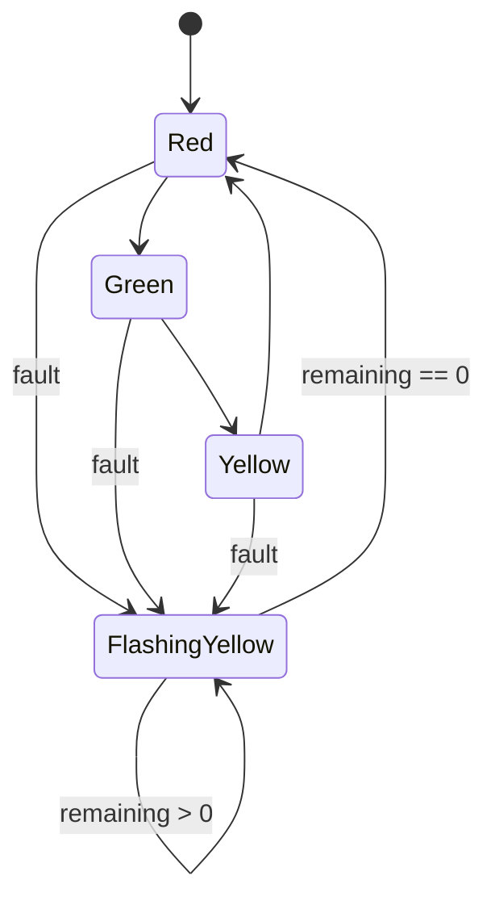

<callout background="green" icon="🏗️">

**Modelling data.** Structs group fields ("and"), enums list alternatives ("or"), and `match` takes them apart, with the compiler checking you handled every case.

</callout>

**Level:** 🟢 Basics · **Needs:** [03 Ownership and Borrowing](page:acpvbrr41r)

<columns>

<column>

### You'll learn

- The three kinds of struct, and when to use each
- Methods, `impl` blocks and `#[derive]`
- Enums that carry data, and `Option`
- Exhaustive `match`, patterns, `if let` and `let else`

</column>

<column>

### Exercises

- 🏋️ 4.1 Shapes and area
- 🏋️ 4.2 Traffic-light state machine
- 🏋️ 4.3 Command parser with let-else
- 🏋️ 4.4 Make invalid states unrepresentable

Track them in [Rust Exercises](page:nbnwy0q2zt).

</column>

</columns>

## Structs

There are three kinds of struct:

| Kind | Looks like | Use it for |
| --- | --- | --- |
| Named-field struct | `struct User { name: String, active: bool }` | most data: the fields have names |
| Tuple struct | `struct Color(u8, u8, u8);` | small wrappers where names add nothing, and **newtypes** like `struct Meters(f64);` |
| Unit struct | `struct Marker;` | a type with no data, e.g. a marker or something that only implements a trait |
|  |  |  |

```rust
#[derive(Debug, Clone, PartialEq)]
struct User {
    name: String,
    email: String,
    active: bool,
}

struct Color(u8, u8, u8);     // tuple struct
struct Marker;                // unit struct (no data)

let name = String::from("Ada");
let u = User { name, email: "ada@x.io".into(), active: true };   // field init shorthand: `name` = `name: name`
let u2 = User { email: "lovelace@x.io".into(), ..u.clone() };   // struct update syntax
println!("{u2:?}");           // needs #[derive(Debug)]
println!("{}", u.name);       // fields by name…
let Color(r, g, b) = Color(255, 128, 0);   // …tuple-struct fields by position (.0, .1) or by destructuring
```

<callout background="yellow" icon="⚠️">

**`..other` moves fields.** Struct update syntax copies `Copy` fields but *moves* the rest. Without the `.clone()` above, `u.name` would move into `u2`, and using `u` as a whole afterwards would fail with E0382.

</callout>


<callout icon="💡">

**Structs usually own their data.** Prefer `String` over `&str` in fields. A struct that holds a reference needs a lifetime (`struct Excerpt<'a> { text: &'a str }`), covered in [07 Generics, Traits and Lifetimes](page:8s3iybt7d1).

</callout>

### Methods and associated functions

```rust
struct Rect { w: f64, h: f64 }

impl Rect {
    const UNIT: Rect = Rect { w: 1.0, h: 1.0 };       // associated constant: Rect::UNIT

    fn new(w: f64, h: f64) -> Self { Rect { w, h } }   // associated fn: Rect::new(…)
    fn area(&self) -> f64 { self.w * self.h }          // borrows
    fn scale(&mut self, k: f64) { self.w *= k; self.h *= k; }  // mutably borrows
    fn into_square(self) -> Rect { let s = self.w.max(self.h); Rect { w: s, h: s } }  // consumes
}

let mut r = Rect::new(2.0, 3.0);
r.scale(2.0);                  // Rust auto-borrows: same as Rect::scale(&mut r, 2.0)
let sq = r.into_square();      // r is moved: no longer usable
```

The receiver says what the method does with the value: `&self` reads, `&mut self` changes, `self` takes ownership. `Self` is the type the `impl` is for. A type can have several `impl` blocks.

/

### Derive: free trait implementations

| Derive | Gives you | Note |
| --- | --- | --- |
| `Debug` | `{:?}` and `{:#?}` printing | derive it on almost everything |
| `Clone` | `.clone()` | an explicit, possibly expensive copy |
| `Copy` | implicit copies instead of moves | only if every field is `Copy` (no `String`, `Vec`…); needs `Clone` |
| `PartialEq` / `Eq` | `==` and `!=` | `Eq` when equality is total (not with `f64` fields) |
| `PartialOrd` / `Ord` | `<`, `>`, `.sort()` | compares fields top to bottom; enums by variant order |
| `Hash` | use as a `HashMap` / `HashSet` key | together with `Eq` |
| `Default` | `Type::default()` | every field's default: `0`, `""`, `false`, empty |

`Display` (`{}`) is never derived: you write it, because only you know how the value should read to a user.

```rust
use std::fmt;

impl fmt::Display for Rect {
    fn fmt(&self, f: &mut fmt::Formatter<'_>) -> fmt::Result {
        write!(f, "{}×{}", self.w, self.h)
    }
}
```

## Enums carry data

```rust
enum Message {
    Quit,                          // no data
    Move { x: i32, y: i32 },       // named fields
    Write(String),                 // one value
    ChangeColor(u8, u8, u8),       // several values
}

impl Message {                     // enums get methods too
    fn is_quit(&self) -> bool { matches!(self, Message::Quit) }
}
```

Each variant can hold different data, and a value is exactly **one** variant at a time. Enums can also be plain lists of names, C-style, with numbers:

```rust
#[derive(Debug, Clone, Copy, PartialEq)]
enum Weekday { Mon = 1, Tue, Wed, Thu, Fri, Sat, Sun }

let n = Weekday::Wed as u8;   // 3
```

The most important enums in Rust replace null and exceptions:

```rust
enum Option<T> { Some(T), None }      // in the prelude: a value that may be missing
enum Result<T, E> { Ok(T), Err(E) }   // an operation that may fail: see 05
```

You can't use an `Option<i32>` as an `i32`; the compiler makes you handle `None`. The helper methods (`map`, `unwrap_or`, `ok_or`…) are in [05 Collections, Strings and Errors](page:ubfingfdn1).

### Make invalid states unrepresentable

The habit that makes enums so powerful: when fields only make sense together, model the **states**, not a bag of flags.

<columns>

<column>

### ❌ Flags that can contradict

```rust
struct Conn {
    connected: bool,
    session_id: Option<u64>,
    error: Option<String>,
}
// connected: false with a session_id?
// connected: true with an error?
```

</column>

<column>

### ✅ One state at a time

```rust
enum Conn {
    Disconnected,
    Connecting { attempt: u32 },
    Connected { session_id: u64 },
    Failed(String),
}
// a session_id exists only when connected
```

</column>

</columns>

<toggle>

How big is an enum in memory?

The size of its largest variant plus a small **tag** saying which variant it is (rounded up for alignment). So one big variant makes every value big: `Box` the large one if that matters. The compiler is also clever with "niches": `Option<&T>`, `Option<Box<T>>` and `Option<NonZeroU32>` are the same size as the type inside, because `None` uses a value the inner type can never have (like a null pointer). More in [17 Memory Layout and Performance](page:ap65audlmt).

</toggle>

## match

```rust
fn describe(m: &Message) -> String {
    match m {
        Message::Quit => "quit".to_string(),
        Message::Move { x, y: 0 } => format!("horizontal to {x}"),
        Message::Move { x, y } => format!("move to {x},{y}"),
        Message::Write(text) if text.is_empty() => "empty write".to_string(),  // guard
        Message::Write(text) => format!("write {text}"),
        Message::ChangeColor(r, _, _) => format!("red = {r}"),
    }
}
```

`match` is **exhaustive**: forget a variant and it won't compile. Arms are tried **top to bottom**, so put specific patterns before general ones. And `match` is an **expression**: every arm gives a value of the same type, so you can write `let label = match m { … };`.

Here `m` is a `&Message`, so the bindings are references too: `text` is a `&String` and `x` is a `&i32`. Matching through a reference never moves anything out of it.

### Pattern cheat sheet

- `_` matches anything and binds nothing; `x` matches anything and binds it
- `1 | 2` either one; `3..=9` an inclusive range (numbers and `char`s)
- `Point { x, y: 0 }` destructure a struct, checking one field; `Point { x, .. }` ignore the rest
- `Some(Message::Write(text))` patterns nest as deep as the data
- `(a, _, c)` tuples; `[first, .., last]` and `[head, rest @ ..]` slices
- `n @ 10..=99` bind the value while testing it; `x if x > 0` a guard

```rust
match n {
    0 => "zero",
    1 | 2 => "small",
    3..=9 => "digit",
    big @ 10.. if big % 2 == 0 => "big even",
    _ => "other",
}

match slice {
    [] => "empty",
    [one] => "one",
    [first, .., last] => "many",
}
```

Patterns aren't only for `match`. They work in `let`, `for` and function parameters, wherever the pattern can't fail:

```rust
let (x, y) = (3, 4);
let User { name, active, .. } = user;          // pulls fields out (moves `name`)
for (i, word) in words.iter().enumerate() { /* … */ }
fn dist(&(x, y): &(f64, f64)) -> f64 { (x * x + y * y).sqrt() }
```

### Building up to 4.1

**The goal in plain words:** three kinds of shape, one type. A `Shape` is a circle *or* a rectangle *or* a triangle, each with its own measurements. You'll teach `Shape` to work out its own area and perimeter, then put a mix of shapes in a list and ask questions about the whole list.

**Step 1: an enum whose variants hold different data.** Each variant has named fields, like a small struct:

```rust
enum Shape {
    Circle { r: f64 },
    Rect { w: f64, h: f64 },
    Triangle { a: f64, b: f64, c: f64 },   // the three side lengths
}

let s = Shape::Rect { w: 2.0, h: 3.0 };
```

**Step 2: a method that matches on `self`.** Inside `impl Shape`, `&self` is the shape the method was called on. `match` picks the variant and pulls its fields out:

```rust
impl Shape {
    fn name(&self) -> &str {
        match self {
            Shape::Circle { .. } => "circle",     // `..`: ignore the fields
            Shape::Rect { w, h } if w == h => "square",
            Shape::Rect { .. } => "rectangle",
            Shape::Triangle { .. } => "triangle",
        }
    }
}
```

`area` and `perimeter` have the same shape, with a formula in each arm:

| Shape | Area | Perimeter |
| --- | --- | --- |
| Circle | π r² (`std::f64::consts::PI * r * r`) | 2 π r |
| Rect | w × h | 2 (w + h) |
| Triangle | Heron: s = (a + b + c) / 2, area = √(s(s−a)(s−b)(s−c)) | a + b + c |

`x.sqrt()` is a square root on an `f64`.

**Step 3: a list of shapes.** All variants are the same type, so they fit in one `Vec`:

```rust
let shapes = vec![
    Shape::Circle { r: 1.0 },
    Shape::Rect { w: 2.0, h: 3.0 },
    Shape::Triangle { a: 3.0, b: 4.0, c: 5.0 },   // area 6: a handy check
];
```

**Step 4: questions about the list.** Total area is a running sum in a `for` loop (or `shapes.iter().map(|s| s.area()).sum::<f64>()`). For the largest perimeter, keep the "best so far" as you go:

```rust
let mut best = &shapes[0];
for s in &shapes {
    if s.perimeter() > best.perimeter() { best = s; }
}
println!("largest perimeter: {}", best.name());
```

<callout background="blue" icon="🏋️">

**Exercise 4.1 — Shapes and area**

Define `enum Shape { Circle { r: f64 }, Rect { w: f64, h: f64 }, Triangle { a: f64, b: f64, c: f64 } }` with methods `area` (Heron's formula for the triangle) and `perimeter`. Put several in a `Vec<Shape>` and print the total area and the shape with the largest perimeter.

</callout>

<toggle>

Hint

```rust
impl Shape {
    fn area(&self) -> f64 {
        match *self {
            Shape::Circle { r } => std::f64::consts::PI * r * r,
            Shape::Rect { w, h } => w * h,
            Shape::Triangle { a, b, c } => {
                let s = (a + b + c) / 2.0;
                (s * (s - a) * (s - b) * (s - c)).sqrt()
            }
        }
    }
}
```

For the largest: `shapes.iter().max_by(|x, y| x.perimeter().total_cmp(&y.perimeter()))`.

</toggle>

## Shorter forms

| Use | When |
| --- | --- |
| `match` | several patterns, or you need exhaustiveness |
| `if let` | you care about one pattern (optionally `else`) |
| `let … else` | bind the value or leave the function early |
| `while let` | loop while it matches |
| `matches!` | just a `bool`: does it match? |

```rust
if let Some(x) = maybe { println!("{x}"); }               // one pattern

let Some(user) = find_user(id) else {                     // let-else: bind or bail out
    return Err("no such user");
};

while let Some(top) = stack.pop() { println!("{top}"); } // loop while it matches

if let Some(x) = a && x > 10 { /* … */ }                 // let chains (edition 2024)

let is_move = matches!(msg, Message::Move { .. });        // pattern → bool
```

The `else` of a `let … else` must **diverge**: `return`, `break`, `continue` or `panic!`. That's what lets `user` be used unwrapped afterwards.

### Building up to 4.2

**The goal in plain words:** a traffic light is only ever in one state (red, yellow or green), and each state knows what comes next and how long it lasts. You'll write that as an enum, then run a pretend clock for 120 seconds and print each time the light changes. The diagram under the exercise shows every allowed change.

**Step 1: a method that consumes `self` and returns the next state.** `self` (no `&`) means "take this light and give back a new one". The old value is used up, which fits: a light can't be red *and* green.

```rust
#[derive(Debug, Clone, Copy)]
enum Light { Red, Yellow, Green }

impl Light {
    fn next(self) -> Light {
        match self {
            Light::Red => Light::Green,
            // …the other two
        }
    }
}
```

`duration(&self) -> u32` is the same kind of `match`, returning seconds (say 30 for red, 5 for yellow, 25 for green).

**Step 2: run the clock.** Keep the current light and the time elapsed. Each turn, add the light's duration and move on:

```rust
let mut light = Light::Red;
let mut t = 0;
while t < 120 {
    println!("{t:>3}s: {light:?}");   // {:?} needs #[derive(Debug)]
    t += light.duration();
    light = light.next();
}
```

**Step 3: a state that carries data.** `FlashingYellow { remaining: u32 }` keeps a countdown *inside* the state. `next` for it decides based on that number:

```rust
Light::FlashingYellow { remaining: 0 } => Light::Red,                  // countdown done
Light::FlashingYellow { remaining } => Light::FlashingYellow { remaining: remaining - 1 },
```

Order matters: the `remaining: 0` arm must come first. Add a `fn fault(self) -> Light` that returns `FlashingYellow { remaining: 3 }` from any state, call it once during the simulation (for example when `t` passes 60), and watch the light recover.

<callout background="blue" icon="🏋️">

**Exercise 4.2 — Traffic-light state machine**

Model `enum Light { Red, Yellow, Green }` with `fn next(self) -> Light` and `fn duration(&self) -> u32` (seconds). Simulate 2 minutes, printing each change. Then add a `FlashingYellow { remaining: u32 }` state entered on a fault, which returns to `Red` when `remaining` hits 0.

</callout>



### Building up to 4.3

**The goal in plain words:** a tiny text game. The player types lines like `go north` or `take lamp`. Your `parse` turns each line into a `Command` value the rest of the program can `match` on, or an error message if it makes no sense. Then a loop reads lines, runs each command, and keeps track of where the player is and what they carry.

**Step 1: model the commands as enums.** Each kind of command is a variant, and the ones that need extra information carry it:

```rust
enum Direction { North, South, East, West }
enum Command {
    Go(Direction),     // "go north"
    Take(String),      // "take lamp": which item
    Drop(String),
    Look,
    Quit,
}
```

**Step 2: split the line into words.** `split_whitespace` ignores extra spaces, and `collect` puts the words in a `Vec`:

```rust
let words: Vec<&str> = "  take   lamp ".split_whitespace().collect();   // ["take", "lamp"]
```

**Step 3: match on the shape of the list.** A slice pattern checks how many words there are *and* what they are, all at once. `words.as_slice()` gives the `&[&str]` to match on:

```rust
match words.as_slice() {
    ["look"] => println!("exactly one word, and it's look"),
    ["take", item] => println!("two words, the second is {item}"),
    [] => println!("nothing typed"),
    _ => println!("anything else"),
}
```

**Step 4: `let … else` for "this or give up".** It binds the value when the pattern matches, and otherwise runs the `else`, which must leave the function:

```rust
fn first_word(line: &str) -> Result<&str, String> {
    let Some(word) = line.split_whitespace().next() else {
        return Err("empty line".to_string());
    };
    Ok(word)   // word is a plain &str here, no Option left
}
```

Handy for turning `"north"` into `Direction::North`: write a small `fn direction(s: &str) -> Option<Direction>`, then `let Some(d) = direction(dir) else { return Err(…) };`.

**Step 5: the game loop.** Read a line at a time from stdin, parse it, and `match` on the `Command`:

```rust
use std::io::BufRead;

let mut pos = (0, 0);
let mut inventory: Vec<String> = Vec::new();
for line in std::io::stdin().lock().lines() {
    let line = line.expect("could not read stdin");
    match parse(&line) {
        Ok(Command::Quit) => break,
        Ok(Command::Go(Direction::North)) => pos.1 += 1,
        // …the other commands: push to / remove from `inventory`, print for Look
        Err(msg) => println!("{msg}"),
        _ => {}
    }
}
```

To drop an item, find it with `inventory.iter().position(|i| *i == item)`, then `inventory.remove(index)`.

<callout background="blue" icon="🏋️">

**Exercise 4.3 — Command parser with let-else**

Write `fn parse(line: &str) -> Result<Command, String>` for a tiny text adventure: `go north|south|east|west`, `take <item>`, `drop <item>`, `look`, `quit`. `Command` is an enum (with a `Direction` enum inside). Use `split_whitespace`, slice patterns and `let ... else`. Then a loop reading stdin that keeps an inventory `Vec<String>` and a position `(i32, i32)`.

</callout>

<toggle>

Sketch

```rust
enum Direction { N, S, E, W }
enum Command { Go(Direction), Take(String), Drop(String), Look, Quit }

fn parse(line: &str) -> Result<Command, String> {
    let words: Vec<&str> = line.split_whitespace().collect();
    match words.as_slice() {
        ["go", dir] => {
            let d = match *dir {
                "north" => Direction::N, "south" => Direction::S,
                "east" => Direction::E, "west" => Direction::W,
                other => return Err(format!("unknown direction {other}")),
            };
            Ok(Command::Go(d))
        }
        ["take", item] => Ok(Command::Take(item.to_string())),
        ["drop", item] => Ok(Command::Drop(item.to_string())),
        ["look"] => Ok(Command::Look),
        ["quit"] => Ok(Command::Quit),
        _ => Err(format!("I don't understand '{line}'")),
    }
}
```

</toggle>

### Building up to 4.4

**The goal in plain words:** a blog post goes Draft → In review → Published, and a reviewer can send it back to Draft. You'll write the post so that wrong steps (like publishing a draft nobody reviewed) can't silently happen. Each step either succeeds and gives you the post in its new state, or fails and gives the post back as it was.

**Step 1: one variant per state, holding only what that state has.** A draft has no reviewer yet, and only a published post has a publish time:

```rust
enum Post {
    Draft { text: String },
    InReview { text: String, reviewer: String },
    Published { text: String, published_at: u64 },
}
```

**Step 2: a method that takes the post and returns it in a new state.** `self` (not `&self`) means the method *takes* the post, so it can move the `text` into the next variant without copying it:

```rust
fn submit(self, reviewer: String) -> Post {
    match self {
        Post::Draft { text } => Post::InReview { text, reviewer },   // text moves across
        other => other,   // not a draft: hand back the same post
    }
}
```

`other` is a pattern that matches anything and names it, so the post is returned untouched.

**Step 3: say whether it worked with `Result<Post, Post>`.** The version above can't tell the caller the step was refused. Wrap the two outcomes: `Ok(new_post)` when the move is allowed, `Err(other)` when it isn't. Both hold a `Post`, so the caller always gets the post back:

```rust
let post = Post::Draft { text: "hi".into() };
match post.approve(1_700_000_000) {
    Ok(p) => println!("published: {p:?}"),
    Err(p) => println!("can't approve that yet, still {p:?}"),   // a draft: refused
}
```

`approve` only works on `InReview` and `reject` only on `InReview`. Each is the same three lines as `submit`, with a different pattern.

**Step 4: the explanation part.** Imagine the other design: `struct Post { text: String, reviewer: Option<String>, published: bool }`. List the combinations of `reviewer` and `published` that make no sense, and ask who is responsible for stopping them in each design.

<callout background="blue" icon="🏋️">

**Exercise 4.4 — Make invalid states unrepresentable**

A blog post is a `Draft { text }`, then `InReview { text, reviewer }`, then `Published { text, published_at: u64 }`. Write it as an enum `Post` with methods `submit(self, reviewer: String)`, `approve(self, now: u64)` and `reject(self)` (back to `Draft`). Each consumes `self` and returns `Result<Post, Post>`: `Err` hands the post back unchanged when the move isn't allowed (you can't approve a draft). Then explain why a struct with `reviewer: Option<String>` and `published: bool` would be worse.

</callout>

<toggle>

Answer

```rust
#[derive(Debug)]
enum Post {
    Draft { text: String },
    InReview { text: String, reviewer: String },
    Published { text: String, published_at: u64 },
}

impl Post {
    fn submit(self, reviewer: String) -> Result<Post, Post> {
        match self {
            Post::Draft { text } => Ok(Post::InReview { text, reviewer }),
            other => Err(other),
        }
    }
    fn approve(self, now: u64) -> Result<Post, Post> {
        match self {
            Post::InReview { text, .. } => Ok(Post::Published { text, published_at: now }),
            other => Err(other),
        }
    }
    fn reject(self) -> Result<Post, Post> {
        match self {
            Post::InReview { text, .. } => Ok(Post::Draft { text }),
            other => Err(other),
        }
    }
}
```

Moving `text` from the old variant into the new one costs nothing: no clone. With flags, nothing stops a post being `published: true` with a reviewer still pending, so every function has to check. Here those values can't exist. [14 Advanced Types and Traits](page:olti30ae4p) takes this further with the typestate pattern, where wrong transitions don't even compile.

</toggle>

## Compiler errors you'll meet

<toggle>

E0004: non-exhaustive patterns: `Message::Quit` not covered

You forgot a variant. Add an arm for it, or a `_ => …` catch-all if you really mean "everything else". Prefer naming the variants: then adding a new variant later shows you every `match` to update.

</toggle>

<toggle>

E0507: cannot move out of `self.name` which is behind a shared reference

You matched or destructured a field of a borrowed value in a way that moves it, e.g. `match self.kind { Kind::Named(s) => … }` inside a `&self` method. Match on a reference instead: `match &self.kind`, so `s` becomes a `&String`.

</toggle>

<toggle>

E0277: `User` doesn't implement `Debug`

You printed with `{:?}`. Add `#[derive(Debug)]` to the type (and to the types of its fields). For `{}`, implement `Display` yourself.

</toggle>

<toggle>

E0382: borrow of moved value

Often after struct update syntax (`..u` moves the non-`Copy` fields) or a method taking `self` (`r.into_square()` uses up `r`). Clone first, or borrow with `&self` if the method doesn't need ownership.

</toggle>

## Checklist

- [ ] I know the three kinds of struct and when to use each
- [ ] I can define structs with methods and pick `&self` / `&mut self` / `self`
- [ ] I know what each common `#[derive]` gives me, and implement `Display` by hand
- [ ] I can model alternatives with enums carrying data, and avoid contradictory flags
- [ ] I can write exhaustive `match` with guards, ranges, `@` and slice patterns
- [ ] I use `if let`, `let else` and `while let` where they're clearer

---

← [03 Ownership and Borrowing](page:acpvbrr41r) · [Rust Learning Hub](page:7jlv8afgwm) · Next → [05 Collections, Strings and Errors](page:ubfingfdn1)
