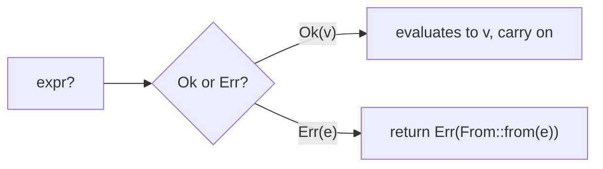

<callout background="green" icon="🧺">

**The everyday toolkit.** Growable collections on the heap, UTF-8 strings done right, and Rust's answer to exceptions: errors are ordinary values of type `Result`, and `?` passes them up.

</callout>

**Level:** 🟢 Basics · **Needs:** [04 Structs, Enums and Pattern Matching](page:fn56do8fw7)

<columns>

<column>

### You'll learn

- Pick the right collection, and know its cost
- Use the `HashMap` entry API
- Why `s[0]` doesn't compile, and what to do instead
- `Result`, `?`, combinators and custom error types

</column>

<column>

### Exercises

- 🏋️ 5.1 Word frequency counter
- 🏋️ 5.2 Config parser with custom errors
- 🏋️ 5.3 Unicode-safe reverse
- 🏋️ 5.4 Parse a list, collecting errors

Each one has a **Building up to it** section just before it. That section breaks the task into small steps, each with a tiny example you can run.

Start each exercise as its own project: `cargo new ex5_1`, write in `src/main.rs`, run with `cargo run`.

Track them in [Rust Exercises](page:nbnwy0q2zt).

</column>

</columns>

## Collections

<table widths="0.2743 0.2113 0.2704 0.244">

| Type | What | Reach for it when | Example uses |
| --- | --- | --- | --- |
| `Vec<T>` | growable array | default choice for a list | lines read from a file, a game's entities, a stack for undo (`push`/`pop`) |
| `VecDeque<T>` | ring buffer | push/pop at both ends (queues) | a job queue (push back, pop front), BFS on a graph, the last 100 log lines |
| `HashMap<K, V>` | hash table | look up by key, order doesn't matter | word counts, a cache of results, users by id, config `key → value` |
| `BTreeMap<K, V>` | sorted map | you need keys in order or range queries | events by timestamp ("everything between 9:00 and 10:00"), a leaderboard, output that must be sorted and repeatable |
| `HashSet<T>` / `BTreeSet<T>` | sets | membership, dedup | visited nodes in a graph search, unique tags, "have I seen this URL?" (`BTreeSet` when you also want them sorted) |
| `BinaryHeap<T>` | max-heap | priority queues (wrap in `Reverse` for min) | a task scheduler (most urgent first), Dijkstra's shortest path, the top-k largest items |

</table>


<toggle>

How fast is each operation?

| Collection | Get | Insert | Remove | Notes |
| --- | --- | --- | --- | --- |
| `Vec` | O(1) by index | O(1)\* at end, O(n) in the middle | O(1) at end, O(n) in the middle | `swap_remove` is O(1) but changes the order |
| `VecDeque` | O(1) by index | O(1)\* at either end | O(1) at either end |  |
| `HashMap` / `HashSet` | O(1) average | O(1)\* average | O(1) average | iteration order is unspecified |
| `BTreeMap` / `BTreeSet` | O(log n) | O(log n) | O(log n) | sorted iteration, `range(..)` |
| `BinaryHeap` | O(1) `peek` | O(log n) `push` | O(log n) `pop` | only the top is reachable |

\* amortized: the occasional regrowth copies everything. When you know the size, `Vec::with_capacity(n)` avoids it.

</toggle>

### Collections in action

One worked example per use case from the table. Open the ones you need.

<toggle>

Vec: an undo stack

```rust
let mut text = String::new();
let mut undo: Vec<String> = Vec::new();

for word in ["hello", " world", "!"] {
    undo.push(text.clone());     // save the state before each edit
    text.push_str(word);
}
if let Some(previous) = undo.pop() {   // last in, first out
    text = previous;                   // "hello world"
}
```

`push` and `pop` work on the end, so both are O(1). That makes a `Vec` the natural stack.

</toggle>

<toggle>

VecDeque: breadth-first search, and the last N lines

```rust
use std::collections::{HashSet, VecDeque};

/// Visit a graph level by level. `adj[n]` lists the neighbours of node n.
fn bfs(adj: &[Vec<usize>], start: usize) -> Vec<usize> {
    let mut order = Vec::new();  // Final order of list to return.
    let mut seen = HashSet::from([start]); // List of already discovered nodes
    let mut queue = VecDeque::from([start]); // List of items waiting to be found
    while let Some(node) = queue.pop_front() {   // oldest first: a queue
        order.push(node);
        for &next in &adj[node] {
            if seen.insert(next) {               // false if already seen
                queue.push_back(next);
            }
        }
    }
    order
}
```

Keeping only the most recent 100 log lines:

```rust
let mut recent: VecDeque<String> = VecDeque::with_capacity(100);
for line in lines {
    if recent.len() == 100 { recent.pop_front(); }   // drop the oldest
    recent.push_back(line);
}
```

A `Vec` could do both, but `remove(0)` shifts every element (O(n)). `VecDeque` pops the front in O(1).

</toggle>

<toggle>

HashMap: a cache (memoisation)

```rust
use std::collections::HashMap;

fn fib(n: u64, memo: &mut HashMap<u64, u64>) -> u64 {
    if n < 2 { return n; } // End the program if n is less than 2 
    if let Some(&v) = memo.get(&n) { return v; }   // already worked out
    let v = fib(n - 1, memo) + fib(n - 2, memo); // Recursively call fib
    memo.insert(n, v); //insert into memo where key = v , and the value = v
    v //return v
}

let mut memo = HashMap::new();
println!("{}", fib(90, &mut memo));   // instant; without the cache it would take ages
```

Why not `memo.entry(n).or_insert_with(|| fib(...))`? The entry holds a mutable borrow of `memo` while the closure needs `memo` too, so the borrow checker refuses. Look up, compute, then insert.

</toggle>

<toggle>

BTreeMap: events in a time range

```rust
use std::collections::BTreeMap;

let mut events: BTreeMap<u32, &str> = BTreeMap::new();   // key: minutes since midnight
events.insert(9 * 60 + 15, "standup");
events.insert(11 * 60, "lunch");
events.insert(9 * 60 + 40, "deploy");

for (t, what) in events.range(9 * 60..10 * 60) {         // only 9:00–9:59, in order
    println!("{:02}:{:02} {what}", t / 60, t % 60);
}
let next_after_ten = events.range(10 * 60..).next();     // Some((660, "lunch"))
let latest = events.last_key_value();                    // the largest key
```

A `HashMap` would need you to scan every entry and sort them. `BTreeMap` keeps them sorted, so ranges and "next after" are O(log n).

</toggle>

<toggle>

HashSet: remove duplicates, keep the order

```rust
use std::collections::HashSet;

let urls = vec!["a.com", "b.com", "a.com", "c.com", "b.com"];
let mut seen = HashSet::new();
let unique: Vec<&str> = urls.iter().copied().filter(|u| seen.insert(*u)).collect();
// ["a.com", "b.com", "c.com"]

let mine: HashSet<&str> = HashSet::from(["rust", "go", "zig"]);
let yours: HashSet<&str> = HashSet::from(["go", "python"]);
let both: Vec<_> = mine.intersection(&yours).collect();   // ["go"]
```

`insert` returns `true` only the first time, which makes it a "have I seen this?" test. Sets also do `union`, `difference` and `is_subset`. `sort` + `dedup` on a `Vec` removes duplicates too, but loses the original order.

</toggle>

<toggle>

BinaryHeap: Dijkstra's shortest path, and top-k

```rust
use std::cmp::Reverse;
use std::collections::BinaryHeap;

/// `adj[n]` lists (neighbour, distance) pairs. Returns the shortest distance to each node.
fn dijkstra(adj: &[Vec<(usize, u32)>], start: usize) -> Vec<Option<u32>> {
    let mut dist = vec![None; adj.len()];
    let mut heap = BinaryHeap::new();
    dist[start] = Some(0);
    heap.push(Reverse((0, start)));                 // Reverse: smallest distance first
    while let Some(Reverse((d, node))) = heap.pop() {
        if dist[node].is_some_and(|best| d > best) { continue; }   // outdated entry
        for &(next, w) in &adj[node] {
            let nd = d + w;
            if dist[next].is_none_or(|best| nd < best) {
                dist[next] = Some(nd);
                heap.push(Reverse((nd, next)));
            }
        }
    }
    dist
}
```

The k largest numbers, keeping only k in memory:

```rust
fn top_k(nums: &[i32], k: usize) -> Vec<i32> {
    let mut heap = BinaryHeap::new();
    for &n in nums {
        heap.push(Reverse(n));                     // a min-heap of the best k so far
        if heap.len() > k { heap.pop(); }          // throw out the smallest
    }
    let mut out: Vec<i32> = heap.into_iter().map(|Reverse(n)| n).collect();
    out.sort_unstable_by(|a, b| b.cmp(a));         // largest first
    out
}
```

Tuples compare field by field, so `(distance, node)` orders by distance first. That's why the distance goes first in the tuple.

</toggle>

### Vec

```rust
let mut v = vec![3, 1, 2];
v.push(4);
v.sort();                      // [1, 2, 3, 4]
let first = v[0];              // panics if out of bounds
let maybe = v.get(10);         // Option<&i32>: None
v.retain(|&x| x != 2);         // keep only what matches
v.dedup();                     // removes *consecutive* duplicates: sort first

for x in &v { println!("{x}"); }        // borrow each element
for x in &mut v { *x *= 10; }           // change each in place
for x in v { /* … */ }                  // consumes v: it's gone after the loop
```

Functions should usually take a **slice** `&[T]` (or `&mut [T]`), not `&Vec<T>`: a `&Vec<T>` coerces to it, and so do arrays and parts of vecs (`&v[1..3]`).

<callout background="yellow" icon="⚠️">

**The borrow checker guards collections too.** While you hold a reference into a `Vec` (`let first = &v[0];`, or a `for x in &v` loop), you can't `push` to it: the push might reallocate and leave the reference dangling. Copy the value out (`let first = v[0];`), use indexes, or collect changes and apply them after the loop.

</callout>

### HashMap and the entry API

```rust
use std::collections::HashMap;

let mut stock: HashMap<String, u32> = HashMap::new();
stock.insert("apple".to_string(), 3);

*stock.entry("pear".to_string()).or_insert(0) += 5;   // insert-or-update in one lookup

if let Some(n) = stock.get("apple") {                  // a &str works to look up String keys
    println!("apples: {n}");
}

for (fruit, n) in &stock {
    println!("{fruit}: {n}");                          // order is unspecified
}
```

`insert` returns the old value (`Option<V>`) if the key was there. Inserting a `String` key **moves** it into the map; values a map owns are dropped with it. `or_insert_with(|| …)` and `or_default()` only build the value when the key is missing.

### Building up to 5.1

**The goal in plain words:** you give the program some text, and it tells you which words come up most often. For this input:

```text
The cat sat. The cat ran! A dog sat.
```

it should print:

```text
     2 cat
     2 sat
     2 the
     1 a
     1 dog
     1 ran
```

"The" and "the" count as one word, and "sat." counts as "sat". Words with the same count are listed alphabetically.

It breaks into five small steps, and each one uses something from this page:

**Step 1: get the text into a `String`.**

```rust
// from a file:
let text = std::fs::read_to_string("input.txt").expect("could not read input.txt");

// or from stdin, so you can run `cargo run < input.txt`:
use std::io::Read;
let mut text = String::new();
std::io::stdin().read_to_string(&mut text).expect("could not read stdin");
```

`expect` is fine for now. Once you've read the Error handling section below, swap it for `?`.

**Step 2: cut the text into words.** `split_whitespace` would leave the punctuation on (`"sat."`). Split on every character that is *not* a letter or a digit instead:

```rust
let words: Vec<&str> = "The cat sat. The cat ran!"
    .split(|c: char| !c.is_alphanumeric())
    .filter(|w| !w.is_empty())   // ". " is two separators in a row, which leaves an empty piece
    .collect();
// ["The", "cat", "sat", "The", "cat", "ran"]
```

**Step 3: ignore case.** `"The".to_lowercase()` gives the `String` `"the"`.

**Step 4: count with the entry API.** This is the `stock` example above, except every count starts at 0:

```rust
let mut counts: HashMap<String, usize> = HashMap::new();
*counts.entry("the".to_string()).or_default() += 1;   // key is new: inserts 0, adds 1 → 1
*counts.entry("the".to_string()).or_default() += 1;   // key is there: finds 1, adds 1 → 2
```

`or_default()` inserts `0` (the default for `usize`) and returns a `&mut usize` to the count. The `*` in front changes the number it points to.

**Step 5: sort by count.** A `HashMap` has no order, so move its pairs into a `Vec` and sort that:

```rust
let mut pairs: Vec<(String, usize)> = counts.into_iter().collect();
pairs.sort_by(|a, b| b.1.cmp(&a.1));   // compare b to a, not a to b: biggest count first
for (word, n) in pairs.iter().take(10) {
    println!("{n:>6} {word}");          // {n:>6}: right-align the number in 6 columns
}
```

`a.1` is the tuple's second field, the count. To list equal counts alphabetically, chain a second comparison: `b.1.cmp(&a.1).then(a.0.cmp(&b.0))`.

**The `BTreeMap` part:** a `BTreeMap` keeps its keys sorted. Declare `counts` as a `BTreeMap<String, usize>` and leave the rest as it is (the entry API is the same). A plain `for (word, n) in &counts` then prints alphabetically, with no sorting step.

<callout background="blue" icon="🏋️">

**Exercise 5.1 — Word frequency counter**

Read a text file (or stdin) and print the 10 most common words with counts, case-insensitive, ignoring punctuation. Use the entry API. Then print them alphabetically instead by switching to a `BTreeMap`.

</callout>

<toggle collapsed=true>

Hint

```rust
let mut counts: HashMap<String, usize> = HashMap::new();
for word in text.split(|c: char| !c.is_alphanumeric()).filter(|w| !w.is_empty()) {
    *counts.entry(word.to_lowercase()).or_default() += 1;
}
let mut pairs: Vec<_> = counts.into_iter().collect();
pairs.sort_by(|a, b| b.1.cmp(&a.1).then(a.0.cmp(&b.0)));
for (w, n) in pairs.iter().take(10) { println!("{n:>6} {w}"); }
```

</toggle>

## Strings

<columns>

<column>

### `String`

- owned, growable, heap-allocated
- `String::from("hi")`, `"hi".to_string()`, `format!(...)`
- `push_str`, `push`, `+` (takes ownership of the left side)

</column>

<column>

### `&str`

- a borrowed **view** into UTF-8 bytes
- string literals are `&'static str`
- functions should usually **take `&str`**: a `&String` coerces to it

</column>

</columns>

```rust
let a = String::from("tic");
let b = String::from("tac");
let s = a + "-" + &b;               // `a` is moved into s; `b` is only borrowed
let s = format!("{s}-{}", "toe");   // format! borrows everything: the clearest choice
let owned: String = s.as_str().to_owned();   // &str → String (allocates)
```

Both are **UTF-8**, so a "character" may be 1 to 4 bytes. That's why you can't index a string with `s[0]`:

```rust
let s = "héllo";
s.len();                   // 6 bytes, not 5 characters
s.chars().count();         // 5
s.chars().nth(1);          // Some('é')
&s[0..1];                  // "h": byte slicing works…
// &s[0..2];               // …but panics here: byte 2 is inside 'é'
s.bytes();                 // raw u8s
```

Handy methods: `split_whitespace`, `split`, `split_once`, `lines`, `trim`, `starts_with`, `contains`, `find`, `replace`, `to_uppercase`, `parse::<T>()`, `char_indices`.

<toggle>

Other string types you'll meet

| Owned | Borrowed | For |
| --- | --- | --- |
| `String` | `&str` | UTF-8 text |
| `PathBuf` | `&Path` | file paths (`Path::new("a").join("b")`) |
| `OsString` | `&OsStr` | OS strings that may not be UTF-8 (env vars, args) |
| `CString` | `&CStr` | nul-terminated strings for C (see [16 FFI: Rust and C](page:zrjvts0nzd)) |
| `Vec<u8>` | `&[u8]` | raw bytes; `b"abc"` is a byte-string literal |

They follow the same pattern: an owned buffer and a borrowed view of it.

</toggle>

### Building up to 5.3

**The goal in plain words:** turn `"hello"` into `"olleh"`. In most languages that's one line. In Rust you first have to decide *what* you are reversing: the bytes, the `char`s, or the letters a person sees. This exercise shows why those are three different things.

**Step 1: `chars()` hands you the characters one at a time.** Each one is a `char`, however many bytes it takes up in the string:

```rust
let cs: Vec<char> = "héllo".chars().collect();   // ['h', 'é', 'l', 'l', 'o']: 5 chars, 6 bytes
```

**Step 2: iterators can run backwards.** Add `.rev()`:

```rust
for c in "abc".chars().rev() {
    print!("{c}");   // prints: cba
}
```

**Step 3: `collect()` can build a `String`.** `collect` builds whatever type you ask for, and a `String` can be built from `char`s:

```rust
let s: String = vec!['h', 'i'].into_iter().collect();   // "hi"
```

Put steps 1–3 together in one line and you have `reverse`. Check it with `assert_eq!`, which panics if the two sides differ:

```rust
fn main() {
    assert_eq!(reverse("hello"), "olleh");
    assert_eq!(reverse("héllo"), "olléh");
    assert_eq!(reverse("🦀rust"), "tsur🦀");
    println!("all good");
}
```

**Step 4: the twist.** `"e\u{301}"` is **two** `char`s: a plain `e`, then U+0301, a "combining acute accent" that draws itself on top of the `char` *before* it. On screen the two show as one `é`. See for yourself:

```rust
let word = "cafe\u{301}";              // shows as "café"
println!("{}", word.chars().count());  // 5, not 4
println!("{}", reverse(word));         // the accent now comes first, before the 'e'
```

When you reverse `char`s, the accent lands *before* the `e`, so it attaches to the wrong letter or to nothing. The question is: what is the name for "one letter as a person sees it", and which crate splits text that way? Search [crates.io](https://crates.io) for "unicode segmentation". `cargo add <crate-name>` adds a crate to your project (more on that in [06 Modules, Crates and Cargo](page:x4l9tlfa1i)).

<callout background="blue" icon="🏋️">

**Exercise 5.3 — Unicode-safe reverse**

Write `fn reverse(s: &str) -> String`. Test it on `"hello"`, `"héllo"`, `"🦀rust"`. Then try `"e\u{301}"` (an `e` followed by a combining accent, displayed as é): what goes wrong, and which crate fixes it?

</callout>

<toggle>

Answer

`s.chars().rev().collect()` handles multi-byte characters. Combining marks are separate `char`s, so the accent ends up on the wrong letter. What users see as one character is a **grapheme cluster**: use the `unicode-segmentation` crate, `s.graphemes(true).rev().collect()`. Reversing bytes would produce invalid UTF-8, which `String` refuses to hold.

</toggle>

## Error handling

Two kinds of failure:

- **Unrecoverable** (a bug): `panic!`, `unwrap()`, `expect("why")`, index out of bounds. Stops the thread.
- **Recoverable** (expected): return `Result<T, E>` and let the caller decide.

```rust
use std::fs;
use std::io;

fn read_username(path: &str) -> Result<String, io::Error> {
    let text = fs::read_to_string(path)?;     // on Err, return it early
    Ok(text.trim().to_string())
}
```

### What `?` does



The `From::from` step is what lets one function use `?` on several error types: each must convert into the function's own error type. It also works on `Option` in functions returning `Option` (`None` returns early). You can't mix the two in one function: turn an `Option` into a `Result` with `.ok_or(err)` first.

### Combinators: handling without `match`

| Method | On | Does |
| --- | --- | --- |
| `unwrap_or(x)` / `unwrap_or_else(f)` / `unwrap_or_default()` | both | the value, or a fallback |
| `map(f)` | both | change the success value |
| `map_err(f)` | `Result` | change the error (e.g. add context) |
| `and_then(f)` | both | chain another fallible step |
| `ok_or(e)` / `ok_or_else(f)` | `Option` | `Option` → `Result` |
| `ok()` | `Result` | `Result` → `Option`, dropping the error |
| `is_some_and(f)` / `is_ok_and(f)` | both | test the value |

```rust
let port: u16 = std::env::var("PORT")
    .ok()                                  // Result → Option
    .and_then(|s| s.parse().ok())         // parse, or None
    .unwrap_or(8080);                      // default
```

A neat trick: an iterator of `Result`s **collects** into a `Result` of a collection, stopping at the first error.

```rust
let nums: Result<Vec<i32>, _> = "1,2,3".split(',').map(str::parse::<i32>).collect();
```

### Building up to 5.4

**The goal in plain words:** turn the text `"4, 8, 15"` into the numbers `vec![4, 8, 15]`. If an item isn't a number, the error message should say *which* one it was: for `"4, 8, x, 15"` you want `item 3 ("x"): invalid digit found in string`, not just "invalid digit".

The whole function is one chain of iterator steps. Here is each step on its own:

**Step 1: parsing one item can fail, so it gives back a `Result`.**

```rust
"8".parse::<i32>()    // Ok(8)
"x".parse::<i32>()    // Err(ParseIntError), which prints as "invalid digit found in string"
" 8".parse::<i32>()   // Err too: a space isn't a digit, so trim first
```

**Step 2: split, trim, and number the items.** `enumerate()` pairs each item with its position, counting from 0:

```rust
for (i, item) in "4, 8, x".split(',').map(str::trim).enumerate() {
    println!("{i}: {item:?}");   // 0: "4"   then 1: "8"   then 2: "x"
}
```

`.map(str::trim)` passes the function itself and is the same as `.map(|s| s.trim())`. `{item:?}` prints with `Debug`, which adds the quotes. People count from 1, so the message uses `i + 1`.

**Step 3: rewrite the error with `map_err`.** It leaves an `Ok` alone and runs your closure only on an `Err`, so you can swap the bare `ParseIntError` for a `String` that says more:

```rust
let item = "x";
let r: Result<i32, String> = item.parse::<i32>()
    .map_err(|e| format!("item 3 ({item:?}): {e}"));
// Err("item 3 (\"x\"): invalid digit found in string")
```

**Step 4: collect many `Result`s into one.** That's the trick just above: an iterator of `Result<i32, String>` collects into a `Result<Vec<i32>, String>`. You get `Ok` with every number if all of them parsed, or the first `Err`:

```rust
let good: Result<Vec<i32>, String> = vec![Ok(1), Ok(2)].into_iter().collect();
// Ok([1, 2])
let bad: Result<Vec<i32>, String> = vec![Ok(1), Err("no".to_string()), Ok(3)].into_iter().collect();
// Err("no")
```

Chain steps 2 → 3 → 4 (split, trim, enumerate, `map` with `parse` and `map_err` inside, `collect`) and you have `parse_all`.

**The second part: report every failure.** The return type becomes `Result<Vec<i32>, Vec<String>>`. `collect` into a `Result` stops at the first error, so collect into a plain `Vec<Result<i32, String>>` first, then split it in two with `partition`:

```rust
let results: Vec<Result<i32, String>> =
    vec![Ok(4), Err("a".to_string()), Ok(8), Err("b".to_string())];
let (oks, errs): (Vec<_>, Vec<_>) = results.into_iter().partition(|r| r.is_ok());
// oks:  [Ok(4), Ok(8)]
// errs: [Err("a"), Err("b")]
```

Both halves still hold `Result`s. `filter_map(Result::ok)` pulls the numbers out of `oks` and `filter_map(Result::err)` pulls the messages out of `errs`, with no `unwrap`. Finish with: if `errs` is empty, return `Ok(numbers)`; otherwise return `Err(messages)`.

<callout background="blue" icon="🏋️">

**Exercise 5.4 — Parse a list, collecting errors**

Write `fn parse_all(s: &str) -> Result<Vec<i32>, String>` for input like `"4, 8, x, 15"`. On failure, the error says which item failed and where: `item 3 ("x"): invalid digit found in string`. Use `map_err` and `collect`, with no `match` and no `unwrap`. Then write a version that returns *all* the failures, not just the first.

</callout>

<toggle collapsed=true>

Answer

```rust
fn parse_all(s: &str) -> Result<Vec<i32>, String> {
    s.split(',')
        .map(str::trim)
        .enumerate()
        .map(|(i, item)| {
            item.parse::<i32>()
                .map_err(|e| format!("item {} ({item:?}): {e}", i + 1))
        })
        .collect()
}
```

For all the failures: `let (oks, errs): (Vec<_>, Vec<_>) = results.into_iter().partition(Result::is_ok);` then unwrap each half (safe now, since they're sorted), and return `Err(errs)` if any.

</toggle>

### Your own error type

```rust
use std::fmt;
use std::num::ParseIntError;

#[derive(Debug)]
enum ConfigError {
    Io(std::io::Error),
    MissingEquals { line: usize },
    BadNumber { line: usize, source: ParseIntError },
}

impl fmt::Display for ConfigError {
    fn fmt(&self, f: &mut fmt::Formatter<'_>) -> fmt::Result {
        match self {
            ConfigError::Io(e) => write!(f, "could not read config: {e}"),
            ConfigError::MissingEquals { line } => write!(f, "line {line}: expected key=value"),
            ConfigError::BadNumber { line, source } => write!(f, "line {line}: {source}"),
        }
    }
}

impl std::error::Error for ConfigError {}

impl From<std::io::Error> for ConfigError {        // lets `?` convert io errors
    fn from(e: std::io::Error) -> Self { ConfigError::Io(e) }
}
```

<columns>

<column>

### Libraries: `thiserror`

Derives `Display`, `Error` and `From` for your enum, removing the boilerplate above. Callers can `match` on variants.

```rust
#[derive(Debug, thiserror::Error)]
enum ConfigError {
    #[error("could not read config: {0}")]
    Io(#[from] std::io::Error),
    #[error("line {line}: expected key=value")]
    MissingEquals { line: usize },
    #[error("line {line}: {source}")]
    BadNumber { line: usize, source: ParseIntError },
}
```

</column>

<column>

### Applications: `anyhow`

`anyhow::Result<T>` holds any error, and `.context("while loading config")` adds a message chain. Perfect for `main`.

```rust
use anyhow::{bail, Context, Result};

fn main() -> Result<()> {
    let text = std::fs::read_to_string("app.conf")
        .context("reading app.conf")?;
    if text.is_empty() { bail!("config is empty"); }
    Ok(())
}
```

</column>

</columns>

<callout icon="💡">

**No crates?** `Box<dyn std::error::Error>` is the standard library's "any error". `?` converts every error type into it, so `fn main() -> Result<(), Box<dyn std::error::Error>>` works anywhere. When `main` returns an `Err`, Rust prints its `Debug` form and exits with code 1.

</callout>

### Building up to 5.2

**The goal in plain words:** many programs read their settings from a small text file. Yours reads one like this `app.conf`:

```text
# server settings
host = localhost
port = 8080

workers = four
```

and turns it into something you can ask questions of:

```rust
config.get_u32("port")      // Ok(8080)
config.get_u32("workers")   // Err: "line 5: invalid digit found in string"
config.get_u32("timeout")   // Err: the key isn't in the file
```

If a line has no `=` at all, `parse` itself fails with `line 3: expected key=value`. Each error **says which line** is wrong, and that is why the exercise uses the `ConfigError` enum above rather than plain strings.

**Step 1: parse the lines into a `HashMap<String, String>`.** The "Core loop" toggle under the exercise does exactly this. Read it line by line, because each line uses one idea from this page:

- `text.lines().enumerate()` gives `(0, "# server settings")`, `(1, "host = localhost")`, and so on. Line numbers for people are `i + 1`.
- `trim()` removes the spaces around a line, then blank lines and `#` comments are skipped with `continue`.
- `line.split_once('=')` returns an `Option`: `Some(("host ", " localhost"))`, or `None` when there is no `=`.
- `.ok_or(ConfigError::MissingEquals { line: i + 1 })?` turns that `None` into your error and returns it early. That's `Option` → `Result` from the combinators table, followed by `?`.

Get this far, print the map with `println!("{map:?}")`, and you've done the first half.

**Step 2: put the map in a struct**, so `get_u32` has somewhere to live (`&self`):

```rust
pub struct Config {
    values: HashMap<String, (String, usize)>,   // key → (value, the line it was on)
}
```

Why store the line too? `BadNumber` needs a `line`, but `get_u32` runs after parsing, when the text is gone. So keep each value's line number next to it: insert `(v.trim().to_string(), i + 1)` instead of just the value.

**Step 3: write `get_u32`.** It does three things, and you've seen each of them:

1. **Look the key up.** `self.values.get(key)` gives an `Option`. A missing key needs an error, but `ConfigError` has no variant for it yet, so add `MissingKey { key: String }` to the enum and a line for it in `Display`. Then `.ok_or_else(|| ConfigError::MissingKey { key: key.to_string() })?`.
1. **Parse the value.** `value.parse::<u32>()` gives a `Result<u32, ParseIntError>`.
1. **Turn the `ParseIntError` into a `BadNumber`.** Use `.map_err(|source| ConfigError::BadNumber { line, source })`, the same move as in 5.4 but building an enum variant instead of a `String`.

**Step 4: `main`, where `?` does the converting.**

```rust
fn main() -> Result<(), Box<dyn std::error::Error>> {
    let text = std::fs::read_to_string("app.conf")?;   // io::Error   → Box<dyn Error>
    let config = Config::parse(&text)?;                // ConfigError → Box<dyn Error>
    println!("port = {}", config.get_u32("port")?);
    Ok(())
}
```

Both `?`s work because `io::Error` and `ConfigError` implement `std::error::Error`. That's what the empty `impl std::error::Error for ConfigError {}` is for. The `Io` variant and `From<io::Error>` come into play when you write a `Config::load(path)` that reads the file itself and returns `ConfigError`: `?` on `read_to_string` then converts through your `From` impl.

**Step 5: rewrite it with `thiserror`.** Run `cargo add thiserror`, then replace the enum, the `Display` impl, the `Error` impl and the `From` impl with the derive version in the `thiserror` column above (plus `#[error("missing key {key}")] MissingKey { key: String }`). Nothing else in your code changes, and that's the point: compare how many lines you deleted.

<callout background="blue" icon="🏋️">

**Exercise 5.2 — Config parser with custom errors**

Parse a file of `key = value` lines into a `HashMap<String, String>`, skipping blank lines and `#` comments. Add `fn get_u32(&self, key) -> Result<u32, ConfigError>`. Use the hand-written `ConfigError` above with line numbers, and `?` everywhere. Make `main` return `Result<(), Box<dyn std::error::Error>>`. Then rewrite the error type with `thiserror` and compare.

</callout>

<toggle>

Core loop

```rust
pub fn parse(text: &str) -> Result<HashMap<String, String>, ConfigError> {
    let mut map = HashMap::new();
    for (i, raw) in text.lines().enumerate() {
        let line = raw.trim();
        if line.is_empty() || line.starts_with('#') { continue; }
        let (k, v) = line.split_once('=').ok_or(ConfigError::MissingEquals { line: i + 1 })?;
        map.insert(k.trim().to_string(), v.trim().to_string());
    }
    Ok(map)
}
```

Compare your rewrite with the `thiserror` enum above. Keep this project: you'll test it in [12 Testing and Tooling](page:m4szna8wnq).

</toggle>

<toggle>

When is unwrap() OK?

In tests, examples and prototypes; and when you can prove it can't fail (then prefer `expect("reason it can't fail")`). Never for user input, files or network data in real code.

</toggle>

## Compiler errors you'll meet

<toggle>

E0502: cannot borrow `v` as mutable because it is also borrowed as immutable

You hold a reference into a collection (often a `for x in &v` loop) and try to change it. Copy the value out, loop over indexes, or collect the changes and apply them after the loop.

</toggle>

<toggle>

E0277: the type `str` cannot be indexed by `{integer}`

You wrote `s[0]`. Use `s.chars().nth(0)`, `s.as_bytes()[0]` for a byte, or a byte range like `&s[0..1]` when you know it lands on a character boundary.

</toggle>

<toggle>

E0277: `?` couldn't convert the error to `MyError`

The function's error type has no `From` for that error. Add `impl From<TheirError> for MyError` (or `#[from]` with `thiserror`), use `.map_err(...)?`, or return `Box<dyn Error>` / `anyhow::Result`.

</toggle>

<toggle>

E0277: the `?` operator can only be used in a function that returns `Result` or `Option`

Usually in `main`. Give it a return type: `fn main() -> Result<(), Box<dyn std::error::Error>>`, and end it with `Ok(())`.

</toggle>

## Checklist

- [ ] I can choose the right collection, know its costs, and use the entry API
- [ ] I take `&[T]` and `&str` in function parameters
- [ ] I know why strings can't be indexed and how to iterate chars
- [ ] I return `Result` and use `?` and combinators instead of `unwrap`
- [ ] I can write a custom error enum with `Display`, `Error` and `From`, and know when to use `thiserror` or `anyhow`

---

← [04 Structs, Enums and Pattern Matching](page:fn56do8fw7) · [Rust Learning Hub](page:7jlv8afgwm) · Next → [06 Modules, Crates and Cargo](page:x4l9tlfa1i)
