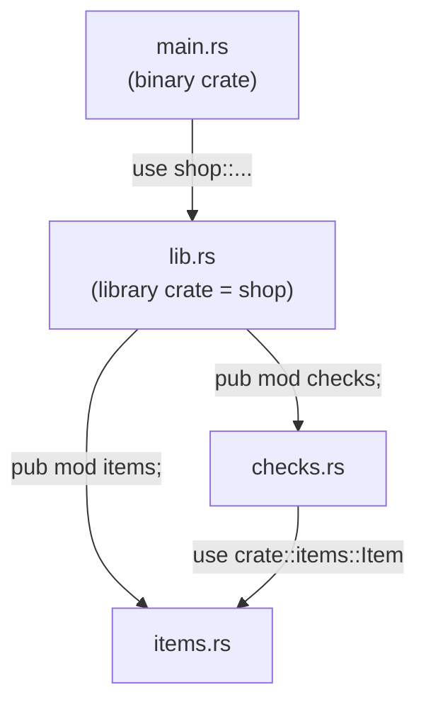

<callout background="green" icon="🗂️">

**Organising code that outgrows one file.** Modules control what's visible, crates are units of compilation, packages are what Cargo builds, and workspaces group packages.

</callout>

**Level:** 🟢 Basics · **Needs:** [05 Collections, Strings and Errors](page:ubfingfdn1)

<callout background="yellow" icon="📌">

**The four rules that clear up most of the confusion**

1. **`mod x;` creates a module, once.** It tells Rust "the file `x.rs` exists, compile it". Write it **one time only**, in `lib.rs`. A file with no `mod` line is silently ignored.
1. **`use` is only a shortcut.** It never loads a file. It just lets you write `Item` instead of `crate::items::Item`.
1. **Inside the library it's `crate::`, outside it's the package name.** `lib.rs` and every module file say `crate::items::Item`. `main.rs` is *outside* the library and says `shop::items::Item`.
1. **`pub` goes on every single thing you want others to see.** `pub struct` makes the *name* public, but each field needs its own `pub`. The same goes for functions and methods.

</callout>

## Hands-on: build a tiny shop library

You'll make a small project step by step and **deliberately hit the common errors**, so you recognise them later. Type everything yourself and run `cargo build` after every step.

The finished layout:

```text
shop/
├── Cargo.toml        name = "shop"
└── src/
    ├── lib.rs        the library crate, called `shop`
    ├── items.rs      mod items   (struct Item)
    ├── checks.rs     mod checks  (fn is_cheap)
    └── main.rs       the program: uses shop::...
```

How the pieces connect:



`main.rs` only talks to the library through its name. Files inside the library talk to each other through `crate::`.

### Step 1: one package, two crates

```bash
cargo new shop
cd shop
touch src/lib.rs
```

You now have **two crates in one package**. `src/lib.rs` is a library called `shop`, the package name with `-` turned into `_`. `src/main.rs` is a program that can use that library. Cargo builds the library first, then the program.

- [x] `cargo build` works with an empty `lib.rs`

### Step 2: add a module file, and see it ignored

Create `src/items.rs`:

```rust
// src/items.rs
pub struct Item {
    pub name: String,
    pub price: u32,
}
```

Run `cargo build`. It succeeds, but **this file is not compiled at all**. Put a typo in it and it still builds. Rust only compiles files that a `mod` line points to.

Now declare it in `lib.rs`:

```rust
// src/lib.rs
pub mod items;     // "compile src/items.rs as the module `items`"
```

Add the typo again and this time `cargo build` complains, which proves the file is part of the library now. Remove the typo.

- [ ] I added `pub mod items;` to `lib.rs` and saw the file get compiled

### Step 3: one module uses another (`crate::`)

Create `src/checks.rs`. First, the **wrong** version, which is the most common mistake:

```rust
// src/checks.rs  ❌
use shop::items::Item;

pub fn is_cheap(item: &Item) -> bool {
    item.price < 10
}
```

Add `pub mod checks;` to `lib.rs` and build:

```text
error[E0433]: cannot find module or crate `shop` in this scope
```

`checks.rs` is **part of** `shop`, and a crate can't refer to itself by its own name. From inside, the top of your own library is called `crate`:

```rust
// src/checks.rs  ✅
use crate::items::Item;
```

- [ ] I saw E0433, then fixed it with `crate::`

### Step 4: use the library from `main.rs`

```rust
// src/main.rs
use shop::checks::is_cheap;
use shop::items::Item;

fn main() {
    let pen = Item { name: String::from("pen"), price: 2 };
    println!("{} cheap? {}", pen.name, is_cheap(&pen));
}
```

Run `cargo run`. Here it **is** `shop::`, because `main.rs` is a separate crate using the library from outside.

- [ ] `cargo run` prints `pen cheap? true`

### Step 5: the double `mod` trap

Add this line at the top of `main.rs`, as if `main.rs` also needed to "know about" items:

```rust
// src/main.rs  ❌
mod items;
```

Then change `Item { ... }` to `items::Item { ... }` and build:

```text
error[E0308]: mismatched types
expected `shop::items::Item`, found `items::Item`
```

Rust now compiled `items.rs` **twice**: once inside the library (`shop::items::Item`) and once inside the program (`items::Item`). They look identical but are **two different types**, so they don't fit together.

✅ Fix: delete `mod items;` from `main.rs`. **`mod` lines live in `lib.rs` only**, and `main.rs` gets everything through `use shop::...`.

- [ ] I saw the "two different Items" error and know why

### Step 6: private fields

In `items.rs`, remove `pub` from `price`:

```rust
pub struct Item {
    pub name: String,
    price: u32,          // private now
}
```

Build:

```text
error[E0616]: field `price` of struct `Item` is private
```

`pub struct` only made the **name** `Item` public. Each field has its own visibility, and a private field can only be touched inside `items.rs`. That breaks `checks.rs` (it reads `item.price`) and `main.rs` (it builds `Item { price: 2 }`).

You can fix it in two ways:

<columns>

<column>

**A. Make the field `pub`**

```rust
pub price: u32,
```

Good for plain data with no rules.

</column>

<column>

**B. Keep it private and add methods**

```rust
impl Item {
    pub fn new(name: &str, price: u32) -> Self {
        Item { name: name.to_string(), price }
    }
    pub fn price(&self) -> u32 {
        self.price
    }
}
```

Good when there are rules to protect, such as "price can't be 0". Nobody can get around `new`.

</column>

</columns>

Try **B**: use `Item::new("pen", 2)` in `main.rs` and `item.price()` in `checks.rs`.

- [ ] I used a constructor so `price` stays private

### Step 7: a tidy public API with `pub use`

Users of your library currently write `shop::items::Item`. Re-export it from `lib.rs` so they can write `shop::Item`:

```rust
// src/lib.rs
pub mod checks;
pub mod items;

pub use items::Item;          // shop::Item now works
pub use checks::is_cheap;     // shop::is_cheap now works
```

```rust
// src/main.rs
use shop::{is_cheap, Item};
```

Run `cargo doc --open` to see exactly what an outside user can reach. Only `pub` items appear.

- [ ] I re-exported with `pub use` and checked `cargo doc --open`

## `mod` vs `use` at a glance

|  | `mod items;` | `use crate::items::Item;` |
| --- | --- | --- |
| What it does | **creates** the module from `items.rs` | **shortens** a path you can already reach |
| How many times | once, in its parent (usually `lib.rs`) | as often as you like, in any file |
| Loads a file? | yes | never |
| Leave it out and… | the file is ignored | you write the full path instead |

## Reading the errors

| You see | It means | Fix |
| --- | --- | --- |
| `cannot find module or crate 'shop'` (E0432 / E0433) inside a library file | the library used its own name | `use crate::...` |
| `expected 'shop::items::Item', found 'items::Item'` | the same file was compiled twice by a `mod` in `main.rs` | delete `mod` lines from `main.rs`, use `shop::...` |
| `field 'x' of struct 'Y' is private` (E0616) | the field has no `pub` | `pub` on the field, or a getter method |
| `function 'f' is private` / `struct 'Y' is private` (E0603) | the item has no `pub` | add `pub` |
| `file not found for module 'x'` (E0583) | `mod x;` has no `x.rs` or `x/mod.rs` next to it | create the file or fix the name |
| `unused import` warning | a `use` you never use | delete it |

<toggle>

Folders: modules inside modules

To make `shop::items::food`, create a folder named after the parent module:

```text
src/
├── lib.rs          pub mod items;
├── items.rs        pub mod food;      ← declared in the PARENT file
└── items/
    └── food.rs
```

The rule is the same at every level: **the parent file declares the child with `mod`**. From `food.rs`, `super::Item` means "the `Item` in my parent module", and `crate::checks` still means "from the top of the library".

</toggle>

## Reference

### The vocabulary

| Term | Meaning |
| --- | --- |
| **Package** | a `Cargo.toml` and its source; what `cargo new` makes |
| **Crate** | one compilation unit: a library (`src/lib.rs`) or a binary (`src/main.rs`, `src/bin/*.rs`) |
| **Module** | a namespace inside a crate (`mod network;`) |
| **Path** | how you name an item: `crate::network::connect` |
| **Workspace** | several packages sharing one `Cargo.lock` and `target/` |

### Visibility levels

**Everything is private by default** (visible to its own module and children).

| Visibility | Visible to |
| --- | --- |
| *(none)* | this module and its children |
| `pub(super)` | the parent module |
| `pub(crate)` | the whole crate, not outside |
| `pub` | everyone who can reach the parent |

### Paths and `use`

```rust
use crate::shapes::circle;          // absolute, from the crate root
use super::helpers::clamp;          // relative: parent module
use std::collections::{HashMap, HashSet};
use std::io::{self, Write};         // io itself and io::Write
use std::fmt::Result as FmtResult;  // rename

pub use crate::shapes::Square;      // re-export: users can write my_crate::Square
```

Convention: bring **functions** in by their module (`circle::area(2.0)`), and **types** by name (`HashMap::new()`).

### Building up to 6.1

**The goal in plain words:** right now your config parser from 5.2 is all in `main.rs`. You'll move the real work into a **library** (code other programs could use) and leave `main.rs` as a thin program that just calls it. The code itself barely changes. What changes is *which file it lives in* and *who is allowed to see it*. It's the same pattern as the shop tutorial above.

**Step 1: one package can hold a library and a program.** If `src/lib.rs` and `src/main.rs` both exist, Cargo builds two crates from one package. Both have the package's name, with `-` turned into `_`:

```text
config-parser/
├── Cargo.toml          name = "config-parser"
└── src/
    ├── lib.rs          the library: config_parser
    ├── main.rs         the program: uses config_parser::…
    ├── parser.rs       mod parser   (Config, parse, get_u32)
    └── error.rs        mod error    (ConfigError)
```

**Step 2: declare the modules in `lib.rs`.** `mod parser;` tells Rust "there is a file `parser.rs`, make it the module `parser`". Without that line the file is ignored:

```rust
// src/lib.rs
pub mod error;     // loads src/error.rs
pub mod parser;    // loads src/parser.rs

pub use error::ConfigError;     // optional: lets users write config_parser::ConfigError
pub use parser::Config;
```

**Step 3: reach across modules.** Inside `parser.rs`, the error type is in a sibling module, so name it from the crate root:

```rust
// src/parser.rs
use std::collections::HashMap;
use crate::error::ConfigError;      // crate:: = "from the top of this library"
```

**Step 4: choose what is visible.** Everything starts private. Mark what `main.rs` needs as `pub` (`Config`, `parse`, `get_u32`, `ConfigError`), and mark helpers that only the library uses as `pub(crate)`. They can be called from any module *inside* the library, but `main.rs` can't see them, because to the library `main.rs` is an outside user.

**Step 5: use the library from `main.rs`.**

```rust
// src/main.rs
use config_parser::Config;

fn main() -> Result<(), Box<dyn std::error::Error>> {
    let text = std::fs::read_to_string("app.conf")?;
    let config = Config::parse(&text)?;
    println!("port = {}", config.get_u32("port")?);
    Ok(())
}
```

**Step 6: see your public API.** `cargo doc --open` builds a website of the library's docs. Only `pub` items appear, so it shows exactly what an outside user can reach.

<callout background="blue" icon="🏋️">

**Exercise 6.1 — Split into lib + bin**

Take your config parser from 5.2. Move the parsing into `src/lib.rs` with modules `parser` and `error`, keep only argument handling and printing in `src/main.rs` (which uses the library as `your_crate_name::...`). Make the error type `pub`, but keep helper functions `pub(crate)`. Run `cargo doc --open` and see what your public API looks like.

</callout>

<toggle>

Why split lib and bin?

Integration tests (`tests/`) and other crates can only use a library. Keeping `main.rs` thin means almost all your logic is testable. This is the standard layout for CLI tools.

</toggle>

## Cargo.toml

```toml
[package]
name = "grep-lite"
version = "0.1.0"
edition = "2024"

[dependencies]
clap = { version = "4", features = ["derive"] }   # "4" means >=4.0.0, <5.0.0
regex = "1.11"

[dev-dependencies]          # only for tests, examples, benchmarks
tempfile = "3"

[features]
default = ["color"]
color = []

[profile.release]
lto = true
```

- **SemVer:** `"1.11"` accepts any `1.x` from 1.11 up. Cargo picks the newest compatible version and records it in `Cargo.lock`.
- **Commit `Cargo.lock`** for binaries and apps (reproducible builds). For libraries it's optional.
- `cargo add regex`, `cargo remove`, `cargo update`, `cargo tree` (see the dependency graph).
- Find crates on [crates.io](https://crates.io) and read docs on [docs.rs](https://docs.rs). [blessed.rs](https://blessed.rs) lists the de-facto standard crates.

## Workspaces

```toml
# Cargo.toml at the root
[workspace]
members = ["app-core", "cli"]
resolver = "3"

[workspace.dependencies]
serde = { version = "1", features = ["derive"] }
```

```toml
# cli/Cargo.toml
[dependencies]
app-core = { path = "../app-core" }   # not "core": that name is taken by Rust's core library
serde = { workspace = true }
```

### Building up to 6.2

**The goal in plain words:** one folder, two packages. A library `temp-core` holds the temperature maths from 2.1, and a program `temp-cli` uses it so you can type `temp-cli 100 C` and get `212.0 °F`. A **workspace** lets you build and test both with one command, sharing one `target/` folder.

**Step 1: make the folders.**

```bash
mkdir temps && cd temps
cargo new --lib temp-core     # a library: src/lib.rs
cargo new temp-cli            # a program: src/main.rs
```

**Step 2: the root `Cargo.toml` lists the members.** Create `temps/Cargo.toml` by hand. It has no `[package]`, only `[workspace]`:

```toml
[workspace]
members = ["temp-core", "temp-cli"]
resolver = "3"
```

**Step 3: the library, with a test.** Put `c_to_f` and `f_to_c` in `temp-core/src/lib.rs`, marked `pub`. A test is a function marked `#[test]`, and `assert_eq!` fails it if the two sides differ:

```rust
pub fn c_to_f(c: f64) -> f64 { c * 9.0 / 5.0 + 32.0 }

#[cfg(test)]
mod tests {
    use super::*;              // bring in everything from the file above
    #[test]
    fn boiling() { assert_eq!(c_to_f(100.0), 212.0); }
}
```

**Step 4: the program depends on the library by path.** In `temp-cli/Cargo.toml`:

```toml
[dependencies]
temp-core = { path = "../temp-core" }
```

and in code it's `temp_core::c_to_f(…)` (`-` becomes `_`).

**Step 5: read the command-line arguments.** `std::env::args()` gives the words typed after the program name, and the first one is the program itself:

```rust
let args: Vec<String> = std::env::args().collect();   // ["temp-cli", "100", "C"]
let value: f64 = args[1].parse().expect("first argument must be a number");
match args[2].as_str() {
    "C" => println!("{:.1} °F", temp_core::c_to_f(value)),
    "F" => println!("{:.1} °C", temp_core::f_to_c(value)),
    other => eprintln!("unknown unit {other}"),
}
```

**Step 6: share a dependency.** Choose any crate both could use (for example `anyhow` for the CLI's errors). Write its version once under `[workspace.dependencies]` in the root, then `anyhow = { workspace = true }` in the member that uses it.

**Step 7: run it from the root.** `cargo test --workspace` runs every member's tests. `cargo run -p temp-cli -- 100 C` runs one member, and everything after `--` goes to *your* program, not to Cargo.

<callout background="blue" icon="🏋️">

**Exercise 6.2 — Cargo workspace**

Create a workspace with a library `temp-core` (your temperature conversions from 2.1, with tests) and a binary `temp-cli` that depends on it by path. Share one dependency via `[workspace.dependencies]`. Run `cargo test --workspace` and `cargo run -p temp-cli -- 100 C`.

</callout>

### Building up to 6.3

**The goal in plain words:** write a small version of `grep`, the Unix tool that prints the lines of a file that contain a pattern. `grep-lite error log.txt` prints every line of `log.txt` containing "error". Flags change the behaviour, and the program reports through its **exit code** whether it found anything, so shell scripts can use it.

How it should behave:

```bash
grep-lite -n fn src/main.rs      # matching lines, with line numbers: "3: fn main() {"
grep-lite -c TODO a.rs b.rs      # just how many lines matched
grep-lite -iv debug < app.log    # no files given: read stdin; -i ignore case, -v lines that DON'T match
echo $?                          # 0 = matched something, 1 = nothing matched, 2 = error
```

**Step 1: add the two crates.** `cargo add clap --features derive` and `cargo add regex`.

**Step 2: let clap read the arguments.** You describe the arguments as a struct, and `#[derive(Parser)]` writes the parsing code, including `--help`. A plain field is a required argument, a `Vec` collects the rest, and a `bool` with `#[arg(short = 'x')]` is a flag. The Starter toggle below has the full struct. Try it with only two fields first:

```rust
use clap::Parser;

#[derive(Parser)]
struct Args {
    pattern: String,
    #[arg(short = 'n')]
    line_numbers: bool,
}

fn main() {
    let args = Args::parse();       // try: cargo run -- -n hello   and   cargo run -- --help
    println!("pattern={} n={}", args.pattern, args.line_numbers);
}
```

**Step 3: match lines with a regex.** A `Regex` is a compiled pattern, and `is_match` tests a line:

```rust
let re = regex::Regex::new(r"err(or)?").unwrap();
re.is_match("an error here");    // true
re.is_match("all fine");         // false
```

`RegexBuilder` (in the Starter) is the same thing with options, such as `.case_insensitive(true)` for `-i`.

**Step 4: read lines from a file or from stdin, with the same code.** Both can be turned into something that implements `BufRead`, the trait with `.lines()`. Put either one in a `Box<dyn BufRead>` and the rest of the code doesn't care which it is:

```rust
use std::fs::File;
use std::io::{self, BufRead, BufReader};

let reader: Box<dyn BufRead> = match path {
    Some(p) => Box::new(BufReader::new(File::open(p)?)),
    None => Box::new(io::stdin().lock()),
};
for (i, line) in reader.lines().enumerate() {
    let line = line?;
    // i + 1 is the line number for -n
}
```

**Step 5: apply the flags.** For each line, `let hit = re.is_match(&line) != args.invert;`. Comparing to `invert` with `!=` flips the answer when `-v` is set. Then print it (with `i + 1` if `-n`), or only count it if `-c`.

**Step 6: exit codes.** Keep `let mut any = false;` and set it on every hit. End with `std::process::exit(if any { 0 } else { 1 })`. For errors (bad regex, missing file), print to stderr with `eprintln!` and `exit(2)`.

<callout background="blue" icon="🏋️">

**Exercise 6.3 — grep-lite CLI with clap**

Build `grep-lite PATTERN [FILES...]` with clap's derive API: flags `-i` (ignore case), `-n` (line numbers), `-c` (count only), `-v` (invert). Read stdin when no files are given. Use the `regex` crate. Exit code 0 if anything matched, 1 if not, 2 on error, like real grep.

</callout>

<toggle>

Starter

```rust
use clap::Parser;
use std::path::PathBuf;

#[derive(Parser)]
#[command(version, about = "A tiny grep")]
struct Args {
    pattern: String,
    files: Vec<PathBuf>,
    #[arg(short = 'i')]
    ignore_case: bool,
    #[arg(short = 'n')]
    line_numbers: bool,
    #[arg(short = 'c')]
    count: bool,
    #[arg(short = 'v')]
    invert: bool,
}

fn main() {
    let args = Args::parse();
    let re = regex::RegexBuilder::new(&args.pattern)
        .case_insensitive(args.ignore_case)
        .build()
        .unwrap_or_else(|e| { eprintln!("{e}"); std::process::exit(2) });
    // read each file (or stdin) with BufRead::lines() …
}
```

For stdin vs file, take a `Box<dyn BufRead>`: `Box::new(io::stdin().lock())` or `Box::new(BufReader::new(File::open(p)?))`.

</toggle>

## Checklist

- [ ] I know `mod` creates a module once (in `lib.rs`) and `use` only shortens paths
- [ ] I use `crate::` inside the library and the package name in `main.rs`
- [ ] I can lay out a crate across files and folders
- [ ] I know the visibility levels, that fields need their own `pub`, and use `pub use` for a clean API
- [ ] I can add dependencies, features and dev-dependencies
- [ ] I can set up a workspace

---

← [05 Collections, Strings and Errors](page:ubfingfdn1) · [Rust Learning Hub](page:7jlv8afgwm) · Next → [07 Generics, Traits and Lifetimes](page:8s3iybt7d1)
