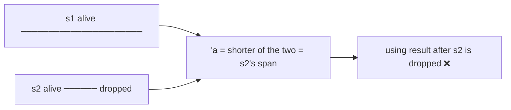

<callout background="yellow" icon="🧩">

**Write code once for many types, describe shared behaviour, and tell the compiler how long references live.** These three ideas are the core of idiomatic Rust; everything advanced builds on them.

</callout>

**Level:** 🟡 Intermediate · **Needs:** [03 Ownership and Borrowing](page:acpvbrr41r), [06 Modules, Crates and Cargo](page:x4l9tlfa1i)

## The big picture first

Three separate tools, each one fixing a different problem. One sentence each:

<columns>

<column>

### 🔤 Generics

**"This works for any type."**

A placeholder (`T`) where a concrete type would go, so you write a function or struct once instead of once per type.

</column>

<column>

### 🤝 Traits

**"…as long as that type can do X."**

A named list of abilities (methods). A type *implements* the trait to say "I can do this." Generics use traits to say which types are allowed.

</column>

<column>

### ⏳ Lifetimes

**"…and this reference came from there."**

A label on a reference that tells the compiler **which input a returned reference borrows from**, so it can check nothing dangles.

</column>

</columns>

<callout icon="💡">

**How they fit together:** generics leave a blank, traits limit what can fill the blank, and lifetimes are a different kind of blank. They are generic over *how long a borrow lasts* instead of over a type. That's why all three go in the same `<…>` brackets: `fn foo<'a, T: Display>(x: &'a T)`.

</callout>

---

## Generics

### The problem they solve

Say you want the largest number in a list. Without generics you write it once per type:

```rust
fn largest_i32(list: &[i32]) -> &i32 {
    let mut largest = &list[0];
    for item in list {
        if item > largest { largest = item; }
    }
    largest
}

fn largest_char(list: &[char]) -> &char {
    let mut largest = &list[0];
    for item in list {
        if item > largest { largest = item; }
    }
    largest
}
```

The two bodies are **identical**. Only the type changed. Generics let you replace the type with a placeholder.

### Step 1: add a type parameter

```rust
fn largest<T>(list: &[T]) -> &T {   // ❌ doesn't compile yet
    let mut largest = &list[0];
    for item in list {
        if item > largest { largest = item; }
    }
    largest
}
```

Read `fn largest<T>` as **"a function called `largest`, for some type we'll call `T`."** The `<T>` *declares* the placeholder; after that you can use `T` anywhere a type goes (`&[T]`, `&T`).

The compiler rejects it:

```
error[E0369]: binary operation `>` cannot be applied to type `&T`
help: consider restricting type parameter `T`: `T: PartialOrd`
```

Why? `T` could be *anything*: a number, a `String`, a `File`, a closure. Not every type can be compared with `>`. Rust won't assume it can; you have to promise it.

### Step 2: add a trait bound

```rust
fn largest<T: PartialOrd>(list: &[T]) -> &T {
    let mut largest = &list[0];
    for item in list {
        if item > largest { largest = item; }
    }
    largest
}

fn main() {
    println!("{}", largest(&[34, 50, 25, 100]));    // T = i32
    println!("{}", largest(&['y', 'm', 'a', 'q'])); // T = char
}
```

`T: PartialOrd` means **"`T` can be any type, as long as it implements the `PartialOrd` trait"** (the trait that provides `<` and `>`). That's a **trait bound**, and it's where generics and traits meet.

<callout icon="🗣️">

**Reading a signature aloud:** `fn largest<T: PartialOrd>(list: &[T]) -> &T` reads as "for any type `T` that can be compared, take a borrowed slice of `T`s and return a borrowed `T`."

</callout>

### Generic structs

The same idea works for structs. `Point<T>` is a point whose coordinates are some type `T`:

```rust
struct Point<T> { x: T, y: T }

let a = Point { x: 5, y: 10 };       // Point<i32>
let b = Point { x: 1.0, y: 4.0 };    // Point<f64>
// let c = Point { x: 5, y: 4.0 };   // ❌ x and y must be the SAME T
```

If you want `x` and `y` to be allowed different types, use two parameters: `struct Point<T, U> { x: T, y: U }`.

You've already been using generic types: `Vec<T>`, `Option<T>`, `Result<T, E>` and `HashMap<K, V>` are all generic.

### Methods on generic structs

```rust
impl<T> Point<T> {                    // methods for EVERY Point<T>
    fn x(&self) -> &T { &self.x }
}

impl Point<f64> {                     // methods ONLY for Point<f64>
    fn dist(&self) -> f64 { (self.x.powi(2) + self.y.powi(2)).sqrt() }
}
```

Why is it `impl<T> Point<T>` with `T` twice? The first `<T>` **declares** "for some type `T`", and the second **uses** it ("…implement for `Point` of that `T`"). In `impl Point<f64>` nothing is declared, because `f64` is a real type rather than a placeholder.

So `Point { x: 3.0, y: 4.0 }.dist()` works, but `Point { x: 3, y: 4 }.dist()` doesn't: `dist` doesn't exist for `Point<i32>`.

### Is it slow? No.

Generics cost nothing at run time. The compiler **monomorphises** them: it looks at every type you actually used and writes a separate copy of the function for each, as if you'd written `largest_i32` and `largest_char` by hand. The binary gets slightly bigger, but each copy runs at full speed.

### Building up to 7.1

**The goal in plain words:** `largest(&[])` currently crashes on `&list[0]`, because an empty list has no element 0. Make it answer "there is no largest" instead, by returning an `Option`. Then write a more flexible version that finds the largest *by some property* you choose: the longest string, the oldest person.

**Step 1: return `Option<&T>`.** `Some(x)` means "here it is", and `None` means "the list was empty". Check for the empty case first:

```rust
fn first<T>(list: &[T]) -> Option<&T> {
    if list.is_empty() { return None; }
    Some(&list[0])
}
```

`list.first()` does exactly this already. Use it (or `list.iter().next()`) to get the starting "best", and `?` to return `None` straight away when there isn't one:

```rust
let mut best = list.first()?;   // empty list → the function returns None here
```

**Step 2: "largest by key".** Sometimes you don't compare the items themselves, but something *about* them:

```rust
struct Person { name: String, age: u32 }
// the oldest person = the largest by `age`
// the longest string = the largest by `len()`
```

So the function takes a second argument: a small function that turns an item into the thing to compare. That's what `key: impl Fn(&T) -> K` means, read as "`key` is something callable that takes a `&T` and returns a `K`". You pass a **closure**, a function written inline as `|parameter| expression` (more in [08 Closures and Iterators](page:ch1buo23yl)):

```rust
let age_of = |p: &Person| p.age;          // a closure
largest_by_key(&people, |p| p.age);       // oldest person
largest_by_key(&words, |w| w.len());      // longest string
```

Inside the function, call it like any function: `key(item)`. The bound `K: Ord` lets you compare the keys with `>`.

**Step 3: compare with the standard library.** Iterators already have both: `list.iter().max()` and `list.iter().max_by_key(|p| p.age)`. Both return `Option`, just like yours.

<callout background="blue" icon="🏋️">

**Exercise 7.1 — Generic largest**

Make `largest` return `Option<&T>` instead of panicking on an empty slice. Then write `largest_by_key<T, K: Ord>(list: &[T], key: impl Fn(&T) -> K) -> Option<&T>` and use it to find the longest string and the oldest `Person`. Compare with the std one-liners `iter().max()` and `iter().max_by_key()`.

</callout>

<toggle>

Solution

```rust
fn largest<T: PartialOrd>(list: &[T]) -> Option<&T> {
    let mut it = list.iter();
    let mut best = it.next()?;
    for x in it { if x > best { best = x; } }
    Some(best)
}
```

`max()` needs `Ord`, so for `f64` (only `PartialOrd`, because of NaN) use `max_by(|a, b| a.total_cmp(b))`.

</toggle>

---

## Traits

### What a trait is

A trait is **a set of methods that a type promises to provide**. If you know interfaces from Java/C#/TypeScript, it's the same idea. Or think of it as a **skill certificate**: the trait `Summary` says "anything with this certificate can summarize itself", and each type earns the certificate by writing an `impl` block.

Three steps: **define** the trait, **implement** it for a type, and **use** it.

### 1\. Define

```rust
pub trait Summary {
    fn author(&self) -> String;                      // required: no body, each type must write it
    fn summarize(&self) -> String {                  // default: has a body, types get it for free
        format!("(Read more from {}...)", self.author())
    }
}
```

- A method **without a body** (ending in `;`) is **required**. Every implementing type must write it.
- A method **with a body** is a **default**. Types get it automatically and may override it.

### 2\. Implement

```rust
struct Tweet { user: String, text: String }

impl Summary for Tweet {
    fn author(&self) -> String { format!("@{}", self.user) }
    // summarize() not written → uses the default
}

struct Article { title: String, author: String, body: String }

impl Summary for Article {
    fn author(&self) -> String { self.author.clone() }
    fn summarize(&self) -> String {                  // override the default
        format!("{}, by {}", self.title, self.author)
    }
}
```

Read `impl Summary for Tweet` as **"here's how a `Tweet` does `Summary`."**

### 3\. Use

Once implemented, you call the methods like normal methods: `tweet.summarize()`. (In another module or crate, the trait must be in scope with `use crate::Summary;` or the method won't be found.)

The real payoff is writing functions that accept **any type with that trait**. That's the trait bound from the generics section.

### Using traits as bounds: four ways to write the same thing

These all mean "accept anything that implements `Summary`". They differ only in how much they can express:

```rust
// 1. impl Trait — shortest; good for simple cases
fn notify(item: &impl Summary) {
    println!("Breaking! {}", item.summarize());
}

// 2. Generic with a bound — same thing, but you get a name (T) to reuse
fn notify2<T: Summary + Clone>(item: &T) { /* … */ }   // + means "and also"

// 3. where clause — same as 2, moved out of the way when bounds get long
fn notify3<T, U>(t: &T, u: &U)
where
    T: Summary + std::fmt::Display,
    U: Clone + std::fmt::Debug,
{ /* … */ }

// 4. Return position — "I return SOME type that implements Summary (I won't say which)"
fn make() -> impl Summary {
    Tweet { user: "rust".into(), text: "hi".into() }
}
```

<toggle>

When does the difference between 1 and 2 matter?

When you need two arguments to be the **same** type:

```rust
fn pair(a: &impl Summary, b: &impl Summary)   // a and b may be DIFFERENT types
fn pair<T: Summary>(a: &T, b: &T)             // a and b must be the SAME type
```

Also, with return-position `impl Summary` the function must return **one** concrete type. You can't return a `Tweet` in one branch and an `Article` in another. (For that you need `Box<dyn Summary>`; see Exercise 7.2 and [14 Advanced Types and Traits](page:olti30ae4p).)

</toggle>

### `#[derive]`: implementing traits for free

Many standard traits are so mechanical that the compiler can write the `impl` for you:

```rust
#[derive(Debug, Clone, PartialEq)]
struct Point { x: i32, y: i32 }

let p = Point { x: 1, y: 2 };
println!("{:?}", p);           // Debug     → Point { x: 1, y: 2 }
let q = p.clone();             // Clone
assert!(p == q);               // PartialEq
```

Without `#[derive(Debug)]`, `println!("{:?}", p)` fails with *"`Point` doesn't implement `Debug`"*. When you see an error like that, the type is missing a trait, and adding a derive (or an `impl`) is usually the fix.

### The standard traits to know

| Trait | Gives you | Derive? |
| --- | --- | --- |
| `Debug` | `{:?}` | ✅ |
| `Display` | `{}`, `.to_string()` | ❌ write it |
| `Clone` / `Copy` | `.clone()` / implicit copy | ✅ |
| `PartialEq` / `Eq` | `==` | ✅ |
| `PartialOrd` / `Ord` | `<`, sorting | ✅ |
| `Hash` | use as `HashMap` key | ✅ |
| `Default` | `T::default()` | ✅ |
| `From` / `Into` | conversions; `?` uses `From` for errors | ❌ |
| `AsRef` / `Borrow` | cheap reference conversions | ❌ |
| `Iterator` / `IntoIterator` | `for` loops | ❌ |
| `Drop` | cleanup | ❌ |

<toggle>

Example: writing `Display` by hand

```rust
use std::fmt;

impl fmt::Display for Point {
    fn fmt(&self, f: &mut fmt::Formatter) -> fmt::Result {
        write!(f, "({}, {})", self.x, self.y)
    }
}

println!("{}", Point { x: 1, y: 2 });   // (1, 2)
```

`Display` can't be derived because there's no single obvious way to show a type to a *user*. You decide the format. `Debug` is for *programmers*, so the automatic format is fine.

</toggle>

### Building up to 7.2

**The goal in plain words:** you have two kinds of post, tweets and articles, and both can summarise themselves. Build a "digest" that joins the summaries of many posts into one text. You'll write it two ways and find out why only one of them accepts a mixed list of tweets *and* articles.

**Step 1: the trait and two impls** are already written above (`Summary`, `Tweet`, `Article`). Copy them in. For `Article`, change `summarize` to show the title plus the first 50 characters of the body. Cut by characters, not bytes:

```rust
let preview: String = self.body.chars().take(50).collect();
```

**Step 2: a list that holds different types.** A `Vec<Tweet>` can only hold tweets. To mix them, store *references to "something that implements Summary"*, written `&dyn Summary`:

```rust
let t = Tweet { user: "rustlang".into(), text: "1.90 is out".into() };
let a = Article { title: "Ownership".into(), author: "Ada".into(), body: "…".into() };
let items: Vec<&dyn Summary> = vec![&t, &a];   // ✅ both fit
for item in &items {
    println!("{}", item.summarize());          // each calls its own summarize
}
```

`dyn` means "which type it really is gets decided at run time". Each call finds the right method while the program runs.

**Step 3: the two digests.** Both loop over the items, call `summarize`, and join the results (`.collect::<Vec<_>>().join("\n")`, or push into a `String`):

- `digest(items: &[&dyn Summary])` takes the mixed list from step 2.
- `digest_generic<T: Summary>(items: &[T])` takes a slice where every item is **one** type `T`, chosen when you call it.

Try calling `digest_generic` with a tweet and an article in the same slice, and read the error. That answers the "why" question.

**Step 4: `Display` for `Tweet`** is the same pattern as the `Point` example in the toggle above. Choose how a tweet should look, for example `@rustlang: 1.90 is out`.

<callout background="blue" icon="🏋️">

**Exercise 7.2 — Summary trait**

Implement `Summary` for `Tweet` and `Article { title, author, body }` (override `summarize` for `Article` to show the title and the first 50 characters). Write `fn digest(items: &[&dyn Summary]) -> String` and `fn digest_generic<T: Summary>(items: &[T]) -> String`. Why can the first mix tweets and articles while the second can't? Implement `Display` for `Tweet` too.

</callout>

<toggle>

Answer

`&dyn Summary` is a trait object: each element carries a pointer to its own vtable, so different types can share a slice (dynamic dispatch). `T: Summary` is one concrete type for the whole call (static dispatch). More in [14 Advanced Types and Traits](page:olti30ae4p).

Beware slicing a `&str` at byte 50: it panics in the middle of a multi-byte character. Use `body.chars().take(50).collect::<String>()`.

</toggle>

### The orphan rule

You may implement a trait for a type only if **the trait or the type is defined in your crate**. You can implement your `Summary` for std's `Vec`, or std's `Display` for your `Tweet`, but you can't `impl Display for Vec<T>`, because both of those belong to someone else.

**Why the rule exists:** if two crates could both implement `Display for Vec<T>`, the compiler wouldn't know which one to use. The rule guarantees there's only ever one implementation.

The workaround is a **newtype**, a one-field struct wrapping the foreign type. Because the wrapper is *yours*, you can implement anything on it:

```rust
struct Wrapper(Vec<String>);

impl std::fmt::Display for Wrapper {
    fn fmt(&self, f: &mut std::fmt::Formatter) -> std::fmt::Result {
        write!(f, "[{}]", self.0.join(", "))       // self.0 = the Vec inside
    }
}
```

### Building up to 7.4

**The goal in plain words:** a table of text is a `Vec<Vec<String>>`: a list of rows, each a list of cells. You want `println!("{table}")` to print it as a CSV file, the format spreadsheets read. The orphan rule stops you implementing `Display` for `Vec` directly, so you wrap it in your own type `Csv`. Then you make the wrapper as convenient as the `Vec` it wraps.

**Step 1: the CSV rules.** Cells are separated by commas and rows by newlines. A cell that itself contains a comma or a quote must be put in quotes, and any quote inside it is written twice:

| Cell | Written as |
| --- | --- |
| `apple` | `apple` |
| `red, round` | `"red, round"` |
| `say "hi"` | `"say ""hi"""` |

So `vec![vec!["name", "note"], vec!["Ada", "said \"hi\", then left"]]` should print:

```text
name,note
Ada,"said ""hi"", then left"
```

**Step 2: a helper for one cell.**

```rust
fn quote(cell: &str) -> String {
    if cell.contains(',') || cell.contains('"') {
        format!("\"{}\"", cell.replace('"', "\"\""))   // wrap in quotes, double the inner ones
    } else {
        cell.to_string()
    }
}
```

**Step 3: `Display` for the newtype.** Same shape as `Wrapper` above. For each row in `self.0`, map every cell through `quote`, `join(",")` the results, and `writeln!(f, "{}", line)?`. The `?` is there because each `writeln!` can fail.

**Step 4: `Deref`, so it still acts like a `Vec`.** With a wrapper, `csv.len()` fails, because `Csv` has no `len`. `Deref` tells Rust "when a method isn't found on `Csv`, look on what's inside":

```rust
use std::ops::Deref;

impl Deref for Csv {
    type Target = Vec<Vec<String>>;
    fn deref(&self) -> &Self::Target { &self.0 }
}
// now csv.len() and csv.iter() work
```

**Step 5: `From`, so making one is easy.** `impl From<Vec<Vec<String>>> for Csv` has one method, `fn from(rows: Vec<Vec<String>>) -> Self { Csv(rows) }`. You also get `Into` for free: `let c: Csv = rows.into();`.

<callout background="blue" icon="🏋️">

**Exercise 7.4 — Newtype around the orphan rule**

Make `struct Csv(Vec<Vec<String>>)` with a `Display` that prints proper CSV (quote fields containing commas or quotes, doubling inner quotes). Implement `Deref<Target = Vec<Vec<String>>>` so `.len()` and `.iter()` still work, and `From<Vec<Vec<String>>>`.

</callout>

---

## Lifetimes

<callout background="yellow" icon="⚠️">

**Lifetimes are the part everyone finds confusing at first.** The key point: **lifetimes don't change how long anything lives.** They are labels you write so the compiler can *check* your references. They aren't instructions. If the program is already correct, adding a lifetime just explains it to the compiler.

</callout>

### Recap: what problem are we preventing?

From [03 Ownership and Borrowing](page:acpvbrr41r): a reference must never outlive the value it points to (a **dangling reference**):

```rust
let r;
{
    let x = 5;
    r = &x;          // r borrows x
}                    // x is dropped here
println!("{r}");     // ❌ E0597: `x` does not live long enough
```

The compiler caught this because it can see `r` borrows `x` and that `x` dies first. Each reference's **lifetime** is the stretch of code where it's valid, and the compiler normally works these out itself.

### When the compiler can't figure it out

Inside one function body, the compiler sees everything. **Function signatures** are the hard part, because the compiler checks each function *on its own*, using only its signature. Look at this:

```rust
fn longest(x: &str, y: &str) -> &str {   // ❌ E0106: missing lifetime specifier
    if x.len() > y.len() { x } else { y }
}
```

The function returns a reference. **Borrowed from where, `x` or `y`?** It depends on run-time data, so the compiler can't tell. And it matters to the *caller*: if the result borrows from `y`, the caller must keep `y` alive as long as the result is in use.

The compiler's help message says it plainly:

```
help: this function's return type contains a borrowed value, but the signature
      does not say whether it is borrowed from `x` or `y`
```

### The fix: label the relationship

```rust
fn longest<'a>(x: &'a str, y: &'a str) -> &'a str {
    if x.len() > y.len() { x } else { y }
}
```

Piece by piece:

| Syntax | Meaning |
| --- | --- |
| `<'a>` | "I'm declaring a lifetime label called `'a`" (like declaring `<T>`) |
| `x: &'a str` | "`x` is a borrow that's valid for (at least) `'a`" |
| `y: &'a str` | "`y` is also valid for `'a`" |
| `-> &'a str` | "the result is valid for `'a` too, so it's tied to `x` and `y`" |

In plain English: **"The returned reference is only safe to use while *both* `x` and `y` are still alive."** In practice `'a` becomes the **shorter** of the two input lifetimes.

The name `'a` is arbitrary (`'src`, `'text` work too). The apostrophe is what marks it as a lifetime. `'a`, `'b` are the conventions for short ones.

### Seeing it catch a bug

```rust
let s1 = String::from("long string");
let result;
{
    let s2 = String::from("xyz");
    result = longest(&s1, &s2);
}                                    // s2 dropped here
// println!("{result}");             // ❌ E0597: `s2` does not live long enough
```



You might say "but `s1` is longer, so `result` points to `s1`, and that's fine!" At run time it would be. But the signature promised only that the result lives as long as the *shorter* input, and the compiler checks against that promise without running your code. Move the `println!` inside the inner block and it compiles.

### Elision rules (why you rarely write them)

Most functions that return references *don't* need annotations, because the compiler fills them in using three rules ("elision" = leaving out):

1. Each reference parameter gets its own lifetime.
1. If there's exactly one input lifetime, it's given to all output references.
1. If there's a `&self` or `&mut self`, its lifetime is given to all outputs.

If the rules don't settle it, you must annotate.

Worked examples:

```rust
fn first_word(s: &str) -> &str
// rule 1 → fn first_word<'a>(s: &'a str) -> &str
// rule 2 → fn first_word<'a>(s: &'a str) -> &'a str      ✅ settled, nothing to write

impl Parser {
    fn peek(&self, n: usize) -> &str
    // rule 3 → output borrows from self                    ✅ settled
}

fn longest(x: &str, y: &str) -> &str
// rule 1 → two different input lifetimes, no self
// rules 2 and 3 don't apply                                ❌ you must annotate
```

So the rule of thumb: **you only write lifetimes when a function takes two or more references (and no `self`) and returns a reference.**

### Structs that hold references

A struct holding a reference must say so with a lifetime, because the struct must not outlive the data it borrows:

```rust
struct Excerpt<'a> {
    part: &'a str,           // an Excerpt can't outlive the text it points into
}

let novel = String::from("Call me Ishmael. Some years ago...");
let first = novel.split('.').next().unwrap();
let e = Excerpt { part: first };     // e borrows from novel
// drop(novel);                       // ❌ can't drop novel while e is still used
println!("{}", e.part);
```

Read `struct Excerpt<'a>` as "an `Excerpt` that borrows something for lifetime `'a`."

<callout icon="💡">

**Beginner shortcut:** if lifetimes on a struct are causing pain, make the field **owned** (`String` instead of `&str`, `Vec<T>` instead of `&[T]`). It costs a copy but removes the borrow entirely. Use references in structs once you specifically want zero-copy views, like the tokenizer in Exercise 7.3.

</callout>

### `'static`

`'static` means "can live for the whole program": string literals, owned data with no borrows.

```rust
let s: &'static str = "hello";   // literals are baked into the binary, so always valid
```

`T: 'static` (as a bound) means `T` holds no non-static references, **not** that it lives forever. A `String` is `'static` in this sense because it borrows nothing, even though it's dropped normally. You'll see this bound on `std::thread::spawn`.

<callout background="red" icon="🚫">

When the compiler suggests adding `'static`, it's usually the wrong fix. It typically means you're returning a reference to something local. Return the owned value instead.

</callout>

### Building up to 7.3

**The goal in plain words:** a tokenizer chops text into pieces ("tokens"). `"Hi, Bob!"` becomes `"Hi"`, `","`, `"Bob"`, `"!"`. Normally each token would be a new `String`. Here every token is a **slice pointing into the original text**, so nothing is copied. Lifetimes are how you tell Rust that the tokens borrow from the text, and not from the tokenizer.

**Step 1: a struct that remembers where it is.**

```rust
struct Tokenizer<'a> {
    src: &'a str,    // the whole text, borrowed
    pos: usize,      // byte index where the next token search starts
}
```

**Step 2: implementing `Iterator`.** It needs one type and one method. `next` returns `Some(token)` while there is more, then `None`. A simpler iterator, to see the shape:

```rust
struct Countdown(u32);

impl Iterator for Countdown {
    type Item = u32;
    fn next(&mut self) -> Option<u32> {
        if self.0 == 0 { return None; }
        self.0 -= 1;
        Some(self.0 + 1)
    }
}
// for n in Countdown(3) { … }   gives 3, 2, 1
```

Once `next` exists, `for` loops, `.collect()` and every other iterator method work on your type.

**Step 3: the tokens' lifetime.** Write `type Item = &'a str;` and not plain `&str`. With `'a`, the token borrows from the **source text**. Without it, elision would tie the token to `&mut self`, the tokenizer, and you couldn't keep a token after asking for the next one.

**Step 4: one token at a time.** In `next`:

1. Skip spaces. `rest.trim_start()` drops the leading whitespace, and the difference in length tells you how many bytes were skipped.
1. Look at the next character: `rest.chars().next()?` (the `?` returns `None` at the end of the text).
1. A letter or digit starts a **word**, which runs until the first character that isn't one: `rest.find(|ch: char| !ch.is_alphanumeric())`, or the end of the text if that is `None`.
1. Anything else is a single punctuation token, `c.len_utf8()` bytes long.
1. Move `self.pos` past the token and return `Some(&self.src[start..end])`.

**Step 5: the two questions.** Collect the tokens into a `Vec<&str>`, then try `drop(tokenizer)` and keep printing the tokens. Then try dropping the `String` that `src` came from. Predict both results first, using the lifetime from step 3.

<callout background="blue" icon="🏋️">

**Exercise 7.3 — A borrowing tokenizer**

Write `struct Tokenizer<'a> { src: &'a str, pos: usize }` and implement `Iterator` with `Item = &'a str` that yields words and single punctuation characters **without allocating** (every token is a slice of `src`). Then check: can you drop the `Tokenizer` and still use the tokens? Can you drop the `String` the source came from?

</callout>

<toggle>

Solution sketch

```rust
impl<'a> Iterator for Tokenizer<'a> {
    type Item = &'a str;
    fn next(&mut self) -> Option<&'a str> {
        let rest = &self.src[self.pos..];
        let start = self.pos + (rest.len() - rest.trim_start().len());
        let rest = &self.src[start..];
        let c = rest.chars().next()?;
        let len = if c.is_alphanumeric() {
            rest.find(|ch: char| !ch.is_alphanumeric()).unwrap_or(rest.len())
        } else {
            c.len_utf8()
        };
        self.pos = start + len;
        Some(&self.src[start..start + len])
    }
}
```

Tokens have lifetime `'a` (tied to the **source**), not to `&mut self`, so they outlive the tokenizer. They can't outlive the `String`.

</toggle>

---

## All three together

```rust
use std::fmt::Display;

fn longest_with_note<'a, T>(x: &'a str, y: &'a str, note: T) -> &'a str
where
    T: Display,
{
    println!("Note: {note}");
    if x.len() > y.len() { x } else { y }
}
```

Read it as: "for some lifetime `'a` and some type `T` that can be printed, take two strings that both live for `'a` and a note of type `T`, and return a string that also lives for `'a`." Lifetimes go first in the `<…>`, then types.

## Error codes from this module

```
error[E0369]: binary operation `>` cannot be applied to type `&T`
  → A generic T is used in a way not every type supports.
    Fix: add a trait bound, e.g. <T: PartialOrd>.

error[E0277]: the trait bound `X: SomeTrait` is not satisfied
  (also: "`X` doesn't implement `Debug`")
  → You passed a type that lacks a trait the function/macro needs.
    Fix: #[derive(SomeTrait)] or write `impl SomeTrait for X`.

error[E0599]: no method named `summarize` found
  → Often the trait isn't in scope. Fix: `use crate::Summary;`

error[E0117]: only traits defined in the current crate can be implemented for types defined outside
  → The orphan rule. Fix: wrap the type in a newtype.

error[E0106]: missing lifetime specifier
  → A returned reference could come from more than one input.
    Fix: add <'a> and label which inputs the output borrows from
         (or return an owned value instead).

error[E0597]: `x` does not live long enough
  → A reference is used after the value it points to was dropped.
    Fix: keep the value alive longer, or use the reference sooner.
```

## Checklist

- [ ] I can write generic functions and structs with trait bounds and `where` clauses
- [ ] I can define traits with default methods and implement std traits
- [ ] I know the orphan rule and the newtype workaround
- [ ] I can read and write lifetime annotations and know the elision rules

---

← [06 Modules, Crates and Cargo](page:x4l9tlfa1i) · [Rust Learning Hub](page:7jlv8afgwm) · Next → [08 Closures and Iterators](page:ch1buo23yl)
