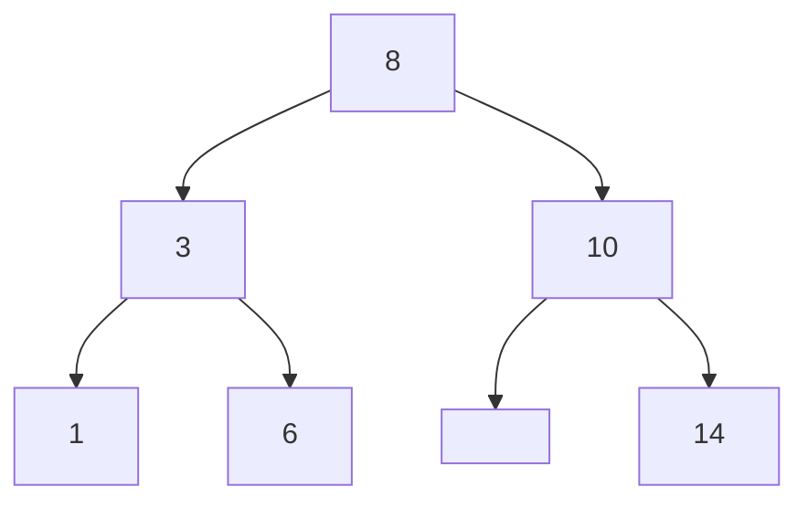
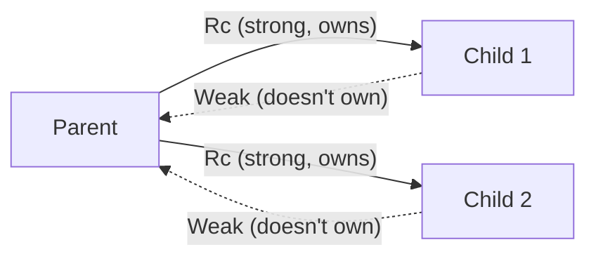

<callout background="yellow" icon="📦">

**Pointers that own, count and check.** `Box` puts a value on the heap, `Rc`/`Arc` give it several owners, and `Cell`/`RefCell` allow mutation through a shared reference by moving the borrow check to run time.

</callout>

**Level:** 🟡 Intermediate · **Needs:** [08 Closures and Iterators](page:ch1buo23yl)

## Which one do I need?

| Type | Owners | Mutation | Threads | Typical use |
| --- | --- | --- | --- | --- |
| `Box<T>` | one | via `&mut` | if `T` is | recursive types, large values, `dyn Trait` |
| `Rc<T>` | many | no | ❌ | shared read-only data in one thread (graphs, trees) |
| `Arc<T>` | many | no | ✅ | the same, across threads |
| `Cell<T>` | one | `get`/`set` copies | ❌ | small `Copy` flags and counters |
| `RefCell<T>` | one | `borrow_mut()` checked at run time | ❌ | mutating inside an `Rc` |
| `Mutex<T>` / `RwLock<T>` | one | `lock()` | ✅ | mutating inside an `Arc` |
| `Weak<T>` | none | no | — | back-references that don't keep things alive |
| `Cow<'a, T>` | borrowed or owned | clones on first write | — | "usually borrow, sometimes own" |

## Box

```rust
#[derive(Debug)]
enum List {
    Cons(i32, Box<List>),   // without Box, List would have infinite size
    Nil,
}
use List::{Cons, Nil};

let list = Cons(1, Box::new(Cons(2, Box::new(Nil))));
```

A `Box<T>` is one pointer; dropping it drops the `T` and frees the heap memory.

## Deref and Drop

```rust
use std::ops::Deref;

struct MyBox<T>(T);

impl<T> Deref for MyBox<T> {
    type Target = T;
    fn deref(&self) -> &T { &self.0 }
}

impl<T> Drop for MyBox<T> {
    fn drop(&mut self) { println!("dropping MyBox"); }
}
```

**Deref coercion** turns `&MyBox<String>` into `&String` into `&str` automatically when a function wants `&str`. Values drop in reverse order of declaration; `drop(x)` drops early.

### Building up to 9.1

**The goal in plain words:** a binary search tree keeps numbers sorted so that you can find one quickly. Each node holds a number, and has an optional smaller-side child on the left and an optional bigger-side child on the right. You'll build the tree, then see what happens to it when you feed it numbers that are already in order.



*Inserting 8, 3, 10, 1, 6, 14: smaller keys go left, bigger keys go right.*

**Step 1: why `Option<Box<Node>>`.** A node contains its children, so a `Node` directly inside a `Node` would need infinite space (the same problem as `List` above). `Box` makes the child a fixed-size pointer, and `Option` lets it be missing:

```rust
struct Node { key: i32, left: Option<Box<Node>>, right: Option<Box<Node>> }
struct Tree { root: Option<Box<Node>> }   // an empty tree has root: None
```

**Step 2: `contains` (read only), the easiest one first.** Start at the root and step left or right until you find the key or fall off the tree:

```rust
pub fn contains(&self, key: i32) -> bool {
    let mut cur = &self.root;                 // &Option<Box<Node>>
    while let Some(node) = cur {
        if key == node.key { return true; }
        cur = if key < node.key { &node.left } else { &node.right };
    }
    false
}
```

`min` is the same walk, always going left until there's no left child.

**Step 3: `insert`** is the same walk with `&mut`, so that when you reach an empty spot (`None`) you can fill it in. The hint toggle below shows it, and it's worth reading line by line next to `contains`.

**Step 4: `height`** is how many levels the tree has. It's easiest recursively: an empty subtree has height 0, and a node has height 1 + the taller of its two children. Write a helper taking `&Option<Box<Node>>`:

```rust
fn height(n: &Option<Box<Node>>) -> usize {
    match n {
        None => 0,
        Some(node) => 1 + height(&node.left).max(height(&node.right)),
    }
}
```

**Step 5: in-order iteration with a stack.** "In order" means smallest to largest: left subtree, then the node, then the right subtree. Without recursion, keep a `Vec<&Node>` as a stack:

1. Push the node and all its left children (go left as far as possible).
1. Pop one: that's the next smallest, so yield it.
1. If it has a right child, push that child and all *its* left children.
1. Repeat until the stack is empty.

Put the stack in a struct, implement `Iterator` for it (as in 8.2), and you can write `for k in tree.iter()`.

**Step 6: the experiment.** Insert `1..=1000` in order and print `height`. Draw the first five inserts on paper: which side does every new key go to?

<callout background="blue" icon="🏋️">

**Exercise 9.1 — Binary search tree with Box**

Implement `struct Tree { root: Option<Box<Node>> }` with `Node { key: i32, left: Option<Box<Node>>, right: Option<Box<Node>> }`. Add `insert`, `contains`, `min`, an in-order iterator (use an explicit stack), and `height`. Insert 1..=1000 in order: what happens to `height` and why?

</callout>

<toggle>

Hint for insert without recursion

```rust
pub fn insert(&mut self, key: i32) -> bool {
    let mut cur = &mut self.root;
    while let Some(node) = cur {
        if key == node.key { return false; }
        cur = if key < node.key { &mut node.left } else { &mut node.right };
    }
    *cur = Some(Box::new(Node { key, left: None, right: None }));
    true
}
```

Inserting sorted keys makes a linked list (height 1000), so lookups are O(n). That's why real trees balance themselves (`BTreeMap` in std).

</toggle>

## Rc and RefCell

```rust
use std::cell::RefCell;
use std::rc::Rc;

let shared = Rc::new(RefCell::new(vec![1, 2, 3]));
let a = Rc::clone(&shared);          // cheap: bumps a counter
let b = Rc::clone(&shared);

a.borrow_mut().push(4);              // runtime-checked &mut
println!("{:?}", b.borrow());        // [1, 2, 3, 4]
println!("owners: {}", Rc::strong_count(&shared));   // 3
```

`RefCell` enforces the same rule as the compiler (many `&` **or** one `&mut`) but at run time, and **panics** if you break it.

### Cycles leak: use Weak

Two `Rc`s pointing at each other never reach count 0, so neither is freed. Break cycles with `Weak`: it doesn't count as an owner, and `upgrade()` returns `Option<Rc<T>>`.



### Building up to 9.2

**The goal in plain words:** a folder tree, like `root/usr/bin`. Every folder knows its children, **and** every folder knows its parent, so starting from `bin` you can walk up and print its full path. Pointers going both ways is exactly what plain ownership can't do, and the reason `Rc` and `Weak` exist.

**Step 1: why not `Box`?** A child would need to point at its parent, but the parent already owns the child. With `Box`, each value has exactly one owner, so nothing can point back. You need:

- `Rc<Node>` for parent → child: the parent *owns* its children (a strong reference).
- `Weak<Node>` for child → parent: the child can *find* its parent but doesn't keep it alive. If both directions were `Rc`, the two counts would never reach 0 and nothing would be freed.

**Step 2: `Rc` basics.** `Rc::clone` makes another owner. The value is freed when the last one goes:

```rust
use std::rc::Rc;

let a = Rc::new(String::from("shared"));
let b = Rc::clone(&a);
println!("{}", Rc::strong_count(&a));   // 2
drop(b);
println!("{}", Rc::strong_count(&a));   // 1
```

**Step 3: `Weak` basics.** `Rc::downgrade` makes a `Weak`. To use it, `upgrade()` it back, which gives `Some(rc)` if the value still exists and `None` if it's gone:

```rust
let strong = Rc::new(5);
let weak = Rc::downgrade(&strong);
println!("{:?}", weak.upgrade());   // Some(5)
drop(strong);
println!("{:?}", weak.upgrade());   // None: nothing kept it alive
```

**Step 4: why the fields are in `RefCell`.** Values inside an `Rc` can only be read, but you need to push children and set parents *after* the nodes exist. `RefCell` allows changing them through a shared reference: `node.children.borrow_mut().push(…)`, and `*child.parent.borrow_mut() = Rc::downgrade(&parent)`.

**Step 5: `path`, walking up.** Start at the node, collect names, and follow `parent` until there isn't one:

```rust
let mut names = vec![node.name.clone()];
let mut cur = node.parent.borrow().upgrade();      // Option<Rc<Node>>
while let Some(p) = cur {
    names.push(p.name.clone());
    cur = p.parent.borrow().upgrade();
}
names.reverse();                                    // root first
names.join("/")
```

**Step 6: prove it's freed.** `impl Drop for Node { fn drop(&mut self) { println!("drop {}", self.name); } }`. When `main` ends you should see a `drop` line for every node. If you change `parent` to an `Rc`, the lines disappear: that's the leak the `Weak` prevents.

<callout background="blue" icon="🏋️">

**Exercise 9.2 — Tree with parent links (Rc + Weak)**

Build `struct Node { name: String, parent: RefCell<Weak<Node>>, children: RefCell<Vec<Rc<Node>>> }`. Write `add_child(parent: &Rc<Node>, name)` and `path(node) -> String` that walks up to the root (`"root/usr/bin"`). Print `strong_count` and `weak_count` as you go, and add a `Drop` impl that prints the name, to prove everything is freed.

</callout>

<toggle>

Hint

```rust
fn add_child(parent: &Rc<Node>, name: &str) -> Rc<Node> {
    let child = Rc::new(Node {
        name: name.into(),
        parent: RefCell::new(Rc::downgrade(parent)),
        children: RefCell::new(vec![]),
    });
    parent.children.borrow_mut().push(Rc::clone(&child));
    child
}
```

For `path`, loop: push the name, then `node = node.parent.borrow().upgrade()` until it's `None`, then reverse and join.

</toggle>

### Building up to 9.3

**The goal in plain words:** the compiler checks the borrow rules (many `&` or one `&mut`) before the program runs. `RefCell` moves that check to *while the program runs*, and breaking the rule then makes the program crash (panic). First you'll trigger the crash on purpose, then meet it the way it really happens in programs, and fix it.

**Step 1: `borrow()` and `borrow_mut()` are the run-time `&` and `&mut`.** Each returns a guard, and the borrow lasts until the guard is dropped:

```rust
use std::cell::RefCell;

let c = RefCell::new(vec![1]);
{
    let r = c.borrow();          // a shared borrow is active
    println!("{:?}", *r);
}                                // r dropped: the borrow ends here
c.borrow_mut().push(2);          // ✅ nothing else is borrowed now
```

For the smallest panic, keep a `borrow()` alive (stored in a variable) and ask for `borrow_mut()` while it is.

**Step 2: the observer pattern.** An "observer" is a callback that gets told when something happens, like a list of functions to call when a button is clicked:

```rust
struct Button {
    observers: RefCell<Vec<Box<dyn Fn(&Button)>>>,
}

impl Button {
    fn on_click(&self, f: Box<dyn Fn(&Button)>) {
        self.observers.borrow_mut().push(f);
    }
    fn click(&self) {
        for f in self.observers.borrow().iter() {   // borrow held during the whole loop…
            f(self);                                 // …while each callback runs
        }
    }
}
```

**Step 3: make it panic.** Register an observer that itself calls `button.on_click(...)` inside its body. During `click`, the loop holds `borrow()`, the callback asks for `borrow_mut()`, and you get `already borrowed: BorrowMutError`. Run it and read the panic message.

**Step 4: the fixes.** Both work by *not holding the borrow while the callbacks run*:

1. **Take the list out first.** `let list = std::mem::take(&mut *self.observers.borrow_mut());` leaves an empty `Vec` behind and ends the borrow on that same line. Loop over `list`, then put it back, adding anything registered meanwhile.
1. **Queue new ones separately.** `on_click` pushes into a second `RefCell<Vec<…>>` named `pending`, and `click` moves `pending` into `observers` after the loop.

(`try_borrow_mut()` gives a `Result` instead of panicking, if you'd rather detect the problem than avoid it.)

<callout background="blue" icon="🏋️">

**Exercise 9.3 — Make RefCell panic**

Write the smallest program that panics with `already borrowed: BorrowMutError`. Then write a realistic version: a struct with a `RefCell<Vec<Observer>>` that calls each observer, where one observer tries to register another observer during the callback. Fix it two ways.

</callout>

<toggle>

Answer

Smallest: `let c = RefCell::new(1); let r = c.borrow(); let w = c.borrow_mut();`. The observer bug: you iterate inside `observers.borrow()` and the callback calls `observers.borrow_mut().push(...)`. Fixes: clone the list (or `mem::take` it) before iterating and release the borrow; or queue new observers in a separate `RefCell<Vec<_>>` and add them after the loop. `try_borrow_mut()` returns a `Result` if you'd rather handle it than panic.

</toggle>

## Cell: for Copy values

```rust
use std::cell::Cell;

struct Counter { hits: Cell<u32> }
impl Counter {
    fn hit(&self) { self.hits.set(self.hits.get() + 1); }   // &self, yet mutates
}
```

No borrows are ever handed out, so `Cell` can't panic and has zero overhead.

## Cow: clone on write

```rust
use std::borrow::Cow;

fn normalize(s: &str) -> Cow<'_, str> {
    if s.contains('\t') { Cow::Owned(s.replace('\t', "    ")) }   // allocate only if needed
    else { Cow::Borrowed(s) }
}
```

## Checklist

- [ ] I can pick the right pointer from the table without looking
- [ ] I can write `Deref` and `Drop` impls
- [ ] I know why `Rc<RefCell<T>>` works and when it panics
- [ ] I break reference cycles with `Weak`

---

← [08 Closures and Iterators](page:ch1buo23yl) · [Rust Learning Hub](page:7jlv8afgwm) · Next → [10 Fearless Concurrency](page:8nzk05a62m)
