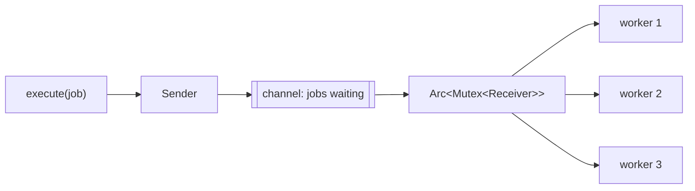

<callout background="yellow" icon="🧵">

**Data races are compile errors in Rust.** Ownership plus two marker traits, `Send` and `Sync`, let the compiler reject sharing that isn't thread-safe. Deadlocks and logic races are still possible, but memory corruption from threads is not (in safe code).

</callout>

**Level:** 🟡 Intermediate · **Needs:** [09 Smart Pointers and Interior Mutability](page:p7tycay9d0)

## Spawning threads

```rust
use std::thread;

let v = vec![1, 2, 3];
let handle = thread::spawn(move || {       // move: the thread takes ownership of v
    v.iter().sum::<i32>()
});
let total = handle.join().unwrap();         // join returns the closure's result
```

Without `move`, the closure would borrow `v`, and the compiler can't prove the thread finishes before `v` is dropped.

### Scoped threads: borrow from the stack

```rust
let data = vec![1, 2, 3, 4, 5, 6];
let (left, right) = data.split_at(3);

let (a, b) = thread::scope(|s| {
    let h1 = s.spawn(|| left.iter().sum::<i32>());
    let h2 = s.spawn(|| right.iter().sum::<i32>());
    (h1.join().unwrap(), h2.join().unwrap())
});   // all scoped threads are joined here, so borrowing is safe
```

### Building up to 10.1

**The goal in plain words:** adding up 100 million numbers on one CPU core takes a moment. Your computer has several cores, so split the list into one piece per core, sum the pieces at the same time, then add the partial sums. Then measure whether it was really faster.

**Step 1: make the data.** `(1..=100_000_000).collect::<Vec<u64>>()` is about 800 MB. If that's too much for your machine, use 10 million instead.

**Step 2: how many cores?**

```rust
let n = std::thread::available_parallelism().unwrap().get();   // e.g. 8
```

**Step 3: cut the list into `n` pieces.** `chunks(size)` gives slices of `size` items, with the last one possibly shorter. To get `n` pieces, the size is the length divided by `n`, **rounded up** (otherwise you'd get `n + 1` pieces):

```rust
let v = [1, 2, 3, 4, 5, 6, 7];
let size = v.len().div_ceil(3);          // 7 / 3 rounded up = 3
for c in v.chunks(size) { println!("{c:?}"); }   // [1, 2, 3]  [4, 5, 6]  [7]
```

**Step 4: one thread per piece.** The scoped-thread example above has exactly two hand-written threads. For `n` threads, spawn them in a loop, keep the handles in a `Vec`, then `join` them all:

```rust
thread::scope(|s| {
    let mut handles = Vec::new();
    for piece in data.chunks(size) {
        handles.push(s.spawn(move || piece.iter().sum::<u64>()));   // move: take this piece
    }
    // join each handle and add up what it returns
});
```

`thread::scope` lets the threads borrow `data` directly, because it guarantees they all finish before the scope ends.

**Step 5: time it.** `std::time::Instant` measures elapsed time:

```rust
let start = std::time::Instant::now();
let total: u64 = data.iter().sum();
println!("single: {total} in {:?}", start.elapsed());
```

Always measure with `cargo run --release`. Debug builds are slow and give misleading numbers.

**Step 6: rayon.** `cargo add rayon`, then `use rayon::prelude::*;` and `data.par_iter().sum::<u64>()`. Rayon does the splitting and the threads for you.

<callout background="blue" icon="🏋️">

**Exercise 10.1 — Parallel sum with scoped threads**

Sum a `Vec<u64>` of 100 million numbers by splitting it into `n` chunks (`n = thread::available_parallelism()`) with `chunks()` and one scoped thread per chunk. Compare the time with a single-threaded sum in `--release`. Then do it in one line with rayon's `par_iter().sum()`.

</callout>

<toggle>

Hint

```rust
let n = thread::available_parallelism().unwrap().get();
let chunk = data.len().div_ceil(n);
let total: u64 = thread::scope(|s| {
    let handles: Vec<_> = data.chunks(chunk).map(|c| s.spawn(move || c.iter().sum::<u64>())).collect();
    handles.into_iter().map(|h| h.join().unwrap()).sum()
});
```

Don't be surprised if the speed-up is small: summing is limited by memory bandwidth, not CPU.

</toggle>

## Message passing

"Don't communicate by sharing memory; share memory by communicating."

```rust
use std::sync::mpsc;   // multi-producer, single-consumer

let (tx, rx) = mpsc::channel();
for id in 0..3 {
    let tx = tx.clone();
    thread::spawn(move || tx.send(format!("hello from {id}")).unwrap());
}
drop(tx);                       // close our copy so the loop below ends
for msg in rx {                 // iterates until every sender is dropped
    println!("{msg}");
}
```

`mpsc::sync_channel(n)` gives a bounded channel (senders block when full: back-pressure). `crossbeam-channel` adds multi-consumer channels and `select!`.

## Shared state

```rust
use std::sync::{Arc, Mutex};

let counter = Arc::new(Mutex::new(0));
let handles: Vec<_> = (0..10).map(|_| {
    let counter = Arc::clone(&counter);
    thread::spawn(move || {
        *counter.lock().unwrap() += 1;     // guard unlocks when dropped
    })
}).collect();
for h in handles { h.join().unwrap(); }
println!("{}", *counter.lock().unwrap());  // 10
```

| Type | Use |
| --- | --- |
| `Arc<T>` | shared ownership across threads (atomic `Rc`) |
| `Mutex<T>` | one thread at a time |
| `RwLock<T>` | many readers **or** one writer |
| `Condvar` | wait until a condition changes |
| `AtomicUsize`, `AtomicBool`, … | lock-free single values |
| `OnceLock<T>` / `LazyLock<T>` | initialise once, read forever (globals) |
| `Barrier` | wait until N threads reach a point |

### Send and Sync

- **`Send`**: a value can be **moved** to another thread. `Rc` is not `Send` (its count isn't atomic).
- **`Sync`**: `&T` can be **shared** between threads. `RefCell` is not `Sync`; `Mutex<T>` is.
- The compiler derives both automatically; you only see them in errors like *"`Rc<i32>` cannot be sent between threads safely"*.

### Building up to 10.2

**The goal in plain words:** starting a thread for every small task is wasteful. A **thread pool** starts a few threads once, the "workers", and keeps them waiting. You hand the pool jobs, and whichever worker is free picks up the next one. When the pool is dropped, it tells the workers to stop and waits for them to finish. Web servers work this way.



**Step 1: a job is a boxed closure.** Every closure has its own type, so to send different jobs down one channel, box them as one common type:

```rust
type Job = Box<dyn FnOnce() + Send + 'static>;
// FnOnce:  each job runs once
// Send:    it will move to another thread
// 'static: it borrows nothing from the caller, who may be gone by the time it runs
```

**Step 2: the channel.** `mpsc::channel()` gives a sender and a receiver. Sending puts a job in the queue, and `recv()` waits for the next one:

```rust
let (tx, rx) = mpsc::channel::<Job>();
tx.send(Box::new(|| println!("hi"))).unwrap();
let job = rx.recv().unwrap();   // waits until there is a job
job();                          // prints "hi"
```

**Step 3: sharing one receiver between workers.** Only one thread can own the `Receiver`, so wrap it: `Arc` gives every worker a handle, and `Mutex` makes sure only one worker takes a job at a time. Each worker loops:

1. lock the receiver and `recv()` the next job,
1. **release the lock** (by finishing the statement),
1. run the job,
1. repeat.

Releasing the lock *before* running the job is what lets the other workers work meanwhile. See the note under the Skeleton.

**Step 4: telling the workers to stop.** When every `Sender` is dropped, `recv()` returns `Err`, and that's the worker's signal to `break`. So the pool keeps its sender in an `Option`, and `Drop` takes it out (`self.sender.take()`) and drops it. Then it `join`s each worker, so the pool waits until the queued jobs are done.

**Step 5: try it.** Submit 20 jobs like:

```rust
pool.execute(move || {
    std::thread::sleep(std::time::Duration::from_millis(100));
    println!("job {i} on {:?}", std::thread::current().id());
});
```

With 4 workers you should see four thread ids taking turns, and the whole run taking about 20 × 100 ms / 4 = 0.5 s.

<callout background="blue" icon="🏋️">

**Exercise 10.2 — Worker pool with channels**

Build `ThreadPool::new(n)` with `execute(f)` where `f: FnOnce() + Send + 'static`. Workers share one `Arc<Mutex<mpsc::Receiver<Job>>>` and loop pulling jobs. Implement `Drop` for the pool so it closes the channel and joins every worker. Submit 20 jobs that sleep and print their thread id.

</callout>

<toggle>

Skeleton

```rust
type Job = Box<dyn FnOnce() + Send + 'static>;

pub struct ThreadPool {
    workers: Vec<thread::JoinHandle<()>>,
    sender: Option<mpsc::Sender<Job>>,
}

impl ThreadPool {
    pub fn new(n: usize) -> Self {
        let (tx, rx) = mpsc::channel::<Job>();
        let rx = Arc::new(Mutex::new(rx));
        let workers = (0..n).map(|_| {
            let rx = Arc::clone(&rx);
            thread::spawn(move || loop {
                let job = rx.lock().unwrap().recv();   // guard dropped at end of statement
                match job {
                    Ok(job) => job(),
                    Err(_) => break,                    // channel closed
                }
            })
        }).collect();
        ThreadPool { workers, sender: Some(tx) }
    }

    pub fn execute(&self, f: impl FnOnce() + Send + 'static) {
        self.sender.as_ref().unwrap().send(Box::new(f)).unwrap();
    }
}

impl Drop for ThreadPool {
    fn drop(&mut self) {
        drop(self.sender.take());
        for w in self.workers.drain(..) { w.join().unwrap(); }
    }
}
```

Note `let job = rx.lock().unwrap().recv();` on its own line: if you wrote `while let Ok(job) = rx.lock().unwrap().recv()`, the lock guard would live for the whole loop body and only one worker would ever run.

</toggle>

## Atomics

```rust
use std::sync::atomic::{AtomicU64, Ordering};

static HITS: AtomicU64 = AtomicU64::new(0);
HITS.fetch_add(1, Ordering::Relaxed);
```

**Memory ordering** says what *other* memory operations are guaranteed visible:

- `Relaxed`: only the atomic itself is consistent. Fine for counters.
- `Release` (on a store) + `Acquire` (on the load that sees it): everything written before the release is visible after the acquire. The basis of locks and flags.
- `SeqCst`: one global order for all `SeqCst` operations. Safest, rarely needed.

### Building up to 10.3

**The goal in plain words:** 8 threads all add 1 to the same counter, a million times each. The right answer is 8,000,000. There are several ways to share the counter safely, and they differ a lot in speed. You'll time four of them. Then you'll build the simplest possible lock yourself, to see what the orderings are for.

**Step 1: a timing harness.** Write the experiment once and pass in what changes. `thread::scope` lets the threads borrow the counter:

```rust
use std::time::Instant;

let start = Instant::now();
std::thread::scope(|s| {
    for _ in 0..8 {
        s.spawn(|| {
            for _ in 0..1_000_000 {
                // increment the shared counter here
            }
        });
    }
});
println!("took {:?}", start.elapsed());
```

**Step 2: the four versions.**

| Version | The shared counter | One increment |
| --- | --- | --- |
| Mutex | `let c = Mutex::new(0u64);` | `*c.lock().unwrap() += 1;` |
| Atomic, Relaxed | `let c = AtomicU64::new(0);` | `c.fetch_add(1, Ordering::Relaxed);` |
| Atomic, SeqCst | the same | `c.fetch_add(1, Ordering::SeqCst);` |
| Local counts | nothing shared | each thread counts in a local `u64` and returns it, and you add the 8 results after `join` |

For the last one, use `s.spawn(...)` handles and `.join().unwrap()` to collect each thread's count (as in 10.1). Check that every version prints 8,000,000, then compare the times in `--release`.

**Step 3: a spin lock in two operations.** A lock is just a flag: `false` = free, `true` = taken.

- **Lock:** keep trying to flip `false` → `true` until you succeed. `compare_exchange(false, true, …)` does "if it's `false`, make it `true`" as one indivisible step, returning `Ok` if it did and `Err` if someone else holds the lock:

```rust
while flag.compare_exchange(false, true, Ordering::Acquire, Ordering::Relaxed).is_err() {
    std::hint::spin_loop();   // tell the CPU we're busy-waiting
}
```

- **Unlock:** `flag.store(false, Ordering::Release);`

**Step 4: why those orderings?** Both CPU and compiler may reorder memory reads and writes for speed, as long as a single thread can't tell. The orderings forbid specific reorderings:

- `Acquire` on taking the lock: nothing in the locked section may be moved *before* the lock is taken.
- `Release` on unlocking: nothing in the locked section may be moved *after* the unlock.

For the explanation, imagine a thread whose `counter += 1` gets moved to *after* its `store(false)`. What could another thread see?

<callout background="blue" icon="🏋️">

**Exercise 10.3 — Atomic vs Mutex counter**

8 threads each increment a shared counter 1 million times. Compare: `Mutex<u64>`, `AtomicU64` with `Relaxed`, `AtomicU64` with `SeqCst`, and per-thread local counts summed at the end. Then build a tiny spin lock from an `AtomicBool` with `compare_exchange(false, true, Acquire, Relaxed)` and `store(false, Release)`, and explain why those orderings.

</callout>

<toggle>

What you'll likely see, and why

Local counts are fastest by far (no sharing). Atomics beat the mutex, and on x86 `Relaxed` vs `SeqCst` `fetch_add` cost about the same (both compile to `lock xadd`), while on ARM they differ. The spin lock needs **Acquire** when taking the lock so reads inside the critical section can't move before it, and **Release** when unlocking so writes inside can't move after it. Read *Rust Atomics and Locks* chapters 1–4 next.

</toggle>

<toggle>

Deadlocks: still your problem

Two threads each holding one lock and waiting for the other's. Avoid it by always taking locks in the same order, holding them briefly (never across slow calls), and preferring channels. `parking_lot` has a deadlock detector feature.

</toggle>

## Checklist

- [ ] I can use `move` closures, `join`, and scoped threads
- [ ] I can pick between channels and `Arc<Mutex<T>>`
- [ ] I can explain `Send` and `Sync` and why `Rc` isn't `Send`
- [ ] I know what `Relaxed`, `Acquire`/`Release` and `SeqCst` guarantee

---

← [09 Smart Pointers and Interior Mutability](page:p7tycay9d0) · [Rust Learning Hub](page:7jlv8afgwm) · Next → [11 Async Rust](page:m5cbwfmofv)
