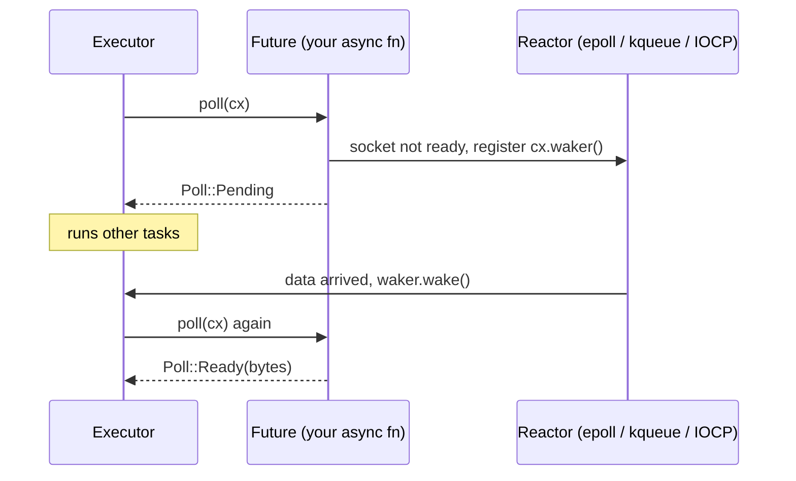

<callout background="orange" icon="⏳">

**Thousands of concurrent I/O tasks on a handful of threads.** An `async fn` compiles to a state machine (a `Future`) that does nothing until an executor polls it. Rust gives you the language part; a runtime like **tokio** gives you the executor, timers and sockets.

</callout>

**Level:** 🟠 Advanced · **Needs:** [10 Fearless Concurrency](page:8nzk05a62m)

## Threads or async?

<columns>

<column>

### Use threads when

- the work is **CPU-bound** (number crunching, compression)
- you have tens or hundreds of concurrent jobs
- you want simple code and no runtime

</column>

<column>

### Use async when

- the work is **I/O-bound** (network servers, many HTTP calls, databases)
- you need thousands to millions of concurrent tasks
- you want timeouts and cancellation everywhere

</column>

</columns>

## The basics with tokio

```toml
[dependencies]
tokio = { version = "1", features = ["full"] }
```

```rust
use std::time::Duration;
use tokio::time::sleep;

async fn fetch(id: u32) -> String {
    sleep(Duration::from_millis(100 * id as u64)).await;   // yields to the executor
    format!("result {id}")
}

#[tokio::main]
async fn main() {
    // Sequential: ~600 ms
    let a = fetch(1).await;
    let b = fetch(2).await;
    let c = fetch(3).await;

    // Concurrent on one task: ~300 ms
    let (a2, b2, c2) = tokio::join!(fetch(1), fetch(2), fetch(3));

    // Separate tasks the runtime can run on any worker thread
    let handle = tokio::spawn(fetch(4));
    let d = handle.await.unwrap();
    println!("{a} {b} {c} {a2} {b2} {c2} {d}");
}
```

<callout background="yellow" icon="⚠️">

**Futures are lazy.** `fetch(1);` without `.await` does nothing at all (the compiler warns you). And **never block** inside async code: `std::thread::sleep`, heavy loops or blocking file I/O freeze every task on that worker. Use `tokio::time::sleep`, `tokio::fs`, or move the work to `tokio::task::spawn_blocking`.

</callout>

### Building up to 11.1

**The goal in plain words:** `slow_square(n)` stands in for real slow work like a network request: it waits `n × 100` ms, then answers. Run five of them in four different ways and time each one. The point is to *see* that waiting on several things at once is much faster than waiting on them one after another.

**Step 1: an async function, and calling it.** `async fn` returns a future, and `.await` runs it to the end. Without `.await`, nothing happens:

```rust
async fn slow_square(n: u64) -> u64 {
    tokio::time::sleep(std::time::Duration::from_millis(n * 100)).await;
    n * n
}

let x = slow_square(3).await;   // 9, after 300 ms
```

`.await` only works inside another `async fn`. `#[tokio::main]` on `main` gives you a runtime to start from (see the example above).

**Step 2: a timer for each version.** Same as 10.1: `let start = Instant::now();` … `println!("{:?}", start.elapsed());`.

**Step 3: the four versions, and what to expect.** The waits are 100, 200, 300, 400 and 500 ms.

| Version | How | Expected time |
| --- | --- | --- |
| (a) sequential | a `for n in 1..=5` loop with `slow_square(n).await` | sum of all waits: 1.5 s |
| (b) `join!` | `tokio::join!(slow_square(1), …, slow_square(5))`, which waits for all of them together | the longest wait: 0.5 s |
| (c) `JoinSet` | spawn each as its own task (see the hint), collect results as they finish | about 0.5 s, results in finishing order |
| (d) timeout | wrap each one: `tokio::time::timeout(Duration::from_millis(250), slow_square(n))` | n = 1 and 2 finish, 3–5 time out |

**Step 4: reading a timeout's result.** `timeout(...)` gives a `Result`: `Ok(value)` if the inner future finished in time, `Err(Elapsed)` if it didn't:

```rust
match tokio::time::timeout(Duration::from_millis(250), slow_square(n)).await {
    Ok(v) => println!("{n}² = {v}"),
    Err(_) => println!("{n} timed out"),
}
```

To run the five timeouts at the same time rather than one after another, spawn them into a `JoinSet`, as in (c).

<callout background="blue" icon="🏋️">

**Exercise 11.1 — Concurrent tasks with join!**

Write `async fn slow_square(n: u64) -> u64` that sleeps `n * 100` ms then returns `n * n`. Compute squares of 1..=5: (a) sequentially, (b) with `join!`, (c) by spawning 5 tasks and collecting with a `JoinSet`, (d) with `tokio::time::timeout` of 250 ms around each, printing which timed out. Time each version.

</callout>

<toggle>

JoinSet hint

```rust
let mut set = tokio::task::JoinSet::new();
for n in 1..=5 { set.spawn(slow_square(n)); }
while let Some(res) = set.join_next().await {
    println!("{}", res.unwrap());   // finishes in completion order, not spawn order
}
```

</toggle>

## Under the hood: Future, poll and wakers

```rust
pub trait Future {
    type Output;
    fn poll(self: Pin<&mut Self>, cx: &mut Context<'_>) -> Poll<Self::Output>;
}

pub enum Poll<T> { Ready(T), Pending }
```



- The compiler turns each `async fn` into an enum: one variant per `.await` point, holding the local variables alive across it.
- **`Pin`** exists because that state machine can hold references to its own fields; once polled it must not move in memory. `Box::pin(fut)` and `tokio::pin!(fut)` handle it for you.
- **`Send`**: `tokio::spawn` needs `Send` futures because tasks move between threads. Holding a non-`Send` value (an `Rc`, a `std::sync::MutexGuard`) across an `.await` makes the whole future non-`Send`.

## Patterns

<toggle>

select!: race several futures, cancel the losers

```rust
tokio::select! {
    msg = rx.recv() => println!("got {msg:?}"),
    _ = tokio::time::sleep(Duration::from_secs(5)) => println!("timed out"),
    _ = tokio::signal::ctrl_c() => println!("shutting down"),
}
```

The branches that lose are **dropped**, which cancels them at their current `.await`. Make sure that's safe ("cancellation safety"): e.g. `read_line` into a buffer may lose partial data.

</toggle>

<toggle>

Channels and shared state in async

- `tokio::sync::mpsc`, `oneshot` (one reply), `broadcast` (every receiver gets every message), `watch` (latest value only)
- `tokio::sync::Mutex` only when you must hold the lock **across an `.await`**; otherwise `std::sync::Mutex` is faster and fine
- `Arc<T>` to share between tasks, exactly as with threads

</toggle>

<toggle>

Async in traits and closures

- `async fn` in traits is stable since Rust 1.75. For `dyn Trait` with async methods, use the `async-trait` crate or return `Pin<Box<dyn Future<Output = T> + Send + '_>>`.
- Async closures `async |x| { … }` and the `AsyncFn*` traits are stable since 1.85.
- Streams (async iterators): `tokio_stream` / `futures::Stream` with `StreamExt::next().await`.

</toggle>

## A TCP echo server

```rust
use tokio::io::{AsyncReadExt, AsyncWriteExt};
use tokio::net::TcpListener;

#[tokio::main]
async fn main() -> std::io::Result<()> {
    let listener = TcpListener::bind("127.0.0.1:8080").await?;
    loop {
        let (mut socket, addr) = listener.accept().await?;
        tokio::spawn(async move {
            let mut buf = [0u8; 1024];
            loop {
                let n = match socket.read(&mut buf).await {
                    Ok(0) | Err(_) => return,       // closed or error
                    Ok(n) => n,
                };
                if socket.write_all(&buf[..n]).await.is_err() {
                    return;
                }
            }
        });
        println!("client {addr}");
    }
}
```

### Building up to 11.2

**The goal in plain words:** an echo server waits for programs to connect over the network and sends back whatever they send it. The code above already works. You'll run it, then improve it in four steps: line by line, counting clients, shutting down cleanly, and proving it can handle thousands of connections.

**Step 0: run it and talk to it.** `cargo run` in one terminal. In another, `nc 127.0.0.1 8080` (netcat) connects. Type something, press Enter, and it comes back. Ctrl-C closes `nc`.

**Step 1: line-based, in upper case.** Reading into a byte buffer gives you whatever arrived, which might be half a line. To get whole lines, split the socket into a read half and a write half, and wrap the reader:

```rust
use tokio::io::{AsyncBufReadExt, AsyncWriteExt, BufReader};

let (reader, mut writer) = socket.into_split();
let mut lines = BufReader::new(reader).lines();
while let Ok(Some(line)) = lines.next_line().await {    // None = client disconnected
    let reply = format!("{}\n", line.to_uppercase());
    if writer.write_all(reply.as_bytes()).await.is_err() {
        break;                                          // client went away
    }
}
```

(The spawned task returns `()`, so `?` can't be used inside it. Hence the `is_err()` check.)

**Step 2: count the clients.** All the tasks share one counter, so use `Arc<AtomicUsize>`, as in module 10. Clone the `Arc` before `tokio::spawn`, then `fetch_add(1, …)` when a client connects and `fetch_sub(1, …)` when its loop ends. Both return the *old* value, so print `old + 1` or `old - 1`.

**Step 3: stop on Ctrl-C.** `select!` waits on several things and runs the branch of whichever happens first. Put it around `accept()`:

```rust
loop {
    tokio::select! {
        res = listener.accept() => {
            let (socket, addr) = res?;
            // spawn the client task as before
        }
        _ = tokio::signal::ctrl_c() => {
            println!("shutting down");
            break;
        }
    }
}
```

**Step 4: 10,000 connections.** Write a second small program (a client) that opens many connections at once and keeps them open:

```rust
let mut conns = Vec::new();
for _ in 0..10_000 {
    conns.push(tokio::net::TcpStream::connect("127.0.0.1:8080").await?);
}
tokio::time::sleep(Duration::from_secs(30)).await;   // hold them while you look
```

While it runs, watch the server's memory with `top` or `htop`. Each task is only a few KB, whereas a thread would need its own stack (MBs). If you get "too many open files", raise the limit with `ulimit -n 20000` in both terminals.

<callout background="blue" icon="🏋️">

**Exercise 11.2 — Async TCP echo server**

Get the server above running and test it with `nc 127.0.0.1 8080`. Then: (1) make it line-based with `BufReader::lines()`, echoing in upper case; (2) count connected clients in an `Arc<AtomicUsize>` and print it on connect/disconnect; (3) shut down gracefully on Ctrl-C with `select!`; (4) open 10,000 connections from a test client and watch memory stay small.

</callout>

### Building up to 11.3

**The goal in plain words:** tokio's job is to *run* futures. Here you write the smallest possible runner yourself, with no crates: give it one future, and it keeps asking the future "are you done?", sleeping in between, until the answer is yes. That shows what `.await` and a runtime really do.

**Step 1: what "polling" means.** A future has one method, `poll`. Each call answers `Poll::Ready(value)` ("done, here it is") or `Poll::Pending` ("not yet"). An executor is a loop:

```text
loop {
    poll the future
    Ready(v)  → return v
    Pending   → sleep until someone says "try again"
}
```

**Step 2: "someone says try again" is the waker.** When a future returns `Pending`, it must keep the `Waker` from the `Context` it was polled with, and call `waker.wake()` when it can make progress. Your waker wakes the sleeping thread.

**Step 3: sleeping a thread and waking it.** `thread::park()` puts the current thread to sleep. Another thread calls `.unpark()` on its `Thread` handle to wake it:

```rust
use std::thread;
use std::time::Duration;

let main = thread::current();          // handle to this thread
thread::spawn(move || {
    thread::sleep(Duration::from_secs(1));
    main.unpark();                      // wake the main thread
});
thread::park();                         // sleeps until unparked
println!("woken!");
```

**Step 4: turn "unpark this thread" into a `Waker`.** Implement the `Wake` trait for a struct holding the `Thread`, with `wake` calling `unpark`. `Waker::from(Arc::new(your_struct))` then gives you a real `Waker`. Build a `Context` from it with `Context::from_waker(&waker)`.

**Step 5: pinning.** `poll` takes `Pin<&mut Self>` (a future may hold pointers into itself, so it must not move once polled). `std::pin::pin!(fut)` pins it on the stack, and `fut.as_mut().poll(&mut cx)` polls it. That's all the pinning you need here.

**Step 6: a future to test with.** It shares a flag with a background thread. `Pending` until the flag is set, and the thread sets it and calls the waker:

```rust
use std::sync::{Arc, Mutex};
use std::task::{Context, Poll, Waker};

struct Shared { done: bool, waker: Option<Waker> }
struct Flag(Arc<Mutex<Shared>>);

impl std::future::Future for Flag {
    type Output = &'static str;
    fn poll(self: std::pin::Pin<&mut Self>, cx: &mut Context<'_>) -> Poll<Self::Output> {
        let mut s = self.0.lock().unwrap();
        if s.done { return Poll::Ready("flag set"); }
        s.waker = Some(cx.waker().clone());      // remember who to wake
        Poll::Pending
    }
}
```

The background thread sleeps a second, sets `done = true`, then `take()`s the waker and calls `.wake()`. `block_on(Flag(shared))` should return `"flag set"` after about a second.

<callout background="blue" icon="🏋️">

**Exercise 11.3 — Write your own block\_on**

Without tokio, write `fn block_on<F: Future>(fut: F) -> F::Output` that polls the future on the current thread and **parks** the thread while it's `Pending`, using a `Waker` that unparks it. Test it with a hand-written `Future` that's `Pending` until a background thread sets a flag and calls the waker.

</callout>

<toggle>

Solution sketch

```rust
use std::future::Future;
use std::pin::pin;
use std::sync::Arc;
use std::task::{Context, Poll, Wake, Waker};
use std::thread::{self, Thread};

struct ThreadWaker(Thread);

impl Wake for ThreadWaker {
    fn wake(self: Arc<Self>) { self.0.unpark(); }
}

fn block_on<F: Future>(fut: F) -> F::Output {
    let mut fut = pin!(fut);
    let waker = Waker::from(Arc::new(ThreadWaker(thread::current())));
    let mut cx = Context::from_waker(&waker);
    loop {
        match fut.as_mut().poll(&mut cx) {
            Poll::Ready(v) => return v,
            Poll::Pending => thread::park(),
        }
    }
}
```

`park` may wake spuriously; that's fine, the loop just polls again. This is essentially what `futures::executor::block_on` does. Next step: a multi-task executor with a channel of `Arc<Task>`s (the async book's "Build an executor" chapter).

</toggle>

## Checklist

- [ ] I know when async beats threads and when it doesn't
- [ ] I can use `join!`, `spawn`, `JoinSet`, `select!` and `timeout`
- [ ] I can explain poll, `Pending`, wakers and why `Pin` exists
- [ ] I know what makes a future non-`Send` and how to avoid blocking the runtime

---

← [10 Fearless Concurrency](page:8nzk05a62m) · [Rust Learning Hub](page:7jlv8afgwm) · Next → [12 Testing and Tooling](page:m4szna8wnq)
