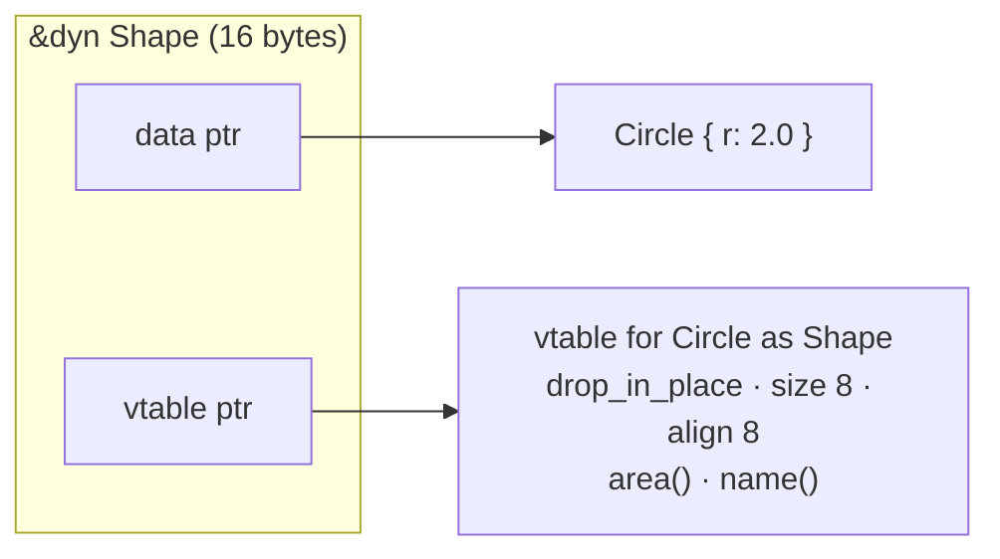
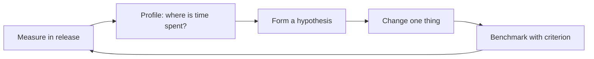

<callout background="red" icon="📐">

**How your types sit in memory, and how to make Rust fast on purpose.** Sizes, alignment, `repr`, niches, fat pointers, allocators, and a profiling workflow that finds the real bottleneck.

</callout>

**Level:** 🔴 Expert · **Needs:** [15 Unsafe Rust](page:fnp814n35n)

## Size and alignment

Every type has a **size** (bytes it occupies) and an **alignment** (its address must be a multiple of this). Size is always a multiple of alignment.

```rust
use std::mem::{size_of, align_of};

println!("{} {}", size_of::<u64>(), align_of::<u64>()); // 8 8
```

### `repr` attributes

| Attribute | Effect | Use for |
| --- | --- | --- |
| *(default)* `repr(Rust)` | compiler may **reorder fields** to cut padding; layout unspecified | everything else |
| `repr(C)` | fields in declared order, C padding rules | FFI, stable layouts, `unsafe` casts |
| `repr(transparent)` | same layout as its single non-zero-sized field | newtypes passed over FFI |
| `repr(packed)` | no padding; fields may be misaligned (taking `&` to them is an error) | wire formats, rarely |
| `repr(align(64))` | raise alignment | keeping hot atomics on separate cache lines |
| `repr(u8)` / `repr(i32)` on enums | fixes the discriminant type | FFI, compact storage |

```rust
struct A { a: u8, b: u32, c: u8 }              // 8 bytes: reordered to b, a, c + 2 padding

#[repr(C)]
struct B { a: u8, b: u32, c: u8 }              // 12 bytes: a, 3 pad, b, c, 3 pad
```

### Niches: free `Option`s

If a type has bit patterns that are never valid (a **niche**), `Option` uses one for `None` and costs **zero** extra bytes. References and `Box` are never null, `NonZeroU32` is never 0, `bool` is only 0 or 1, `char` is never above `0x10FFFF`.

### Fat pointers

Pointers to dynamically sized types carry extra data:

- `&[T]`, `&str`, `Box<[T]>`: pointer + **length**
- `&dyn Trait`, `Box<dyn Trait>`: pointer + **vtable pointer** (drop, size, align, then the trait's methods)



### Building up to 17.1

**The goal in plain words:** nineteen types. Before running anything, write down how many bytes each one takes, then check with `size_of`. The surprises teach you more than the answers: why an `Option` is sometimes free and sometimes doubles the size, and why `&str` is twice as big as `&u8`.

**Step 1: the measuring tool.** One line per type:

```rust
use std::mem::size_of;
println!("{:>25} {}", "Option<Box<u64>>", size_of::<Option<Box<u64>>>());
```

A small macro saves typing (13.1 practice): `macro_rules! sz { ($t:ty) => { println!("{:>25} {}", stringify!($t), size_of::<$t>()) } }`, then `sz!(&str);`.

**Step 2: the five rules that settle almost all of them.** Work through them in order for each type:

1. **Basics on 64-bit:** a pointer is 8 bytes, `u8`/`bool` 1, `u16` 2, `u32`/`char` 4, `u64` 8.
1. **Thin or fat pointer?** `&T` and `Box<T>` are one pointer (8) for a normal `T`. Pointers to slices, `str` or `dyn Trait` also carry a length or a vtable pointer (16).
1. **Padding:** the total size is rounded up to a multiple of the largest alignment inside. In the default layout Rust may reorder fields to waste less space. Arrays never pad between elements.
1. **Enums need a tag** saying which variant is active. Usually that's a byte, rounded up by padding. `Option<u32>` is a tag plus a `u32`.
1. **…unless there's a niche:** if the inner type has an impossible value (a null pointer, a `0` in `NonZeroU32`, a `bool` that's `2`), `None` is stored *as* that value, and the tag costs nothing.

**Step 3: three worked examples.**

```text
&[u8]             → pointer to slice → fat: ptr + len                      = 16
Option<&u8>       → & is never null → None uses the null value            = 8
(u8, u16)         → largest alignment is 2; 1 + 2 = 3 → round up to 4     = 4
```

**Step 4: predict, then run.** Write all nineteen predictions down *first* (a table in your notes works). Then run the program, and for each one you got wrong, find which of the five rules you missed.

<callout background="blue" icon="🏋️">

**Exercise 17.1 — Predict type sizes**

On 64-bit, write down your prediction for each, then check with `size_of`:

`&u8`, `&[u8]`, `&str`, `&dyn Fn()`, `Box<u64>`, `Option<Box<u64>>`, `Option<u32>`, `Option<NonZeroU32>`, `String`, `Vec<u8>`, `Option<String>`, `char`, `(u8, u32, u8)`, `[u16; 3]`, `Result<u32, ()>`, `enum E { A, B, C }`, `Option<Option<bool>>`, `()`, `[u64; 0]`.

</callout>

<toggle>

Answers (x86-64)

| Type | Size | Why |
| --- | --: | --- |
| `&u8` | 8 | thin pointer |
| `&[u8]`, `&str`, `&dyn Fn()` | 16 | fat pointers |
| `Box<u64>` | 8 | thin pointer |
| `Option<Box<u64>>` | 8 | null niche |
| `Option<u32>` | 8 | needs a tag, padded to align 4 |
| `Option<NonZeroU32>` | 4 | 0 is the niche |
| `String`, `Vec<u8>` | 24 | ptr + cap + len |
| `Option<String>` | 24 | niche in the pointer / capacity |
| `char` | 4 | Unicode scalar value |
| `(u8, u32, u8)` | 8 | reordered |
| `[u16; 3]` | 6 | arrays never pad between elements |
| `Result<u32, ()>` | 8 | tag + u32 |
| `enum E { A, B, C }` | 1 | discriminant fits in a u8 |
| `Option<Option<bool>>` | 1 | bool has 254 spare values |
| `()`, `[u64; 0]` | 0 | zero-sized types |

</toggle>

## Allocation

Heap allocation is often the hidden cost. Habits that help:

- `Vec::with_capacity(n)` / `String::with_capacity(n)` when you know the size
- Reuse buffers: `buf.clear()` keeps the capacity
- Borrow (`&str`, `&[T]`) instead of cloning; `Cow<'_, str>` when you *sometimes* need to own
- `SmallVec` / `ArrayVec` for small collections that usually fit on the stack
- Arenas (`bumpalo`) for many short-lived objects freed together
- Swap the global allocator (`mimalloc`, `jemallocator`) for allocation-heavy servers

### Writing a global allocator

```rust
use std::alloc::{GlobalAlloc, Layout, System};
use std::sync::atomic::{AtomicUsize, Ordering::Relaxed};

struct Counting;

static ALLOCS: AtomicUsize = AtomicUsize::new(0);
static BYTES: AtomicUsize = AtomicUsize::new(0);

unsafe impl GlobalAlloc for Counting {
    unsafe fn alloc(&self, layout: Layout) -> *mut u8 {
        ALLOCS.fetch_add(1, Relaxed);
        BYTES.fetch_add(layout.size(), Relaxed);
        unsafe { System.alloc(layout) }
    }
    unsafe fn dealloc(&self, ptr: *mut u8, layout: Layout) {
        unsafe { System.dealloc(ptr, layout) }
    }
}

#[global_allocator]
static GLOBAL: Counting = Counting;
```

### Building up to 17.2

**The goal in plain words:** every `String`, `Vec` and `Box` asks the allocator for memory, and each request takes time. You can't see these requests in your code. So you'll replace Rust's allocator with one that *counts* the requests, and use it to compare pairs of programs that produce the same result with very different numbers of allocations.

**Step 1: what the code above does.** `GlobalAlloc` is the trait every allocator implements. `Counting` passes each request on to the normal system allocator (`System`), after adding 1 to a counter. `#[global_allocator]` makes *every* allocation in the program go through it, including the ones inside `String`, `Vec` and `format!`.

**Step 2: measure a block of code.** Read the counter before and after:

```rust
fn count<R>(label: &str, f: impl FnOnce() -> R) -> R {
    let before = ALLOCS.load(Relaxed);
    let out = f();
    println!("{label:>30}: {} allocations", ALLOCS.load(Relaxed) - before);
    out
}

count("push_str x1000", || {
    let mut s = String::new();
    for _ in 0..1000 { s.push_str("ab"); }
    s
});
```

Returning the value from the closure stops the optimiser from deleting the work. Always run with `--release`.

**Step 3: the pairs to compare.**

| Version A | Version B | What changes |
| --- | --- | --- |
| `String::new()` + 1000 × `push_str` | `String::with_capacity(2000)` + the same | grows step by step vs. reserved once |
| `let s = format!("{i}");` in a loop | `write!(buf, "{i}")` into one `buf` that you `clear()` each time | a new `String` per turn vs. reusing one |
| `(0..1000).collect::<Vec<_>>()` | `(0..1000).filter(\|x\| x % 2 == 0).collect::<Vec<_>>()` | does `collect` know the length in advance? |

`write!` into a `String` needs `use std::fmt::Write;`.

**Step 4: peak memory.** "Peak" is the most memory in use at any one moment. Add a `CURRENT` counter (add the size in `alloc`, subtract it in `dealloc`) and a `PEAK` that remembers the highest `CURRENT` seen. The hint shows the one-line way to update it.

<callout background="blue" icon="🏋️">

**Exercise 17.2 — Counting allocator**

Install the allocator above and print how many allocations each of these does: building a `String` with 1000 `push_str` calls vs `with_capacity`; `format!` in a loop vs `write!` into one reused `String`; `collect::<Vec<_>>()` from `0..1000` vs `(0..1000).filter(..)`. Add a `peak bytes` counter (track current bytes on `dealloc` too).

</callout>

<toggle>

Hint for peak memory

Keep `CURRENT` (add on alloc, subtract on dealloc) and update `PEAK` with `PEAK.fetch_max(new_current, Relaxed)`. Note that `realloc` has a default implementation calling `alloc` + `dealloc`, so growth is counted correctly; override it to see how often `Vec` reallocates.

</toggle>

## Making it fast: a workflow



1. **Always measure `--release`.** Debug builds can be 10–50× slower.
1. **Profile** before guessing: `perf record -g ./target/release/app` + `perf report`, or `cargo flamegraph`, or `samply record` (opens in the Firefox profiler). Enable `debug = true` in `[profile.release]` for readable symbols.
1. **Fix the algorithm first** (a `HashMap` lookup instead of a linear scan beats any micro-optimisation).
1. Then data layout: contiguous `Vec`s, struct-of-arrays for hot loops, fewer pointers to chase.
1. Then the compiler knobs below.

```toml
[profile.release]
lto = "fat"          # whole-program inlining across crates
codegen-units = 1    # slower build, better optimisation
panic = "abort"      # smaller code, no unwinding tables
debug = true         # symbols for the profiler (no runtime cost)
```

```bash
RUSTFLAGS="-C target-cpu=native" cargo build --release   # use every instruction this CPU has
```

### Building up to 17.3

**The goal in plain words:** this is 5.1's word counter again, run on a *huge* file. First write the obvious version and time it. Then use a profiler, a tool that shows where the time actually goes, and fix the slowest part. Repeat until it's at least twice as fast, with exactly the same output.

**Step 1: get a big input file.** Download a few plain-text books from Project Gutenberg and repeat them into one file of a few hundred MB:

```bash
for i in $(seq 1 100); do cat book1.txt book2.txt book3.txt; done > big.txt
ls -lh big.txt
```

**Step 2: the naive version.** It's your 5.1 solution: read the file, split it into words, `to_lowercase()` each word into a new `String`, count them in a `HashMap<String, usize>`, sort, and print the top 20. Keep it simple, since it's the starting point.

**Step 3: a baseline.** Save the output so you can check that later versions print exactly the same:

```bash
cargo build --release
time ./target/release/wordcount big.txt > baseline.txt
```

**Step 4: profile.** `cargo install flamegraph`, add `debug = true` under `[profile.release]` so function names show up, then:

```bash
cargo flamegraph -- big.txt > /dev/null     # writes flamegraph.svg
```

Open `flamegraph.svg` in a browser. **Width is time**: the wider a box, the more time was spent in that function and everything it called. Hover over the wide boxes near the top. You'll likely see the allocator (`malloc`), hashing, and `to_lowercase`.

**Step 5: one change at a time.** Choose the widest box, change one thing (the hint toggle lists the usual suspects), then:

```bash
time ./target/release/wordcount big.txt > new.txt && diff baseline.txt new.txt
```

No output from `diff` means the result is unchanged. Write the change and its time in your notes, then profile again, because the widest box will now be something else.

<toggle>

Micro-optimisations that actually matter

- **Bounds checks:** iterate (`for x in &v`, `zip`) instead of indexing; or slice once (`let v = &v[..n];`) so the compiler can prove later indexes are in range.
- **Branch prediction:** sort data or make the hot loop branch-free; check with `perf stat -e branch-misses`.
- **Cache:** a `Vec<f32>` walked in order is far faster than a `Vec<Box<f32>>`. Cache lines are 64 bytes.
- **False sharing:** two threads writing atomics in the same cache line slow each other down. `#[repr(align(64))]` or `crossbeam_utils::CachePadded`.
- **`#[inline]`** matters across crates for small functions (without LTO); `#[cold]` on error paths.
- **Hashing:** the default `SipHash` is DoS-resistant but slow; `FxHashMap` / `ahash` for trusted keys.

</toggle>

<callout background="blue" icon="🏋️">

**Exercise 17.3 — Profile and double the speed**

Write a naive program: read a large text file (a few hundred MB, e.g. concatenated Project Gutenberg books), lowercase every word with `to_lowercase()` into a new `String`, count with a `HashMap<String, usize>`, sort, print the top 20. Time it, flamegraph it, and get it **at least 2× faster** without changing the output. Write each change and its speed-up in the *Notes* of [Rust Exercises](page:nbnwy0q2zt).

</callout>

<toggle>

Things that usually help (in roughly this order)

- Read the file once into memory (or use a `BufReader` with a big buffer) instead of line by line with a new `String` each time
- Look up with `&str` and only allocate on first insert (`entry` needs an owned key, so check `get_mut` first)
- `make_ascii_lowercase` on a reused buffer when the text is ASCII
- `FxHashMap` / `ahash` instead of the default hasher
- `HashMap::with_capacity`
- `sort_unstable_by` for the final sort, or `select_nth_unstable_by` to only partially sort
- Split the input and count in parallel with rayon, then merge maps

</toggle>

## Checklist

- [ ] I can predict sizes, including niches and fat pointers
- [ ] I know when to use `repr(C)`, `repr(transparent)` and `repr(align)`
- [ ] I can write a `GlobalAlloc`
- [ ] I profile before optimising and benchmark after

---

← [16 FFI: Rust and C](page:zrjvts0nzd) · [Rust Learning Hub](page:7jlv8afgwm) · Next → [18 Inline Assembly](page:nes55qk0m4)
