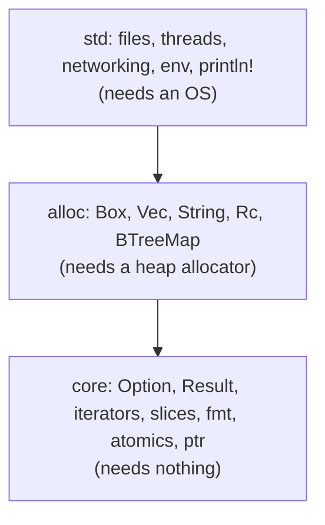

<callout background="red" icon="🔩">

**Rust with no operating system underneath.** Drop `std`, keep `core`, bring your own panic handler and entry point, and you can write kernels, bootloaders and firmware for microcontrollers.

</callout>

**Level:** 🔴 Expert · **Needs:** [15 Unsafe Rust](page:fnp814n35n), [18 Inline Assembly](page:nes55qk0m4)

## The three layers of the standard library



| Crate | Needs | You get |
| --- | --- | --- |
| `core` | nothing | primitives, `Option`/`Result`, traits, iterators, `fmt`, `ptr`, `mem`, atomics |
| `alloc` | a `#[global_allocator]` | `Box`, `Vec`, `String`, `Rc`, `Arc`, collections |
| `std` | an OS | I/O, threads, `HashMap` (needs randomness), processes, time |

`#![no_std]` at the top of a crate links only `core` (add `extern crate alloc;` when you have a heap). Many crates on crates.io support `no_std` behind a feature flag.

## What std was doing for you

Without `std`, two things are missing and you must supply them:

1. **A panic handler.** `std` prints the message and unwinds. In `no_std` you write `#[panic_handler]`.
1. **An entry point.** `main` is called by `std`'s runtime, which is called by the C runtime's `_start`. With `#![no_main]` you define the symbol the linker or bootloader jumps to.

Unwinding needs runtime support too, so set `panic = "abort"`:

```toml
[profile.dev]
panic = "abort"

[profile.release]
panic = "abort"
```

## A freestanding binary

```rust
#![no_std]
#![no_main]

use core::panic::PanicInfo;

#[panic_handler]
fn panic(_info: &PanicInfo) -> ! {
    loop {}
}

// The linker's default entry symbol. No mangling, C calling convention.
#[unsafe(no_mangle)]
pub extern "C" fn _start() -> ! {
    loop {}
}
```

```bash
rustup target add x86_64-unknown-none
cargo build --target x86_64-unknown-none
```

### Building up to 19.1

**The goal in plain words:** every program so far ran on top of an operating system, with `std` handling the details. Here you build a program for a machine with **no** operating system. It does nothing yet (it loops forever), but getting it to compile at all shows you exactly what `std` was providing.

**Step 1: what a "target" is.** A target is the system you're compiling *for*. Normally that's your own machine (`x86_64-unknown-linux-gnu`: x86-64, Linux, GNU libc). `x86_64-unknown-none` means the same CPU, with **no OS** (`none`). `rustup target add` downloads the pieces of `core` built for it.

**Step 2: why each line of the program is there.** Read it as a list of replacements:

| Line | Replaces |
| --- | --- |
| `#![no_std]` | don't link `std` (it needs an OS); use only `core` |
| `#![no_main]` | there's no runtime to call `main`, so don't expect one |
| `#[panic_handler] fn panic(...) -> !` | what happens on `panic!`. `std` would print and unwind, and here we just stop |
| `#[unsafe(no_mangle)] extern "C" fn _start() -> !` | the entry point: `_start` is the name the linker jumps to, and `no_mangle` keeps that exact name |
| `-> !` on both | neither may ever return, because there is nothing to return *to* |

Also set `panic = "abort"` in `Cargo.toml` as shown above, because unwinding needs runtime support.

**Step 3: build it.** `cargo new bare && cd bare`, replace `src/main.rs` with the program, add the profile settings, then `cargo build --target x86_64-unknown-none`. The binary appears in `target/x86_64-unknown-none/debug/bare`.

**Step 4: the three investigations.**

- **(a)** Delete the `#[panic_handler]` function and build again. Read the error: it names exactly what `std` used to provide.
- **(b)** Look at the machine code: `objdump -d -M intel target/x86_64-unknown-none/debug/bare`. Find the `<_start>:` label. A `loop {}` compiles to a `jmp` to itself.
- **(c)** `cargo build --release --target x86_64-unknown-none`, then `ls -l` on both binaries. Compare with the `hello` binary from 1.2.

<callout background="blue" icon="🏋️">

**Exercise 19.1 — Freestanding binary**

Build the program above for `x86_64-unknown-none`. Then: (a) remove `#[panic_handler]` and read the error; (b) run `objdump -d` on the output and find `_start`; (c) check its size with `size` or `ls -l` in release mode.

</callout>

<toggle>

Hint

If you see `can't find crate for std`, a dependency isn't `no_std`. If linking fails building for your host target instead, you forgot `--target` (your host target expects the C runtime). Put the target in `.cargo/config.toml` under `[build] target = "x86_64-unknown-none"` to stop typing it.

</toggle>

## Talking to hardware: memory-mapped I/O

Devices appear as addresses. Writes must not be optimised away or reordered, so use **volatile** access:

```rust
const VGA: *mut u8 = 0xb8000 as *mut u8;

fn print_at(col: usize, byte: u8) {
    unsafe {
        // Each cell is 2 bytes: character, then colour attribute.
        VGA.add(col * 2).write_volatile(byte);
        VGA.add(col * 2 + 1).write_volatile(0x0f); // white on black
    }
}
```

<callout background="yellow" icon="⚠️">

A normal write to a pointer the compiler thinks nobody reads can be deleted. `read_volatile` / `write_volatile` tell it each access is an observable side effect. Volatile is **not** atomic and not a memory barrier.

</callout>

In real code, wrap registers in a safe type so the `unsafe` lives in one place (the [`volatile`](https://crates.io/crates/volatile) crate, or the register types generated by `svd2rust` for microcontrollers).

### Building up to 19.2

**The goal in plain words:** boot your own tiny operating system kernel in an emulator and make it print text on the screen. Nobody's OS is underneath it. Your code writes straight into the memory the video card reads. The *Writing an OS in Rust* blog walks through every step, and this section tells you what to expect in each post, so you know where you are.

**Step 1: tools.** You'll need QEMU, a program that pretends to be a whole PC, so you never need to reboot your real machine:

```bash
sudo dnf install qemu-system-x86      # Fedora; on Ubuntu: sudo apt install qemu-system-x86
qemu-system-x86_64 --version
```

The blog uses nightly Rust for a few features. Its first post shows the `rust-toolchain` file to add.

**Step 2: what each of the four posts gives you.**

| Post | You end up with | The new idea |
| --- | --- | --- |
| 1\. A Freestanding Rust Binary | 19\.1 again | you've done this already |
| 2\. A Minimal Rust Kernel | a disk image that boots in QEMU and prints "Hello World!" | a bootloader loads your `_start` |
| 3\. VGA Text Mode | a `Writer` type that prints strings with colours and scrolls | memory-mapped I/O at `0xb8000`, volatile writes |
| 4\. Testing | `cargo test` running *inside* QEMU | custom test frameworks in `no_std` |

The exercise asks for posts 1–4, but `println!` arrives at the end of post 3, so you can print your name before you start post 4.

**Step 3: the VGA buffer, in one picture.** The screen is 80 × 25 cells. Each cell is 2 bytes in memory starting at `0xb8000`: the character, then its colour.

```text
address:  0xb8000  0xb8001  0xb8002  0xb8003  …
content:   'H'      0x0f     'i'      0x0f
           char     colour   char     colour     → "Hi" in white on black, top-left
```

The `print_at` example above writes one cell. The blog's `Writer` wraps this so you never touch raw addresses outside it.

**Step 4: why `spin::Mutex` and `lazy_static`.** `println!` needs one global `Writer` that any code can use. A global that changes must be behind a lock, but `std::sync::Mutex` needs an OS. `spin::Mutex` works with only atomics (see the toggle below, and your spin lock from 10.3). `lazy_static!` (or `spin::Lazy`) creates it on first use, because the global can't be fully built at compile time.

**Step 5: the finish line.** In `_start`, call `println!("Hello, I'm {}", "your name");`, run `cargo run`, and a QEMU window opens with your text.

<callout background="blue" icon="🏋️">

**Exercise 19.2 — Kernel that prints to VGA**

Follow the first four posts of [Writing an OS in Rust](https://os.phil-opp.com/): freestanding binary, minimal kernel with the `bootloader` crate, VGA text mode, then a `println!` macro backed by a `spin::Mutex<Writer>`. Boot it in QEMU and print your name.

</callout>

<toggle>

Why a spin lock and not `std::sync::Mutex`?

`std::sync::Mutex` asks the OS to put the thread to sleep. There is no OS. A spin lock just loops on an atomic flag, which needs only `core::sync::atomic`. (Inside an interrupt handler you also need to disable interrupts while holding it, or you deadlock: later posts in the series cover this.)

</toggle>

## Heap in no\_std

Provide a global allocator and `alloc` comes alive:

```rust
#![no_std]
extern crate alloc;

use alloc::vec::Vec;
use linked_list_allocator::LockedHeap;

#[global_allocator]
static ALLOCATOR: LockedHeap = LockedHeap::empty();

pub fn init_heap(start: *mut u8, size: usize) {
    unsafe { ALLOCATOR.lock().init(start, size) };
}
```

## Embedded Rust

<columns>

<column>

### The stack

- **PAC** (peripheral access crate): registers generated from the chip's SVD file
- **HAL**: safe drivers implementing [`embedded-hal`](https://crates.io/crates/embedded-hal) traits
- **Board crate**: pin names for a specific board
- **Runtime**: [`cortex-m-rt`](https://crates.io/crates/cortex-m-rt) or [Embassy](https://embassy.dev)

</column>

<column>

### Tools

- `probe-rs` to flash and debug over SWD/JTAG
- `defmt` for tiny, fast logging
- `flip-link` for stack-overflow protection
- RTIC or Embassy for concurrency (interrupt-driven or `async`)

</column>

</columns>

Targets look like `thumbv6m-none-eabi` (Cortex-M0, RP2040), `thumbv7em-none-eabihf` (Cortex-M4F, STM32F4), `thumbv8m.main-none-eabihf` (RP2350, Cortex-M33), `riscv32imac-unknown-none-elf` (ESP32-C6).

```rust
#![no_std]
#![no_main]

use embassy_executor::Spawner;
use embassy_rp::gpio::{Level, Output};
use embassy_time::Timer;
use {defmt_rtt as _, panic_probe as _};

#[embassy_executor::main]
async fn main(_spawner: Spawner) {
    let p = embassy_rp::init(Default::default());
    let mut led = Output::new(p.PIN_25, Level::Low);
    loop {
        led.toggle();
        Timer::after_millis(500).await;
    }
}
```

### Building up to 19.3

**The goal in plain words:** run Rust on a microcontroller, a tiny computer on a single chip with no operating system. Make the board's LED blink. Then add a button that changes how fast it blinks. It's the "hello world" of embedded programming, and it uses the same `async` you learned in module 11, running on bare metal.

**Step 1: the hardware.** A **Raspberry Pi Pico** (RP2040) is cheap and well supported. To flash it comfortably you need a **debug probe**: either the official Raspberry Pi Debug Probe, or a second Pico running the "picoprobe"/debugprobe firmware. Without a probe you can still copy a `.uf2` file onto the Pico in BOOTSEL mode with `elf2uf2-rs`. No hardware at all? See step 6.

**Step 2: tools.**

```bash
rustup target add thumbv6m-none-eabi       # the Pico's CPU: ARM Cortex-M0+
cargo install probe-rs-tools                # flash and debug over the probe
```

**Step 3: start from a working example.** Don't write `Cargo.toml` and `memory.x` (the chip's memory map) yourself on your first board. Clone the Embassy repository and use `examples/rp`:

```bash
git clone https://github.com/embassy-rs/embassy
cd embassy/examples/rp
cargo run --release --bin blinky            # builds, flashes through the probe, shows logs
```

If the onboard LED blinks, your whole toolchain works. The example above is essentially `blinky.rs`. On a Pico **W** the LED is on the Wi-Fi chip, so use the `wifi_blinky` example instead.

**Step 4: read `blinky` line by line.** `embassy_rp::init` gives you the chip's peripherals (`p.PIN_25` is the pin wired to the LED). `Output::new` makes it an output pin. `Timer::after_millis(500).await` sleeps this task without blocking anything else. The executor puts the CPU to sleep until the timer interrupt fires.

**Step 5: a second task and a channel.** Wire a push button between a free pin (say `PIN_15`) and ground, and set up the pin as `Input::new(p.PIN_15, Pull::Up)`. Then:

1. Write a `#[embassy_executor::task] async fn button(...)` that loops on `pin.wait_for_falling_edge().await` (pressed) and sends the new delay.
1. Share a `static SPEED: Signal<CriticalSectionRawMutex, u64> = Signal::new();` (from `embassy_sync`). The button task calls `SPEED.signal(new_ms)`.
1. In the blink loop, check `if let Some(ms) = SPEED.try_take() { delay = ms; }` each time round.
1. Start the button task from `main` with `spawner.spawn(button(pin)).unwrap();`.

**Step 6: without hardware.** The *Embedded Rust Book*'s "QEMU" chapter runs a Cortex-M program in `qemu-system-arm`. There's no LED, so print messages over semihosting instead. It's the same `no_std` and `#[entry]` structure, with a different runtime (`cortex-m-rt` instead of Embassy).

<callout background="blue" icon="🏋️">

**Exercise 19.3 — Blink an LED with Embassy**

With a Raspberry Pi Pico (or any board Embassy supports), start from the Embassy examples for your chip, flash with `probe-rs`, and blink an LED. Then make a second task that reads a button and changes the blink speed through a `Signal` or `Channel`. No hardware? Do the same on the `qemu` Cortex-M examples of the Embedded Rust Book.

</callout>

<toggle>

What is actually happening in `async fn main` with no OS?

Embassy's executor is a loop that polls ready tasks and then runs `WFE`/`WFI` to sleep the core. Timer and GPIO interrupts wake the matching task's waker. It's the same `Future` machinery as [11 Async Rust](page:m5cbwfmofv), just with interrupts instead of epoll.

</toggle>

## Checklist

- [ ] I can explain what `core`, `alloc` and `std` each need
- [ ] I know why a `no_std` binary needs `#[panic_handler]` and `panic = "abort"`
- [ ] I know when to use volatile and why it isn't atomic
- [ ] I've booted something in QEMU or flashed a board

---

← [18 Inline Assembly](page:nes55qk0m4) · [Rust Learning Hub](page:7jlv8afgwm) · Next → [20 Capstone Projects](page:vs9mlsqw3d)
