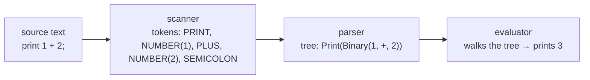

<callout background="green" icon="🏁">

**Put it all together.** Each capstone uses several modules at once. Pick one per level; finishing one real project teaches more than ten more drills.

</callout>

| Project | Level | Modules it exercises |
| --- | --- | --- |
| C1 Multithreaded HTTP server | Intermediate | 03, 05, 06, 09, 10 |
| C2 Async chat server | Advanced | 10, 11, 12 |
| C3 Tree-walking interpreter | Advanced | 04, 05, 07, 09, 12 |
| C4 CHIP-8 emulator | Advanced | 04, 08, 17 |
| C5 Toy OS kernel | Expert | 15, 17, 18, 19 |

## C1 · Multithreaded HTTP server

Serve static files from a folder over HTTP/1.1 using only `std`.

### Building up to C1

**The goal in plain words:** a web server. A browser connects, asks for a file by name, and your program sends the file back. You'll do it with no web framework, so you see that HTTP is just text over a TCP connection, and you'll reuse your thread pool from 10.2 so many browsers can be served at once.

**What a browser actually sends.** Run `nc -l 8080` and open `http://localhost:8080/index.html` in a browser. You'll see something like:

```text
GET /index.html HTTP/1.1          ← request line: method, path, version
Host: localhost:8080              ← headers: "Name: value", one per line
User-Agent: Mozilla/5.0 …
                                  ← an empty line ends the headers
```

**What you send back.**

```text
HTTP/1.1 200 OK\r\n
Content-Type: text/html\r\n
Content-Length: 42\r\n
\r\n
<42 bytes of the file>
```

Lines end in `\r\n`. `Content-Length` is the file's size in **bytes**, so the browser knows when the body ends.

**Milestones, in order.**

1. **One request, one thread.** `TcpListener::bind("127.0.0.1:8080")`, and for each connection in `listener.incoming()`, read the request line with `BufReader::new(&stream).lines().next()` and always reply with a fixed "hello" page. Check it in the browser.
1. **Parse the request line.** `split_whitespace()` into method, path, version, using a slice pattern as in 4.3. Anything else gets `400 Bad Request`.
1. **Serve files.** Join the path onto your folder (`root.join(path.trim_start_matches('/'))`) and `fs::read` it. If it's missing, reply `404 Not Found`.
1. **Block path traversal.** `GET /../../etc/passwd` must not escape your folder. `canonicalize()` the joined path and check `starts_with(&root)`.
1. **Thread pool.** Replace the direct handling with `pool.execute(move || handle(stream))`.
1. **Graceful shutdown.** For Ctrl-C you need a handler (the `ctrlc` crate is the usual choice, even though the rest is `std` only). Set an `AtomicBool`, stop the accept loop, and let `Drop` on the pool join the workers. One catch: `accept` waits until a client connects, so the loop won't see the flag until then. Either have the Ctrl-C handler open one connection to your own port to wake it, or `set_nonblocking(true)` on the listener and sleep briefly when there's nothing to accept.

- [ ] `TcpListener` accepting connections; parse the request line and headers by hand
- [ ] Map `GET /path` to a file; return 200, 404 or 400 with correct `Content-Length`
- [ ] Hand connections to a fixed-size **thread pool** (your worker pool from 10.2)
- [ ] Graceful shutdown on Ctrl-C: stop accepting, let workers finish, `Drop` joins threads
- [ ] Guard against path traversal (`../../etc/passwd`)

<callout icon="💡">

The final chapter of the Book builds a version of this. Try it alone first, then compare.

</callout>

## C2 · Async chat server

A TCP chat room on tokio: every line a client sends is broadcast to everyone else.

### Building up to C2

**The goal in plain words:** several people connect with `nc` and type. Whatever one person types appears on everyone else's screen, like a group chat. It's the echo server from 11.2, with one change that makes it interesting: each client has to *listen to two things at once*, its own keyboard and everyone else's messages.

**What it looks like with two terminals:**

```text
terminal A: nc 127.0.0.1 8080          terminal B: nc 127.0.0.1 8080
> /nick ada                            > /nick bob
> hi bob                               [ada] hi bob
[bob] hey!                             > hey!
```

**The key piece: a broadcast channel.** `tokio::sync::broadcast` is a channel where *every* receiver gets *every* message (unlike `mpsc`, where each message goes to one receiver):

```rust
let (tx, _) = tokio::sync::broadcast::channel::<String>(100);
let mut rx1 = tx.subscribe();
let mut rx2 = tx.subscribe();
tx.send("hello".to_string()).unwrap();
// rx1.recv().await and rx2.recv().await both give "hello"
```

Each client task gets a clone of `tx` (to send) and its own `tx.subscribe()` (to receive).

**The other key piece: `select!` inside the client loop.** Wait for whichever comes first:

```rust
loop {
    tokio::select! {
        line = lines.next_line() => {
            // the client typed something: handle /commands, or tx.send(...) it
        }
        msg = rx.recv() => {
            // someone said something: write it to this client's socket
        }
    }
}
```

**Milestones, in order.**

1. Start from your 11.2 line-based echo server.
1. Add the broadcast channel, so every line goes to everyone (including the sender, for now).
1. Don't echo to the sender. Send `(sender_addr, text)` pairs and skip your own address.
1. Commands: lines starting with `/`. `/nick` changes a per-client `String`. `/list` needs a shared set of names, so use an `Arc<Mutex<HashSet<String>>>`, as in module 10. `/quit` ends the loop.
1. **Test.** Bind to `127.0.0.1:0`: port 0 means "any free port", and `listener.local_addr()` tells you which one you got. Spawn the server in the test, connect two `TcpStream`s, write on one, and assert that the other receives it.

- [ ] `tokio::net::TcpListener`, one task per client
- [ ] `tokio::sync::broadcast` channel for messages; `select!` between reading the socket and receiving broadcasts
- [ ] `/nick name`, `/list`, `/quit` commands
- [ ] Integration test that spins up the server on port 0 and connects two clients

## C3 · Tree-walking interpreter

Follow the first half of [Crafting Interpreters](https://craftinginterpreters.com/) (Lox), but in Rust.

### Building up to C3

**The goal in plain words:** write a program that runs programs. You give it the text of a small language called Lox, and it executes it:

```text
var x = 3;
fun double(n) { return n * 2; }
print double(x) + 1;            // prints 7
```

The book's code is in Java. Following it in Rust means translating classes into enums and `match`, and that translation is where you'll use modules 04, 05, 07 and 09.

**The three stages.** Every interpreter is a pipeline:



**Java → Rust translations you'll make again and again.**

| The book (Java) | In Rust |
| --- | --- |
| a class per token type | `enum TokenKind { Plus, Number(f64), Identifier, … }` |
| `Expr` base class with subclasses | `enum Expr { Binary(Box<Expr>, Op, Box<Expr>), Literal(Value), … }`, where `Box` is needed because it's recursive (as in 9.1) |
| the Visitor pattern | a `match` on the enum, one arm per kind |
| exceptions for errors | `Result<T, LoxError>` and `?` (from 5.2) |
| `Object` for runtime values | `enum Value { Nil, Bool(bool), Number(f64), Str(Rc<str>), Function(…) }` |
| shared, mutable environments | `Rc<RefCell<Environment>>`, since closures keep their parent scope alive (module 09) |

**Milestones, in order.** Run each one before starting the next.

1. **Scanner** (book chapter 4): `"1 + 2"` → a `Vec<Token>`. Start with owned `String` lexemes. Switching to `Token<'src>` with `&'src str` slices (7.3's tokenizer) is a good second pass.
1. **Expressions only** (chapters 5–7): parse and evaluate `1 + 2 * 3` → `7`. A REPL that reads a line and prints the result makes testing easy.
1. **Statements and variables** (chapter 8): `var`, `print`, blocks.
1. **Control flow and functions** (chapters 9–10): `if`, `while`, `fun`. Closures are where `Rc<RefCell<…>>` appears.
1. **Errors** with line numbers throughout: keep `line` in every `Token`.

- [ ] Scanner producing `Token<'src>` that borrows the source (lifetimes!)
- [ ] Recursive-descent parser to an AST of `enum Expr` / `enum Stmt` with `Box`
- [ ] Evaluator with environments; closures need `Rc<RefCell<Env>>`
- [ ] Errors with line numbers via a custom error type
- [ ] Stretch: a bytecode VM (second half of the book) and compare speed

## C4 · CHIP-8 emulator

A 1970s virtual machine with 35 opcodes: the classic first emulator.

### Building up to C4

**The goal in plain words:** CHIP-8 is a tiny imaginary computer from the 1970s. Old games (Pong, Space Invaders clones) were written for it as files of 2-byte instructions. You'll write a program that *pretends to be that computer*: it reads a game file and executes the instructions one by one, drawing to a 64 × 32 pixel screen.

**The machine, as one struct.** Everything CHIP-8 has fits in a few fields:

```rust
struct Chip8 {
    memory: [u8; 4096],      // the game is loaded at address 0x200
    v: [u8; 16],             // registers V0–VF (VF doubles as a flag)
    i: u16,                  // the "index" register, holds addresses
    pc: u16,                 // program counter: address of the next instruction
    stack: Vec<u16>,         // return addresses for subroutine calls
    delay_timer: u8,
    sound_timer: u8,
    display: [[bool; 64]; 32],
    keys: [bool; 16],
}
```

**The loop every emulator runs:** fetch, decode, execute.

**1. Fetch:** read two bytes at `pc` and join them into one 16-bit opcode: `(mem[pc] as u16) << 8 | mem[pc + 1] as u16`. Add 2 to `pc`.

**2. Decode:** split the opcode into 4-bit pieces ("nibbles"):

```text
opcode 0x7A05  →  0x7 | A | 0 | 5
                  kind  x   y   n        nn = 0x05 (last byte), nnn = 0xA05 (last 12 bits)
meaning: "add 0x05 to register VA"
```

**3. Execute:** one `match` arm per instruction kind, using the tuple pattern matching from 2.2 and 4.3:

```rust
match (op >> 12, x, y, n) {
    (0x0, 0x0, 0xE, 0x0) => self.display = [[false; 64]; 32],   // 00E0: clear screen
    (0x1, _, _, _) => self.pc = nnn,                              // 1NNN: jump
    (0x6, _, _, _) => self.v[x] = nn,                             // 6XNN: set VX
    (0x7, _, _, _) => self.v[x] = self.v[x].wrapping_add(nn),     // 7XNN: add (wraps!)
    // …
    _ => panic!("unknown opcode {op:04X}"),
}
```

**Milestones, in order.**

1. Load a ROM file into `memory[0x200..]` and print each opcode in hex (a "disassembler"). No executing yet.
1. Implement the **IBM logo** opcodes: `00E0`, `1NNN`, `6XNN`, `7XNN`, `ANNN`, `DXYN` (draw). The `IBM Logo.ch8` test ROM needs only these. Print the display as `#` and `.` in the terminal.
1. Add a real window (`minifb` is the simplest) and run \~700 instructions per second.
1. Implement the remaining opcodes, checking each one with a test ROM suite (search "chip8-test-suite").
1. Timers (count down 60 times a second) and keys. Then play a game.

Keep [Cowgod's CHIP-8 technical reference](http://devernay.free.fr/hacks/chip8/C8TECH10.HTM) open: it lists every opcode.

- [ ] CPU struct: 4 KB memory, 16 registers, stack, timers
- [ ] `match` on opcode nibbles, e.g. `match (op >> 12, x, y, n)`
- [ ] Display with `minifb`, `pixels` or a terminal renderer
- [ ] Run test ROMs; then games
- [ ] Stretch: look at the assembly of your decode loop (module 18)

## C5 · Toy OS kernel

Follow [Writing an OS in Rust](https://os.phil-opp.com/) past where 19.2 stops.

### Building up to C5

**The goal in plain words:** in 19.2 your kernel could print. Now it reacts to the world: it catches its own errors instead of rebooting, gets a timer tick and keyboard presses from the hardware, and manages memory so you can use `Vec` and `Box` inside the kernel. It's the same blog series, continued, and this section is a map of what comes after 19.2.

**What each part of the series adds.**

| Blog posts | You end up with | The core idea |
| --- | --- | --- |
| CPU Exceptions, Double Faults | a divide-by-zero or bad memory access prints an error instead of rebooting the machine | the **IDT**: a table telling the CPU which function to run for each kind of event |
| Hardware Interrupts | a timer tick and typing on the keyboard prints characters | the **PIC**: the chip that turns hardware signals into interrupts |
| Introduction to Paging, Paging Implementation | you can map addresses to physical memory yourself | **page tables**: the CPU translates every address through them |
| Heap Allocation, Allocator Designs | `alloc::vec::Vec` and `Box` work in the kernel | a `#[global_allocator]`, as in 17.2 and the heap section of 19 |
| Async/Await | cooperative tasks, and a keyboard that's an async stream | your own executor, as in 11.3, driven by interrupts |

**Three ideas to have clear before you start.**

1. **An interrupt is a forced function call.** The CPU stops whatever it's doing, saves its place, and jumps to the handler you registered in the IDT. When the handler returns, the interrupted code carries on as if nothing happened. Handlers use the special `extern "x86-interrupt"` calling convention because of that saved state.
1. **Handlers can interrupt anything, including your `println!`.** If the keyboard handler calls `println!` while the main code holds the `Writer`'s lock, it waits forever (a deadlock). The fix in the series is to turn interrupts off while holding the lock (`without_interrupts`). That's the reason the 19.2 toggle mentioned it.
1. **Paging means every address is translated.** The addresses your code uses are *virtual*. The CPU looks each one up in the page tables to find the *physical* RAM address. To use a heap, you first map some virtual pages to real memory, then give that range to the allocator.

**How to work through it.** Do one post at a time, and commit after each one that boots (`git tag` makes good checkpoints). When a post's code doesn't fit your earlier changes, the blog has a branch per post on [GitHub](https://github.com/phil-opp/blog_os) to compare against.

- [ ] VGA text buffer with a `println!` macro
- [ ] CPU exceptions and the interrupt descriptor table
- [ ] Hardware timer and keyboard interrupts
- [ ] Paging and a heap allocator so you can use `alloc::vec::Vec`
- [ ] Stretch: cooperative async tasks in the kernel

## After the capstones

<columns>

<column>

### Contribute

- Look for `good first issue` / `E-easy` labels in crates you used
- The compiler itself: [rustc-dev-guide](https://rustc-dev-guide.rust-lang.org/)
- Clippy lints are a gentle first compiler contribution

</column>

<column>

### Apply it here

- [Vellum Project Hub](page:qo8zh49wt3): a Rust NPR renderer on wgpu
- [Winit-Rust](page:6v7lwwxlhd): windowing
- [Rust Patterns for Engines](page:7nta66y9tk)

</column>

</columns>

---

← Back to [Rust Learning Hub](page:7jlv8afgwm) · Track progress in [Rust Exercises](page:nbnwy0q2zt)
